# অ-তে অজগর statechart

## After the rewrite (games-to-the-bar)
The game was rewritten (design: `ai_docs/game-dev/rewrites/o-te-ojogor.md`). There are now two ways to play: গাছতলা (the default, untimed, tap the right fruit) and ঝড়ো হাওয়া (the old falling game, 7+). The rules now live in pure modules the node tests drive: `lib/session.ts` (screens, pause, away, the hand, the kids' break), `lib/progress.ts` (this game's own unlock and link levels), `lib/tree.ts` + `lib/step.hot.ts` (the tree). Three specs, each under the chart budget:

| Spec | What it covers | TLC | Result |
|---|---|---|---|
| `Ojogor.tla` / `view.ts` | round, the player's menu, blur and hide, the held arrow or finger | 19 states, 56 steps | all 10 rules hold → `after-fix/chart.mmd` |
| `OjogorLevels.tla` / `view-levels.ts` | stars, the game's own unlock, old links, the level list (3 levels stand in for 22) | 396 states, 2852 steps | all 6 rules hold → `after-fix-levels/chart.mmd` |
| `OjogorKids.tla` / `view-kids.ts` | the daily limit, the rest screen, the parent gate, what leaves the phone | 48 states, 188 steps | all 9 rules hold → `after-fix-kids/chart.mmd` |

The rules are the ones below, never weakened. New ones: **HeldOnlyWhileMoving** (nothing is held unless the round moves), **LinkOpensOnlyItsLevel** (the unlock rises only by clearing the level just below it), **OnlyPlayableLevels**.

### Bugs fixed (each replayed as a node test in `tools/o-te-ojogor/tests/o-te-ojogor.test.ts`, then live in Orca)
1. **BasketStopsWhenYouLetGo:** test "bug 1, BasketStopsWhenYouLetGo…". `pauseNow()` (onPause) calls `hold()`, and every arrow keyup lets go, paused or not. Live (ঝড়ো হাওয়া, Pixel 9 and desktop): hold ← → basket 137, aim 50 → Escape → aim 137, clock frozen for 1 s → keyup under the menu → চালিয়ে যাও → **1.5 s later the basket is still at 137** (before the fix it ran to 50).
2. **InputReleasedWhenAway:** test "bug 2, InputReleasedWhenAway…". The game's own window `blur` / hidden listener runs `leave()` (pause, drop the hand) and `hold()`. Live: hold → at 197 (aim 310) → blur → paused, held false, aim 197, clock frozen 1.2 s → focus → চালিয়ে যাও → **still 197** (before: 310).
3. **UnlockNeverShrinks:** test "bug 3, UnlockNeverShrinks…". This game keeps its own unlock (`ektukhani-unlock-o-te-ojogor`, migrated once from the stars), a link opens only its own level, and every link level is kept on the phone (`ektukhani-links-o-te-ojogor`). Live: `#…&l=8` → open ১, ২, ৮ (before: 1–8) → `#…&l=3` → **open ১, ২, ৩, ৮** (before: 1–3, and 4–8 locked again).
4. **NoShareForKids, NoNameField, NoChildDataLeaves, NoNetworkCalls:** tests "bug 4, NoChildDataLeaves…" and "bug 4, NoNetworkCalls / NoShareForKids / NoNameField…". The name field, `ShareBar` and `/api/share` are gone, and `share.normalize` returns null. The end screen shows `ShowParentButton`. `ShowParent` holds the card with no name, "ছবিটা রাখো" behind its gate, and `<ParentGate><ShareToolLink/></ParentGate>`, which shares only the tool's address. Old links still open their level and seed. The name is never read, and `history.replaceState` strips `n=` from the address bar. A source scan in the test bans `/api/`, `fetch(`, `share-client`, `ShareBar`, `<input`. Live: `#s=4242&t=1&l=8&n=রাফি` opened level ৮ with seed 4242, the address bar became `#s=4242&t=1&l=8`, "রাফি" appears nowhere on the page, and a wrapped `fetch` + `sendBeacon` saw **0 calls** across the link changes, a full level and the parent card (`ShareToolLink` uses the phone's share sheet or clipboard, never `fetch`).
5. **RestAtTheBreak, NoNewRoundPastLimit:** test "bug 5, RestAtTheBreak / NoNewRoundPastLimit…" (with 400 random action runs for RestOnlyAtBreak). `useKidsSession()`, then `atBreak()` in `begin()` and `playAgain()` before a round, and in `finish()` the moment it is won (not in a timer). Between rounds the game also asks `atBreak()` every second, which the model found was needed: time running out while the child sits on the end screen broke RestAtTheBreak until then. Live: past the limit → খেলো → **rest screen, phase stays title**. On the end screen, pushing the time past the limit → **rest screen within 1.6 s**.
- **Two pause overlays (migration note):** gone. The game draws its own small "ছুঁয়ে দাও" only when it paused itself with no player menu up (blurred before anyone touched it), and that first tap only wakes it (`tapCounts`).
- **Shared patterns:** P calls `player.requestPause()`. End-screen keys need a fresh press (`!e.repeat`) and the buttons wait 700 ms (`GUARD_MS`). Buttons blur after a click, and the game's keys are handled at `window`. No celebration timers (StarReveal owns its own). No speech anywhere.

### The chart (`after-fix/chart.mmd`)

```mermaid
---
title: "o-te-ojogor (after the rewrite): round, pause menu, window and arrow key"
---
stateDiagram-v2
  state "Legend" as legend {
    lg0: title
    lg1: play
    lg2: held
    lg3: done
  }
  class lg0 tan
  class lg1 teal
  class lg2 yellow
  class lg3 blue
  state "Game Title (খ#2503;ল#2507;)" as s0 {
    state "Window You're on the page" as s1 {
      s2: Basket Basket still
    }
    state "Window Another window has focus" as s3 {
      s4: Basket Basket still
    }
    state "Window Tab hidden" as s5 {
      s6: Basket Basket still
    }
  }
  state "Game Round in play" as s7 {
    state "Window You're on the page" as s8 {
      s9: Basket Basket still
      s10: Basket Arrow held, basket heads for the edge
    }
  }
  state "Game Title, menu open" as s11 {
    state "Window You're on the page" as s12 {
      s13: Basket Basket still
    }
    state "Window Another window has focus" as s14 {
      s15: Basket Basket still
    }
    state "Window Tab hidden" as s16 {
      s17: Basket Basket still
    }
  }
  state "Game End screen (আব#2494;র খ#2503;ল#2507; / শ#2503;ষ)" as s18 {
    state "Window You're on the page" as s19 {
      s20: Basket Basket still
    }
  }
  state "Game Paused, menu open" as s21 {
    state "Window Another window has focus" as s22 {
      s23: Basket Basket still
    }
    state "Window You're on the page" as s24 {
      s25: Basket Basket still
    }
    state "Window Tab hidden" as s26 {
      s27: Basket Basket still
    }
  }
  state "Game End screen, menu open" as s28 {
    state "Window Another window has focus" as s29 {
      s30: Basket Basket still
    }
    state "Window You're on the page" as s31 {
      s32: Basket Basket still
    }
    state "Window Tab hidden" as s33 {
      s34: Basket Basket still
    }
  }
  [*] --> s2
  s2 --> s9: you press খ#2503;ল#2507;
  s2 --> s4: you click into another window
  s2 --> s6: you hide the tab
  s2 --> s13: you press #9208;, Escape or P
  s9 --> s10: you hold #8592; or #8594; (or drag)
  s4 --> s2: you come back to the window
  s4 --> s6: you hide the tab
  s6 --> s2: the tab shows again
  s13 --> s2: you press নত#2497;ন কর#2503; শ#2497;র#2497; or you press চ#2494;ল#2495;য#2492;#2503; য#2494;ও
  s13 --> s15: you click into another window
  s13 --> s17: you hide the tab
  s20 --> s9: you press আব#2494;র খ#2503;ল#2507;
  s20 --> s2: you press শ#2503;ষ (or pick a level, or open a link)
  s20 --> s30: you click into another window
  s20 --> s32: you press #9208;, Escape or P
  s20 --> s34: you hide the tab
  s10 --> s9: you let go
  s23 --> s25: you come back to the window
  s23 --> s27: you hide the tab
  s25 --> s9: you press চ#2494;ল#2495;য#2492;#2503; য#2494;ও
  s25 --> s23: you click into another window
  s25 --> s27: you hide the tab
  s25 --> s2: you press নত#2497;ন কর#2503; শ#2497;র#2497;
  s27 --> s25: the tab shows again
  s2 --> s15: you click into another window
  s2 --> s17: you hide the tab
  s15 --> s13: you come back to the window
  s15 --> s17: you hide the tab
  s17 --> s13: the tab shows again
  s30 --> s32: you come back to the window
  s30 --> s34: you hide the tab
  s32 --> s20: you press চ#2494;ল#2495;য#2492;#2503; য#2494;ও
  s32 --> s2: you press নত#2497;ন কর#2503; শ#2497;র#2497;
  s32 --> s30: you click into another window
  s32 --> s34: you hide the tab
  s34 --> s32: the tab shows again
  s7 --> s20: the last right letter lands
  s7 --> s23: you click into another window
  s7 --> s25: you press #9208;, Escape or P
  s7 --> s27: you hide the tab
  s7 --> s2: you press শ#2503;ষ (or pick a level, or open a link)
  class s2 tan
  class s4 tan
  class s6 tan
  class s9 teal
  class s10 teal
  class s13 tan
  class s15 tan
  class s17 tan
  class s20 blue
  class s23 yellow
  class s25 yellow
  class s27 yellow
  class s30 blue
  class s32 blue
  class s34 blue
```


---

## Before the rewrite

**Which code the before-fix run modelled:** HEAD `6775639` and later. That commit made o-te-ojogor the pilot of the shared game player (`GamePage kids`, the pause menu, `useGamePlayer` onPause / onResume / onRestart) and made `useGameLoop` stop on window blur. I started this run on the older code, where nothing listened for blur. That commit landed mid-run, so I re-modelled everything against it, and every live replay below ran on it. The working tree for `tools/o-te-ojogor/` matched HEAD when I finished. If the migration moves on, re-run both specs.

Two specs, because one would pass the 500-state chart budget:
- `Ojogor.tla` / `Ojogor.cfg` / `view.ts`: the level, the player's pause menu, pause and focus, the held arrow key, the clock, levels and friend links. TLC: 400 states, 1735 steps. Chart: `before-fix/chart.mmd` (48 states, 138 arrows).
- `OjogorKids.tla` / `OjogorKids.cfg` / `view-kids.ts`: the kids' rules (daily limit, share, the name field, network). TLC: 90 states, 282 steps. Chart: `before-fix-kids/chart.mmd` (13 states, 14 arrows).

Mirrored from `tools/o-te-ojogor/components/ojogor-game.tsx`, `tools/o-te-ojogor/page.tsx`, `shared/game-player-client.tsx` (`openMenu`, `resume`, `restart`, `away`, the key capture), `shared/game-kit.ts` (`useGameLoop`, `useLevels`), and `shared/share-kit.tsx` + `shared/share-client.ts` (`ShareBar`, `shareLink`).

## Systems modelled
- **Play phase:** start screen (শুরু করো) → letters falling → the card. আবার খেলো, পরের লেভেল (or Space / Enter), নতুন করে শুরু from the menu, and the level grid. Two levels stand in for 22.
- **Pause and focus:** the player's menu opens on blur, tab hide, Escape and ⏸, once the player is "engaged" (any tap or key inside it). `onPause` pauses only a level in play. The game's own `hide()` also pauses on tab hide. `useGameLoop` stops on hide and on blur. While the menu is open, the player swallows every key.
- **Input:** the held ← / → (`steer(edge)` on keydown, `hold()` on keyup). `hand` is off, held, or stuck (the keyup never reached the game, so the basket keeps gliding to the edge). The on-screen ◀ ▶ are left out, because their pointerup / pointercancel always call `hold()`, and the player sends `pointercancel` to a held finger.
- **Levels and links:** `unlockedOrFriend = max(unlocked, friend.level)`. `opened` is the most that was ever open. `rival` means the current tree is the friend's seed.
- **Kids' rules (second spec):** the section's shared daily limit (`ektukhani-kids-time`, run up by every kids' game). Who has the phone. The name field under the card. `ShareBar`'s শেয়ার করো / লিংক কপি করো, which POST the card state to `/api/share`. The page uses only `ParentNote` from the kids' kit: no `useKidsSession`, `RestScreen`, `ParentGate` or `ShowParent`.
- **Left out:** the board scrolled off screen (the player pauses it like blur), phones outside full screen (the stage is hidden there), and the per-letter rules in `lib/game.ts` (pure, covered by node tests).

## Rules in plain words
| Spec | Rule | Plain words | Result |
|---|---|---|---|
| Ojogor | NoProgressWhileAway | The letters don't fall while you're in another window or tab. | holds |
| Ojogor | PausedWhenBlurred | A level in progress is paused while you're in another window. | holds |
| Ojogor | PausedWhenHidden | A level in progress is paused while its tab is hidden. | holds |
| Ojogor | MenuFreezesPlay | While the pause menu is open, nothing falls. | holds |
| Ojogor | InputReleasedWhenAway | After blur or hide, no key counts as held. | **breaks** |
| Ojogor | BasketStopsWhenYouLetGo | When you let go of the arrow, the basket stops. | **breaks** |
| Ojogor | PausedOnlyMidLevel | Only a level in progress is ever paused. | holds |
| Ojogor | UnlockNeverShrinks | A level you could open stays open. | **breaks** |
| Ojogor | ReplayIsExact | A friend's link plays exactly the friend's level and seed. | holds |
| Kids | RestAtTheBreak | At the end of a level past today's limit, the rest screen shows. | **breaks** |
| Kids | RestOnlyAtBreak | The rest screen comes only between rounds. | holds (there is none) |
| Kids | NoNewRoundPastLimit | Once today's time is up, no new round starts without the rest screen. | **breaks** |
| Kids | NoShareForKids | While the child has the phone, no share button is in front of them. | **breaks** |
| Kids | NoNameField | There is no name field for the child. | **breaks** |
| Kids | NoChildDataLeaves | Nothing about the child leaves the phone. | **breaks** |
| Kids | NoNetworkCalls | No network calls after the page loads. | **breaks** |
| both | TypeOK, NoDeadlock | | hold |

## Bugs

Replays ran in Orca (my own tab, Pixel 9, immersive player after খেলো). I read the game's `live` object through the React fiber (`OjogorGame`'s `useState(makeLive)` hook): `phase`, `paused`, `game.t`, `game.basketX`, `game.aimX`. Keys were window `KeyboardEvent`s; blur and focus were window events. That's the same `blur` the player reacts to, and the game hears nothing different on a real one. The pause in bug 2 is the player's Escape, whose `onPause` does exactly what `hide()` does (`live.paused = true; setPaused(true)`). That follows the note that Orca pins `document.hidden`, so hide paths are replayed through the hide handler's effects.

### 1. BasketStopsWhenYouLetGo: "I let go of the arrow while it was paused, and when I came back the basket ran off to the side" (game-specific)
- **Path (4 steps):** শুরু করো → hold ← → ⏸ / Escape (or the tab hides) → let go: *paused, menu open; you let go, the basket still runs to the edge*.
- **Why:** `steer()` sets `aimX` to the far lane, and only `hold()` (on keyup) sets it back. While the menu is open the player swallows the keyup, and while `live.paused` the game's handler returns before `hold()`. Neither `onPause` nor `resume()` resets the aim.
- **Live:** control first: tap → and let go while playing → basket and aim both stop at **232**. Then the bug path: playing at basket **180** → hold ← (aim **50**) → Escape (paused, menu open, the clock frozen at t = 0.35) → keyup (aim still **50**) → the menu's চালিয়ে যাও → **1.5 s later the basket is at 50**, with no key down.
- **Fix:** call `hold()` in the `onPause` handler and in `resume()`, and run `hold()` on every arrow keyup, paused or not. Add a node test: steer, pause, resume → `aimX === basketX`.

### 2. InputReleasedWhenAway: "I was holding → when I clicked away; when I came back the basket slid all the way right" (game-specific; same pattern as the shared rule)
- **Path (3 steps):** শুরু করো → hold → → click into another window: *paused, menu open; arrow held*. Back on the page, চালিয়ে যাও, and the basket goes to the edge.
- **Why:** blur opens the menu and stops the loop (good), but nothing in the game drops the held key. The real keyup happens in the other window and never arrives.
- **Live:** playing at basket **180** → hold → (aim **310**) → window blur → paused, menu open. The clock stayed at **t = 0.67 for 1.5 s** (so PausedWhenBlurred holds) and the aim stayed **310** → focus → চালিয়ে যাও → 1.5 s later the basket is at **310**.
- **Fix:** the same `hold()` in `onPause`. The player's synthetic `blur` reaches every game, so a game that tracks held keys should clear them on window `blur`, as the antenna fix does.

### 3. UnlockNeverShrinks: "a second friend's link locked the levels the first one opened" (game-specific; the same bug as ১৫ ঘরের ধাঁধা)
- **Path (2 steps):** a friend's link opens (level 2) → a friend's link opens (level 1): *a level you opened is locked again*.
- **Why:** `unlockedOrFriend` is computed from the *current* `friend`, and `readFriend` replaces it on every `hashchange`. A reload without the hash does the same. The FAQ promises "একবার খোলা লেভেল আর বন্ধ হয় না।"
- **Live (no stars on this phone):** 1 level open → `#s=4242&t=1&l=8` → **8 open**, "লেভেল ৮", banner "এক বন্ধু ঝুড়িতে ধরেছে প থেকে ম, ভুল ১টা।" → `#s=4242&t=1&l=3` → **3 open**, "লেভেল ৩", and levels ৪–৮ read "বন্ধ".
- **Fix:** a link plays only its own level (don't open the ones in between), or store what a link opened so it never locks again. Then the FAQ is true.

### 4. NoShareForKids, NoNameField, NoChildDataLeaves, NoNetworkCalls: "my child typed her name and it went to the server" (game-specific)
- **Paths (2–4 steps):** শুরু করো → the level ends: *the card with শেয়ার করো and a name field, in front of the child*. Someone types a name, then taps শেয়ার করো or লিংক কপি করো: *the name went to `/api/share`*.
- **Why:** the page is now a kids' page (`<GamePage kids>`, the kids' header and rails, a parent note for ৪–৮ বছর), but the game still has the grown-up card. That's a free-text "তোমার নাম: কার্ডে বসবে" input and a `ShareBar` with no gate, whose `shareLink()` POSTs `{tool, state}` with the name to `/api/share` (stored a year, per the privacy text). The brief says no name field anywhere, no share in front of the child, no `/api/*`, and nothing about the child in a URL or card.
- **Live:** autopilot cleared level 1 (6 letters, 0 mistakes, 3 stars, 31 s). The card shows "তোমার নাম" and লিংক কপি করো (`navigator.share` is missing in Orca, so the main button copies). I typed "রাফি" and tapped it, with `fetch` and `navigator.clipboard` **stubbed** (nothing reached the server or the real clipboard). Result: **one `POST /api/share`** with body `{"tool":"o-te-ojogor","state":"s=408564250&t=0&l=1&n=%E0%A6%B0%E0%A6%BE%E0%A6%AB%E0%A6%BF"}` (n = রাফি). The copied text was "অ-তে অজগর, লেভেল ১: অ থেকে ঊ ঝুড়িতে ধরলাম, একটাও ভুল ছাড়া। তুমি পারবে? …/s/stub".
- **Fix:** do what কার-চিহ্ন does. Remove the name field and `ShareBar`. Put `<ShowParentButton>` / `<ShowParent>` (the card without a name, with "ফোনে ছবি রাখো" behind the gate) on the card, and `<ParentGate><ShareToolLink/></ParentGate>` below. `share.ts` → `normalize: () => null`. Drop the friend-link banner and the comparison copy, or keep links seed-only behind the gate. Update the privacy text.

### 5. RestAtTheBreak, NoNewRoundPastLimit: "the rest screen never comes in অ-তে অজগর" (game-specific)
- **Paths (2–3 steps):** today's kids' time runs out → শুরু করো (a new level starts), or the level ends: *no rest screen*.
- **Why:** the game never calls `useKidsSession()`, so it neither counts time nor calls `atBreak()`. A child sent to the rest screen in another kids' game can come here and play on.
- **Live:** today's kids' time read **122,320 s** (limit 900 s; other agents' tests had pushed it up) when level 1 ended. There was no rest screen, and পরের লেভেল / আবার খেলো were live.
- **Fix:** `useKidsSession()`, then `atBreak()` in `finish()` and in `startLevel()` / `begin()` (see the kit fix in `kar-chinho/README.md` bug 4), and `{resting && <RestScreen onExtend={extend} />}`.

### Rules that hold, checked live
- **PausedWhenBlurred / NoProgressWhileAway:** blur → paused, menu open, and `t` didn't move for 1.5 s (bug 2's replay).
- **MenuFreezesPlay:** Escape → `t` frozen at 0.35 until চালিয়ে যাও (bug 1's replay).
- **ReplayIsExact:** both links opened exactly their level, and `retry()` keeps the seed only for the friend's tree.

### Migration notes (from the replays, for the agent moving this game onto the player)
- **Two pause overlays:** the game still draws its own "খেলা থেমে আছে। চালিয়ে যাও" overlay under the player's menu (`.shots/o-te-ojogor-paused.png` shows the menu). Its button is covered in normal use. Clicked from script, it cleared `live.paused` with the menu still open. Drop the game's overlay now that the player owns pause.

## Quality-bar gaps (level 1 played end to end by autopilot in Orca at Pixel 9, plus the code)
1. **First screen:** good. The launch card's art (the basket of vowels) and a full-width খেলো are the biggest things on screen. Then the start screen inside the stage has a second step, শুরু করো. Screenshot: `.shots/o-te-ojogor-first-screen.png`.
2. **Kids' fit:** the page says ৪–৮ বছর, but play is real-time falling letters. The brief forbids timers for 3–5 and says no lost lives and no red. Here the HUD counts "ভুল ২" while you play, and mistakes cost stars. ধীরে খেলো helps, but the counter should go, with stars from first tries only.
3. **Ending:** পরের লেভেল is primary and আবার খেলো secondary, there's no শেষ, and Space / Enter jumps to the next level. The brief wants আবার খেলো and শেষ at equal size and never an auto-next. "কার্ড দেখো ↓" leads to the share bar (bug 4). Screenshot: `.shots/o-te-ojogor-end-screen.png`.
4. **Pause:** now a real menu (চালিয়ে যাও, নতুন করে শুরু, কীভাবে খেলবে, শব্দ, ধীরে খেলো, বের হও), good. But two overlays stack, and resume can drift the basket (bugs 1–2).
5. **Daily limit and parent gate:** missing (bug 5, bug 4).
6. **Pacing:** level 1 has 6 vowels, about 30 s at perfect play, with one fruit at a time in the first two rounds (a win within ~10 s). 22 levels in four worlds, each adding one idea (more decoys, more speed, words, numbers). Good.
7. **HUD:** the picture-word line, the "এবার" chip and the letter strip sit above the tree, with the star total at the top. The middle stays clear. Good.
8. **Sound:** a signature two-note chime on each picture word, a springy boing for a wrong letter (never a buzzer), and a soft thump for a miss. All synthesized and all also shown in text. Good.

## Regenerate (after the rewrite; the specs in this folder now model the rewritten code)
```sh
scripts/statechart.sh ai_docs/statecharts/o-te-ojogor/Ojogor.tla --view ai_docs/statecharts/o-te-ojogor/view.ts --out ai_docs/statecharts/o-te-ojogor/after-fix
scripts/statechart.sh ai_docs/statecharts/o-te-ojogor/OjogorLevels.tla --view ai_docs/statecharts/o-te-ojogor/view-levels.ts --out ai_docs/statecharts/o-te-ojogor/after-fix-levels
scripts/statechart.sh ai_docs/statecharts/o-te-ojogor/OjogorKids.tla --view ai_docs/statecharts/o-te-ojogor/view-kids.ts --out ai_docs/statecharts/o-te-ojogor/after-fix-kids
rm ai_docs/statecharts/o-te-ojogor/after-fix*/tlc.out
```
(Use a fresh `--out` folder, or delete the old one first.) The before-fix specs are in git history at `1191cab`; their reports are in `before-fix/` and `before-fix-kids/`.
After the fixes:
- **Ojogor:** `YouPressPause`, `WindowBlurs` and `TabHides` set `hand' = "off"`; `YouLetGo` always sets `"off"`; `AFriendsLinkOpens` keeps `opened` reachable.
- **OjogorKids:** `SomeoneTypesAName` and `SomeoneSharesTheCard` go away (a gated `AParentSharesTheLink` replaces them), and `TheLevelEnds` / `YouPressStart` set `resting' = overLimit`.
