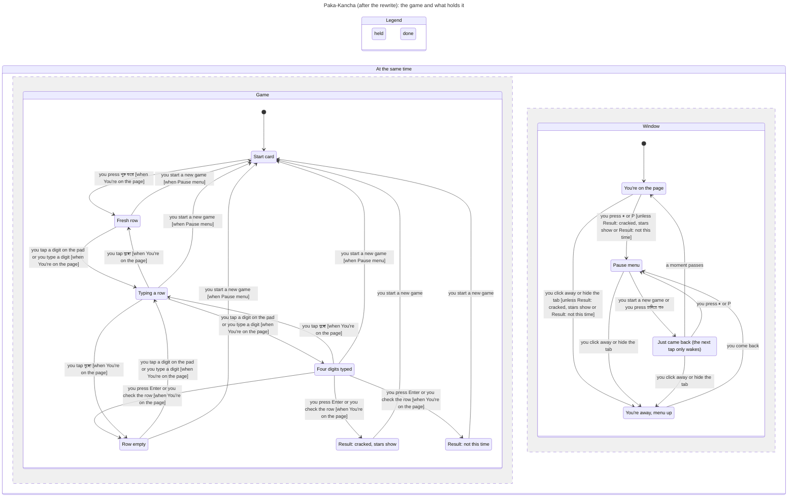

# পাকা-কাঁচা statechart

## After the rewrite (2026-11-05)
Model: `PakaKancha.tla` with `PakaKancha.cfg` (the full check: two levels, a friend link to level 2 while it is locked) and `Chart.cfg` (the drawn chart: one level, `CONSTRAINT ChartScope`), plus `view.ts`. It mirrors:
- `tools/paka-kancha/lib/flow.ts`: `running`, `held`, `start`, `toTitle`, `toOver`, `finish`, `menu`, `away`, `sheet`, `awake`, `takesPress`, `takesResultKey`;
- `lib/keys.ts`: `decideKey` and `landedOn` (what a key does, and where it landed);
- `lib/save.ts`: `openAfter` (your own open level);
- `components/paka-game.tsx`:
  - `pressKey`, `pressErase` and `pressCheck`, each gated by `takesPress`;
  - `finishGame`, which records stars and the open level in the same step as the last try, and queues the cheer;
  - `load`, `openFriend` and the hashchange guard (never over a game in progress);
  - the blur, focus and visibility effect (it clears the cheer timers) and `useGamePlayer` `onPause` / `onResume` / `onRestart` / `onLevels`;
  - the window key handler and `dropFocus` (a pointer click leaves no button focused);
- the player's menu, which opens on blur and hide once the game has been touched.

Runs:
- `after-fix/report.md`: the full check, 9,276 states;
- `after-fix/chart.mmd` and `after-fix/chart-report.md`: 154 states, 11 chart states, 24 arrows.

**Every rule holds in both runs:** TypeOK, EnterChecksTheRow, PausedWhenAway, BoardFrozenWhileHeld, ChoiceFreezesPlay, ComeBackIsNotAMove, NoDoubleResult, ResultMatchesPlay, NoCheerAfterMovingOn, OpenLevelsAreEarned, StarsNeverDrop, OpenNeverShrinks, ReplayIsExact, NoDeadlock.

**Mutant check:** each fix was taken out of a copy of the spec, one at a time. The matching rule broke at once:
- Enter on a focused pad key erases instead of checking: EnterChecksTheRow;
- clearing any level opens the next one: OpenLevelsAreEarned;
- a digit tap with no come-back guard: ComeBackIsNotAMove and BoardFrozenWhileHeld;
- not clearing the cheer timers on blur: NoCheerAfterMovingOn;
- typing allowed while the menu or another window holds play: BoardFrozenWhileHeld.

### What changed in the model
- **Enter is decided by one function** (`decideKey`). With four digits typed, Enter checks the row on the page or on any pad key. A button reached with Tab that is not on the pad does its own job (the level badge opens the sheet), and the row stays.
- **A click leaves no button focused** (`dropFocus`), so mixing taps and keys can no longer leave মুছো or a level button holding Enter.
- **Every game action goes through `takesPress`:** a live game, no menu, not away, no sheet, and not within 350 ms of coming back. Digits, মুছো and দেখো all use it.
- **Presence is its own hold.** Blur or a hidden tab sets `away`, the player's menu opens and the cheer timers are cleared. Coming back starts the guard, and the menu stays up until চালিয়ে যাও.
- **Your open level is your own.** Clearing it, or a level below it, opens the next one. A friend's far-ahead level records its stars and opens nothing in between. (The old rule "a level has stars only if the one before has" is no longer a rule: a friend's level 18 may have stars on its own. The rule is about what is *open*.)
- **The result shows in the same step as the last try.** Only a fresh Enter after 0.4 s, or a click, goes on. StarReveal's chimes live with the end screen.

| Rule | In plain words | Result |
|---|---|---|
| EnterChecksTheRow | With four digits typed, Enter checks the row. It never erases a digit or restarts the level instead. | holds (broke before) |
| OpenLevelsAreEarned | Every open level above 1 was opened by clearing the one before it. | holds (broke before) |
| PausedWhenAway | Away mid-game, the pause menu is up. | holds |
| BoardFrozenWhileHeld | Nothing on the board changes while the menu, the sheet or another window holds play, or in the come-back guard. | holds |
| ChoiceFreezesPlay | While সব লেভেল is open, play is held. | holds |
| ComeBackIsNotAMove | The click that brings you back never types a digit or checks a row. | holds |
| NoDoubleResult | A game is recorded and celebrated once. | holds |
| ResultMatchesPlay | A cracked game's level has stars. | holds |
| NoCheerAfterMovingOn | The cheer never plays on a game you have left, under the menu, or while you are away. | holds |
| StarsNeverDrop, OpenNeverShrinks | | hold |
| ReplayIsExact | A friend link opens that friend's level on a fresh start card. | holds |

| Bug | Fix | Node test | Live replay (Orca, after the fix) |
|---|---|---|---|
| 1. EnterChecksTheRow | `decideKey` makes Enter on the pad with four digits typed দেখো; `dropFocus` blurs a clicked button. | `bug 1 · EnterChecksTheRow: …` (tests/flow.test.ts) | Level 9: typed 1 2 3, tapped মুছো (focus `BODY`, row `১ ২`), typed 3 4 (row `১ ২ ৩ ৪`), Enter: 1 row checked, `আর ৬ বার`. Then 4 digits typed and focus put on মুছো by hand: Enter checked the row (2 rows). |
| 2. OpenLevelsAreEarned | Your own open level (`ektukhani-paka-kancha-open`, `openAfter`) decides what is open; `unlockedLevel` is used once, for the one-time move. | `bug 2 · OpenLevelsAreEarned: …` (tests/flow.test.ts) | Own keys removed, then a `v=2` link to level 18 (রাফি, 4 tries). I cracked it: "রাফির চেয়ে ৩ বার কম লাগল!", stars saved `{"18":3}`, open level still `1`, the sheet listed levels 1 and 18 as the only open ones. |

Also checked live (Pixel 9 emulation):
- the window `blur` event opens the player's menu; digits typed while it was up and while away did nothing (row stayed `১ ২ ৩`); a digit 100 ms after চালিয়ে যাও did nothing, one 500 ms later typed (row `১ ২ ৩ ৪`);
- P opens the player's menu; its সব লেভেল opens the game's own sheet and the menu goes away; নতুন করে শুরু returns to the level's start card;
- today's game saves after every try and the start card then says চালিয়ে যাও.



### The quality-bar gaps of the first run, and how each closed
1. **First screen:** the pad is on screen the moment a game runs (under the board, stage-sized keys), and a start card with the level's own picture and a huge শুরু করো opens before it.
2. **The example takes room:** the "এভাবে বুঝবে" row lives on level 1's start card only; the legend shows on a game's first try and never again.
3. **Danger:** from level 5 the stage edge turns amber with two tries left and red on the last, with two low beats; static in ধীরে খেলো.
4. **Choices:** the level sheet gives every level its name, stars, a lock or a red boss mark, and **এটা খেলো** on the recommended one; the start card says each level's new thing and the stars' try limits.
5. **Pacing:** each world adds one twist (a pair, the basket), each level one new thing, and the sixth is a named boss with a pin bar (নানার সিন্দুক, মালির গুদাম, হাটের বড় তালা).
6. **First win:** level 1 has only four keys and all four are in the code (24 codes), so a sharp bot cracks it in about 8 s and everyone clears it.
7. **Keyboard:** the Enter bug is fixed, and দেখো and মুছো show Enter and ⌫ on a desktop.
8. **Ending:** kept, now with the code shown, counted-up stats and the boss's name.
9. **The minor items:** the untracked `setTimeout(() => buzz(12), 60)` is gone (`buzz` is called at once); the day is still read once at load, so a game played past midnight still says "আজকের কোড" (unchanged, noted for the orchestrator).

### Regenerate
```sh
scripts/statechart.sh ai_docs/statecharts/paka-kancha/PakaKancha.tla --view ai_docs/statecharts/paka-kancha/view.ts --out <new folder>    # full check → after-fix/report.md
scripts/statechart.sh ai_docs/statecharts/paka-kancha/PakaKancha.tla --config ai_docs/statecharts/paka-kancha/Chart.cfg --view ai_docs/statecharts/paka-kancha/view.ts --out <new folder>    # chart.mmd, chart-report.md
```

## Before the rewrite
The text below is the first run, kept as it was. Its spec is `before-fix-model/PakaKancha.tla` (with `.cfg` and `view.ts`) and its output is `before-fix/`.

Spec `PakaKancha.tla` / `PakaKancha.cfg`, view `view.ts`, output `before-fix/` (`report.md`, `chart.mmd`).
It mirrors `tools/paka-kancha/components/code-game.tsx` (`press`, `start`, `playLevel`, the `onKey` effect, the `guesses.length` end effect, the opened effect), `shared/game-ui.tsx` (`LevelGrid`) and `shared/game-core.ts` (`recordLevel`, `unlockedLevel`).
TLC: 498 states, 2575 steps. The chart has 12 states and 23 arrows. **4 rules hold, 2 break** (plus TypeOK and NoDeadlock). Both bugs reproduced live in Orca.

## Systems modelled
- **Play phase:** row empty → typing → four digits typed → result (found, or out of tries). The model uses 1 try per game: more tries only repeat the typing loop.
- **Input and focus:** digits typed on the keyboard (focus stays where it is), digits tapped on the pad (the key turns disabled, so focus drops to the page), মুছো (keeps focus while anything is left to erase), a level button under সব লেভেল (keeps focus), and Enter. `onKey` checks the row only when the event target is not a `button, a, summary`. Otherwise the browser clicks the focused button.
- **Timers:** the end effect's `later()` timeout (cheer, or the lose sound). `start()` clears it.
- **Levels and stars:** 2 levels, 1 or 2 stars per clear, `recordLevel` keeps the max, `unlockedLevel` = 1 + the highest level with stars, and `LevelGrid` shows `max(unlocked, level)` as open.
- **Links:** the page opens on লেভেল ১ or on a friend's level link. `parseShare` accepts any valid level, locked or not.

Not modelled: the daily code and the seeded আরেকবার code (they type and check the same way but record no stars), the "make a code" panel (its input is excluded from `onKey`), and the day-save restore (`submittedAt` guards it, and the tests cover it). No sound loops: the game only plays one-shot sounds.

## Rules, in plain words
| Rule | In plain words | Result |
|---|---|---|
| EnterChecksTheRow | With four digits typed, Enter checks the row. It never erases a digit or restarts the level instead. | **breaks** |
| LevelsOpenInOrder | A level has stars only if the level before it has stars, so levels open one by one. | **breaks** |
| NoDoubleResult | A finished game is recorded once. | holds |
| NoCheerAfterMovingOn | The cheer or the lose sound plays only while that game's result is on screen. | holds |
| StarsNeverDrop | Stars on a level never go down. | holds |
| UnlockNeverShrinks | An open level never closes. | holds |
| TypeOK, NoDeadlock | | hold |

## Bugs

### 1. EnterChecksTheRow: "I typed four digits and pressed Enter, and my row was wiped (or lost a digit) instead of being checked"
- **Path (report):** 0 লেভেল ১, row empty → 1 you pick a level under সব লেভেল (focus stays on that button) → 2–3 you type digits → 4 you press Enter: the row is empty again and the level restarted. A second path ends the same way: type 3 digits, tap মুছো, type 2 more digits, then press Enter.
- **Live replay (Orca, desktop, trusted `orca click` and `orca keypress`):**
  - Level button: I opened সব লেভেল and clicked লেভেল ১ (focus `BUTTON:লেভেল ১`), then typed 1 2 3 4, and the row read `এখন: ১ ২ ৩ ৪`. I pressed Enter. The row read `এখন: খালি`, 0 rows were checked, the HUD still said `লেভেল ১ · আর ৭ বার`, and a new code had been dealt.
  - মুছো: I typed 1 2 3, clicked মুছো (row `১ ২`, focus `BUTTON:মুছো`), typed 3 4 (row `১ ২ ৩ ৪`) and pressed Enter. The row read `এখন: ১ ২ ৩`, with 0 rows checked. Enter had erased the last digit.
  - Control: after a tap on a pad digit, that key turns disabled and focus drops to `BODY`. Then 1 2 3 + Enter checked the row (`আর ৬ বার`). The model's YouTapADigit step matches this.
  - The same happens with focus on আজকের কোড or লেভেল (Enter does nothing), on ধীরে খেলো (Enter toggles slow mode) and on the sound button (Enter mutes).
- **Fix:** in `onKey`, when the row is full (`input.length === LENGTH`) and the game isn't over, take Enter as দেখো, `preventDefault()`, whatever is focused. Exclude only real text fields (as now) and the একটা কোড বানাও panel. Or blur pad, level and মুছো buttons after a pointer click (`event.currentTarget.blur()` when `event.detail > 0`), so keyboard and mouse can be mixed. Add a node test of the `onKey` decision as a pure function `(key, targetKind, input) → action`. **Shared pattern:** chhok-jora's `keyHandler` has the same `closest("button, a, summary")` escape. Any game whose window `keydown` handler skips `button` targets should check whether the game is waiting for Enter first.

### 2. LevelsOpenInOrder: "A friend sent me লেভেল ১৮, I cracked it, and now all 18 levels are open on my phone"
- **Path:** 0 the page opens from a friend's level 2 link → 1–2 you tap digits → 3 you crack the friend's level 2 code: level 2 has stars, and level 1 was never played.
- **Live replay (Orca):** with clean storage I opened `/paka-kancha#s=424242&t=1&l=18&r=pppp&n=রাফি` (made with `shareHash`). It showed the banner "রাফি লেভেল ১৮-এর কোড ১ বারে ধরেছে।", the HUD read `লেভেল ১৮ · আর ৭ বার`, and while I played, সব লেভেল already showed all **18** levels open. I typed the code 1327 and pressed Enter, and the game saved `ektukhani-levels-paka-kancha = {"18":3}`. After a reload without the hash, সব লেভেল listed লেভেল ১ … ১৭ open with no stars, plus লেভেল ১৮ with ৩ তারা. The total went ★ ০/৫৪ → ★ ৩/৫৪.
- **Fix:** in `shared/game-core.ts`, make `unlockedLevel` count the unbroken run of cleared levels from 1 (`while (stars[n]) n++`). Let a friend's locked level be playable for that visit and show its result, but either don't `record()` it or record it without it counting towards unlocks. Keep `migrateLevels` writing levels 1–9 so old players keep their skip. **Shared:** jora-melao has the same bug (see its README), and so do sudoku and switchboard (their READMEs). Fix it once in `unlockedLevel` and `LevelGrid`.

### Minor (not in the model)
- The celebration timers are cleared on every `start()`, but `dropMangoes`' `setTimeout(() => buzz(12), 60)` isn't tracked. It's harmless.
- `today` is read once when the page opens. If you play past midnight, "আজকের কোড" still shows yesterday's code, and the share caption and link call it today's.

## Quality-bar gaps (game-quality-bar)
1. **First screen (§1):** on a Pixel 9 the first screen is the hero, the mode chips, the example row and seven empty rows. The number pad, which is the start action, is below the fold, so nothing says "start here" (`.shots/paka-kancha-sc-first.png`).
2. **The example takes room on every level:** the "এভাবে বুঝবে" example and legend sit above the board on all 18 levels, which pushes the pad and the result further down after level 1.
3. **Danger (§6):** the last try looks like every other try. Only "আর ১ বার" in the top line changes. An edge glow or a different pad tint on the last try would give the tension the bar asks for.
4. **Choices (§4):** পরের লেভেল explains the next level well in one line ("লেভেল ২: সুযোগ ৬ বার।"). The সব লেভেল grid gives no such line per level, and locked levels are a bare 🔒.
5. **Pacing (§9):** each level changes one number (pad size, tries or par), which is right. But there's no named "boss" code at the end of উঠান (৯) or আমবাগান (১৮), only harder numbers.
6. **First win (§9):** level 1 takes about 3 guesses, roughly 30 s with typing. That's fine for a puzzle, but nothing celebrates the first পাকা within the first 10 seconds.
7. **Keyboard (§7):** the bug 1 family. Mixing taps and keys breaks Enter, and there's no key hint for দেখো or মুছো on desktop.
8. **Ending (§10):** good. Real stats, a near-miss line in exact tries, a card with mangoes only, and a link that replays. Nothing to fix beyond bug 2.

## Screenshots
- `.shots/paka-kancha-sc-first.png`: Pixel 9 first screen. The pad is below the fold.
- `.shots/paka-kancha-sc-result.png`: the board after a 3-try win on লেভেল ১.
- `.shots/paka-kancha-sc-over.png`: the result panel (৩ তারা, আবার খেলো / পরের লেভেল) and the start of the card. Orca's phone mode repeats the pane, so trust the top part only.

## Regenerate (the first run)
```sh
scripts/statechart.sh ai_docs/statecharts/paka-kancha/before-fix-model/PakaKancha.tla --view ai_docs/statecharts/paka-kancha/before-fix-model/view.ts --out <new folder>
```
The cfg has `CONSTRAINT Explore` (stop past a broken Enter or a skipped level) to keep the model under 500 states. Both bugs are fixed now; see the section at the top for the model of the new code.
