# পাটি বুনি: statechart

## After the rewrite (`after-fix/`)
The spec `PatiBuni.tla` now mirrors the rewritten game:
- `components/loom-game.tsx` (begin, load, pause, resume, openList, closeList, finishRun, again, act/press/release, the key and pointer handlers, the blur/focus/visibilitychange effect, the IntersectionObserver on the play area, hashchange);
- `lib/session.ts`, the pure phase machine the component runs (`start`, `pause`, `resume`, `away`, `back`, `finish`, `again`, `reset`, `pick`, `cheerMayPlay`), now with `inView` as part of `canPlay`;
- `lib/hand.ts` (`letGo`, every held key, button and finger), `lib/progress.ts` (`afterClear`, `playable`) and `lib/step.hot.ts` (a strip weaves a row or grows the stack; a full frame rolls up while গোটানো lasts).

It runs twice:
- **Full check** (`Full = TRUE`: three পাটি, a hidden tab, Enter held through the end, both modes, both kinds of hold, a 2-row goal in a frame full at 2): TLC reached 34,128 states (`after-fix/report-full.md`).
- **Chart run** (`Full = FALSE`, as committed): 312 states; the chart has 13 states and 35 arrows (`after-fix/report.md`, `after-fix/chart.mmd`).

**All 12 rules hold in both runs, and so does NoDeadlock.** A mutation check put the old behaviours back into a copy of the spec (a blur that neither pauses nor lets go, a resume that ignores the frame being off screen, a friend's clear that opens every পাটি). PausedWhenBlurred, PausedWhenScrolledAway, InputReleasedWhenAway and OpenLevelsAreEarned then broke, so none of them is vacuous.

| Rule | In plain words | After |
|---|---|---|
| PausedWhenHidden, PausedWhenBlurred | Hiding the tab or clicking into another window pauses falling strips. | hold |
| PausedWhenScrolledAway | Strips never fall while the frame is scrolled off screen, and nothing starts, resumes or replays there. | holds |
| InputReleasedWhenAway | Once you leave, no key, button or finger counts as held. | holds |
| NoHoldOffThePlay | No control counts as held on the title, the pause, a list or the end screen. | holds |
| ChoiceFreezesPlay (new) | While সব পাটি is open, nothing falls. | holds |
| ResultMatchesPlay | The end screen shows exactly when the goal is woven, or the frame is full with no গোটানো left. | holds |
| CelebrationOnItsOwnCard (new) | A fanfare or confetti plays only on its own end screen. | holds |
| ReplayIsExact | When the friend's পাটি is on screen, their seed is what falls. | holds |
| HeldKeyNeverSkips (new) | An Enter held from before the end screen never takes its choice. | holds |
| OpenLevelsAreEarned (new) | Every পাটি below your unlock is one you cleared yourself. | holds |

```mermaid
---
title: "Pati Buni after the rewrite: run, the list, window and link"
---
stateDiagram-v2
  direction LR
  state "Legend" as legend {
    lg0: wait
    lg1: play
    lg2: held
    lg3: done
  }
  class lg0 blue
  class lg1 teal
  class lg2 yellow
  class lg3 blue
  state "At the same time" as all {
    state "Game" as r0 {
      s0: Title (ব#2507;ন#2494; শ#2497;র#2497;)
      s1: Strips falling
      s2: সব প#2494;ট#2495; open
      s3: Goal woven, end screen
      s4: Paused
      s5: সব প#2494;ট#2495; open, run paused
      s6: Frame full, end screen
      [*] --> s0
      s0 --> s1: you press ব#2507;ন#2494; শ#2497;র#2497; (or a key, or tap the frame) [when Window is Frame on screen]
      s0 --> s2: you open সব প#2494;ট#2495; [when Window is Frame on screen]
      s1 --> s0: you press নত#2497;ন কর#2503; শ#2497;র#2497;
      s1 --> s0: a friend's link opens [when Link is No friend's link]
      s1 --> s3: the last row weaves
      s1 --> s4: you click into another window or you scroll the frame off screen or you press P or #9208;
      s1 --> s5: you open সব প#2494;ট#2495;
      s2 --> s0: you close সব প#2494;ট#2495; or you pick a প#2494;ট#2495; or you press নত#2497;ন কর#2503; শ#2497;র#2497; [when Window is Frame on screen]
      s2 --> s0: a friend's link opens [when Link is No friend's link]
      s3 --> s2: you open সব প#2494;ট#2495; [when Window is Frame on screen]
      s3 --> s1: you press আব#2494;র খ#2503;ল#2507; [when Window is Frame on screen]
      s3 --> s0: you press নত#2497;ন কর#2503; শ#2497;র#2497; [when Window is Frame on screen]
      s3 --> s0: a friend's link opens [when Link is No friend's link]
      s4 --> s0: a friend's link opens [when Link is No friend's link]
      s4 --> s0: you press নত#2497;ন কর#2503; শ#2497;র#2497; [when Window is Frame on screen]
      s4 --> s1: you press চ#2494;ল#2495;য#2492;#2503; য#2494;ও (or tap the cover) [when Window is Frame on screen]
      s4 --> s5: you open সব প#2494;ট#2495; [when Window is Frame on screen]
      s5 --> s0: you pick a প#2494;ট#2495; or you press নত#2497;ন কর#2503; শ#2497;র#2497; [when Window is Frame on screen]
      s5 --> s0: a friend's link opens [when Link is No friend's link]
      s5 --> s1: you close সব প#2494;ট#2495; [when Window is Frame on screen]
      s1 --> s6: the frame fills for good
      s6 --> s1: you press আব#2494;র খ#2503;ল#2507; [when Window is Frame on screen]
      s6 --> s0: you press নত#2497;ন কর#2503; শ#2497;র#2497; [when Window is Frame on screen]
      s6 --> s0: a friend's link opens [when Link is No friend's link]
      s6 --> s2: you open সব প#2494;ট#2495; [when Window is Frame on screen]
      s2 --> s3: you close সব প#2494;ট#2495; [when Window is Frame on screen]
      s2 --> s6: you close সব প#2494;ট#2495; [when Window is Frame on screen]
    }
    --
    state "Window" as r1 {
      s7: Frame on screen
      s8: Another window has focus
      s9: Frame scrolled off
      [*] --> s7
      s7 --> s8: you click into another window
      s7 --> s9: you scroll the frame off screen
      s8 --> s7: you come back to the window
      s9 --> s7: you scroll the frame back
      s9 --> s8: you click into another window
      s8 --> s9: you come back to the window
    }
    --
    state "Link" as r2 {
      s10: No friend's link
      s11: Friend's প#2494;ট#2495;, their seed
      s12: Friend's link, another প#2494;ট#2495; picked
      [*] --> s10
      [*] --> s11
      s10 --> s11: a friend's link opens
      s11 --> s12: you pick a প#2494;ট#2495; [when Game is one of সব প#2494;ট#2495; open, সব প#2494;ট#2495; open, run paused and Window is Frame on screen]
    }
  }
  class s0 blue
  class s1 teal
  class s3 blue
  class s4 yellow
  class s5 yellow
  class s6 blue
```



### The bugs, fixed, with their tests (`tools/pati-buni/tests/session.test.ts`)
1. **PausedWhenBlurred:** the game listens to window `blur` itself (the player's pause sends one too): `letGo()`, then `away()` pauses. Focus coming back never resumes by itself; a tap on the cover, a control or চালিয়ে যাও only resumes, after a 0.5 s breath. Test: *bug 1 · PausedWhenBlurred*. Live in Orca (Pixel 9, immersive, পাটি 6 mid-run): blur → phase `paused`, the player's menu up; 3 s away: game clock +0 ms, strip x +0, y +0, strips +0; focus → still `paused`; চালিয়ে যাও → `playing` inside its breath, 750 ms of play in the next 1.5 s.
2. **InputReleasedWhenAway:** every held thing lives in `lib/hand.ts` and `letGo()` runs on blur, a hidden tab, the frame scrolled off, a pause, a list and every load. Arrows use our own repeat, so no OS key repeat is ever trusted. Test: *bug 2 · InputReleasedWhenAway*. Live: pointerdown on ◀ (`btnDir −1`) and keydown ↓ (`softKey true`), then blur → `btnDir 0`, `softKey false`; after resuming, the strip did not move (`dx 0`).
3. **PausedWhenScrolledAway:** an IntersectionObserver on the play area calls `away("scroll")` under half on screen, and `canPlay` needs `inView`, so `start`, `resume` and `again` all refuse while the frame is off screen. The game no longer calls `scrollIntoView`. Test: *bug 3 · PausedWhenScrolledAway*. Live in Orca (desktop, পাটি 1 falling): scroll until 60 px of the play area shows → `paused`, `inView false`; Enter (the game's own resume key) with the frame off screen → still `paused`, 0 ms of play in 1.5 s; scroll back → `inView true`, and it waits on the cover for চালিয়ে যাও. The same rule held by itself in another live run: a test set `location.hash`, the player read it as Back and left immersive, and with the stage hidden the finale's title refused to start until খেলায় ফেরো.
- **Also fixed:** the end screen takes only a fresh Enter after a 0.7 s guard (*HeldKeyNeverSkips*); a friend's far-ahead পাটি records stars but opens nothing in between (*OpenLevelsAreEarned*, `ektukhani-unlock-pati-buni`); P calls the player's `requestPause()`; game keys are ignored while paused; clicked buttons drop focus; the celebration is a `later()` timer that checks `cheerMayPlay(session, run)` and every timer is cleared on load, a new run and unmount (*CelebrationOnItsOwnCard*); stars and the unlock are recorded at the moment of the result; nothing starts, replays or falls while the player's menu is open (its game is inert, and the component checks `player.paused` too, because a script's `click()` passes `inert`). The hidden-tab path was checked in headless Chrome, since Orca pins `document.hidden`: ↓ held, then hidden → `paused`, the menu up, `softKey false`, 0 ms and 0 rows of fall in 2.5 s, still `paused` when shown again.

### Quality-bar gaps, closed
1. **Danger:** from 10 rows high the stage edge glows orange and pulses, at 12 it turns red and quicker, with a soft heartbeat tick; ধীরে খেলো shows a steady border. Rising rows show their count on the bottom bamboo, which glows one strip ahead.
2. **Pause:** the shared player's menu (চালিয়ে যাও, নতুন করে শুরু, কীভাবে খেলবে, শব্দ, ধীরে খেলো) on P, Esc, ⏸, blur, hide and scroll; the game's own pause, sound and slow toggles are gone.
3. **Pacing:** 3 worlds × 4 পাটি, each adding one thing (turning, the long strip, old rows, rising rows, wet cane, gold, the সুই, the ডালা), each world ending in a named নকশা with a named bar. খোলা পাটি keeps the old endless game.
4. **ধীরে খেলো:** lives in the player's menu, with one line in the FAQ saying what it changes.
5. **First screen:** the start is a code-drawn rolled শীতলপাটি labelled বোনা শুরু; the পাটি, its one new thing, the গোটানো chips and the star targets sit small under it. The H1 and lead live in the player's bar and launch card, not above the frame.
6. **Friend's bundle:** the title names the friend's পাটি with their card; picking another পাটি deals a fresh seed, and বন্ধুর পাটিতে ফেরো goes back.
7. **Sound:** a signature (knock, সরসর and the world's three-note call), and sounds for move, knock, turn, a wet refusal, drop, lock, weave by row count, gold, rise, সুই, গোটানো and danger. No loops. Every meaning is also visible.
8. **Ending:** the end screen counts up সারি, পয়েন্ট, একসাথে সেরা and ফালি, shows the stars one by one and the exact near-miss line, and its keys wait 0.7 s for a fresh press.

### Regenerate
```sh
D=ai_docs/statecharts/pati-buni
# the drawn chart: PatiBuni.cfg as committed (Full = FALSE)
scripts/statechart.sh $D/PatiBuni.tla --view $D/view.ts --out $D/after-fix-new
# the full check: set CONSTANT Full = TRUE in PatiBuni.cfg, run into another folder, then set it back
rm $D/after-fix-new/tlc*.out
```
The `before-fix/` output came from the original spec, which is in git history (before this rewrite).

## Before the rewrite (the original analysis)

Spec `PatiBuni.tla`, config `PatiBuni.cfg` and view `view.ts`, mirrored from `tools/pati-buni/components/pati-game.tsx` and `shared/game-kit.ts` (`useGameLoop`). Results are in `before-fix/report.md` and `before-fix/chart.mmd`: 142 states, 17 chart states, 51 arrows.

**Result: 5 rules held and 3 broke. All 3 bugs reproduced live in Orca.**

### Systems modelled
- **Play phase:** ready → playing → paused → over. After `resume()` comes a 600 ms breath and after `restart()` a 350 ms one (`live.hold`), and nothing falls during it.
- **Tab, window and scroll:**
  - `hide` on `visibilitychange` runs `pause()`.
  - The `boardInView` effect runs `pause()`, but **only when `boardInView` changes**.
  - The game has **no blur listener**.
- **Input:** a pointer holding ◀ or ▶ (`live.repeatDir`), and a pointer or key holding নামাও or ↓ (`live.soft`). A release only reaches the page while it has focus. The arrow keys use the keyboard's own repeat and hold nothing.
- **The stack:** each strip that lands either weaves a row or adds one. When the frame is full, `finish()` runs.
- **Links:** a friend's link loads the friend's seed. আরেকবার and আরেকবার খেলো reuse it.

The stack height is abstracted to 0 to 2, full at 2; the real frame has 14 rows. The model leaves out scoring, speed stages, the hard-drop tap timing and the 700 ms restart guard. The game has no sound loops, so no sound system is modelled.

### Rules in plain words
| Rule | Plain words | Result |
|---|---|---|
| PausedWhenHidden | Hiding the tab mid-game pauses it. | holds |
| PausedWhenBlurred | Strips fall only while you're on the page to steer them. | **breaks** |
| PausedWhenScrolledAway | Strips never fall while the frame is scrolled off screen. This is the code's own stated intent. | **breaks** |
| InputReleasedWhenAway | After blur or hide, no control counts as held. | **breaks** |
| NoHoldOffThePlay | No control counts as held on the start card, the pause card or the result. | holds |
| ResultMatchesPlay | The result shows exactly when the frame is full. | holds |
| ReplayIsExact | After a friend's link, every replay deals the friend's bundle. Without a link, you get your own. | holds |
| NoDeadlock | There's always a next step. | holds |

### Bugs

### 1. PausedWhenBlurred: strips keep falling in another window (shared)
- **What the player sees:** "I clicked into another window and the strips kept falling. The frame filled up without me."
- **Path:**
  0. The start card shows.
  1. You press শুরু করো.
  2. You click into another window.
- **Live replay (Orca):** read through the game ref. Press শুরু করো, then window `blur` at t = 19.9 s. At t = 28.2 s the phase is still `playing`, a strip has landed (`pieces` 0 → 1) and a row has been woven (`rows` 1).
- **Fix:** window `blur` → `pause()`. That's the shared away-handler, the same one shobdo-khoja and carrom need.

### 2. InputReleasedWhenAway: a held control keeps acting after you leave (shared)
- **What the player sees:** "I held ◀ (or নামাও) and clicked away. The strip kept sliding into the wall, or slamming down one strip after another, while I was gone."
- **Path:**
  0. The start card shows.
  1. You press শুরু করো.
  2. You hold a control.
  3. You click into another window.
- **Live replay (Orca):**
  - Pointer down on ◀: `repeatDir` is −1 and the strip is at x = 1.
  - Window `blur`: the strip reaches x = 0 and falls from y = 2 to y = 6 in 3 s. `repeatDir` stays −1.
  - Back on the page, let go of ◀, then hold নামাও and blur again: `soft` stays true, and `pieces` goes from 2 to 8 in 4 s away.
- **Fix:** on `blur`, call `letGo()` as well as `pause()`. This is the same release that `pause()` already does on hide.

### 3. PausedWhenScrolledAway: a new game plays off screen (game)
- **What the player sees:** "On the result I'd scrolled down so only the bottom of the frame showed. I pressed আরেকবার and the new game started where I couldn't see the falling strip."
- **Path (the model's shortest):**
  0. The start card shows.
  1. You press শুরু করো.
  2. You scroll past the board: it pauses.
  3. You press চালিয়ে যাও, using the top bar's ▶ button, which stays on screen when the frame is below the fold, for example on a phone in landscape.

  The pause effect has already fired once and doesn't fire again, so play starts with the frame off screen.
- **Live replay (Orca):** the restart variant of the same root cause, because the desktop pane is too tall to push the frame below the fold.
  - Space hard drops until the frame is full: the slip reads "আর জায়গা নেই!".
  - Scroll until only the bottom 10% of the frame shows. `useInView` has a 15% threshold, so the frame now counts as out of view, while আরেকবার is still on screen.
  - Press আরেকবার: the phase is `playing` with the frame at 10%.
  - 8 s later a strip has landed and the score shows ১০, while the frame is still at 10%.
- **Fix:**
  - In `resume()` and `restart()`, either refuse to unpause while `!boardInView`, or scroll the frame into view first, as `playFromCard()` already does.
  - Or make the effect `useEffect(() => { if (!boardInView) pause(); }, [boardInView, phase])`, so going back to playing off screen pauses again at once.

### Quality-bar gaps (played end to end in Orca, with screenshots from headless Chrome)
1. **Danger:** nothing warns you when the stack nears the top. The bar asks for an edge glow or vignette, with a static border in slow mode. The game just ends on "আর জায়গা নেই!".
2. **Pause:**
   - Blur doesn't pause (bug 1).
   - The pause is an overlay with one button, not a menu with নতুন করে শুরু, কীভাবে খেলবে, শব্দ and ধীরে খেলো.
   - Enter pauses and P or Esc toggle, but nothing on screen says so.
3. **Pacing:** the only new thing as you go is speed. The named mats (ছোট আসন …) are a nice goal beside the frame. No new element arrives per stage, and there's no finale.
4. **ধীরে খেলো:** on a phone it's an icon-only snail with the text hidden. It doesn't say what it changes. The bar asks for one line saying what each choice does.
5. **First screen:** the H1 and lead sit above the HUD and frame. The শুরু করো card is big and clear, and the opening board is pre-filled so the first row comes quickly, which is good.
6. **Friend's bundle:** once a friend's link has opened, every আরেকবার deals the friend's bundle until you reload without the hash. Nothing offers a fresh bundle. This is a design choice, but say it on the card ("বন্ধুর গোছায় আবার").
7. **Sound:** rustle, nudge, knock, creak, সরসর for a woven row, plonk, a rising combo, and win/lose. There's no music, on purpose; the bar would welcome a small stage loop. Every sound meaning is also visible.
8. **Ending:** this meets the bar. The slip shows the score, rows, the near line and the best on this phone. The card draws the woven mat, and the link deals the same bundle.

Screenshots:
- `.shots/pati-buni-first.png`: the start card, with the controls in view at 390 × 844.
- `.shots/pati-buni-play.png`: play with the next bundle and the goal beside the frame.
- `.shots/pati-buni-result.png`: the "আর জায়গা নেই!" slip and the card below it.

### Regenerate
```sh
scripts/statechart.sh ai_docs/statecharts/pati-buni/PatiBuni.tla --view ai_docs/statecharts/pati-buni/view.ts --out ai_docs/statecharts/pati-buni/after-fix
rm ai_docs/statecharts/pati-buni/after-fix/tlc.out
```
Before re-running, update the spec to match the fixed code. `WindowBlurs` should pause and let go, and `YouResume` and `YouPlayAgain` should stay paused or bring the frame back into view.
