# পেনাল্টি কিক: statechart

The game was rewritten on 2026-11-04 (design: `ai_docs/game-dev/rewrites/penalty.md`). It now lives in the shared game player, with a pure match in `tools/penalty/lib/` (`game.ts` + `step.hot.ts`), a pure screen machine (`lib/session.ts`) and a pure crowd rule (`lib/crowd.ts`).

| Spec | What it covers | Mirrors | TLC |
|---|---|---|---|
| `Penalty.tla` / `Penalty.cfg`, view `view.ts` | the title, the match clock (your kick, their run-up, the flight, the end), the player's pause, going away (blur, hide), your finger and the tap back, Space held, the crowd loop and the sound switch, the match list, the card | `components/penalty.tsx`, `lib/session.ts`, `lib/game.ts`, `lib/step.hot.ts`, `lib/crowd.ts`, `shared/game-player-client.tsx`, `useGameLoop` | 218 states, 1070 steps |

- `before-fix/` is the run on the code before the rewrite. Its spec is in git at commit a4e1ef4 (`Penalty.tla`, `view.ts`).
- `after-fix/` is the run on the rewritten code. **Every rule holds.**
- As a check of the model, putting the old finish back (`next()` → `finish()` leaving the stage in "after") breaks **NoDoubleResult** again.

## Rules (plain words), all holding after the fix
| Rule | Says |
|---|---|
| PausedWhenHidden, PausedWhenBlurred | Hide the tab or click into another window mid-match, and the match is paused (the player's menu is open) until you come back and press চালিয়ে যাও. |
| NoProgressWhileAway (property) | The run-up, the flight and the whistle only move while you're on the page, with no menu or list open. |
| InputReleasedWhenAway | After a blur, a hide or a pause, no finger counts as on the field. |
| ClickBackIsNotAMove (property) | The tap that brings the window back neither dives nor starts a swipe. |
| CrowdOnlyInPlay | The crowd loop plays only while a match runs on screen with sound on: never paused, hidden, on the card or under the list. |
| CrowdComesBack | Whenever it should play, it is playing: turning sound back on, resuming or kicking off brings a fresh loop. |
| LevelPickerFreezesPlay | The match list opens only on the title or the card. |
| NoDoubleResult | A match ends once: one long whistle, one save of the stars, one fanfare. |
| CardMatchesTheEnd | The card shows exactly when the match is decided. |
| CardNeedsAFreshPress (property) | Space held through the last kick never skips the card or starts the next match. |

The friend-link and progress rules (a friend's far-ahead final opens nothing in between, the unlock only grows, the old stars move once) are node tests in `tools/penalty/tests/session.test.ts`.

## The bugs, and how each was fixed
| # | Bug (the reader's sentence) | Fix | Node test | Live check after the fix (Orca, own tab) |
|---|---|---|---|---|
| 1 | **NoDoubleResult:** "When I won, the long whistle and the win music played over themselves." | The match's Over stage is terminal: `stepGame` returns at once, and `next()` sets Over before anything else, so the extra steps of a slow frame can't finish again. The session's `finish()` also refuses a second call. | `session.test.ts` › bug 1, NoDoubleResult | Desktop, match 4, every frame forced to ~65 ms (4 steps a frame) through the end: 4–1, **1** long whistle (3100 Hz hold), **1** save of the stars. Before: 2–4 of each. |
| 2 | **CardNeedsAFreshPress:** "I held Space to dive on the last kick, and the next match started before I saw that I'd won." | `session.again()` takes a key only with `!repeat` and pressed after the card appeared, and only after the 0.7 s guard. Dives ignore repeats too. Enter and Space are handled at `window` with `preventDefault`, and buttons blur after a click. | `session.test.ts` › bug 2, CardNeedsAFreshPress | Match 2's card: 40 Space repeats (`repeat: true`, every 33 ms): still the card, still match 2. One fresh Space: match 3 starts. |
| 3 | **MurmurComesBack:** "I muted and unmuted during their run-up and the crowd went quiet for the rest of the kick." | The crowd loop is made only while sound is on (`keepCrowd`), never with `??=`. The settings event drops it at once on off and makes a fresh one at once on on; every step re-syncs it too. | `session.test.ts` › bug 3, MurmurComesBack | Match 3, their run-up at t 0.62: live loops 1 → sound off: **0** → sound on: **1**. |
| 4 | **PausedWhenBlurred:** "I clicked my other window during their run-up. It froze with the crowd still murmuring, and my click back picked a side." | The page is in `GamePage`; the player's menu opens on blur. The game's own blur listener stops the crowd, lets go of the finger and marks the next tap as spent; resuming gives a 0.45 s breath. | `session.test.ts` › bug 4, PausedWhenBlurred | Match 2, run-up t 0.33 → blur: menu open, phase paused, the run-up still **0.33** after 1.2 s, crowd loop stopped. Focus, then a tap on the left third: **no dive** (−1). চালিয়ে যাও: the crowd loop is back. |
| 5 | **InputReleasedWhenAway:** "I'd put my finger on the board, switched windows, and when I came back one swipe shot the ball." | `lostFocus()` and the player's pause clear `session.finger`; a move or lift without it does nothing. | `session.test.ts` › bug 5, InputReleasedWhenAway | Match 1, finger down on the ball → blur: finger **false**, paused, menu open → focus, move and lift towards the goal: still **aiming**. |
| 6 | **LevelPickerFreezesPlay:** "I opened সব ম্যাচ during their run-up and they scored while I was looking at the list." | The match list is a choice screen inside the stage, reachable only from the title and the card (`session.pick()`). | `session.test.ts` › bug 6, LevelPickerFreezesPlay | Opened from the card and the title only; the in-match drawer is gone. |
| 7 | **Friend links open matches in between** (shared pattern) | The game keeps its own unlock in `ektukhani-unlock-penalty`, migrated once from `unlockedLevel`; `afterClear` raises it only for a match that was already open. | `session.test.ts` › friend links…, UnlockNeverShrinks | — |

**Quality-bar gaps closed** (see the design): the game fills the player's stage; the call line sits under the field and never covers the goal; the HUD is a row above the field; the danger rim glows when the next kick can lose the match and as the shot clock runs out; four cups of three with a named final each, one new thing per match; a distinct start (the ball on the spot as খেলো) and a three-panel story with hold to skip; the end screen counts up real stats; four grounds with their own palettes and crowds that cheer.

## Chart: `after-fix/chart.mmd`

```mermaid
---
title: "Penalty kick: the match, pause, going away, the crowd and the card"
---
stateDiagram-v2
  state "Legend" as legend {
    lg0: wait
    lg1: play
    lg2: held
    lg3: done
  }
  class lg0 blue
  class lg1 teal
  class lg2 yellow
  class lg3 blue
  state "Match Title screen" as s0 {
    state "Window You're on the page" as s1 {
      s2: Crowd Crowd quiet
    }
    state "Window Away (blurred or hidden)" as s3 {
      s4: Crowd Crowd quiet
    }
  }
  state "Match Your kick" as s5 {
    state "Window You're on the page" as s6 {
      s7: Crowd Crowd murmuring
      s8: Crowd Crowd quiet
    }
  }
  state "Match Match list" as s9 {
    state "Window You're on the page" as s10 {
      s11: Crowd Crowd quiet
    }
    state "Window Away (blurred or hidden)" as s12 {
      s13: Crowd Crowd quiet
    }
  }
  state "Match Paused (menu open)" as s14 {
    state "Window You're on the page" as s15 {
      s16: Crowd Crowd quiet
    }
    state "Window Away (blurred or hidden)" as s17 {
      s18: Crowd Crowd quiet
    }
  }
  state "Match Ball in the air" as s19 {
    state "Window You're on the page" as s20 {
      s21: Crowd Crowd murmuring
      s22: Crowd Crowd quiet
    }
  }
  state "Match Their run-up" as s23 {
    state "Window You're on the page" as s24 {
      s25: Crowd Crowd murmuring
      s26: Crowd Crowd quiet
    }
  }
  state "Match Card shows" as s27 {
    state "Window You're on the page" as s28 {
      s29: Crowd Crowd quiet
    }
    state "Window Away (blurred or hidden)" as s30 {
      s31: Crowd Crowd quiet
    }
  }
  [*] --> s2
  s2 --> s7: you press খ#2503;ল#2507;
  s2 --> s11: you open সব ম#2509;য#2494;চ
  s2 --> s4: you hide the tab or you click into another window
  s7 --> s8: you turn sound off
  s2 --> s8: you press খ#2503;ল#2507;
  s11 --> s2: you close the list or you pick a match
  s11 --> s13: you hide the tab or you click into another window
  s4 --> s2: the tab shows again or you come back to the window
  s16 --> s2: you press নত#2497;ন কর#2503; শ#2497;র#2497;
  s16 --> s7: you press চ#2494;ল#2495;য#2492;#2503; য#2494;ও
  s16 --> s18: you hide the tab or you click into another window
  s18 --> s16: the tab shows again or you come back to the window
  s8 --> s7: you turn sound on
  s7 --> s21: you swipe and shoot
  s13 --> s4: you close the list
  s13 --> s11: the tab shows again or you come back to the window
  s16 --> s8: you press চ#2494;ল#2495;য#2492;#2503; য#2494;ও
  s8 --> s22: you swipe and shoot
  s21 --> s22: you turn sound off
  s16 --> s21: you press চ#2494;ল#2495;য#2492;#2503; য#2494;ও
  s22 --> s21: you turn sound on
  s21 --> s25: their kicker steps up
  s16 --> s22: you press চ#2494;ল#2495;য#2492;#2503; য#2494;ও
  s22 --> s26: their kicker steps up
  s25 --> s26: you turn sound off
  s16 --> s25: you press চ#2494;ল#2495;য#2492;#2503; য#2494;ও
  s26 --> s25: you turn sound on
  s25 --> s21: they kick
  s16 --> s26: you press চ#2494;ল#2495;য#2492;#2503; য#2494;ও
  s26 --> s22: they kick
  s29 --> s7: you press আব#2494;র খ#2503;ল#2507;
  s29 --> s11: you open সব ম#2509;য#2494;চ
  s29 --> s31: you hide the tab or you click into another window
  s29 --> s8: you press আব#2494;র খ#2503;ল#2507;
  s11 --> s29: you close the list
  s31 --> s29: the tab shows again or you come back to the window
  s13 --> s31: you close the list
  s5 --> s2: you press নত#2497;ন কর#2503; শ#2497;র#2497;
  s5 --> s16: you press #9208; or P
  s5 --> s18: you hide the tab or you click into another window
  s19 --> s2: you press নত#2497;ন কর#2503; শ#2497;র#2497;
  s19 --> s16: you press #9208; or P
  s19 --> s18: you hide the tab or you click into another window
  s19 --> s29: the match is decided
  s23 --> s2: you press নত#2497;ন কর#2503; শ#2497;র#2497;
  s23 --> s16: you press #9208; or P
  s23 --> s18: you hide the tab or you click into another window
  class s2 blue
  class s4 blue
  class s7 teal
  class s8 teal
  class s16 yellow
  class s18 yellow
  class s21 teal
  class s22 teal
  class s25 teal
  class s26 teal
  class s29 blue
  class s31 blue
```


## Live checks
In a dev build the page exposes `window.__penalty = { game(), session, view }` for the Orca autopilot. `scratchpad/penalty/autopilot.js` plays whole matches with real pointer events (a swipe from the ball for each kick, a touch-down on a side button for each dive). Orca only runs the page's frames while a command is running in its tab, so long checks wait inside one `orca eval`.

## Regenerate
```sh
scripts/statechart.sh ai_docs/statecharts/penalty/Penalty.tla --view ai_docs/statecharts/penalty/view.ts --out ai_docs/statecharts/penalty/<new-folder>
rm ai_docs/statecharts/penalty/<new-folder>/tlc*.out
```
