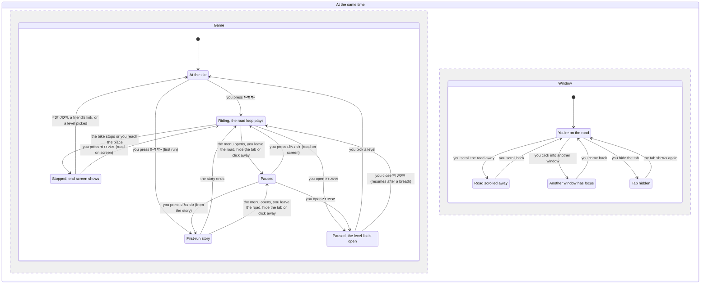

# পিয়নের সাইকেল: statechart

Two runs, both TLC:
- **Before the rewrite:** `before-fix/model/` (the old `Cycle.tla`, `Cycle.cfg`, `view.ts`) mirrors `tools/peoner-cycle/components/cycle-game.tsx` as it was on `games-to-the-bar` (commit a5fb4f1). Output: `before-fix/report.md` and `before-fix/chart.mmd`. 392 states; 6 rules broke.
- **After the rewrite:** `Cycle.tla`, `Cycle.cfg`, `view.ts` mirror `lib/session.ts` (the pure machine the component runs) and `components/ride-game.tsx`. Output: `after-fix/report.md` and `after-fix/chart.mmd`. 384 states, **every rule holds**, no deadlock.

Regenerate:
```sh
scripts/statechart.sh ai_docs/statecharts/peoner-cycle/Cycle.tla --view ai_docs/statecharts/peoner-cycle/view.ts --out ai_docs/statecharts/peoner-cycle/after-fix
```

## Systems modelled (after)
- **Play phase:** title → (story, first run only) → riding ⇄ paused → over. `start()`, `storyDone()`, `finish()`, `pause()`, `resume()` (0.45 s breath), `again()` (0.7 s guard, fresh press only).
- **Pause and focus:** the window is on the page, another window has focus, the tab is hidden, or the road is scrolled away. `blur`, `visibilitychange` and `useInView` all call `away(session, …)`; the player's menu pauses through the same `pause()`.
- **Choices:** the সব লেভেল list (`pick(session, true)` pauses a ride first, closing resumes), পরের লেভেল / নতুন করে শুরু / a level picked (`load()`), আবার খেলো.
- **Timers:** the star chimes and cheer that `finishRun()` queues. They are tied to the run (`cheerMayPlay(session, run)`) and cleared by `load()` and `newRun()`.
- **Sound:** the road loop (`loopStep`): plays only while the road rolls with sound on, stops on pause, blur, hide, scroll, list and the end, and comes back as a fresh loop when sound does.
- **Links and the card:** a friend's link on load or by hashchange; kept for after when it arrives mid-ride (`friendMayLoad`); the card compares with a friend only on the friend's road (`versusLine`).
- **Not modelled:** held input (lane changes are taps; the story's hold-to-skip finger is released by the same blur), stars, unlocks and migration (covered by `tests/link.test.ts`), the ride itself (covered by `tests/ride.test.ts` and the bots in `tests/levels.test.ts`).

## Rules (plain words)
| Rule | Plain words | Before | After |
|---|---|---|---|
| PausedWhenHidden | Hiding the tab mid-ride pauses it. | holds | holds |
| PausedWhenBlurred | Clicking into another window mid-ride pauses it. | broke | holds |
| NoProgressWhileAway | The road never rolls while you are in another window. | broke | holds |
| PausedWhenOffScreen | The road never rolls while it is scrolled off screen, and nothing starts or resumes there. | broke | holds |
| ChoiceFreezesPlay | While the সব লেভেল list is open, the road does not roll. | broke | holds |
| NoFanfareAfterMovingOn | The star chimes and the cheer only play on the end screen they belong to. | broke | holds |
| RouteMatchesRide | While you ride, the route on screen (and the stars you earn) is the route you are riding. | broke | holds |
| CompareOnlySameRoad | The card compares you with a friend only when you rode the friend's road. | broke | holds |
| LoopOnlyWhenMeaningful | The road loop plays only while the road rolls. | n/a | holds |
| NoDeadlock | Every state has a way out. | holds | holds |

## Chart after the fix

The generated `after-fix/chart.mmd` has the same states with the full step labels.

## Bugs found before the rewrite, and the fix (each replayed in `tests/session.test.ts`)
Every one reproduced live in Orca on the old code, then was fixed in the rewrite and is now a node test against the same pure code the component runs.

### 1. PausedWhenBlurred and NoProgressWhileAway
- **Player's sentence:** "I clicked into another window and my পিয়ন rode straight into the mud."
- **Path:** (0) title → (1) you tap the road → (2) you click into another window, still riding.
- **Live replay (old code, Orca):** শুরু করো, then `blur`. 2.6 s later the ride had gone 3 → 26 m and bumped ("ছপাৎ! কাদায় চাকা পিছলে গেল।"), and the phase was `over`.
- **Fix:** `window` `blur` calls `away(session, "blur")`, which pauses; `moving()` is false until a resume plus a 0.45 s breath, and the first tap back only resumes.
- **Test:** `bug 1 · PausedWhenBlurred / NoProgressWhileAway`.

### 2. PausedWhenOffScreen
- **Player's sentence:** "I scrolled a little, tapped বাঁয়ে, and the ride started where I couldn't see the road."
- **Live replay (old code):** with 6% of the road on screen one pointerdown on the lane button set the phase to `playing`; 3.0 s later it had bumped at 26 m, unseen. আবার খেলো under the bump did the same.
- **Fix:** `useInView(play)` calls `away(session, "scroll")`; `start()`, `again()` and `resume()` need `canPlay()` (tab shown, window focused, road on screen), and lane taps need `steerable()`. The lane buttons are gone: the whole road is the control.
- **Test:** `bug 2 · PausedWhenOffScreen`.

### 3. ChoiceFreezesPlay
- **Player's sentence:** "I opened সব রুট to see the next route and crashed while reading it."
- **Live replay (old code):** with the `<details>` list open the ride bumped at 26 m, 2.5 s later.
- **Fix:** the list is a real sheet; `pick(session, true)` pauses a ride first, `moving()` is false while `picking`, and the player's menu offers সব লেভেল (`onLevels`).
- **Test:** `bug 3 · ChoiceFreezesPlay`.

### 4. NoFanfareAfterMovingOn
- **Player's sentence:** "I pressed পরের রুট straight after the bump and heard the star chimes on the next route's start screen."
- **Live replay (old code):** oscillators started at 5362, 5642 and 5922 ms on route 4's start screen after পরের রুট at 5332 ms.
- **Fix:** every `later()` timer is cleared by `load()` and `newRun()`, and each callback also asks `cheerMayPlay(session, run)`, so a timer from an older run or under the list stays silent.
- **Test:** `bug 4 · NoFanfareAfterMovingOn`.

### 5. RouteMatchesRide
- **Player's sentence:** "A friend's link opened while I was riding route 1. The label jumped to route 2, and I got route 2's star without riding route 2's road."
- **Live replay (old code):** with `location.hash` set to a route-2 link mid-ride, the label became "রুট ২ · হাটখোলা" on the same run; at 125 m stored levels went `null` → `{"2":1}`.
- **Fix:** `fromHash()` keeps the friend and returns when `!friendMayLoad(session)` (mid-ride, paused or story). The ride's own course is fixed in the `Game`, and the stars are recorded for the route in `now.current.level`, which only `load()` changes. A far-ahead friend route records its stars and opens nothing in between (`afterClear`).
- **Tests:** `bug 5 · RouteMatchesRide` and `unlocks: …` in `tests/link.test.ts`.

### 6. CompareOnlySameRoad
- **Player's sentence:** "I opened Rafi's route-2 link, rode route 1 instead, and the card told me Rafi was 274 ahead 'on the same road'."
- **Live replay (old code):** seed 77341388 vs Rafi's 12345; the card head still said "Rafi এবার ২৭৪ এগিয়ে। একই রাস্তায় আরেকবার?".
- **Fix:** `versusLine(mine, friend)` returns text only for a friend ride with the same seed and route; an old link never compares.
- **Test:** `bug 6 · CompareOnlySameRoad`.

## Quality-bar gaps, closed in the rewrite
1. **First screen:** the পিয়ন on his bike is the biggest thing, with **রওনা দাও** under it; ধাক্কা chips (সহজ, স্বাভাবিক, কঠিন) say what each means.
2. **Banners over the road:** none. The HUD sits in the corners (level badge top-left, score top-centre, letters and wheels top-right, the bag bottom-left, progress along the top edge).
3. **Pause:** the player's menu, with সব লেভেল; blur, hide, scrolling away and the list all pause.
4. **Danger:** the top edge glows orange when something is in your lane within 0.6 s; the bottom edge when a dog is close; a pointer on the edge for a ভ্যান, a dog and a coming gate; chevrons before a gust; a soft rim on the last allowed bump.
5. **Level design:** 12 routes in three worlds, one new thing each, a named finale each (হাটবার, গরুর পাল, কালবৈশাখী).
6. **Ending:** heading, stars one by one, stats counting up, the exact near-miss line, পরের লেভেল / আবার খেলো (fresh presses only), the card.
7. **Sound:** ক্রিং-ক্রিং signature, delivery chime, pickup, splash and thud, the ভ্যান's horn, a dog's bark, the gust, a road loop; all on `shared/game-sound.ts`.

Testing note from the first run: another agent's tab on the same origin cleared `localStorage` during the replays. `record()` merges with what is stored, so this was not this game's bug.
