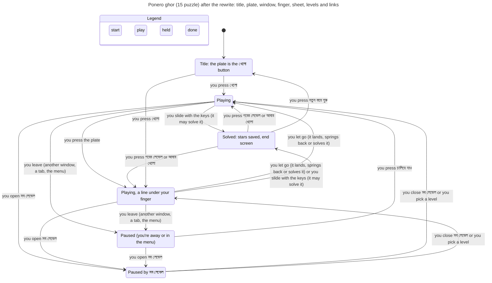

# ১৫ ঘরের ধাঁধা statechart

## After the rewrite (`after-fix/`)
`Ponero.tla` now mirrors the rewritten game: `components/plate-game.tsx` and `plate.tsx` (handlers and effects), `lib/session.ts` (phase and clock), `lib/progress.ts` (your own unlock, playable levels) and `lib/drag.hot.ts` (the finger on the plate).

It runs twice:
- **Chart run** (`Ponero.cfg` as committed: N = 2, Full = FALSE): TLC reached 370 states; the chart has 6 states and 17 arrows (`after-fix/report.md`, `after-fix/chart.mmd`). Full = FALSE leaves out the hidden tab (it takes the blur's path), the story (seen from the start), Enter held through a win, friends' links away from the title, and the sheet on the title and result.
- **Full check** (N = 3, Full = TRUE): 11,691 states (`after-fix/report-full.md`).

**All 14 rules hold in both runs, and so does NoDeadlock.** A mutation check put each old behaviour back into a copy of the spec (full config), and each broke its rule, so none is vacuous:

| Old behaviour put back | Rule that broke |
|---|---|
| a friend's link sets the open level (`open = max(unlocked, friend)`) | UnlockNeverShrinks, OpenLevelsAreEarned |
| clearing a friend's far-ahead level opens the next one | OpenLevelsAreEarned |
| blur and hide keep the press | InputReleasedWhenAway |
| the result accepts a key repeat | HeldKeyNeverSkips |
| the press that resumes also moves | ComingBackIsNotAMove |
| the sheet opens without pausing | ChoiceFreezesPlay |
| a new plate keeps the celebration timers | ChimesOnlyForThisWin |
| the story plays on every level-1 start | StoryOnce |

The mutation run also caught a bug in the first draft of this spec: the friend's-link action set `linked` both FALSE and TRUE, so it could never fire and ReplayIsExact held vacuously. Fixed (`Load` vs `GoTo`).

| Rule | In plain words | After |
|---|---|---|
| InputReleasedWhenAway | After blur, hide or the player's pause, no finger counts as on the plate. | holds (was broken) |
| UnlockNeverShrinks | A level you could open stays open. | holds (was broken) |
| OpenLevelsAreEarned (new) | Only your own unbroken run of cleared levels opens the next one. | holds |
| LevelIsOpen (new) | The level on screen is open, has stars, or is this link's level. | holds |
| ClockStillWhileAway, PausedWhenHidden | The plate (and its clock) is paused whenever you're not on the page. | hold |
| ChoiceFreezesPlay (new) | While সব লেভেল is open, the plate is paused. | holds |
| PausedMeansStarted | A paused plate always says why. | holds |
| ChimesOnlyForThisWin | The win sound, confetti and end screen belong to this win only. | holds |
| ReplayIsExact | A friend's link opens exactly their level. | holds |
| HeldKeyNeverSkips (new) | Enter held through the win never skips the result. | holds |
| ComingBackIsNotAMove (new) | The press that brings you back only resumes. | holds |
| StoryOnce (new) | The story plays only before it was ever seen. | holds |



The chart hides: coming back to the window (nothing moves until you resume), Enter held or released (HeldKeyNeverSkips checks it in the full run), the celebration timers (they stay on "Solved"), a restart or a friend's link from mid-plate (the same reset every state has), and the press that only wakes the plate (drawn as চালিয়ে যাও).

### The two bugs, fixed and replayed
1. **UnlockNeverShrinks** ("a second friend's link locked the level the first one opened"). Fix: the game keeps its own unlock (`ektukhani-unlock-ponero-ghor`, migrated once from the old rule) and a link is a *visit*: it opens only its own level, and clearing it records stars without opening the levels between. Node test: `bug 1, UnlockNeverShrinks: a second friend's link never locks a level, and a link opens only its own level` (tests/session.test.ts). **Live in Orca** (storage cleared): `#l=8&t=15&m=YJ8p3` → playable ১, ৮ (before: ১–৮) → `#l=3&t=4&m=nw` → playable ১, ৩, own unlock still 1. Playing the friend's ৮ in 15 moves: "একদম সমান! বন্ধুও ১৫ চালেই মিলিয়েছিল।", stars `{"8":3}`, unlock 1, primary "তোমার লেভেলে ফেরো".
2. **InputReleasedWhenAway** ("a press from before I left still slid a ঘুঁটি after I came back"). Fix: `plate.tsx` drops the drag (`releaseDrag`) on blur, a hidden tab, the player's pause (`away`) and pointercancel / lost capture; the line springs back. Node test: `bug 2, InputReleasedWhenAway: a press from before you left never moves a ঘুঁটি when you come back`. **Live in Orca** (Pixel 9, immersive, level 11): pressed cell 12 (1 tile marked dragging) → blur → paused, why away, 0 tiles dragging, the player's menu open → চালিয়ে যাও → the old pointerup → moves 0.

### Quality-bar gaps, closed
1. First screen: the world's plate is the খেলো button; the H1 lives in the player. 2. Pause: the player's menu on P, Esc, blur, hide. 3. Copy contradicting stars: `quality-bar gap 3: the end lines never contradict the stars`. 4. Pacing: 4 worlds, one new thing per level, a named picture-only finale each. 5. Hint: its price shows before you press it (★৩→২), and the first hint caps at 2 stars, not 1. 6. HUD: a ঘুঁটি-home bar on the plate's edge (a boss bar on finales), stars on track top-right. 7. Friend links: bug 1.

## Regenerate
```sh
# the drawn chart: Ponero.cfg as committed (N = 2, Full = FALSE)
scripts/statechart.sh ai_docs/statecharts/ponero-ghor/Ponero.tla --view ai_docs/statecharts/ponero-ghor/view.ts --out <new folder>
# the full check: set CONSTANT N = 3 and CONSTANT Full = TRUE in Ponero.cfg, run into another folder, then set them back
```
Copy `chart.mmd` and `report.md` into `after-fix/` and delete `tlc.out`. The before-fix spec is in git history (`Ponero.tla` before this rewrite); its outputs stay in `before-fix/`.

## Before the rewrite (`before-fix/`)

Spec: `Ponero.tla` / `Ponero.cfg` / `view.ts`, mirrored from `tools/ponero-ghor/components/ponero-game.tsx` and `tools/ponero-ghor/lib/game.ts`. TLC: 352 states, 1602 steps. Chart: `before-fix/chart.mmd` (11 states, 30 arrows). Report: `before-fix/report.md`.

### Systems modelled
- **Play phase:** fresh plate → started (moves > 0) → solved. Any move may solve the plate.
- **Pause and focus:** tab visible or hidden, window focused or blurred, the pause overlay. `hide()` pauses only a started, unsolved plate. চালিয়ে যাও or Space resumes.
- **Input:** the pointer press (`press.current`) from `onPointerDown` to `onPointerUp` / `onPointerCancel`. Arrows, H and keyboard clicks commit at once.
- **Timers:** the star chimes, win sound and confetti after a win (`timers.current`), cleared by `goTo()`.
- **Levels and links:** two levels stand in for thirty. `unlocked` is one past the highest cleared. A friend's link sets `friend` and `goTo(link level)`. What you may open is `open = max(unlocked, friend.level)`, and `opened` remembers the most that was ever open.
- There is no game clock: nothing moves unless you move it, so NoProgressWhileAway and ChoiceFreezesPlay hold trivially and aren't modelled. Left out: sound loops (none), kids' rules (not a kids' game), and the hint solver (pure, covered by node tests).

### Rules in plain words
| Rule | Plain words | Result |
|---|---|---|
| InputReleasedWhenAway | After blur or hide, no finger counts as on the plate. | **breaks** |
| UnlockNeverShrinks | A level you could open stays open. | **breaks** |
| PausedWhenHidden | A started plate is paused while its tab is hidden. | holds |
| PausedOnlyMidPlate | Only a started, unsolved plate is ever paused. | holds |
| ChimesOnlyForThisWin | The chimes and confetti never fire after you've moved on. | holds |
| ReplayIsExact | A friend's link opens exactly the friend's level. | holds |
| TypeOK, NoDeadlock | | hold |

### Bugs

Replays ran in Orca (my own tab) by reading the real React state (`PoneroGame` hooks: `game`, `paused`, the `press` ref) and sending `PointerEvent`s at tile centres. Orca pins `document.hidden` to `false`, so the hide replay ran inside a src-less iframe filled with the page's own HTML, where I controlled `document.hidden` (see the ghontar-sur README).

#### 1. UnlockNeverShrinks: "a second friend's link locked the level the first one opened" (game-specific)
- **Path (2 steps):** a friend's link opens (level 2) → a friend's link opens (level 1): *Fresh plate, a level you opened is locked again*.
- **Why:** `open` is computed from the *current* `friend`, and `readFriend` runs on every `hashchange`. A newer link with a lower level replaces the friend and shrinks `open`. A reload without the hash does the same.
- **Live (storage cleared, unlocked 1):** link `#l=8&t=15&m=YJ8p3` → 8 levels open, plate "লেভেল ৮ · ৩×৩", banner "এক বন্ধু ৮ নম্বর লেভেল (৩×৩) ১৫ চালে মিলিয়েছে।" → link `#l=3&t=4&m=nw` → **3 levels open**, the level-8 button reads "লেভেল ৮, বন্ধ", and → is disabled on level 3.
- **Fix:** decide what a link opens. The simplest consistent rule: a link opens only its own level (play it, don't unlock the levels between), so `open` stays `unlocked`, and the friend's level stays playable through `friend` alone. Or keep the levels a link opened in storage (`unlocked = max(unlocked, link level)`) so they never lock again. Either way, add a node test for "open never shrinks across two links".

#### 2. InputReleasedWhenAway: "a press from before I left still slid a ঘুঁটি after I came back" (shared, low impact)
- **Path (2 steps):** you press a ঘুঁটি → you leave (another window or tab): *finger still counts as down while you're away*. From there, you come back → চালিয়ে যাও → the release lands as a move.
- **Why:** neither `hide()` nor anything on blur clears `press.current`. `onPointerUp` then acts on a press from before the pause.
- **Live, blur:** pressed "২, সরানো যায়" (moves ০) → blur 1 s → focus → the release arrives → moves **১**.
- **Live, hide (iframe):** one slide (moves 2) → pressed "১" (held cell 1) → tab hidden → paused, press still "held cell 1" → shows → Space resumes → release → moves **1** (the old press slid ১ back).
- **Impact:** on phones a system gesture sends `pointercancel`, which already clears the press. The only effect is on desktop, and a fresh `pointerdown` always replaces a stale press. Fix it for consistency with the other games, not because players hit it.
- **Fix (shared):** clear held input (`press.current = null`) on `blur` and on hide. This is the same shared rule as in ছবি ফোটাও.

#### Rules that hold, checked live
- **PausedWhenHidden:** the hide replay above shows the overlay "থেমে আছে। তৈরি হলে চাপো।" after one slide.
- **ReplayIsExact:** both links opened exactly their level, and `parseShared` replays the moves (node tests cover invalid links).
- **ChimesOnlyForThisWin:** every way off a won plate goes through `goTo()`, which clears the timers.

### Quality-bar gaps (level 1 solved in Orca at Pixel 9, plus reading levels 1–30)
1. **First screen:** good. The plate is the biggest thing on screen, and level 1 is solved in 2 moves. But the H1 plus a level bar sit above it, and the tools (হিন্ট, ছবি, ধীরে খেলো, sound) are below the fold. Screenshot: `.shots/ponero-ghor-first-screen.png`.
2. **Pause is not a menu:** there's no pause button, P or Esc, and the overlay has one button. It pauses on hide only (fine with no clock, but the shared pause menu should still be there).
3. **Copy contradicts the stars:** solving level 1 with 2 hints at par shows 1 star and "এর চেয়ে কম চালে হয় না।" next to "নিজে নিজে মেলালে ৩ তারা পর্যন্ত পাবে।". Screenshot: `.shots/ponero-ghor-solved.png`.
4. **Pacing:** 10 levels of 3×3, then 15 of 4×4 with par rising to 110 moves, then 5×5 up to 180. Size is the only new idea. There's nothing new per level and no "boss" plate at the end of a size (the picture mode is a toggle, not a stage).
5. **Hint is all-or-nothing:** one hint caps the solve at 1 star, and the button doesn't say so until after you press it. Choices should explain their cost first.
6. **HUD:** the moves counter and the three-star target sit top-right in a level bar (good). Rows done show only as a status line under the plate. There's no progress bar.
7. **Friend links open every level up to theirs** (levels 2–7 opened with a level-8 link), and then shrink back (bug 1).
8. **Sound:** a tin clink per ঘুঁটি, a dull টং for a blocked one, a rising chord per finished row, and the win chimes are all meaningful and synthesized. No loop. Every sound also shows on screen.
9. **Ending:** real stats (moves, par on 3×3, best on this phone), a card and a replay-verified link. Good.

The before-fix chart hid these steps: a cancelled touch (the same as lifting the finger); the star chimes (they stay on "Solved"); picking a level from mid-plate (the same reset from every state); and friend links that open on a started plate. Away is shown only when a finger is still down, and "a level you opened is locked again" only on a fresh plate (later states with the same flag are marked "may break").
