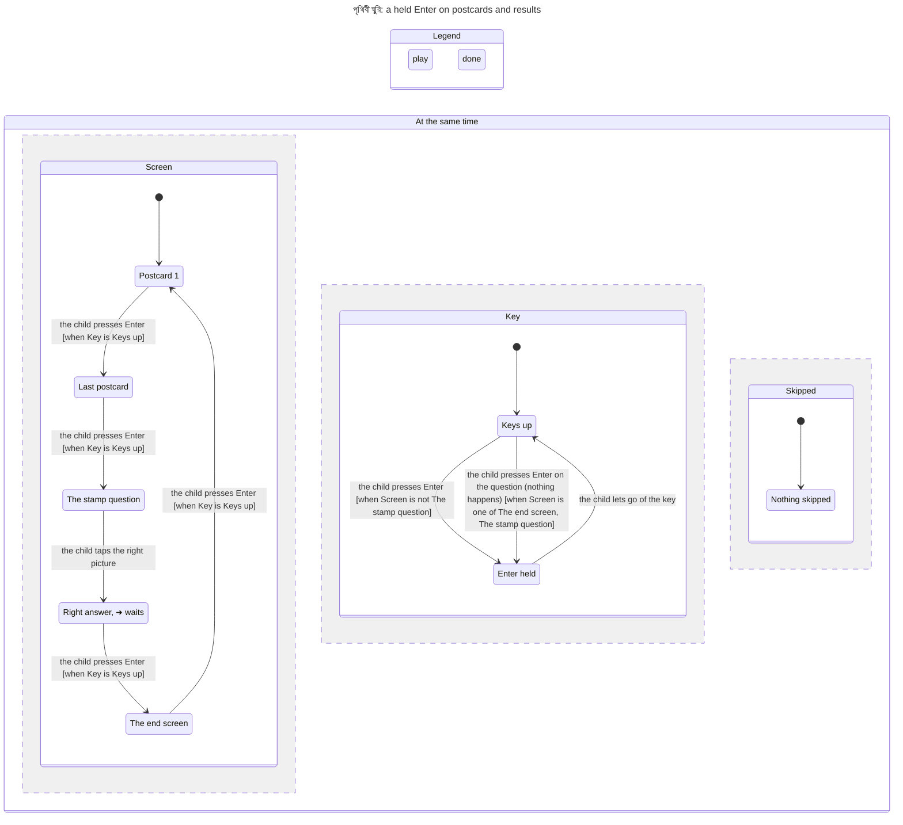
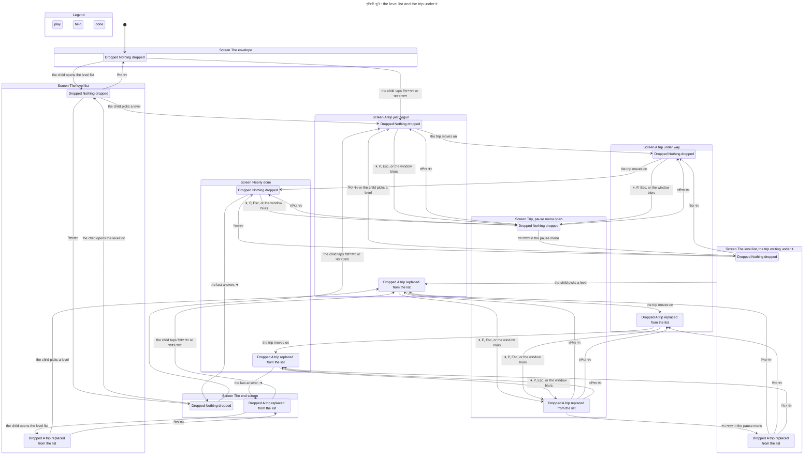

# পৃথিবী ঘুরি: statechart

The game was rewritten on 2026-11-05 (design: `ai_docs/game-dev/rewrites/prithibi-ghuri.md`). The model has four parts, so each chart stays readable. The run on the old code is in `before-fix/` (with the old spec itself); the four runs on the rewritten code are `after-fix/`, `after-fix-keys/`, `after-fix-list/` and `after-fix-gates/`. **Every rule holds.**

| Spec | What it covers | Mirrors | TLC |
|---|---|---|---|
| `PrithibiGhuri.tla` / `.cfg`, view `view.ts` | the screens, one trip (map → plane → postcards → stamp question → ➜), the player's pause, away and back, the daily limit and rest screen | `lib/session.ts`, `lib/trip.ts`, `components/game.tsx` (`begin`, `goTo`, `landed`, `turn`, `pick`, `onward`, `useGamePlayer`), `shared/kids-kit.tsx` | 345 states, 1,160 steps |
| `PrithibiGhuriKeys.tla` / `.cfg`, view `view-keys.ts` | Enter held on postcards, the answer and the end screen | `components/game.tsx` (the `keydown` at `window`), `lib/session.ts` (`freshKey`, `freshTap`) | 19 states, 23 steps |
| `PrithibiGhuriList.tla` / `.cfg`, view `view-list.ts` | the level list, over a trip only from the pause menu, and the trip under it | `lib/session.ts` (`openChoice`, `closeChoice`), `components/game.tsx` (`onLevels`, `pickLevel`) | 105 states, 210 steps |
| `PrithibiGhuriGates.tla` / `.cfg`, view `view-gates.ts` | who has the phone, the share gate on the title, the rest screen's gate | `components/game.tsx` (`<ParentGate key={gateKey}>`, the outside-tap listener), `shared/kids-kit.tsx` | 96 states, 536 steps |

Two postcards stand for five and two stops for three. No voice anywhere on the site, so there is no sound rule to check. The only thing that runs by itself is the plane's flight (a Web Animation the game holds while frozen), so "nothing moves while away" is a rule about the flight.

## Rules (plain words), all holding after the fix
- **RestOnlyAtBreak:** the rest screen comes only between trips. If the limit passes on the last answer, it waits for the end screen.
- **NoNewRoundPastLimit:** past today's limit, উড়াল দাও, আবার খেলো and a level from the list show the rest screen, not a trip. A reload past the limit opens on the rest screen.
- **EveryFinishCounts:** the last right tap saves the stars and checks the limit in that same tap, whatever the hand does next.
- **NothingMovesUnderTheMenu:** ➜ is ignored while the pause menu is open.
- **NothingFliesWhileAway:** the plane holds in the air while the menu is open, the window is blurred or hidden, or the level list is over the trip.
- **PostcardsAreNotSkipped (bug 1) and ResultNeedsFreshPress:** a held Enter never turns a second postcard, moves past an answer, or starts the next trip.
- **NoOneTapDrop (gap 3), ChoiceFreezesPlay and ListKeepsTheTrip:** a trip is dropped only by picking another level from a list the pause menu opened; the list never opens from a plain tap over a trip; closing it gives the trip back exactly.
- **GateNeedsAnAdult, GateShutOutsideTheTitle, RestGateOnlyOnTheRestScreen, OnlyParentsGiveMoreTime:** only a grown-up opens a gate; the share gate lives on the title only and shuts at its one action, the next touch elsewhere, a trip's start or 20 s.

## The bugs, and how each was fixed
All five bugs and the eight gaps were found by the model in the old code and replayed live on 2026-11-04 (the old spec, chart and report are in `before-fix/`; the old reader's sentences and live numbers are in the second half of this file). After the rewrite (2026-11-05, design: `ai_docs/game-dev/rewrites/prithibi-ghuri.md`), each is a node test and a live check in Orca (own tab on `localhost:3100`, so its storage is private; audio untouched).

| # | Bug (the reader's sentence) | Fix | Node test | Live check after the fix |
|---|---|---|---|---|
| 1 | **PostcardsAreNotSkipped:** "I held Enter and the postcards flew past, then it asked me which place I saw in India." | One button for every card is gone. Keys are handled at `window`; `freshKey` ignores a repeat (`!e.repeat`) and a press that began before the card appeared; ➜ ignores a second tap within 180 ms. | `session.test.ts` › bug 1 | Enter pressed once on a card: card 0 → 1. Six repeating `keydown`s 33 ms apart: still 1. A fresh press: 2. Two clicks on ➜ in the same tick: one move. |
| 2 | **NoNewRoundPastLimit** (shared): "Her time was up while she sat on the map, and she still played a whole trip before the rest screen came." | `begin()` asks `kids.atBreak()` when a trip starts; the last right tap also asks it and saves the stars in that same tap. | `session.test.ts` › bug 2, every finish counts | Kids' time set to 99999 s: reload opens on the rest screen; a tap on উড়াল দাও and Enter both left `serial` at 0. Time set past the limit on the last stop: the rest screen came only on the end screen, never over the question. |
| 3 | **GateNeedsAnAdult** (shared kit) | `ParentGate` now holds a 2 s press that ignores auto-repeat, locks 10 s after a wrong answer and shuts after one action, 20 s or a hidden tab (kit). The share gate sits on the title only. | `PrithibiGhuriGates` | n/a (kit) |
| 4 | **GateClosesBehindTheParent** (shared) | Any pointerdown in the game outside an open gate bumps the gate's `key`, so it shuts at the next touch. | `PrithibiGhuriGates` | not replayed again here: the outside-tap listener and `key` bump are the ones `nirapode-thaki` checked live |
| 5 | **NoOutboundForKids** (shared): "Under the game there's a card for আমার ছোটবেলা. She tapped it and landed on a grown-up's quiz." | `GamePage kids`: the rails, grid, header and footer link only to ছোটদের খেলাঘর tools. | `prithibi-ghuri.test.ts` › the page is the shared player with the kids' frame | 71 links on the page: `#main`, the game's own guide and privacy pages, and kids' tools only (0 to `/`, `/tools`, `/amar-chhotobela`). |
| gap 1 | First screen: the start is not the biggest thing | The airmail envelope with the map is the start button. | n/a | `.shots/prithibi-ghuri-desktop-title.png`, `-phone-title.png` |
| gap 2 | No pause or menu | `useGamePlayer({ onPause, onResume, onRestart, onLevels })`: pause on ⏸, P, Esc, blur and hide; the menu has শব্দ, ধীরে খেলো, সব লেভেল. The plane is held in the air. | `session.test.ts` › pause freezes the game | Blur 2.5 s mid-flight: 4 map animations running, then paused for the whole blur; চালিয়ে যাও flew on and landed with `visited = [0]`. |
| gap 3 | One tap on a trip number drops a trip | The trip grid is gone from play. The list opens from the title or the end screen with a tap, over a trip only from the pause menu, freezes the trip, and ফিরে যাও gives it back. | `session.test.ts` › gap 3; `PrithibiGhuriList` | Menu → সব লেভেল → ফিরে যাও: phase, card and stop unchanged, the first tap back only woke the game. |
| gap 4 | Postcards read like a slideshow and need a reader | A greeting in a speech bubble with a waving hand, a big drawing and its name, a drawing for "like", a stamp corner with the flag. One line of text for a parent. | `prithibi-ghuri.test.ts` › postcards say their fact with a picture | `.shots/prithibi-ghuri-phone-hello.png`, `-desktop-hello-card.png` |
| gap 5 | The choice is not numbered, and no keyboard path | Keys 1–3 pick a country, 1–4 a picture, Enter or Space ➜, at `window`. | `levels.test.ts` | Key `1`–`4` picked the matching picture (solved after the key); a repeating Enter did nothing; a fresh Enter moved on; P opened the menu. |
| gap 6 | No named finale | Three passport checks (recall) with a tune and confetti. | `levels.test.ts` › worlds | `.shots/prithibi-ghuri-desktop-end.png` |
| gap 7 | Sound: one-shots, no signature | A world-pitched stamp signature, take-off, landing, page, miss, stars and a tune. | n/a | Node starts counted with the dev server muted (oscillators/noise): take-off 1/1, landing 1/0, page 0/1, miss 2/0, stamp 3/0. |
| gap 8 | Pacing: only a fourth picture after trip 3 | Nine levels, one new idea each (pictures, flags, recall, four pictures, near mix-ups, hello, two stamps). | `levels.test.ts` › each level teaches one thing | all nine levels played end to end in Orca (level ১ clean, the other eight with a deliberate first-tap miss at every stop); stars saved for each |
| — | **NoVoice** (site rule) | No `speak`, `SpeakButton` or `speechSynthesis` anywhere in the game. | `prithibi-ghuri.test.ts` › no voice anywhere | n/a |

**Mutation checks (scratch copies in `scratchpad/prithibi-ghuri/mut/`):** putting the old behaviours back breaks the rules at once. A repeating key that acts breaks **PostcardsAreNotSkipped** in 2 steps and **ResultNeedsFreshPress** in 4. A tap that restarts the trip breaks **NoOneTapDrop** in 3. Starting past the limit breaks **NoNewRoundPastLimit** in 2. A plane that ignores the pause breaks **NothingFliesWhileAway** in 4. ➜ under the menu breaks **NothingMovesUnderTheMenu**.

## The chart (after the fix)
`after-fix/chart.mmd` is the main chart (97 states, 359 arrows; it nests the menu and the daily limit under each trip step). The three smaller charts follow.

```mermaid
---
title: "পfl°°2499¶ßথfl°°2495¶ßবfl°°2496¶ß ঘfl°°2497¶ßরfl°°2495¶ß: screens, the plane, postcards, the stamp question, pause and the daily limit"
---
stateDiagram-v2
  state "Legend" as legend {
    lg0: play
    lg1: held
    lg2: done
  }
  class lg0 teal
  class lg1 yellow
  class lg2 blue
  state "Trip The envelope (উড#2492;#2494;ল দ#2494;ও)" as s0 {
    state "Menu Playing" as s1 {
      s2: Today Time left today
      s3: Today Rest screen
      s4: Today Today's time is up
    }
    state "Menu Window away, everything holds" as s5 {
      s6: Today Time left today
      s7: Today Rest screen
      s8: Today Today's time is up
    }
    state "Menu Pause menu open" as s9 {
      s10: Today Time left today
      s11: Today Rest screen
      s12: Today Today's time is up
    }
  }
  state "Trip The map, pick a country" as s13 {
    state "Menu Playing" as s14 {
      s15: Today Time left today
      s16: Today Today's time is up
    }
    state "Menu Window away, everything holds" as s17 {
      s18: Today Time left today
      s19: Today Today's time is up
    }
    state "Menu Pause menu open" as s20 {
      s21: Today Time left today
      s22: Today Today's time is up
    }
    state "Menu Back from away, the next tap only wakes" as s23 {
      s24: Today Time left today
      s25: Today Today's time is up
    }
  }
  state "Trip The plane is flying" as s26 {
    state "Menu Playing" as s27 {
      s28: Today Time left today
      s29: Today Today's time is up
    }
    state "Menu Window away, everything holds" as s30 {
      s31: Today Time left today
      s32: Today Today's time is up
    }
    state "Menu Pause menu open" as s33 {
      s34: Today Time left today
      s35: Today Today's time is up
    }
    state "Menu Back from away, the next tap only wakes" as s36 {
      s37: Today Time left today
      s38: Today Today's time is up
    }
  }
  state "Trip The plane is about to land" as s39 {
    state "Menu Playing" as s40 {
      s41: Today Time left today
      s42: Today Today's time is up
    }
    state "Menu Window away, everything holds" as s43 {
      s44: Today Time left today
      s45: Today Today's time is up
    }
    state "Menu Pause menu open" as s46 {
      s47: Today Time left today
      s48: Today Today's time is up
    }
    state "Menu Back from away, the next tap only wakes" as s49 {
      s50: Today Time left today
      s51: Today Today's time is up
    }
  }
  state "Trip Postcard 1 (হ#2509;য#2494;ল#2507;)" as s52 {
    state "Menu Playing" as s53 {
      s54: Today Time left today
      s55: Today Today's time is up
    }
    state "Menu Window away, everything holds" as s56 {
      s57: Today Time left today
      s58: Today Today's time is up
    }
    state "Menu Pause menu open" as s59 {
      s60: Today Time left today
      s61: Today Today's time is up
    }
    state "Menu Back from away, the next tap only wakes" as s62 {
      s63: Today Time left today
      s64: Today Today's time is up
    }
  }
  state "Trip Last postcard" as s65 {
    state "Menu Playing" as s66 {
      s67: Today Time left today
      s68: Today Today's time is up
    }
    state "Menu Window away, everything holds" as s69 {
      s70: Today Time left today
      s71: Today Today's time is up
    }
    state "Menu Pause menu open" as s72 {
      s73: Today Time left today
      s74: Today Today's time is up
    }
    state "Menu Back from away, the next tap only wakes" as s75 {
      s76: Today Time left today
      s77: Today Today's time is up
    }
  }
  state "Trip The stamp question" as s78 {
    state "Menu Playing" as s79 {
      s80: Today Time left today
      s81: Today Today's time is up
    }
    state "Menu Window away, everything holds" as s82 {
      s83: Today Time left today
      s84: Today Today's time is up
    }
    state "Menu Pause menu open" as s85 {
      s86: Today Time left today
      s87: Today Today's time is up
    }
    state "Menu Back from away, the next tap only wakes" as s88 {
      s89: Today Time left today
      s90: Today Today's time is up
    }
  }
  state "Trip Right answer, the stamp lands, #10140; waits" as s91 {
    state "Menu Playing" as s92 {
      s93: Today Time left today
      s94: Today Today's time is up
    }
    state "Menu Window away, everything holds" as s95 {
      s96: Today Time left today
      s97: Today Today's time is up
    }
    state "Menu Pause menu open" as s98 {
      s99: Today Time left today
      s100: Today Today's time is up
    }
    state "Menu Back from away, the next tap only wakes" as s101 {
      s102: Today Time left today
      s103: Today Today's time is up
    }
  }
  state "Trip The map, pick the next country" as s104 {
    state "Menu Playing" as s105 {
      s106: Today Time left today
      s107: Today Today's time is up
    }
    state "Menu Window away, everything holds" as s108 {
      s109: Today Time left today
      s110: Today Today's time is up
    }
    state "Menu Pause menu open" as s111 {
      s112: Today Time left today
      s113: Today Today's time is up
    }
    state "Menu Back from away, the next tap only wakes" as s114 {
      s115: Today Time left today
      s116: Today Today's time is up
    }
  }
  state "Trip Last answer right, stars saved, #10140; waits" as s117 {
    state "Menu Playing" as s118 {
      s119: Today Time left today
      s120: Today Today's time is up
      s121: Today Time's up, the rest waits for the end screen
    }
    state "Menu Window away, everything holds" as s122 {
      s123: Today Time left today
      s124: Today Today's time is up
      s125: Today Time's up, the rest waits for the end screen
    }
    state "Menu Pause menu open" as s126 {
      s127: Today Time left today
      s128: Today Today's time is up
      s129: Today Time's up, the rest waits for the end screen
    }
    state "Menu Back from away, the next tap only wakes" as s130 {
      s131: Today Time left today
      s132: Today Today's time is up
      s133: Today Time's up, the rest waits for the end screen
    }
  }
  state "Trip The end screen (আব#2494;র খ#2503;ল#2507; / শ#2503;ষ)" as s134 {
    state "Menu Playing" as s135 {
      s136: Today Time left today
      s137: Today Today's time is up
      s138: Today Rest screen
    }
    state "Menu Window away, everything holds" as s139 {
      s140: Today Time left today
      s141: Today Today's time is up
      s142: Today Rest screen
    }
    state "Menu Pause menu open" as s143 {
      s144: Today Time left today
      s145: Today Today's time is up
      s146: Today Rest screen
    }
    state "Menu Back from away, the next tap only wakes" as s147 {
      s148: Today Time left today
      s149: Today Today's time is up
      s150: Today Rest screen
    }
  }
  [*] --> s2
  [*] --> s3
  s2 --> s15: the child taps উড#2492;#2494;ল দ#2494;ও or আব#2494;র খ#2503;ল#2507;
  s2 --> s6: the window blurs or the tab hides
  s2 --> s4: today's play time runs out
  s2 --> s10: #9208;, P or Esc
  s3 --> s2: a grown-up gives আজ আরও ১০ ম#2495;ন#2495;ট
  s3 --> s7: the window blurs or the tab hides
  s3 --> s11: #9208;, P or Esc
  s15 --> s28: the child taps a country
  s15 --> s16: today's play time runs out
  s15 --> s18: the window blurs or the tab hides
  s15 --> s21: #9208;, P or Esc
  s6 --> s2: the window comes back
  s6 --> s18: the child taps উড#2492;#2494;ল দ#2494;ও or আব#2494;র খ#2503;ল#2507;
  s6 --> s8: today's play time runs out
  s6 --> s10: #9208;, P or Esc
  s4 --> s3: the child taps উড#2492;#2494;ল দ#2494;ও or আব#2494;র খ#2503;ল#2507;
  s4 --> s8: the window blurs or the tab hides
  s4 --> s12: #9208;, P or Esc
  s7 --> s3: the window comes back
  s7 --> s6: a grown-up gives আজ আরও ১০ ম#2495;ন#2495;ট
  s7 --> s11: #9208;, P or Esc
  s10 --> s2: নত#2497;ন কর#2503; শ#2497;র#2497;, or শ#2503;ষ or চ#2494;ল#2495;য#2492;#2503; য#2494;ও
  s10 --> s12: today's play time runs out
  s11 --> s3: নত#2497;ন কর#2503; শ#2497;র#2497;, or শ#2503;ষ or চ#2494;ল#2495;য#2492;#2503; য#2494;ও
  s11 --> s10: a grown-up gives আজ আরও ১০ ম#2495;ন#2495;ট
  s28 --> s29: today's play time runs out
  s28 --> s31: the window blurs or the tab hides
  s28 --> s34: #9208;, P or Esc
  s18 --> s15: the window comes back
  s18 --> s19: today's play time runs out
  s18 --> s21: #9208;, P or Esc
  s16 --> s29: the child taps a country
  s16 --> s19: the window blurs or the tab hides
  s16 --> s22: #9208;, P or Esc
  s8 --> s4: the window comes back
  s8 --> s7: the child taps উড#2492;#2494;ল দ#2494;ও or আব#2494;র খ#2503;ল#2507;
  s8 --> s12: #9208;, P or Esc
  s18 --> s24: the window comes back
  s10 --> s6: নত#2497;ন কর#2503; শ#2497;র#2497;, or শ#2503;ষ or চ#2494;ল#2495;য#2492;#2503; য#2494;ও
  s12 --> s4: নত#2497;ন কর#2503; শ#2497;র#2497;, or শ#2503;ষ or চ#2494;ল#2495;য#2492;#2503; য#2494;ও
  s11 --> s7: নত#2497;ন কর#2503; শ#2497;র#2497;, or শ#2503;ষ or চ#2494;ল#2495;য#2492;#2503; য#2494;ও
  s21 --> s2: নত#2497;ন কর#2503; শ#2497;র#2497;, or শ#2503;ষ
  s21 --> s15: চ#2494;ল#2495;য#2492;#2503; য#2494;ও
  s21 --> s22: today's play time runs out
  s41 --> s54: the plane lands
  s41 --> s42: today's play time runs out
  s41 --> s44: the window blurs or the tab hides
  s41 --> s47: #9208;, P or Esc
  s29 --> s32: the window blurs or the tab hides
  s29 --> s35: #9208;, P or Esc
  s31 --> s37: the window comes back
  s31 --> s32: today's play time runs out
  s31 --> s34: #9208;, P or Esc
  s34 --> s28: চ#2494;ল#2495;য#2492;#2503; য#2494;ও
  s34 --> s2: নত#2497;ন কর#2503; শ#2497;র#2497;, or শ#2503;ষ
  s34 --> s35: today's play time runs out
  s19 --> s16: the window comes back
  s19 --> s22: #9208;, P or Esc
  s24 --> s15: the child taps a country
  s24 --> s18: the window blurs or the tab hides
  s24 --> s21: #9208;, P or Esc
  s24 --> s25: today's play time runs out
  s19 --> s25: the window comes back
  s12 --> s8: নত#2497;ন কর#2503; শ#2497;র#2497;, or শ#2503;ষ or চ#2494;ল#2495;য#2492;#2503; য#2494;ও
  s21 --> s6: নত#2497;ন কর#2503; শ#2497;র#2497;, or শ#2503;ষ
  s21 --> s18: চ#2494;ল#2495;য#2492;#2503; য#2494;ও
  s22 --> s4: নত#2497;ন কর#2503; শ#2497;র#2497;, or শ#2503;ষ
  s22 --> s16: চ#2494;ল#2495;য#2492;#2503; য#2494;ও
  s54 --> s67: the child taps #10140; on a postcard
  s54 --> s55: today's play time runs out
  s54 --> s57: the window blurs or the tab hides
  s54 --> s60: #9208;, P or Esc
  s42 --> s55: the plane lands
  s42 --> s45: the window blurs or the tab hides
  s42 --> s48: #9208;, P or Esc
  s37 --> s31: the window blurs or the tab hides
  s37 --> s34: #9208;, P or Esc
  s37 --> s38: today's play time runs out
  s44 --> s50: the window comes back
  s44 --> s45: today's play time runs out
  s44 --> s47: #9208;, P or Esc
  s32 --> s38: the window comes back
  s32 --> s35: #9208;, P or Esc
  s34 --> s31: চ#2494;ল#2495;য#2492;#2503; য#2494;ও
  s34 --> s6: নত#2497;ন কর#2503; শ#2497;র#2497;, or শ#2503;ষ
  s47 --> s41: চ#2494;ল#2495;য#2492;#2503; য#2494;ও
  s47 --> s2: নত#2497;ন কর#2503; শ#2497;র#2497;, or শ#2503;ষ
  s47 --> s48: today's play time runs out
  s35 --> s29: চ#2494;ল#2495;য#2492;#2503; য#2494;ও
  s35 --> s4: নত#2497;ন কর#2503; শ#2497;র#2497;, or শ#2503;ষ
  s25 --> s16: the child taps a country
  s25 --> s19: the window blurs or the tab hides
  s25 --> s22: #9208;, P or Esc
  s22 --> s8: নত#2497;ন কর#2503; শ#2497;র#2497;, or শ#2503;ষ
  s22 --> s19: চ#2494;ল#2495;য#2492;#2503; য#2494;ও
  s67 --> s80: the child taps #10140; on a postcard
  s67 --> s68: today's play time runs out
  s67 --> s70: the window blurs or the tab hides
  s67 --> s73: #9208;, P or Esc
  s55 --> s68: the child taps #10140; on a postcard
  s55 --> s58: the window blurs or the tab hides
  s55 --> s61: #9208;, P or Esc
  s57 --> s63: the window comes back
  s57 --> s58: today's play time runs out
  s57 --> s60: #9208;, P or Esc
  s60 --> s54: চ#2494;ল#2495;য#2492;#2503; য#2494;ও
  s60 --> s2: নত#2497;ন কর#2503; শ#2497;র#2497;, or শ#2503;ষ
  s60 --> s61: today's play time runs out
  s31 --> s28: the window comes back
  s50 --> s44: the window blurs or the tab hides
  s50 --> s47: #9208;, P or Esc
  s50 --> s63: the plane lands
  s50 --> s51: today's play time runs out
  s38 --> s32: the window blurs or the tab hides
  s38 --> s35: #9208;, P or Esc
  s45 --> s51: the window comes back
  s45 --> s48: #9208;, P or Esc
  s47 --> s44: চ#2494;ল#2495;য#2492;#2503; য#2494;ও
  s47 --> s6: নত#2497;ন কর#2503; শ#2497;র#2497;, or শ#2503;ষ
  s35 --> s32: চ#2494;ল#2495;য#2492;#2503; য#2494;ও
  s35 --> s8: নত#2497;ন কর#2503; শ#2497;র#2497;, or শ#2503;ষ
  s48 --> s42: চ#2494;ল#2495;য#2492;#2503; য#2494;ও
  s48 --> s4: নত#2497;ন কর#2503; শ#2497;র#2497;, or শ#2503;ষ
  s80 --> s93: the child taps the right picture
  s80 --> s81: today's play time runs out
  s80 --> s83: the window blurs or the tab hides
  s80 --> s86: #9208;, P or Esc
  s68 --> s81: the child taps #10140; on a postcard
  s68 --> s71: the window blurs or the tab hides
  s68 --> s74: #9208;, P or Esc
  s63 --> s54: the child taps #10140; on a postcard
  s63 --> s57: the window blurs or the tab hides
  s63 --> s60: #9208;, P or Esc
  s63 --> s64: today's play time runs out
  s70 --> s76: the window comes back
  s70 --> s71: today's play time runs out
  s70 --> s73: #9208;, P or Esc
  s58 --> s64: the window comes back
  s58 --> s61: #9208;, P or Esc
  s60 --> s57: চ#2494;ল#2495;য#2492;#2503; য#2494;ও
  s60 --> s6: নত#2497;ন কর#2503; শ#2497;র#2497;, or শ#2503;ষ
  s73 --> s67: চ#2494;ল#2495;য#2492;#2503; য#2494;ও
  s73 --> s2: নত#2497;ন কর#2503; শ#2497;র#2497;, or শ#2503;ষ
  s73 --> s74: today's play time runs out
  s61 --> s55: চ#2494;ল#2495;য#2492;#2503; য#2494;ও
  s61 --> s4: নত#2497;ন কর#2503; শ#2497;র#2497;, or শ#2503;ষ
  s44 --> s41: the window comes back
  s32 --> s29: the window comes back
  s51 --> s45: the window blurs or the tab hides
  s51 --> s48: #9208;, P or Esc
  s51 --> s64: the plane lands
  s48 --> s45: চ#2494;ল#2495;য#2492;#2503; য#2494;ও
  s48 --> s8: নত#2497;ন কর#2503; শ#2497;র#2497;, or শ#2503;ষ
  s93 --> s94: today's play time runs out
  s93 --> s96: the window blurs or the tab hides
  s93 --> s99: #9208;, P or Esc
  s93 --> s106: the child taps #10140;
  s81 --> s94: the child taps the right picture
  s81 --> s84: the window blurs or the tab hides
  s81 --> s87: #9208;, P or Esc
  s83 --> s89: the window comes back
  s83 --> s84: today's play time runs out
  s83 --> s86: #9208;, P or Esc
  s86 --> s80: চ#2494;ল#2495;য#2492;#2503; য#2494;ও
  s86 --> s2: নত#2497;ন কর#2503; শ#2497;র#2497;, or শ#2503;ষ
  s86 --> s87: today's play time runs out
  s57 --> s54: the window comes back
  s76 --> s67: the child taps #10140; on a postcard
  s76 --> s70: the window blurs or the tab hides
  s76 --> s73: #9208;, P or Esc
  s76 --> s77: today's play time runs out
  s64 --> s55: the child taps #10140; on a postcard
  s64 --> s58: the window blurs or the tab hides
  s64 --> s61: #9208;, P or Esc
  s71 --> s77: the window comes back
  s71 --> s74: #9208;, P or Esc
  s73 --> s70: চ#2494;ল#2495;য#2492;#2503; য#2494;ও
  s73 --> s6: নত#2497;ন কর#2503; শ#2497;র#2497;, or শ#2503;ষ
  s61 --> s58: চ#2494;ল#2495;য#2492;#2503; য#2494;ও
  s61 --> s8: নত#2497;ন কর#2503; শ#2497;র#2497;, or শ#2503;ষ
  s74 --> s68: চ#2494;ল#2495;য#2492;#2503; য#2494;ও
  s74 --> s4: নত#2497;ন কর#2503; শ#2497;র#2497;, or শ#2503;ষ
  s45 --> s42: the window comes back
  s94 --> s97: the window blurs or the tab hides
  s94 --> s100: #9208;, P or Esc
  s94 --> s107: the child taps #10140;
  s89 --> s80: the child taps a wrong picture or the child taps the right picture
  s89 --> s83: the window blurs or the tab hides
  s89 --> s86: #9208;, P or Esc
  s89 --> s90: today's play time runs out
  s96 --> s102: the window comes back
  s96 --> s97: today's play time runs out
  s96 --> s99: #9208;, P or Esc
  s84 --> s90: the window comes back
  s84 --> s87: #9208;, P or Esc
  s99 --> s93: চ#2494;ল#2495;য#2492;#2503; য#2494;ও
  s99 --> s2: নত#2497;ন কর#2503; শ#2497;র#2497;, or শ#2503;ষ
  s99 --> s100: today's play time runs out
  s86 --> s83: চ#2494;ল#2495;য#2492;#2503; য#2494;ও
  s86 --> s6: নত#2497;ন কর#2503; শ#2497;র#2497;, or শ#2503;ষ
  s87 --> s81: চ#2494;ল#2495;য#2492;#2503; য#2494;ও
  s87 --> s4: নত#2497;ন কর#2503; শ#2497;র#2497;, or শ#2503;ষ
  s70 --> s67: the window comes back
  s58 --> s55: the window comes back
  s77 --> s68: the child taps #10140; on a postcard
  s77 --> s71: the window blurs or the tab hides
  s77 --> s74: #9208;, P or Esc
  s74 --> s71: চ#2494;ল#2495;য#2492;#2503; য#2494;ও
  s74 --> s8: নত#2497;ন কর#2503; শ#2497;র#2497;, or শ#2503;ষ
  s106 --> s28: the child taps a country
  s106 --> s107: today's play time runs out
  s106 --> s109: the window blurs or the tab hides
  s106 --> s112: #9208;, P or Esc
  s83 --> s80: the window comes back
  s102 --> s96: the window blurs or the tab hides
  s102 --> s99: #9208;, P or Esc
  s102 --> s103: today's play time runs out
  s102 --> s115: the child taps #10140;
  s90 --> s81: the child taps a wrong picture or the child taps the right picture
  s90 --> s84: the window blurs or the tab hides
  s90 --> s87: #9208;, P or Esc
  s97 --> s103: the window comes back
  s97 --> s100: #9208;, P or Esc
  s99 --> s6: নত#2497;ন কর#2503; শ#2497;র#2497;, or শ#2503;ষ
  s99 --> s96: চ#2494;ল#2495;য#2492;#2503; য#2494;ও
  s100 --> s94: চ#2494;ল#2495;য#2492;#2503; য#2494;ও
  s100 --> s4: নত#2497;ন কর#2503; শ#2497;র#2497;, or শ#2503;ষ
  s87 --> s84: চ#2494;ল#2495;য#2492;#2503; য#2494;ও
  s87 --> s8: নত#2497;ন কর#2503; শ#2497;র#2497;, or শ#2503;ষ
  s71 --> s68: the window comes back
  s107 --> s29: the child taps a country
  s107 --> s110: the window blurs or the tab hides
  s107 --> s113: #9208;, P or Esc
  s109 --> s115: the window comes back
  s109 --> s110: today's play time runs out
  s109 --> s112: #9208;, P or Esc
  s112 --> s106: চ#2494;ল#2495;য#2492;#2503; য#2494;ও
  s112 --> s2: নত#2497;ন কর#2503; শ#2497;র#2497;, or শ#2503;ষ
  s112 --> s113: today's play time runs out
  s96 --> s93: the window comes back
  s84 --> s81: the window comes back
  s103 --> s97: the window blurs or the tab hides
  s103 --> s100: #9208;, P or Esc
  s103 --> s116: the child taps #10140;
  s100 --> s8: নত#2497;ন কর#2503; শ#2497;র#2497;, or শ#2503;ষ
  s100 --> s97: চ#2494;ল#2495;য#2492;#2503; য#2494;ও
  s115 --> s106: the child taps a country
  s115 --> s109: the window blurs or the tab hides
  s115 --> s112: #9208;, P or Esc
  s115 --> s116: today's play time runs out
  s110 --> s116: the window comes back
  s110 --> s113: #9208;, P or Esc
  s112 --> s109: চ#2494;ল#2495;য#2492;#2503; য#2494;ও
  s112 --> s6: নত#2497;ন কর#2503; শ#2497;র#2497;, or শ#2503;ষ
  s113 --> s107: চ#2494;ল#2495;য#2492;#2503; য#2494;ও
  s113 --> s4: নত#2497;ন কর#2503; শ#2497;র#2497;, or শ#2503;ষ
  s97 --> s94: the window comes back
  s109 --> s106: the window comes back
  s116 --> s107: the child taps a country
  s116 --> s110: the window blurs or the tab hides
  s116 --> s113: #9208;, P or Esc
  s113 --> s110: চ#2494;ল#2495;য#2492;#2503; য#2494;ও
  s113 --> s8: নত#2497;ন কর#2503; শ#2497;র#2497;, or শ#2503;ষ
  s110 --> s107: the window comes back
  s80 --> s119: the child taps the right picture
  s119 --> s136: the child taps #10140;
  s119 --> s120: today's play time runs out
  s119 --> s123: the window blurs or the tab hides
  s119 --> s127: #9208;, P or Esc
  s81 --> s121: the child taps the right picture
  s136 --> s15: the child taps উড#2492;#2494;ল দ#2494;ও or আব#2494;র খ#2503;ল#2507;
  s136 --> s140: the window blurs or the tab hides
  s136 --> s2: নত#2497;ন কর#2503; শ#2497;র#2497;, or শ#2503;ষ
  s136 --> s137: today's play time runs out
  s136 --> s144: #9208;, P or Esc
  s120 --> s137: the child taps #10140;
  s120 --> s124: the window blurs or the tab hides
  s120 --> s128: #9208;, P or Esc
  s121 --> s138: the child taps #10140;
  s121 --> s125: the window blurs or the tab hides
  s121 --> s129: #9208;, P or Esc
  s123 --> s131: the window comes back
  s123 --> s124: today's play time runs out
  s123 --> s127: #9208;, P or Esc
  s127 --> s119: চ#2494;ল#2495;য#2492;#2503; য#2494;ও
  s127 --> s2: নত#2497;ন কর#2503; শ#2497;র#2497;, or শ#2503;ষ
  s127 --> s128: today's play time runs out
  s140 --> s18: the child taps উড#2492;#2494;ল দ#2494;ও or আব#2494;র খ#2503;ল#2507;
  s140 --> s136: the window comes back
  s140 --> s6: নত#2497;ন কর#2503; শ#2497;র#2497;, or শ#2503;ষ
  s140 --> s141: today's play time runs out
  s140 --> s144: #9208;, P or Esc
  s137 --> s138: the child taps উড#2492;#2494;ল দ#2494;ও or আব#2494;র খ#2503;ল#2507;
  s137 --> s141: the window blurs or the tab hides
  s137 --> s4: নত#2497;ন কর#2503; শ#2497;র#2497;, or শ#2503;ষ
  s137 --> s145: #9208;, P or Esc
  s138 --> s136: a grown-up gives আজ আরও ১০ ম#2495;ন#2495;ট
  s138 --> s142: the window blurs or the tab hides
  s138 --> s146: #9208;, P or Esc
  s131 --> s123: the window blurs or the tab hides
  s131 --> s127: #9208;, P or Esc
  s131 --> s148: the child taps #10140;
  s131 --> s132: today's play time runs out
  s124 --> s132: the window comes back
  s124 --> s128: #9208;, P or Esc
  s125 --> s133: the window comes back
  s125 --> s129: #9208;, P or Esc
  s144 --> s136: চ#2494;ল#2495;য#2492;#2503; য#2494;ও
  s144 --> s2: নত#2497;ন কর#2503; শ#2497;র#2497;, or শ#2503;ষ
  s144 --> s145: today's play time runs out
  s127 --> s123: চ#2494;ল#2495;য#2492;#2503; য#2494;ও
  s127 --> s6: নত#2497;ন কর#2503; শ#2497;র#2497;, or শ#2503;ষ
  s128 --> s120: চ#2494;ল#2495;য#2492;#2503; য#2494;ও
  s128 --> s4: নত#2497;ন কর#2503; শ#2497;র#2497;, or শ#2503;ষ
  s129 --> s121: চ#2494;ল#2495;য#2492;#2503; য#2494;ও
  s129 --> s3: নত#2497;ন কর#2503; শ#2497;র#2497;, or শ#2503;ষ
  s123 --> s119: the window comes back
  s141 --> s137: the window comes back
  s141 --> s142: the child taps উড#2492;#2494;ল দ#2494;ও or আব#2494;র খ#2503;ল#2507;
  s141 --> s8: নত#2497;ন কর#2503; শ#2497;র#2497;, or শ#2503;ষ
  s141 --> s145: #9208;, P or Esc
  s142 --> s140: a grown-up gives আজ আরও ১০ ম#2495;ন#2495;ট
  s142 --> s138: the window comes back
  s142 --> s146: #9208;, P or Esc
  s148 --> s15: the child taps উড#2492;#2494;ল দ#2494;ও or আব#2494;র খ#2503;ল#2507;
  s148 --> s140: the window blurs or the tab hides
  s148 --> s2: নত#2497;ন কর#2503; শ#2497;র#2497;, or শ#2503;ষ
  s148 --> s144: #9208;, P or Esc
  s148 --> s149: today's play time runs out
  s132 --> s124: the window blurs or the tab hides
  s132 --> s128: #9208;, P or Esc
  s132 --> s149: the child taps #10140;
  s133 --> s125: the window blurs or the tab hides
  s133 --> s129: #9208;, P or Esc
  s133 --> s150: the child taps #10140;
  s144 --> s140: চ#2494;ল#2495;য#2492;#2503; য#2494;ও
  s144 --> s6: নত#2497;ন কর#2503; শ#2497;র#2497;, or শ#2503;ষ
  s145 --> s137: চ#2494;ল#2495;য#2492;#2503; য#2494;ও
  s145 --> s4: নত#2497;ন কর#2503; শ#2497;র#2497;, or শ#2503;ষ
  s146 --> s138: চ#2494;ল#2495;য#2492;#2503; য#2494;ও
  s146 --> s144: a grown-up gives আজ আরও ১০ ম#2495;ন#2495;ট
  s146 --> s3: নত#2497;ন কর#2503; শ#2497;র#2497;, or শ#2503;ষ
  s128 --> s124: চ#2494;ল#2495;য#2492;#2503; য#2494;ও
  s128 --> s8: নত#2497;ন কর#2503; শ#2497;র#2497;, or শ#2503;ষ
  s129 --> s125: চ#2494;ল#2495;য#2492;#2503; য#2494;ও
  s129 --> s7: নত#2497;ন কর#2503; শ#2497;র#2497;, or শ#2503;ষ
  s124 --> s120: the window comes back
  s125 --> s121: the window comes back
  s149 --> s138: the child taps উড#2492;#2494;ল দ#2494;ও or আব#2494;র খ#2503;ল#2507;
  s149 --> s141: the window blurs or the tab hides
  s149 --> s4: নত#2497;ন কর#2503; শ#2497;র#2497;, or শ#2503;ষ
  s149 --> s145: #9208;, P or Esc
  s150 --> s142: the window blurs or the tab hides
  s150 --> s148: a grown-up gives আজ আরও ১০ ম#2495;ন#2495;ট
  s150 --> s146: #9208;, P or Esc
  s145 --> s141: চ#2494;ল#2495;য#2492;#2503; য#2494;ও
  s145 --> s8: নত#2497;ন কর#2503; শ#2497;র#2497;, or শ#2503;ষ
  s146 --> s142: চ#2494;ল#2495;য#2492;#2503; য#2494;ও
  s146 --> s7: নত#2497;ন কর#2503; শ#2497;র#2497;, or শ#2503;ষ
  class s2 blue
  class s3 yellow
  class s4 blue
  class s6 blue
  class s7 yellow
  class s8 blue
  class s10 blue
  class s11 yellow
  class s12 blue
  class s15 teal
  class s16 teal
  class s18 teal
  class s19 teal
  class s21 teal
  class s22 teal
  class s24 teal
  class s25 teal
  class s28 teal
  class s29 teal
  class s31 teal
  class s32 teal
  class s34 teal
  class s35 teal
  class s37 teal
  class s38 teal
  class s41 teal
  class s42 teal
  class s44 teal
  class s45 teal
  class s47 teal
  class s48 teal
  class s50 teal
  class s51 teal
  class s54 teal
  class s55 teal
  class s57 teal
  class s58 teal
  class s60 teal
  class s61 teal
  class s63 teal
  class s64 teal
  class s67 teal
  class s68 teal
  class s70 teal
  class s71 teal
  class s73 teal
  class s74 teal
  class s76 teal
  class s77 teal
  class s80 teal
  class s81 teal
  class s83 teal
  class s84 teal
  class s86 teal
  class s87 teal
  class s89 teal
  class s90 teal
  class s93 teal
  class s94 teal
  class s96 teal
  class s97 teal
  class s99 teal
  class s100 teal
  class s102 teal
  class s103 teal
  class s106 teal
  class s107 teal
  class s109 teal
  class s110 teal
  class s112 teal
  class s113 teal
  class s115 teal
  class s116 teal
  class s119 teal
  class s120 teal
  class s121 teal
  class s123 teal
  class s124 teal
  class s125 teal
  class s127 teal
  class s128 teal
  class s129 teal
  class s131 teal
  class s132 teal
  class s133 teal
  class s136 blue
  class s137 blue
  class s138 yellow
  class s140 blue
  class s141 blue
  class s142 yellow
  class s144 blue
  class s145 blue
  class s146 yellow
  class s148 blue
  class s149 blue
  class s150 yellow
```

### A held key (`after-fix-keys/chart.mmd`)


### The level list and the trip under it (`after-fix-list/chart.mmd`)


### The phone and the gates (`after-fix-gates/chart.mmd`)

```mermaid
---
title: "পfl°°2499¶ßথfl°°2495¶ßবfl°°2496¶ß ঘfl°°2497¶ßরfl°°2495¶ß: the phone, the share gate and the rest screen's gate"
---
stateDiagram-v2
  state "Legend" as legend {
    lg0: play
    lg1: held
    lg2: done
  }
  class lg0 teal
  class lg1 yellow
  class lg2 blue
  state "Screen The envelope" as s0 {
    state "Today Time left today" as s1 {
      state "Phone The child has the phone" as s2 {
        state "ShareGate Share gate closed" as s3 {
          s4: RestGate Rest gate closed
        }
        state "ShareGate Share gate open (a parent answered)" as s5 {
          s6: RestGate Rest gate closed
        }
      }
      state "Phone A parent has the phone" as s7 {
        state "ShareGate Share gate closed" as s8 {
          s9: RestGate Rest gate closed
        }
        state "ShareGate Share gate open (a parent answered)" as s10 {
          s11: RestGate Rest gate closed
        }
      }
    }
    state "Today Rest screen" as s12 {
      state "Phone The child has the phone" as s13 {
        state "ShareGate Share gate closed" as s14 {
          s15: RestGate Rest gate closed
          s16: RestGate Rest gate open (a parent answered)
        }
      }
      state "Phone A parent has the phone" as s17 {
        state "ShareGate Share gate closed" as s18 {
          s19: RestGate Rest gate closed
          s20: RestGate Rest gate open (a parent answered)
        }
      }
    }
  }
  state "Screen The page or the level list" as s21 {
    state "Today Time left today" as s22 {
      state "Phone The child has the phone" as s23 {
        state "ShareGate Share gate closed" as s24 {
          s25: RestGate Rest gate closed
        }
      }
      state "Phone A parent has the phone" as s26 {
        state "ShareGate Share gate closed" as s27 {
          s28: RestGate Rest gate closed
        }
      }
    }
    state "Today Rest screen" as s29 {
      state "Phone The child has the phone" as s30 {
        state "ShareGate Share gate closed" as s31 {
          s32: RestGate Rest gate closed
          s33: RestGate Rest gate open (a parent answered)
        }
      }
      state "Phone A parent has the phone" as s34 {
        state "ShareGate Share gate closed" as s35 {
          s36: RestGate Rest gate closed
          s37: RestGate Rest gate open (a parent answered)
        }
      }
    }
  }
  state "Screen A trip" as s38 {
    state "Today Time left today" as s39 {
      state "Phone The child has the phone" as s40 {
        state "ShareGate Share gate closed" as s41 {
          s42: RestGate Rest gate closed
        }
      }
      state "Phone A parent has the phone" as s43 {
        state "ShareGate Share gate closed" as s44 {
          s45: RestGate Rest gate closed
        }
      }
    }
  }
  [*] --> s4
  [*] --> s15
  s4 --> s9: a parent takes the phone
  s15 --> s19: a parent takes the phone
  s25 --> s4: the page opens again or the child goes back to the envelope
  s25 --> s15: the page opens again
  s25 --> s42: the child taps উড#2492;#2494;ল দ#2494;ও
  s25 --> s28: a parent takes the phone
  s25 --> s32: the child taps উড#2492;#2494;ল দ#2494;ও
  s42 --> s4: the page opens again or the child goes back to the envelope
  s42 --> s15: the page opens again
  s42 --> s25: the trip ends
  s42 --> s32: the trip ends
  s42 --> s45: a parent takes the phone
  s9 --> s4: the child takes the phone back
  s9 --> s11: the parent opens বড#2492;দ#2503;র জন#2509;য
  s19 --> s15: the child takes the phone back
  s19 --> s20: the parent opens the rest screen's gate
  s28 --> s25: the child takes the phone back
  s28 --> s9: the page opens again or the child goes back to the envelope
  s28 --> s19: the page opens again
  s28 --> s45: the child taps উড#2492;#2494;ল দ#2494;ও
  s28 --> s36: the child taps উড#2492;#2494;ল দ#2494;ও
  s32 --> s36: a parent takes the phone
  s45 --> s42: the child takes the phone back
  s45 --> s9: the page opens again or the child goes back to the envelope
  s45 --> s19: the page opens again
  s45 --> s28: the trip ends
  s45 --> s36: the trip ends
  s11 --> s9: the page opens again or 20 s pass or the link is shared
  s11 --> s6: the child takes the phone back
  s20 --> s19: the page opens again or a limit is chosen, or 20 s pass
  s20 --> s9: আজ আরও ১০ ম#2495;ন#2495;ট
  s20 --> s16: the child takes the phone back
  s36 --> s32: the child takes the phone back
  s36 --> s37: the parent opens the rest screen's gate
  s6 --> s4: the page opens again or 20 s pass or the link is shared
  s6 --> s11: a parent takes the phone
  s16 --> s15: the page opens again or a limit is chosen, or 20 s pass
  s16 --> s20: a parent takes the phone
  s16 --> s4: আজ আরও ১০ ম#2495;ন#2495;ট
  s37 --> s36: a limit is chosen, or 20 s pass
  s37 --> s28: আজ আরও ১০ ম#2495;ন#2495;ট
  s37 --> s33: the child takes the phone back
  s33 --> s32: a limit is chosen, or 20 s pass
  s33 --> s37: a parent takes the phone
  s33 --> s25: আজ আরও ১০ ম#2495;ন#2495;ট
  s2 --> s15: the page opens again or the child taps উড#2492;#2494;ল দ#2494;ও
  s2 --> s25: the child opens the level list
  s2 --> s42: the child taps উড#2492;#2494;ল দ#2494;ও
  s13 --> s4: the page opens again
  s7 --> s19: the page opens again or the child taps উড#2492;#2494;ল দ#2494;ও
  s7 --> s28: the child opens the level list
  s7 --> s45: the child taps উড#2492;#2494;ল দ#2494;ও
  s17 --> s9: the page opens again
  s30 --> s4: the page opens again
  s30 --> s15: the page opens again
  s34 --> s9: the page opens again
  s34 --> s19: the page opens again
  class s4 blue
  class s6 blue
  class s9 blue
  class s11 blue
  class s15 yellow
  class s16 yellow
  class s19 yellow
  class s20 yellow
  class s25 blue
  class s28 blue
  class s32 yellow
  class s33 yellow
  class s36 yellow
  class s37 yellow
  class s42 teal
  class s45 teal
```


## Not modelled
- **The pace** (three misses ease a question by one picture, five right add one, kept from trip to trip): a node test proves it (`levels.test.ts` › difficulty), because it changes only how many pictures show, not which screen.
- **Star values:** `recordLevel` keeps the higher value (`shared/tests/game-kit.test.ts`).
- **The passport check's order** (visit every country, then ask): `levels.test.ts` › a passport check.
- **NoNetwork / NoChildData:** no action of this game sends anything; a node test greps the folder for `fetch`, `/api/` and share clients.

## Regenerate
```sh
scripts/statechart.sh ai_docs/statecharts/prithibi-ghuri/PrithibiGhuri.tla --view ai_docs/statecharts/prithibi-ghuri/view.ts --out ai_docs/statecharts/prithibi-ghuri/<new-folder>
scripts/statechart.sh ai_docs/statecharts/prithibi-ghuri/PrithibiGhuriKeys.tla --view ai_docs/statecharts/prithibi-ghuri/view-keys.ts --out ai_docs/statecharts/prithibi-ghuri/<new-folder>
scripts/statechart.sh ai_docs/statecharts/prithibi-ghuri/PrithibiGhuriList.tla --view ai_docs/statecharts/prithibi-ghuri/view-list.ts --out ai_docs/statecharts/prithibi-ghuri/<new-folder>
scripts/statechart.sh ai_docs/statecharts/prithibi-ghuri/PrithibiGhuriGates.tla --view ai_docs/statecharts/prithibi-ghuri/view-gates.ts --out ai_docs/statecharts/prithibi-ghuri/<new-folder>
rm ai_docs/statecharts/prithibi-ghuri/<new-folder>/tlc*.out
```

---

# Before the rewrite (the original findings and live replays)


Kids' game (ছোটদের জন্য, ৬–১২). Spec: `PrithibiGhuri.tla` / `PrithibiGhuri.cfg` / `view.ts`, mirrored from `tools/prithibi-ghuri/components/ghuri-game.tsx`, `shared/kids-kit.tsx` (commits f4f75be and 23fd7c1) and `shared/site-shell.tsx`. Output: `before-fix/report.md` and `before-fix/chart.mmd`. TLC reached 329 states. The chart draws 23 states and 49 arrows.

The chart hides some steps:
- the trip-number grid mid-trip (it resets from every state, like আবার খেলো);
- the reload from every state except the map, the rest screen and the আমার ছোটবেলা page;
- the flagship card from every state except the map.

This spec also holds the shared kids' rules that are the same code on every kids' page: the parent gate, the related-tool cards, and "a new round after time ran out". The `chhorar-tal` and `ammur-number` specs leave these rules out to stay under 500 states and point here. The live replays ran on all three pages.

## Systems modelled
- **The trip:** map → plane flying → postcards → stamp question → right picture (700 ms timer) → stamp page → done screen (আবার খেলো / শেষ) → আজকের মতো হলো. One country stands for a trip's three, and two postcards stand for five. A wrong pick changes nothing that the model tracks.
- **Keys:** Enter held on পরেরটা, and its auto-repeat. Focus stays on পরেরটা, because one button serves every card. It falls to the page when the question or the stamp page replaces it.
- **The trip grid** under the game (startTrip, at any time).
- **The daily limit:** time runs out (the 10 s tick); `atBreak()` at the end of a trip; the rest screen (a real modal since f4f75be); a parent's ১০ more minutes. Since 23fd7c1, a page that opens past the limit opens on the rest screen.
- **The parent gate** under the game: a parent opens it and hands the phone back; a child mashes it; it closes on বন্ধ করো, after 60 s, when the tab hides (f4f75be), or after one grown-up action inside it (23fd7c1).
- **Leaving:** the related-tool cards under the game, and a reload or coming back.

Not modelled:
- **Window focus and tab visibility.** The game has no clock. The flight is a 1.8 s animation that rAF freezes in a hidden tab, and the 700 ms stamp timer firing while away changes nothing that the player sees.
- **Sound.** There are only one-shot `sfx` sounds, with no loops. `SpeakButton` appears only with a Bangla voice.
- **Star values.** `recordLevel` keeps the higher value (`shared/tests/game-kit.test.ts`).

## Rules in plain words
| Rule | Says | Result |
|---|---|---|
| PostcardsAreNotSkipped | Every postcard stays on screen until the child chooses to move on. A held key never flips past one. | **breaks** |
| HeldKeyNeverActsOnTheCard | A key held through the end of a trip never acts on the done screen. | holds |
| NoDoubleResult | A trip is recorded once. | holds (checked live) |
| RestOnlyAtBreak | The rest screen comes only between trips: on the fresh map, the done screen or আজকের মতো হলো. | holds (checked live) |
| NoNewRoundPastLimit | Once today's time is up, no new trip starts before the rest screen. | **breaks** (shared) |
| GateNeedsAnAdult | Only a grown-up opens বড়দের জন্য. | **breaks**, much narrower since f4f75be (shared) |
| GateClosesBehindTheParent | When the parent hands the phone back, the share link is behind a closed gate. | **breaks** for up to 60 s (shared) |
| NoOutboundForKids | Nothing leads from the kids' page to a grown-up tool with share buttons without the gate. | **breaks** (shared) |
| NoNetwork / NoChildData | Nothing is sent and nothing about the child is stored beyond progress. | holds (from the code; not in the spec, see below) |
| NoReadingNeeded | Ages 3–5 only. This game is for 6–12. | not applicable |

## Bugs
Replays ran in Orca on 2026-11-04 between 16:49 and 16:59 (+06), against the code as of 23fd7c1.

### 1. PostcardsAreNotSkipped (game-specific)
- **The player's version:** "I held Enter and the postcards flew past, then it asked me which place I saw in India."
- **Path:** tap a country → the plane lands → hold Enter on পরেরটা → the held key repeats (4 steps).
- **Why:** `nextCard()` is the click handler of one পরেরটা button for all five cards. That button keeps focus, so every repeated Enter keydown clicks it again. No guard against key repeat, and no minimum time per card.
- **Live replay (Orca, 16:49):** trip 1, ভারত. I focused পরেরটা and sent trusted Enter presses. One press moved হ্যালো বলো → খাবার. Four more quick presses moved দেখার জায়গা (35302 ms) → প্রাণী (35962) → আমাদের মতোই (36613) → the question "ভারতে কোন জায়গাটা দেখলে?" (37131). Three cards went past in 1.8 s, with the gap set by the CLI's speed. A real auto-repeat at about 30 Hz is faster. Orca's `keydown` alone (without `keypress`) doesn't activate a button, so the replay used rapid full presses to stand in for auto-repeat.
- **Fix:** ignore `event.repeat` on পরেরটা (`onKeyDown` that calls `preventDefault` on a repeat), and ignore a click within about 400 ms of a card change. The rewrite on the shared player should route Enter through the player, not through whichever button has focus.

### 2. NoNewRoundPastLimit (shared, kids-kit)
- **The player's version:** "Her time was up while she sat on the map, and she still played a whole trip before the rest screen came."
- **Path:** today's time runs out → tap a trip number (2 steps). আবার খেলো on a done screen reached before the limit does the same.
- **Why:** `atBreak()` runs only in `finish()`. Since 23fd7c1, opening a page past the limit shows the rest screen, so the reload path is closed. Starting a trip still never checks.
- **Live replay (16:59):** I loaded the page with kids-time = 0 and no rest screen. Then I set `ektukhani-kids-time` to 1000 s (limit 900 s) to stand for time running out on the map, and tapped trip ১. The trip started with no rest screen. I flew to ভারত, নেপাল and ভুটান (each landing 2149–2151 ms) and took three stamps. The rest screen came only on the done screen.
- **Fix:** call `atBreak()` at the start of each trip too (`startTrip`, আবার খেলো, the trip grid). The rewrite prompt (1191cab) already asks for this.

### 3. GateNeedsAnAdult (shared, kids-kit)
- **The player's version:** "My son held the বড়দের জন্য button and tapped numbers until it opened."
- **Path:** the child keeps holding বড়দের জন্য and mashing the pad (1 step).
- **Why:** since f4f75be the sum is 10–18 and two misses close the gate, so one random two-digit answer is right about 1 time in 100. Every answer starts with ১, so a child who learns that is right 1 time in 10. The hold can be repeated as often as the child likes.
- **Live replay (16:51):** a scripted child repeated hold 2 s, random digit taps, hold again. Run 1 opened the gate after **4 holds and 16 taps (9 s)**. That was a lucky draw: the expected rate is about 50 holds, or 2 minutes. A second, longer run was cut off by a page reload (HMR from another agent's edit) before it finished.
- **Fix:** after two closed attempts, lock the gate for a minute. Better still, use a gate a child can't brute-force: a hold, then a question with no visible pad, such as dragging a number to a spot named in words.

### 4. GateClosesBehindTheParent (shared, kids-kit)
- **The player's version:** "I opened the gate to read it, gave the phone back, and the share button was still there."
- **Path:** a parent opens বড়দের জন্য and hands the phone back without touching anything inside (1 step).
- **Why:** since 23fd7c1 the gate shuts after one action inside it. With no action, it stays open until বন্ধ করো, the 60 s timer, or the tab hiding.
- **Live replay (16:50):** I held the gate 2 s and answered "আট আর সাত যোগ করলে কত?" with ১৫. It opened and showed "খেলাটার লিংক পাঠাও". It was still open at 30 s, and closed by 62 s.
- **Fix:** close the gate when anything outside it is touched (a capture `pointerdown` outside the open gate), not only on a timer.

### 5. NoOutboundForKids (shared, site-shell)
- **The player's version:** "Under the game there's a card for আমার ছোটবেলা. She tapped it and landed on a grown-up's quiz with share buttons."
- **Path:** tap the আমার ছোটবেলা card under the game (1 step).
- **Why:** `PageFrame` always puts the flagship first in "এগুলোও ভালো লাগতে পারে", including on kids' pages.
- **Live check (16:59):** the related cards on `/prithibi-ghuri` link to `/amar-chhotobela`, `/chhorar-tal` and `/ammur-number`. On `/chhorar-tal` they link to `/amar-chhotobela`, `/ammur-number` and `/sur-banai`. On `/ammur-number` they link to `/amar-chhotobela`, `/sur-banai` and `/borno-likhi`. `/amar-chhotobela` has three "লিংক পাঠাও" share controls.
- **Fix:** on a ছোটদের জন্য page, show only kids' tools in the related grid, and put links to grown-up tools behind the gate or in the parent note.

### Rules that hold
- **RestOnlyAtBreak:** at the end of the 16:59 trip, the rest screen covered the done screen. In the same session on `/chhorar-tal` (16:54, same shared `RestScreen`), Tab, Tab, Tab, Enter and Space started nothing. A trusted click on the drum was refused, because the rest screen covered it. One small leak: after Tab, `document.activeElement` was the বড়দের জন্য button **under** the rest screen (`.ct-gate`). Its keys are swallowed, so nothing happens, but a screen reader would follow focus there (shared).
- **NoDoubleResult:** the trip saved `ektukhani-levels-prithibi-ghuri` = `{"1":3}` once, with ★★★ and "আজ ৩টা দেশ ঘুরলাম।".
- **NoNetwork / NoChildData (from the code, not replayed here):** pictures and flags load as `data:` SVG URLs, and fonts come from the site's own fonts through `document.fonts.load`. There's no `fetch`, tally or `/api` call. The share link is the plain address behind the gate. The only stored value is the stars. This rule isn't in the spec: no action of this game sends anything, so a variable for it would never change.

## Quality-bar gaps (one full trip in Orca, desktop width)
1. **First screen.** The map and three country cards fill the game box, with the ghost finger on ভারত. That's good. But on desktop the box is a narrow column, and the H1, lead and parent note sit above it. The start isn't the biggest thing on the page.
2. **No pause or menu.** No pause button, P or Esc. That matters little here, with no clock, but the bar wants one place for শব্দ, ধীরে খেলো and সব সফর.
3. **One tap drops a trip.** The trip grid under the game restarts at once, mid-visit, with no confirm and no "continue where you were".
4. **The postcards read like a slideshow.** Five cards, one "পরেরটা" each, and nothing to do on them. A child who can't read waits for an adult. Sound adds nothing: no greeting is spoken unless the phone has a Bangla voice.
5. **The choice is not numbered,** and has no keyboard path besides Tab. After the question replaces পরেরটা, focus falls to the page, and Enter does nothing until you Tab through the header.
6. **The ending.** The done screen shows ★★★, three mini stamps with the hello word, আবার খেলো / শেষ at equal size and আব্বু-আম্মুকে দেখাও. That's good, but confetti is saved for the full set and there's no named finale for the last trip (আমেরিকা).
7. **Sound:** whoosh, drop, tap, pick, good and thud are one-shots. No signature sound and no gentle loop for the flight.
8. **Pacing:** six trips of three countries each. The only new idea after trip 3 is a fourth picture. The ask types (food, place, animal, flag) rotate, but no trip has its own twist.

Screenshots: `.shots/prithibi-ghuri-first-screen.png` (the map, trip 1, ghost finger) and `.shots/prithibi-ghuri-rest.png` (the rest screen after the trip past the limit).
