# রশি টানাটানি: statechart

Before the rewrite — model: `before-fix/Roshi.tla`, `before-fix/Roshi.cfg`, `before-fix/view.ts`. Report and chart: `before-fix/report.md`, `before-fix/chart.mmd`. The after-fix run is further down.
Code mirrored: `tools/roshi-tana/components/roshi-game.tsx`, `tools/roshi-tana/lib/rope.ts` (update, resume), `tools/roshi-tana/lib/sound.ts` (crowd), `shared/game-kit.ts` (useGameLoop), `shared/game-sound.ts` (loop, setSoundOn), `shared/game-ui.tsx` (SoundToggle).

Before the rewrite, TLC: 288 states. 4 rules broke and 6 held (counting NoDeadlock and the StarsNeverDrop property).

## Systems modelled
- **Play phase:** ready (the drum waits for a tap) → play (count-in, then pulling) → over (the card). `results` counts how many times the round ended.
- **Pause and focus:** the tab is visible or hidden, the window is focused or blurred, and the field is on screen or scrolled away (`boardInView`). Hide and scroll-away call `pause()`. Blur only stops useGameLoop's rAF.
- **Time:** the beat clock is `performance.now() - live.origin`, which is real time. Only `pause()`/`resume()` re-base it. `unseen` (0–2) counts beats the clock passes while the loop isn't stepping. On the next step, `update()` runs all of them at once.
- **Input:** taps only (pad, field, Space/Enter/↑↓). Nothing is held, so there's no held-input system to release.
- **Sound:** the crowd loop `live.hum` is none, a silent stub (`crowd()` made while sound was off; not null) or live. The site-wide switch is also modelled.
- **Choices:** আবার খেলো / পরের লেভেল / আরেকবার / Space on the card (all `start()`) and the level grid (`toReady()`, in any phase).
- **Saved progress:** saved stars (0–2), recorded by `levels.record` on a win.
- Left out: two-player mode. It uses the same `pause`, `resume`, `step` and blur paths, so both bugs below apply to it as well.

## Rules
| Rule | In plain words | Result |
|---|---|---|
| PausedWhenHidden | Hiding the tab pauses the match. | holds |
| PausedWhenBlurred | Clicking into another window pauses the match. | **breaks** |
| NoProgressWhileAway | No beat of the match goes by while you can't see it or answer it. | **breaks** |
| OffScreenMeansPaused | Scrolling the field away pauses the match. | holds |
| LoopOnlyWhenMeaningful | The crowd plays only while a match runs on a focused, visible page with sound on. | **breaks** |
| LoopComesBack | While a match runs with sound on, the crowd plays, including after you turn sound back on. | **breaks** |
| NoDoubleResult | A match ends once, so stars, the cheer and the confetti happen once (`live.ended`). | holds |
| StarsNeverDrop (property) | Saved stars only go up (`recordLevel` keeps the max). | holds |
| ReplayIsExact | A friend's link replays the same seed and level. An invalid link falls back to a fresh game. | checked live (below), not modelled |

## Bugs

### 1. PausedWhenBlurred / NoProgressWhileAway / LoopOnlyWhenMeaningful: "I clicked into another window for a few seconds. When I came back, the other team had pulled eight beats in one go and the crowd had roared the whole time."
- **Path (report):** 0 the drum waits → 1 you tap the drum to start → 2 you click into another window → 3 a beat goes by while the loop is frozen.
- **Code:** useGameLoop's `blur` listener only cancels the rAF. `pause()` runs on `visibilitychange` and on `boardInView`, never on blur. `step()` computes `t = performance.now() - live.origin`, so on focus `update(m, t)` jumps the whole gap. The bot pulls every missed beat (`while (match.botNext * period <= t)`), every beat you missed is closed as missed, and the drum scheduler fires every missed stroke with delay 0. The crowd loop is never stopped.
- **Live replay (Orca, level 1, 750 ms beat, sound on):** start via pad pointerdown. At t=3.98 s: beats 3, bot pulls 0, x 0, 7 tones. Then `window.dispatchEvent(new Event("blur"))`. Six seconds later (t=10.2 s) nothing has moved: beats 3, x 0. But the crowd loop is still running (1 loop started, 0 stopped) and there is no pause overlay. Then `focus`, and 150 ms later: **beats 3 → 11, bot pulls 0 → 4, rope x 0 → −0.174, and 9 drum strokes at once** (tones 7 → 16). After about 45 s away (60 beats), the match would end on the first frame back, decided while you were gone (this follows from `update`; not replayed).
- **Fix:** on window `blur`, call `pause()`. That re-bases the clock (`pausedAt`) and stops the crowd. Resume already gives a fresh ৩-২-১ count-in. **Shared:** do it once in a kit hook (blur + hide → release input, pause real-time play, stop loops), as moshar-raat and al-dhore-hati need the same fix. Also call `silenceScheduled()` in `pause()`: drum strokes up to 90 ms ahead are already on the audio clock.

### 2. LoopComesBack: "I started with sound off, turned it on mid-match, and the drum came back but the crowd never did."
- **Path (report):** 0 the drum waits (sound off) → 1 you tap the drum to start → 2 you turn sound on.
- **Code:** `start()` sets `live.hum = crowd()`. With sound off, `loop()` returns a silent stub object, not null. SoundToggle's `onChange(true)` does `live.hum ??= crowd()`, which leaves the stub in place. The crowd only comes back after a pause and resume.
- **Live replay:** sound off (`ektukhani-sound=0`), then level grid → level 1, then start. At t=1.05 s `live.hum` is set (the stub). Turn sound on (aria-pressed true). 3.3 s later the drum plays (tones 34 → 39), but **loops started stays at 1** (the one from the earlier match), and `live.hum.stop` is `()=>{}`, which is the stub.
- **Fix:** in onChange(true), `live.hum?.stop(); live.hum = crowd()` while playing. Or have `start()`/`resume()` leave `hum` null when sound is off. **Shared pattern:** any game that stores `loop()`'s result and restores it with `??=` has this bug. antenna-thik-koro had the same one. Prefer a kit helper (`useLoop(kind, shouldPlay)`) that rebuilds the loop whenever sound turns on.

### Found by reading, not a rule
- A `hashchange` to an invalid link keeps the previous friend banner, because `readFriend()` returns early without clearing `friend`. On a fresh load an invalid link falls back correctly (below).

### ReplayIsExact, live
- `#s=424242&t=12&l=2&h=10&n=রাফি`: the banner reads "রাফি রশি টানাটানিতে ক্লাস ফোরকে ১২ টানে হারিয়েছে।" Tapping the drum starts with `live.seed` 424242 at level 2.
- `#s=424242&t=2&l=11&h=10` (reload): no banner, and the game opens at the unlocked level (2).

## Quality-bar gaps (played end to end in Orca: level 1, a beat-tapping autopilot through the real pad handler)
1. **Pause:** solo has no pause button and no P/Esc (Esc works only in duo). Blur doesn't pause (bug 1). The overlay offers only চালিয়ে যাও, with no নতুন করে শুরু, কীভাবে খেলবে or সব লেভেল.
2. **Pacing:** the 10 levels change only the tempo, the bot's accuracy and its weight. No level adds a new idea, and the হেডস্যারের দল final has no boss moment (a named bar, a different rhythm, a mid-match surge). A headless sim shows a smooth curve: perfect play wins L1 in 10 beats and L10 in 26, and a 60% hit rate wins L1 40/40 but L10 6/40.
3. **First screen:** the H1 and lead sit above the player, and the একা/দুজনে chips come first. The start drum is below the 0.8-ratio field, so on a phone it sits near or under the fold and isn't the biggest thing on screen. The first win comes fast: 9 beats, about 8.5 s at level 1.
4. **Danger at the edges:** when the ribbon nears our line, the only signs are the crowd's pitch and the status line. There is no edge glow, and "আর N ঢোল" is text under the field.
5. **HUD:** no beat count or progress during play until the last 10 beats. The combo chip sits top-right (fine), but the coach line and the count are status text under the field.
6. **Ending:** the card shows beats and on-beat hits. Perfect pulls, slips, missed beats and best combo are tracked (`p.perfect`, `p.slips`, `p.missed`, `p.best`) but only the loss line uses some of them.
7. **Sound:** a strong set (ঢোল strokes, grunt, creak, scuff, cheer, crowd), but bug 2 loses the crowd and bug 1 fires a burst of drum strokes on return. There is no short tune for the final.
8. **Choices:** the level grid in `<details>` works mid-match and throws the round away without asking (`toReady`), and opening it doesn't pause.
9. **Story:** no sports-day intro panel (the মাঠ, the মাইক, the teams). It would suit the world and play once.

Screenshots: `.shots/roshi-tana-ready.png` (the ready field and drum), `.shots/roshi-tana-over.png` (the 3★ card after a 9-beat win).

## After the rewrite (`after-fix/`)
Model: `Roshi.tla`, `Roshi.cfg`, `view.ts` now mirror the rewritten code: `tools/roshi-tana/lib/session.ts` (ticking, canTap, wantCrowd, syncLoops, the events, `tick`, `wake`) and `tools/roshi-tana/components/game.tsx` (begin, step, finish, wakeUp, the player's onPause/onResume, the sound effect). The spec and view from before are kept in `before-fix/`.

TLC: 180 states, 652 steps. **Every rule holds:** TypeOK, PausedWhenHidden, PausedWhenBlurred, NoProgressWhileAway, OffScreenMeansPaused, LoopOnlyWhenMeaningful, LoopComesBack, NeverAStub, ChoiceFreezesPlay, FreshCountInOnReturn, NoDoubleResult, NoDeadlock and the StarsNeverDrop property.

New rules beyond the first run:
- **NeverAStub:** the crowd is only ever started by `syncLoops` when sound is on, so a silent stub is never kept.
- **ChoiceFreezesPlay:** while the level list is open, the match doesn't tick.
- **FreshCountInOnReturn:** whenever the match ticks again after time away (blur, hide, the menu, the list), the clock was re-based and a fresh ৩-২-১ ran. So the click that brings focus back can't be a pull.

### The fixes
1. **The clock is the step.** Match time moves only in `step()` through `S.tick()`, and `step()` runs only while `ticking()` (play screen, menu shut, list shut, tab visible, window focused). One step never moves the clock more than 100 ms, so even a frozen tab with no blur can't burst. On the way back, `S.wake()` re-bases the clock where it stopped and `resume()` runs a fresh count-in. Drum strokes whose moment has passed are dropped, not fired late. The player's menu opens on blur (P calls `requestPause()` too).
2. **The crowd follows the session.** `syncLoops` starts a fresh `crowd()` when `wantCrowd` turns true (including sound coming back on) and stops it when it turns false. There is no `??=`, and no loop is ever made while muted.
3. **The level list is a choice screen** (`openSheet` stops ticking), and the invalid-link `hashchange` now clears the friend banner.

### Node tests (`tools/roshi-tana/tests/session.test.ts`)
- `statechart PausedWhenBlurred / NoProgressWhileAway: six seconds in another window, and not one beat goes by`
- `statechart NoProgressWhileAway: a hidden tab and the player's menu freeze the match the same way` (45 s away decides nothing)
- `statechart NoProgressWhileAway: even with no blur at all (a frozen tab), one step never plays more than 100 ms`
- `statechart: the click that brings focus back is not a move, and a tap while away is ignored`
- `statechart LoopOnlyWhenMeaningful: the crowd stops while away, in the menu, on the level list and on the card`
- `statechart LoopComesBack: start with sound off, turn it on mid-match, and a fresh crowd starts`
- `statechart ChoiceFreezesPlay: the level list freezes the clock and comes back with a count-in`
- `statechart NoDoubleResult: a match ends once, and nothing steps after the card shows`
- `result keys need a fresh press: a Space held through the win doesn't skip the card`
- `the clock re-bases on return: a tap right on the next pulling beat after the count-in is judged right on`

### Live replays after the fix (Orca, Pixel 9, sound on)
- **Blur, level 2, autopilot tapping:** at match time 4648 ms, beats 4, their pulls 1, rope x 0.411. Then `blur`, and the player's menu opens. Six seconds later: beats 4, clock 4648 ms, 0 drum strokes, crowd stopped. Then `focus` and চালিয়ে যাও, and 150 ms later: **beats 4, their pulls 1, x 0.411, 0 strokes fired**, the next pulls from beat 11 after a fresh ৩-২-১, and the crowd back. (Before: beats 3 → 11, bot 0 → 4, x 0 → −0.174, 9 strokes at once.)
- **Sound off, start, sound on:** with sound off, a match starts with 0 looping sources. P opens the player's menu; turning শব্দ on there and pressing চালিয়ে যাও starts **1 fresh crowd loop** (`session.crowd` true). (Before: loops stayed at the stub.)

### Chart (after the fix)

```mermaid
---
title: "রশfl°°2495¶ß টfl°°2494¶ßনfl°°2494¶ßটfl°°2494¶ßনfl°°2495¶ß after the rewrite: the match, the window, the list, the clock and the crowd"
---
stateDiagram-v2
  direction LR
  state "Legend" as legend {
    lg0: play
    lg1: held
    lg2: done
    lg3: wait
  }
  class lg0 teal
  class lg1 yellow
  class lg2 blue
  class lg3 tan
  state "At the same time" as all {
    state "Match" as r0 {
      s0: Title drum waiting
      s1: Pulling on the beat
      s2: Card shows
      s3: Level list open
      s4: Paused (menu)
      [*] --> s0
      s0 --> s1: you tap the drum to start [when Window is You're on the field]
      s1 --> s2: the ribbon reaches their line or the ribbon reaches our line
      s1 --> s3: you open the level list
      s1 --> s4: you hide the tab or you click into another window or you scroll the stage away or you press #9208; or P
      s2 --> s1: you tap the drum to start [when Window is You're on the field]
      s3 --> s1: you close the level list [when Window is You're on the field]
      s4 --> s1: you press চ#2494;ল#2495;য#2492;#2503; য#2494;ও (a fresh ৩-২-১) [when Window is You're on the field]
    }
    --
    state "Window" as r1 {
      s5: You're on the field
      s6: Tab hidden
      s7: Another window has focus
      s8: Stage scrolled away
      [*] --> s5
      s5 --> s6: you hide the tab
      s5 --> s7: you click into another window
      s5 --> s8: you scroll the stage away
      s6 --> s5: the tab shows again
      s7 --> s5: you come back to the window
      s7 --> s6: you hide the tab
      s8 --> s5: you scroll the stage back
      s8 --> s6: you hide the tab
      s8 --> s7: you click into another window
      s6 --> s8: the tab shows again
      s7 --> s8: you come back to the window
    }
    --
    state "Crowd" as r2 {
      s9: No crowd
      s10: Crowd playing
      [*] --> s9
      s9 --> s10: you tap the drum to start [when Match is one of Card shows, Title drum waiting and Window is You're on the field and Sound is Sound on]
      s9 --> s10: you turn sound on [when Match is Pulling on the beat and Window is You're on the field and Sound is Sound off]
      s10 --> s9: you turn sound off or the ribbon reaches their line or the ribbon reaches our line or you open the level list or you hide the tab or you click into another window or you scroll the stage away or you press #9208; or P
      s9 --> s10: you close the level list [when Match is Level list open and Window is You're on the field and Sound is Sound on]
      s9 --> s10: you press চ#2494;ল#2495;য#2492;#2503; য#2494;ও (a fresh ৩-২-১) [when Match is Paused (menu) and Window is You're on the field and Sound is Sound on]
    }
    --
    state "Sound" as r3 {
      s11: Sound off
      s12: Sound on
      [*] --> s11
      [*] --> s12
      s11 --> s12: you turn sound on
      s12 --> s11: you turn sound off
    }
  }
  class s0 tan
  class s1 teal
  class s2 blue
  class s3 yellow
  class s4 yellow
  class s10 teal
```


## Regenerate
```sh
scripts/statechart.sh ai_docs/statecharts/roshi-tana/Roshi.tla --view ai_docs/statecharts/roshi-tana/view.ts --out ai_docs/statecharts/roshi-tana/<new-folder>
# the model before the rewrite:
scripts/statechart.sh ai_docs/statecharts/roshi-tana/before-fix/Roshi.tla --view ai_docs/statecharts/roshi-tana/before-fix/view.ts --out ai_docs/statecharts/roshi-tana/<another-folder>
```
The chart hides "you pick a level". It is in the model and the rule checks.

Replay harness note: Orca throttles rAF in a background tab, so before each replay the page's `requestAnimationFrame` was swapped for a 60 Hz MessageChannel pump. Game logic was untouched. State was read from the `live` object in React's hook list, and sound was counted by wrapping `OscillatorNode`/`AudioBufferSourceNode.start`. Orca pins `document.hidden` to false, so the hide path was checked against the code, not live. Test data (stars, best, the sound key) was removed afterwards.
