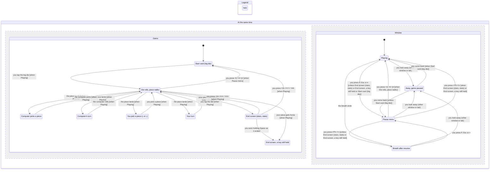

# সাপলুডু: statechart

## After the rewrite (2026-11-04)
Model: `SapLudu.tla` / `SapLudu.cfg` / `view.ts`. It mirrors `tools/sap-ludu/components/ludu-game.tsx` (`tap`, `throwDie`, `pickPiece`, `step` on the `useGameLoop` clock, `settle`, `finish`, `toTitle`, `start`, the window key handler, `onPause` / `onResume` / `onRestart`, `readFriend`), `lib/motion.hot.ts` (`stepMotion`, `paceStep`, `freshPress`), `lib/save.ts` (`openAfter`) and `lib/game.ts` (`starsOf`), plus the menu in `shared/game-player-client.tsx`.

**Full check** (`SapLudu.cfg`, 3 levels): TLC reached 61,968 states (`after-fix/report.md`). **Every rule holds:** TypeOK, PausedWhenAway, NoProgressWhileAway, NothingMovesWhilePaused, BreathBeforeMotion, SheetOffPlay, NoDoubleResult, ResultMatchesPlay, HeldKeyNeverSkipsResult, UnlockByOwnPlay, ReplayIsExact, NoDeadlock.
**Chart** (`Chart.cfg`: one level, `CONSTRAINT ChartScope`): 140 states, `after-fix/chart.mmd` and `after-fix/chart-report.md`.
**Mutant:** let the loop run while the window is blurred (`LoopRuns == screen = "play" /\ win # "hidden"`, the old `useGameLoop`) and NoProgressWhileAway and NothingMovesWhilePaused break at once, so the rules have teeth.

What changed in the model:
- Every timed thing (the die, the walk, the jump, a computer's roll or pick, the breath after resume) runs on the game loop's clock (`stepMotion`, `paceStep`). The loop runs only on the race screen with the menu shut and the window focused, so it freezes on blur, hide, P, Esc and ⏸.
- Pause is the shared player's menu. চালিয়ে যাও gives a 280 ms breath before anything moves.
- The end screen takes Space or Enter only as a fresh press (`freshPress`); a key held through the last move does nothing.
- Stars are recorded once, in `finish()`, at the moment you get home. A level opens only when you clear the level before it while it was open (`openAfter`), so a friend's far level opens nothing in between.
- The level sheet opens only on the title and end screens.

| Rule | In plain words | Result |
|---|---|---|
| PausedWhenAway | Hide the tab or click into another window mid-race, and the pause menu is up. | holds |
| NoProgressWhileAway | No walk, computer roll or computer pick happens while you're away. | holds |
| NothingMovesWhilePaused | Nothing moves under the pause menu. | holds |
| BreathBeforeMotion | After চালিয়ে যাও, nothing moves until the breath is over. | holds |
| SheetOffPlay | সব লেভেল never covers a race in progress. | holds |
| NoDoubleResult | The fanfare plays once a race. | holds |
| ResultMatchesPlay | The stars on the end screen and card are the stars recorded. | holds |
| HeldKeyNeverSkipsResult | A key held through the last move never leaves the end screen. | holds |
| UnlockByOwnPlay | Only your own play opens levels. | holds |
| ReplayIsExact | A friend's link plays their dice; a fresh race takes new ones. | holds |

| Bug | Fix | Node test | Live replay (Orca, after) |
|---|---|---|---|
| 1. NoProgressWhileAway | the walk and the computer's turns run only on `useGameLoop` steps (stopped on blur), and the player's menu opens on blur | `bug 1 (NoProgressWhileAway): …` and `a computer's turn runs on the same clock …` | Level ২: tapped the die (walk শুরু → ৭), blur 300 ms later: menu up, game `inert`, 1.8 s later the tray still read "চাপলে চালটা তখনই শেষ হবে" (mid-walk) and the chip still showed ২. After চালিয়ে যাও it landed on ৭. Level ৪: blur while "মিনু আপা চালছে…": 2 s later still waiting, her chip on ৮; after resume she rolled. |

Quality-bar gaps from the first run, closed: a real pause (the player's menu, P, Esc, blur, hide); the start action is the big die; no in-game toggles (চাল দ্রুত করো and কড়ি are gone, a tap still hurries a walk); the piece choice marks সুপারিশ; no label over the board (captions sit in the tray); 12 levels in 3 worlds with named boss snakes; a red edge when a snake head is one roll away.



## Regenerate
```sh
scripts/statechart.sh ai_docs/statecharts/sap-ludu/SapLudu.tla --view ai_docs/statecharts/sap-ludu/view.ts --out ai_docs/statecharts/sap-ludu/after-fix
scripts/statechart.sh ai_docs/statecharts/sap-ludu/SapLudu.tla --config ai_docs/statecharts/sap-ludu/Chart.cfg --view ai_docs/statecharts/sap-ludu/view.ts --out <new folder>
# copy its chart.mmd to after-fix/chart.mmd and its report.md to after-fix/chart-report.md, then
rm ai_docs/statecharts/sap-ludu/after-fix/tlc*.out
```
The chart hides letting go of a key, closing the sheet, hiding the tab (it acts as blur), a tap during the walk, the friend's link except from the title, and নতুন করে শুরু except from a walk. The full check keeps all of them.

## Before the rewrite (kept for the record)

Model: `before-fix-model/SapLudu.tla` / `.cfg` / `view.ts`. Report and chart: `before-fix/report.md`, `before-fix/chart.mmd`.
Code mirrored: `tools/sap-ludu/components/sap-ludu-game.tsx`, `tools/sap-ludu/lib/game.ts`, `shared/game-kit.ts` (`useGameLoop`).

TLC: 54 states, 184 steps. **8 rules hold, 1 breaks.**

## Systems modelled
- **Play phase:** first roll → your roll → pick a piece (two pieces could move) → reached 100. A roll can walk, ask for a pick, or win at once. Fast mode and a stuck roll count as a roll that doesn't walk.
- **Walking piece:** the `anim` ref, stepped by `useGameLoop`. A tap or চাল দ্রুত করো finishes it. The loop stops while the tab is hidden, but it keeps running while the window is blurred.
- **Pause and focus:** `visibilitychange` pauses only mid-game (`rolls > 0` and not over) and finishes the walk. There is no blur or focus listener, and no pause button, P or Esc.
- **Result:** the `settled` effect (best, win sound, confetti) runs once per change of `settled`/seed, and then a 450 ms timer shows the cover. আরেকবার and একই ছক্কায় আবার start a new game; নতুন খেলা restarts a game in progress.
- **Friend's link (solo):** `hashchange` → `start(seed)` with their dice and their card shown. একই ছক্কায় আবার keeps the friend; আরেকবার, নতুন খেলা and a player-count change drop the friend. (A group link deliberately gives fresh dice, so the model leaves it out.)
- **Sound:** only one-shot sounds, no loops. No loop rules apply.
- **Not modelled:** names, কড়ি skin, the card canvas, keyboard focus details. None of these advance play.

## Rules (plain words)
| Rule | In plain words | Result |
|---|---|---|
| PausedWhenHidden | If you hide the tab mid-game, the game is paused. | holds |
| NoProgressWhileAway | A piece never keeps walking while you are in another window. | **breaks** |
| ChoiceFreezesPlay | Nothing moves while you choose a piece. | holds |
| NothingMovesWhilePaused | Under the pause cover, no piece walks. | holds |
| NoDoubleResult | The win sound and confetti fire once per game. | holds |
| ResultMatchesPlay | The result cover appears only after the last walk and the celebration. | holds |
| OneCoverAtATime | The pause cover and the result cover never show together. | holds |
| ReplayIsExact | While a friend's card shows, you are rolling their dice. | holds |

## Bugs
### 1. NoProgressWhileAway (game-specific symptom, shared cause)
- **Player's sentence:** "I tapped the dice, switched to WhatsApp, and when I came back my piece had already walked and climbed the ladder without me seeing it."
- **Path (report):** 0 waiting for the first roll → 1 you tap the dice (piece walks) → 2 you click into another window (the piece keeps walking).
- **Live replay (Orca, tab `sap-ludu`, 2 players):** I clicked ছক্কা ফেলো and dispatched `blur` in the same tick, with `document.hasFocus()` false the whole time. The walk ref read `t = 400 ms` of `total = 680 ms` (0 → 4) right after the blur. About 1 s later `anim` was `null`, the piece was on ৪ and the news line read "গোলাপি: ৪ পড়েছে". Nothing paused.
- **Severity:** low. The game is turn-based, and the walk only animates a roll you already made. But it fails the bar's "pause on blur" rule. Also, the jump sound (ladder or snake) plays while you are away.
- **Fix:** add `blur` (and `pagehide`) handling. Finish the walk (`finishAnim()`) and pause the same way as hide, ideally through the shared game player's away handling. The `visibilitychange` branch already shows the right behaviour.

## Quality-bar gaps (played solo to 100 in Orca: 21 rolls, about 2 minutes)
1. **No real pause:** there is no পজ button, P or Esc, and blur doesn't pause. Only a hidden tab shows the cover.
2. **The first screen has many controls of equal weight:** একা/২/৩/৪ জন, দুই গুটি, কড়ি, চাল দ্রুত করো, ধীরে খেলো and sound all sit under the board. The start action (the dice) is a small tile at the bottom-left, not the biggest thing on screen.
3. **The game invents its own toggles** (চাল দ্রুত করো, কড়ি) that the shared settings don't cover.
4. **The piece choice has no recommended default.** The two cards show the real effect ("৪২ → ৪৬, সিঁড়ি! ৬৭-তে"), but neither is marked as the sensible pick for beginners.
5. **A label covers the play area:** the ladder or snake bubble sits on the board during play.
6. **Pacing:** one board, no stages or new elements, and no named "boss" moment. A run lasts 20–40 rolls with no change of rhythm.
7. **No edge danger cue** (for example, a snake right ahead), and there is no music.
8. **What's good:** 6 synthesized sounds (rattle, hop tick, ladder, snake slide, stuck, win), a real end stat (চাল count, best on this phone), a personal card, and the solo link replays the same dice.

Screenshot: `.shots/sap-ludu-result.png` (the result cover after the autopilot run).

The before-fix chart hides "you tap again to finish the move" (it repeats "the piece lands") and the friend's link from every state except the first screen.
