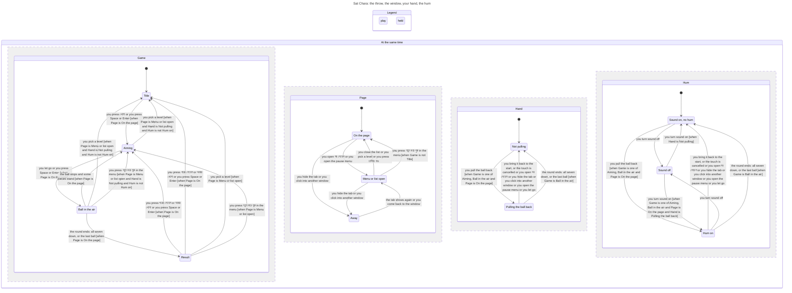
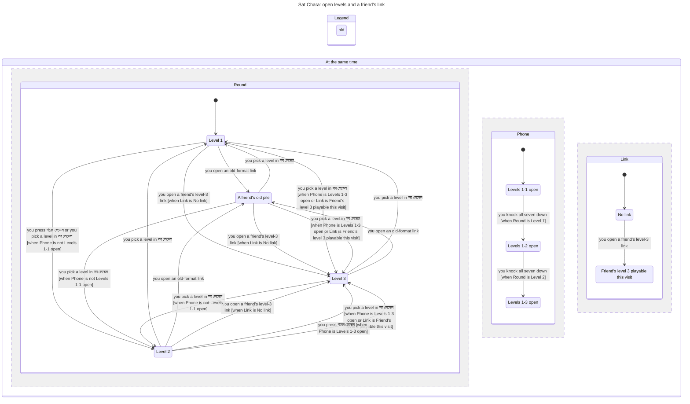

# সাত চাড়া: statechart

Two specs, because together they pass the chart budget of 500 states:
- `SatChara.tla` / `SatChara.cfg`, view `view.ts`: the play, window focus, the pull, the held key and the hum. TLC: 484 states, 2,822 steps. The chart has 12 states and 27 arrows.
- `SatCharaLevels.tla` / `SatCharaLevels.cfg`, view `view-levels.ts`: saved levels and friend links. TLC: 60 states, 314 steps. The chart has 9 states and 19 arrows.

`before-fix/` holds the specs and charts for the old code (5 rules held and 5 broke, from 4 bugs). `after-fix/` holds the reports and charts for the rewritten code: **every rule holds.**

Both specs mirror `tools/sat-chara/components/game.tsx`, which forwards every event to `tools/sat-chara/lib/session.ts` (the pure rules for ticking, pull, key, hum and the guards) and `tools/sat-chara/lib/save.ts` (`openAfter`, `playable`, `readOpen`), plus `shared/game-player-client.tsx` (blur and hide open the menu; the menu's সব লেভেল resumes, then opens the list).

## Systems modelled
- **Screens:** title → play (aiming → ball in the air → aiming) → end screen → পরের লেভেল (a title) or আবার খেলো (play).
- **Aim:** a real pull (past the tap slop) throws on let go. A still press is the two-tap path: the first fixes the direction (`fixed`), the second throws.
- **Page:** tab visible or hidden, window focused or blurred, the player's menu, সব লেভেল. Blur and hide open the menu; the menu's চালিয়ে যাও, ↻ and সব লেভেল.
- **Hand:** a finger or mouse on the lane (`hold = pull`, `dragging`), or Space or Enter (`hold = key`). `keyDown` is the physical key: a keydown event while it is already down is the browser's auto-repeat, and the model sends it through the same handler.
- **Guards:** `guard` is the 250 ms after চালিয়ে যাও, ✕ or a new round, when a press only wakes the game. `fresh` is the 450 ms after the end screen appears, when result keys are refused.
- **Sound:** the stretch hum (`session.syncHum` after every event), and the site-wide switch.
- **Levels (second spec):** your own open levels (`openAfter`), the level a friend's link brings you to for this visit (`playable`), and an old-format link, which plays one old pile and records nothing.

Not modelled: the physics (deterministic, covered by `tests/physics.test.ts`), star counts (`recordLevel` keeps the max, pure), and the exact number of balls. A flight is one step, taken only while the session ticks.

## Rules, in plain words
| Rule | In plain words | Result |
|---|---|---|
| PausedWhenHidden / PausedWhenBlurred | Leave the tab or the window and the round stops, a ball in the air included. | holds |
| ChoiceFreezesPlay | With the menu or সব লেভেল open, nothing flies on. | holds |
| InputReleasedWhenAway | Away, in the menu or in the list, you hold nothing. | holds |
| HumOnlyWhilePulling (LoopOnlyWhenMeaningful) | The stretch hum plays only while you pull on a live round with sound on. | holds |
| HumComesBack (LoopComesBack) | While you pull with sound on, you hear it. | holds |
| OnePressOneThrow | A held key's auto-repeat never aims or throws. | holds |
| FocusClickIsNotAThrow | Nothing throws in the breath after চালিয়ে যাও, ✕ or a new round. | holds |
| NoKeyPastResult | A key held through the end of a round never skips the result. | holds |
| NothingHeldOnTheResult | The end screen never sits over a held ball or a hum. | holds |
| LevelIsOpen (levels) | The level you play is one you can open. | holds |
| OpenLevelsAreEarned (levels) | A level opens on this phone only after you clear the ones before it. A friend's level is playable for that visit only. | holds |
| UnlockNeverShrinks, StarsNeverDrop (levels) | Open levels and stars only go up. | hold |
| OldPileRecordsNothing (levels) | An old-format link's round never changes stars or open levels. | holds |
| TypeOK, NoDeadlock | | hold |

**The model has teeth.** I broke the spec four ways and each broke the rule it should: dropping `~keyDown` from the key's check (OnePressOneThrow), keeping the pull on blur (InputReleasedWhenAway), letting a held key choose on the result (NoKeyPastResult), and ignoring the breath guard (FocusClickIsNotAThrow). In the levels spec, `openAfter` that opens the level after any clear breaks OpenLevelsAreEarned.

## Chart (`after-fix/chart.mmd`)


## Chart of saved levels (`after-fix/levels/chart.mmd`)


## Bugs found in the old code, and how each is fixed
Each bug was found by the model on the code before the rewrite, then replayed live in Orca. The write-ups below are from that run. **Fixes in the rewrite**, each with a node test in `tests/session.test.ts` that replays the path against the pure code:

| Bug | Fix in the rewrite | Test |
|---|---|---|
| 1. A pull kept going, and its hum kept droning, after you left the window | `session.blur/hide/pause/openSheet` all `letGo`; `syncHum` stops the hum; the component's `dropPull` releases pointer capture; the pointerup that comes later is `none` | `statechart InputReleasedWhenAway + HumOnlyWhilePulling` |
| 2. Mute then unmute while pulling left the pull silent | the hum is wanted by `humWanted(session)` and re-synced after every event, always made fresh (never the muted stub) | `statechart HumComesBack` |
| 3. A held Enter on the stars started the next level and threw | `keyDown` acts only on a fresh press; result keys need `freshResultKey` (not a repeat, after the screen's 450 ms) | `statechart OnePressOneThrow`, `statechart NoKeyPastResult` |
| 4. A friend's level 3 on a fresh phone opened levels 2 and 4 | the game's own `ektukhani-sat-chara-open` key and `openAfter`/`playable`; a friend's level is playable for the visit only | `statechart OpenLevelsAreEarned` |
| Also: the first tap after a pause could hop or throw | `RESUME_GUARD`: a press inside 250 ms only wakes the game | `statechart FocusClickIsNotAThrow` |
| Also: opening সব লেভেল kept play running | the list pauses the round and drops the pull | `statechart ChoiceFreezesPlay` |
| Also: blur froze the ball with no sign | the shared player now opens its menu on blur and hide; `NoProgressWhileAway` replayed | `statechart NoProgressWhileAway + PausedWhenBlurred` |

### The old runs, in full

### 1. InputReleasedWhenAway + HumOnlyWhilePulling: "I was pulling the ball back when a message came up in another window, and the hum kept droning until I came back"
- **Path (report):** 0 aiming → 1 you pull the ball back (hum on) → 2 you click into another window (still pulling, hum still on).
- **Live replay (Orca, level 1):** I counted the hum by wrapping `OscillatorNode.prototype.start/stop` for the 90 Hz sawtooth. Then I sent a pointerdown and two pointermoves (60 px back), which gave `humStart` at t = 40 911 ms. I sent `blur` at 41 113. At 43 114, 2 s later, the hum hadn't stopped, the status still read "ছেড়ে দিলেই বল যাবে।", and a pointermove sent while away still re-aimed the ball. A pointerup while away threw it (`aim → flying`, balls ৩ → ২). The hum stopped only then (`humStop` at 43 167). Because the shared loop is now stopped by the blur, the thrown ball then hung in the hand (`world.steps` 0, `ball = 1`) until the window got focus again, while the status said "দেখো কয়টা পড়ে।".
- **Fix:** give the game a `blur` handler that does what `hide()` does: `stopHum()`, `live.pull.id = -1`, `drag → sweep` and release pointer capture. A ball in the air should also show the থেমে আছে overlay (`live.paused = true; setPaused(true)`), so leaving the window looks like leaving the tab. **Shared:** the shared loop now freezes on blur, but each game's own input, loops and overlay don't hear it. A shared `useAway(onAway)` in `shared/game-kit.ts` (blur plus hidden) would let every game drop held input and stop its loops in one place. Moving to the shared game player gives the same result.

### 2. HumComesBack: "I muted and unmuted while pulling, and the pull went silent"
- **Path:** 0 → 1 you turn sound off → 2 you pull the ball back (silent, which is right) → 3 you turn sound on, but the pull stays silent.
- **Live replay:** I pulled with sound on (1 hum start) and clicked the সাউন্ড toggle off. `live.hum` became `null` and the hum stopped. I clicked it back on and pulled 5 more moves. The hum starts stayed at **1**, `live.hum` stayed `null`, and the toggle showed `aria-pressed="true"`. From the model's own path (sound off before the pull), `loop()` returns a silent stub that `live.hum ??= stretch()` keeps for the whole pull.
- **Fix:** in `onPointerMove`, create the hum whenever `p.moved && !live.hum && soundOn()`, and drop a stub. Or pass `SoundToggle onChange={on => on ? (live.aim === "drag" && (live.hum = stretch())) : (live.hum = null)}`. This is low severity, since you need a second hand to toggle mid-pull. **Shared pattern:** it's the same LoopComesBack gap that antenna's model found.

### 3. OnePressOneThrow: "I held Enter a moment too long on the stars, and the next level's ball flew before I aimed"
- **Path:** 0 → 1 you press Enter → 2 you keep holding Enter: the ball is in the air. From the result screen, the same press first moves to the next level.
- **Live replay:** on লেভেল ৩'s stars, I dispatched one Enter keydown, then repeats (`repeat: true`) every 33 ms, the way a held key sends them. Enter: `startLevel(4)`. Repeat 1 (+536 ms): লেভেল ৪, aim `power`, so the direction was fixed. Repeat 2 (+572 ms): `flying`, with balls ৩ → ২. The ball was gone 0.6 s after one long press, with no aim at all.
- **Fix:** add `if (event.repeat && (key === " " || key === "Enter")) return;` in the keydown handler, and keep repeats for the arrow keys. **Game**, but it's a pattern: 54 games handle Enter or Space and only 22 read `event.repeat`.

### 4. OpenLevelsAreEarned: "I beat a friend's level 3 on a new phone, and now levels 2 and 4 are open though I never played 1 or 2"
- **Path (levels report):** 0 a fresh phone, levels 1–1 open → 1 you open a friend's level-3 link → 2 you knock all seven down: level 3 open, and level 1 never played.
- **Live replay:** with `ektukhani-levels-sat-chara` removed, I opened `/sat-chara#s=24757&t=2&l=3&n=Rafi`. The banner read "Rafi লেভেল ৩-এর সাত চাড়া ২ বলে ফেলেছে।" and the game opened on লেভেল ৩. I cleared it with one ball ("Rafi-এর চেয়ে ১ বল কম লাগল!"), which saved `{"3":3}`. After a reload without the hash, the game opened on **লেভেল ৪**. The সব লেভেল grid showed **4 open**: লেভেল ১, ২, ৩ (৩ তারা) and ৪, with ৫ and up বন্ধ.
- **Fix:** make `unlockedLevel` in `shared/game-core.ts` count the unbroken run of cleared levels from 1, and keep a friend's level playable for that visit only (it's already in the grid through `unlockedOrFriend`). **Shared** with sudoku (its bug 5), switchboard and every game whose link carries a level.

### Checked and fine
- **PausedWhenHidden** (Orca pins `document.hidden`, so I applied `hide()`'s effects directly: `live.pull.id = -1; live.paused = true; setPaused(true)`): during a flight, `world.steps` stayed at 18 for 1.5 s under "থেমে আছে। বল মাঝপথে ঝুলে আছে।", and চালিয়ে যাও resumed it (18 → 41 in 0.4 s).
- **NoProgressWhileAway** after `6775639`: I threw with two taps, then sent `blur`. `world.steps` held at 15 for 3 s, then ran 56 → 98 → clear after `focus`. No overlay appeared, so the ball just hangs.

### Minor (not in the model)
- Blur freezes the ball silently: the status still says "দেখো কয়টা পড়ে।" and nothing says it's paused.
- Space or Enter resumes, and throws, only while the board is in view (`boardInView`), and there's no P or Esc.
- `useGameLoop` (shared) starts each new effect with `away = false`. If `running` flips while the window is blurred, the new loop runs although you're away. In this game `running` flips only from actions on the page or from `hide()`, so I couldn't reach it, but other games with timers may.
- Replaying a level for fewer stars shows the near-miss line ("আর ৩টা পড়লে ৩ তারা হতো") even when that level already has 3 stars.

## Quality-bar gaps in the old game (all closed by the rewrite)
The rewrite (`ai_docs/game-dev/rewrites/sat-chara.md`) answers each: the shared player's pause menu with P, ⏸ and সব লেভেল (1); 15 levels with a bot-tuned curve, asserted in `tests/levels.test.ts` (2); a named finale per world with a rival's record, a horn line and confetti (3); a title whose biggest control is the pile with খেলো on it, and a lane that fills the stage (4); a lit edge on the last ball and while টুনি stacks (5); a numbered, paused level list that says what each level adds (6).

1. **Pause isn't a real menu (§7):** the game isn't in the shared game player. There's no pause button and no P or Esc. A hidden tab shows a one-line overlay, while blur freezes the game with no sign (bug 1). The overlay offers only চালিয়ে যাও.
2. **Easy is too easy, and the curve wobbles (§2, §9):** a random-throw autopilot cleared levels 1–9 in about 60 s with one fail, then 10–15 in about another minute. Over a 23 × 18 grid of angle and power, the share of throws that clear in one ball was L1 40%, L2 49%, L3 44%, L4 29%, **L5 60%**, L6 14%, L7 31%, **L8 50%**, L9 18%, L10 6%, then L11–18 13–26%, L19 4%, L20 1%, L21–30 0–11% (L27 0%). Levels 5 and 8 are easier than the levels before them, and a dead-weak 5° roll at 0.2 power clears levels 1, 2, 3, 5 and 8 with one ball.
3. **No "boss" moment at the end of a world (§9):** levels 10, 20 and 30 get one line ("গলির সব সাজানো শেষ। এবার স্কুলের মাঠে।") and confetti on a first clear, but no named final pile and no special card.
4. **The first screen puts words over the game (§1, §12):** the H1 and a two-line lead sit above the board, and the hint chip "⟵ টেনে ছাড়ো" sits on the play area. On desktop the board is 480 px wide in a 1,120 px column, with empty space on the right. The biggest control is the plain "দিক ঠিক করো" button rather than the ball itself.
5. **No danger cue (§6):** the last ball is marked only by "শেষ বল।" in the status line. There's no edge glow and no change to the ball chips beyond one dot left.
6. **Choices (§4):** পরের লেভেল is the clear default, which is good. But সব লেভেল hides in a `<details>` drawer, and neither the grid nor পরের লেভেল says what the next level adds (a brick, a step, two piles).
7. **HUD (§5):** good. The level and stars are top-left, the balls and the `০/৭` count top-right, and the status line sits under the board. The middle stays clear except for the first-run hint chip.
8. **Sound (§11):** good. There are 6 sounds (the clatter signature, thwack, bounce, the far dog, the stretch hum, release) plus shared combo, good and lose sounds. The dog joke is also written in text ("দূরে একটা কুকুর ডেকে উঠল।"). There's no music, which fits.
9. **Ending (§10):** good. The result has real stats and an exact near-miss line, and the card, the friend banner and the compare line all work. Friends' scores are labelled "নিজের ফোনের হিসাব".


## Screenshots
- Old game (before the rewrite): `.shots/sat-chara-desktop-top.png`, `sat-chara-desktop-first-screen.png`, `sat-chara-desktop-midplay.png`, `sat-chara-desktop-result.png`.
- Rewrite, phone (Pixel 9): `sat-chara-phone-title.png` (title), `-pull.png` (aiming with the dots), `-blur.png` (pause menu after blur), `-list.png` and `-list2.png` (সব লেভেল), `-title13.png`, `-tuni.png` (টুনি stacking), `-mithu14.png` (মিঠু), `-finale.png` (ঈদের বিকেল), `-end.png` (end screen), `-card.png`, `-danger.png` (last ball), `-fail.png`, `-friend.png` and `-friend-list.png` (friend link on a fresh phone).
- Rewrite, desktop: `sat-chara-desktop-launch.png`, `-title.png`, `-play.png`, `-fly.png`, `-after.png`.
- 320 px: `sat-chara-320-play.png`, `sat-chara-320-end.png` (no sideways scroll: scrollWidth 320).

## Live checks on the rewritten game (Orca, Pixel 9 and 1280 wide)
- **Pull, then blur:** pointerdown and two pointermoves gave `hold = pull`, `dragging`, `hum = true` (1 hum start). `blur` gave `hold = none`, `hum = false`, 1 stop, and the pause menu opened. The pointerup that came later threw nothing (`balls = 0`).
- **Sound off, pull, sound on, pull:** sound off through the menu: a pull made 0 hum starts. Sound on: a new pull made 1 start, and `blur` stopped it.
- **Held Enter:** one press fixed the direction (`mode = power`); 6 repeats at 33 ms did nothing; the second fresh press threw. Held through the end of level 1, 1 repeat inside the guard and 5 after it left the stars up; a lifted key and a fresh press moved on to level 2's title.
- **Friend link on a fresh phone** (`#s=323757&t=2&v=2&c=3&n=Rafi`, cleared with one ball): the stars saved as `{"3":3}`, the open key stayed `1`, and the list showed levels 1 and 3 open, 2 and 4–15 shut. The banner read "Rafi-এর চেয়ে ১ বল কম লাগল।"
- **Menu:** P opened the player's menu and the clock held for 0.6 s; Enter in the menu did nothing; চালিয়ে যাও resumed the flight; নতুন করে শুরু gave a fresh round (০/৭).
- Orca pins `document.hidden`, so hiding is proved by the node test (`S.hide`) and by blur; the same `session.hide` runs for both.

## Regenerate
```sh
scripts/statechart.sh ai_docs/statecharts/sat-chara/SatChara.tla --view ai_docs/statecharts/sat-chara/view.ts --out <fresh folder>
scripts/statechart.sh ai_docs/statecharts/sat-chara/SatCharaLevels.tla --view ai_docs/statecharts/sat-chara/view-levels.ts --out <fresh folder>
```
Copy each `chart.mmd` and `report.md` into `after-fix/` and `after-fix/levels/`, and delete `tlc.out`. The old specs are in `before-fix/` and `before-fix/levels/` (their `--out` was the same).
