# সাত টুকরো: statechart

The game was rewritten on 2026-11-05 (design: `ai_docs/game-dev/rewrites/sat-tukro.md`). `SatTukro.tla` now mirrors the new code; the model before the rewrite, its run and the first README are kept in `before-fix/` (`SatTukro.tla`, `.cfg`, `view.ts`, `report.md`, `chart.mmd`, `README-before.md`). `after-fix/` is the run on the rewritten code: **TLC 444 states, 1,582 steps, every rule holds**, and the chart draws 15 states and 47 arrows.

Mirrors: `tools/sat-tukro/lib/session.ts` (screens, the cheer timer, pause, the picture list, keys), `components/game.tsx` (`begin`, `landed`, `useGamePlayer`, keys at the window), `components/table.tsx` (the hand), `shared/kids-kit.tsx` (`useKidsSession`, `RestScreen`, `ParentGate`). Two pieces stand for the seven. No sound loop and no voice exist, so sound is not modelled.

## Rules (plain words), all holding after the fix
| Rule | In plain words |
|---|---|
| InputReleasedWhenAway | After you leave the window, no piece stays stuck to your pointer. |
| ChoiceFreezesPlay | While the picture list is open, nothing behind it moves on: no cheer timer waits under it. |
| FinishCounts | A finished picture always gets its stars and the daily-limit check, at the drop that finishes it. |
| PickerKeepsWork | Opening the list mid-picture and tapping the same picture keeps the pieces you placed. |
| RestOnlyAtBreak | The rest screen never covers a half-built picture. |
| NoNewRoundPastLimit | Past today's limit, খেলো, আবার খেলো and a picture from the list show the rest screen, not a round. |
| NothingMovesUnderTheMenu | The end screen waits while the player's pause menu is open. |
| ParentGate | The child's view has no link out; the only exits (the plain share link, the print sheet) are behind the gate. |
| NoNetwork, NoChildData | Nothing is sent; only stars are stored. |
| NoReadingNeeded | Every screen's next step is a picture: the board, a piece, ↻ and ✓ at 112 px, a thumbnail and ← at 64 px. |

**Not in the model, tested in node:** *ResultNeedsFreshPress* (a key held through the last piece never starts the next round: `session.test.ts` › result keys need a fresh press) was taken out of the spec to stay under the chart's 500-state budget; `freshKey()` is three comparisons and the test covers it.

**Model check (mutations, run in a scratch copy):** putting back the old behaviours breaks the rules at once. Not recording at the last drop breaks **FinishCounts** in 5 steps. Keeping the cheer timer when the list opens breaks **ChoiceFreezesPlay** in 6. Not letting go of the hand on blur breaks **InputReleasedWhenAway** in 3. Restarting on the same picture breaks **PickerKeepsWork** in 3.

## The bugs, and how each was fixed
| # | Bug (the reader's sentence) | Fix | Node test (`tests/session.test.ts`) | Live check after the fix (Orca, own tab) |
|---|---|---|---|---|
| 1 | **FinishCounts:** "I finished the boat and quickly picked the next picture. The boat never got its stars, and the rest check was skipped." | `landed()` records the stars and calls `atBreak()` at the drop that finishes the picture (`session.finished`); only the end screen waits on the 1.3 s cheer. The picture list pauses and the cheer timer is cleared on every path that leaves play. | bug 1, FinishCounts; bug 1 again (one result per round) | Level ১ with no saved stars: the last piece dropped, and in the same tick `ektukhani-levels-sat-tukro` read `{"1":3}`, `recorded` equalled `serial`, `pending` was `end`. Level ২ the same: `{"1":3,"2":3}` at the drop. |
| 2 | **ChoiceFreezesPlay:** "I opened the picture list during the cheer and a second later it vanished and the end screen jumped up." | `openLevels()` during the cheer shows the end screen first (`back = "end"`) and clears the pending timer; a stale timer fires into nothing. | bug 2, ChoiceFreezesPlay | Finished level ২, 250 ms later ⏸ → সব লেভেল: `screen levels, back end, pending none`; 2.5 s later still `levels`, stars saved. |
| 3 | **PickerKeepsWork:** "I tapped the picture's name by mistake. There was no way back, and my half-built house was empty again." | A big ← **ফিরে যাও** (64 px) in the list. The current picture's cell resumes it (`pickFromList` answers `resume`) and the table is rebuilt from the kept round. | bug 3, PickerKeepsWork; the list is a choice screen | Level ২ with 5 of 7 pieces in: ⏸ → সব লেভেল → the current card: `done 5, level 2, same round (serial unchanged), canvas back`. |
| 4 | **InputReleasedWhenAway:** "I was dragging the big triangle, clicked into another window and came back. The triangle followed my mouse." | `Table` drops the hand on window blur, a hidden tab, `pointercancel`, lost pointer capture and a mouse move with `buttons === 0`; a stale press is replaced, never trusted. The player's pause also calls `cancel()`. `session.blur` makes the first press back only wake the game. | bug 4 (swallow, and the table's handlers by source) | Mouse drag of a piece (held), window `blur` then `focus`, then a `pointermove` with `buttons: 0`: `held` went from 0 to −1, the piece was back in the tray and did not follow. The pause menu was up, so the next press was the menu's. |
| 5 | **ParentGate:** "I scrolled down, tapped the picture of a lantern, and I was on a grown-ups' page." | `GamePage` with `kids`: the header, rails, grid and footer link only to the ছোটদের খেলাঘর. The print link and the share link sit behind `ParentGate` (and the print sheet is also listed below the guide, for parents). The game has exactly one link, inside the gate. | bug 5, ParentGate | Header and rails checked in the phone and desktop shots: only kids' tools. |
| 6 | **NoReadingNeeded:** "I'm five. Two buttons came up with words on them, and I didn't know which one plays again." | **আবার খেলো** (↻) and **শেষ** (✓) are icon buttons 112 px tall with their words under them. The list shows a thumbnail per picture (its colours when built, a dark shadow when not), stars, the finale spanning two cells and এটা খেলো on the next one. | bug 6, NoReadingNeeded | End-screen buttons measured 112 px; the list shot `.shots/sat-tukro-list.png`. |
| — | **Gap: আবার খেলো started the next picture; শেষ opened the list.** | আবার খেলো begins the same picture with a fresh tray; শেষ goes to the title with the next picture ready. Nothing starts by itself. | আবার খেলো replays the same picture | — |
| — | **Gap: away and back.** The cheer and confetti fired while away. | The player's pause freezes the cheer timer (`stopCheer`, re-armed after a 0.5 s breath), the idle-hint timer and the frames. | pause freezes the cheer timer | Pause menu opened on blur in the replays above. |
| — | **Gap: hints.** A lost child got none. | The right spot lights after 3 wrong drops (2 after a hard round), 4 drops on nothing, or 10 s of quiet. | gap 5 | — |
| — | **Gap: pacing.** | 22 pictures in 4 worlds, each level one step on the ladder; a quiet easing after a hard round. | `levels.test.ts` | — |
| — | **Gap: ending.** | Each world's last picture is a named শেষ ছবি with a tune, confetti and the whole world's pictures in a row. | `levels.test.ts` | `.shots/sat-tukro-finale.png` |

## The chart (after the fix)

```mermaid
---
title: "সfl°°2494¶ßত টfl°°2497¶ßকরfl°°2507¶ß: picture, hand, window, pause, picture list and daily limit"
---
stateDiagram-v2
  direction LR
  state "Legend" as legend {
    lg0: play
    lg1: between
    lg2: rest
    lg3: gone
  }
  class lg0 teal
  class lg1 blue
  class lg2 yellow
  class lg3 orange
  state "At the same time" as all {
    state "Picture" as r0 {
      s0: Title (the board is খ#2503;ল#2507;)
      s1: Rest screen
      s2: Picture list
      s3: Empty shadow
      s4: Parent opens the gate: plain link or print sheet
      s5: Picture list, the half-built picture kept
      s6: Half built
      s7: Picture done, stars saved, the cheer
      s8: End screen (আব#2494;র খ#2503;ল#2507; / শ#2503;ষ)
      [*] --> s0
      [*] --> s1
      s0 --> s2: you open the picture list [when Hand is Hands off and Player is Playing]
      s0 --> s3: the child taps খ#2503;ল#2507; or আব#2494;র খ#2503;ল#2507; [when Hand is Hands off and Player is Playing]
      s0 --> s4: a grown-up opens the gate and shares or prints [when Hand is Hands off and Player is Playing]
      s1 --> s0: a grown-up gives আজ আরও ১০ ম#2495;ন#2495;ট
      s2 --> s0: ফ#2495;র#2503; য#2494;ও [when Hand is Hands off and Player is Playing]
      s2 --> s3: you pick a picture [when Hand is Hands off and Player is Playing]
      s3 --> s5: you open the picture list [when Hand is Hands off and Player is Playing]
      s0 --> s1: the child taps খ#2503;ল#2507; or আব#2494;র খ#2503;ল#2507; [when Hand is Hands off and Player is Playing]
      s5 --> s3: ফ#2495;র#2503; য#2494;ও or you pick a picture or you pick the picture you are building [when Hand is Hands off and Player is Playing]
      s3 --> s6: you drop it in its place [when Hand is Dragging a piece and Player is Playing]
      s2 --> s1: you pick a picture [when Hand is Hands off and Player is Playing]
      s2 --> s0: নত#2497;ন কর#2503; শ#2497;র#2497; [when Player is Pause menu open, the cheer waits]
      s3 --> s0: নত#2497;ন কর#2503; শ#2497;র#2497; [when Hand is one of Away, Back from away, the next press only wakes and Player is Pause menu open, the cheer waits]
      s6 --> s5: you open the picture list [when Hand is Hands off and Player is Playing]
      s5 --> s1: you pick a picture [when Hand is Hands off and Player is Playing]
      s1 --> s2: a grown-up gives আজ আরও ১০ ম#2495;ন#2495;ট [when Hand is Hands off or Player is Pause menu open, the cheer waits]
      s5 --> s0: নত#2497;ন কর#2503; শ#2497;র#2497; [when Player is Pause menu open, the cheer waits]
      s5 --> s6: ফ#2495;র#2503; য#2494;ও or you pick the picture you are building [when Hand is Hands off and Player is Playing]
      s6 --> s7: you drop it in its place [when Hand is Dragging a piece and Player is Playing]
      s1 --> s5: a grown-up gives আজ আরও ১০ ম#2495;ন#2495;ট [when Hand is Hands off or Player is Pause menu open, the cheer waits]
      s6 --> s0: নত#2497;ন কর#2503; শ#2497;র#2497; [when Hand is one of Away, Back from away, the next press only wakes and Player is Pause menu open, the cheer waits]
      s7 --> s2: you open the picture list [when Hand is Hands off and Player is Playing]
      s7 --> s8: the cheer ends and the end screen shows [when Hand is Hands off and Player is Playing]
      s2 --> s8: ফ#2495;র#2503; য#2494;ও [when Hand is Hands off and Player is Playing]
      s8 --> s3: the child taps খ#2503;ল#2507; or আব#2494;র খ#2503;ল#2507; [when Hand is Hands off and Player is Playing]
      s8 --> s2: you open the picture list [when Hand is Hands off and Player is Playing]
      s8 --> s0: you press শ#2503;ষ [when Hand is Hands off and Player is Playing]
      s7 --> s1: you open the picture list or the cheer ends and the end screen shows [when Hand is Hands off and Player is Playing]
      s7 --> s0: নত#2497;ন কর#2503; শ#2497;র#2497; [when Hand is not Hands off and Player is Pause menu open, the cheer waits]
      s8 --> s1: the child taps খ#2503;ল#2507; or আব#2494;র খ#2503;ল#2507; [when Hand is Hands off and Player is Playing]
      s1 --> s8: a grown-up gives আজ আরও ১০ ম#2495;ন#2495;ট [when Hand is Hands off or Player is Pause menu open, the cheer waits]
      s8 --> s0: নত#2497;ন কর#2503; শ#2497;র#2497; [when Player is Pause menu open, the cheer waits]
      s7 --> s1: নত#2497;ন কর#2503; শ#2497;র#2497; [when Hand is not Hands off and Player is Pause menu open, the cheer waits]
    }
    --
    state "Hand" as r1 {
      s9: Hands off
      s10: Away
      s11: Dragging a piece
      s12: Back from away, the next press only wakes
      [*] --> s9
      s9 --> s10: you click into another window
      s9 --> s11: you press a piece [when Picture is one of Empty shadow, Half built and Player is Playing]
      s9 --> s12: #9208;, P or Esc [when Picture is one of Empty shadow, Half built, Picture done, stars saved, the cheer and Player is Playing]
      s10 --> s9: you come back to the window [when Picture is none of Empty shadow, Half built, Picture done, stars saved, the cheer]
      s11 --> s9: the phone cancels the touch or you drop it in the wrong place or you drop it in its place
      s11 --> s10: you click into another window
      s11 --> s12: #9208;, P or Esc
      s10 --> s12: you come back to the window [when Picture is one of Empty shadow, Half built, Picture done, stars saved, the cheer and Player is Pause menu open, the cheer waits]
      s12 --> s9: নত#2497;ন কর#2503; শ#2497;র#2497; or চ#2494;ল#2495;য#2492;#2503; য#2494;ও
      s12 --> s10: you click into another window
    }
    --
    state "Player" as r2 {
      s13: Playing
      s14: Pause menu open, the cheer waits
      [*] --> s13
      s13 --> s14: you click into another window [when Hand is not Away]
      s13 --> s14: #9208;, P or Esc
      s14 --> s13: নত#2497;ন কর#2503; শ#2497;র#2497;
      s14 --> s13: চ#2494;ল#2495;য#2492;#2503; য#2494;ও [when Hand is not Away]
    }
  }
  class s0 blue
  class s1 yellow
  class s2 blue
  class s3 teal
  class s4 orange
  class s5 blue
  class s6 teal
  class s7 teal
  class s8 blue
  class s11 teal
  class s12 teal
```


## Regenerate
```sh
scripts/statechart.sh ai_docs/statecharts/sat-tukro/SatTukro.tla --view ai_docs/statecharts/sat-tukro/view.ts --out ai_docs/statecharts/sat-tukro/after-fix
rm ai_docs/statecharts/sat-tukro/after-fix/tlc.out
```
The `--out` folder must be new or empty.
