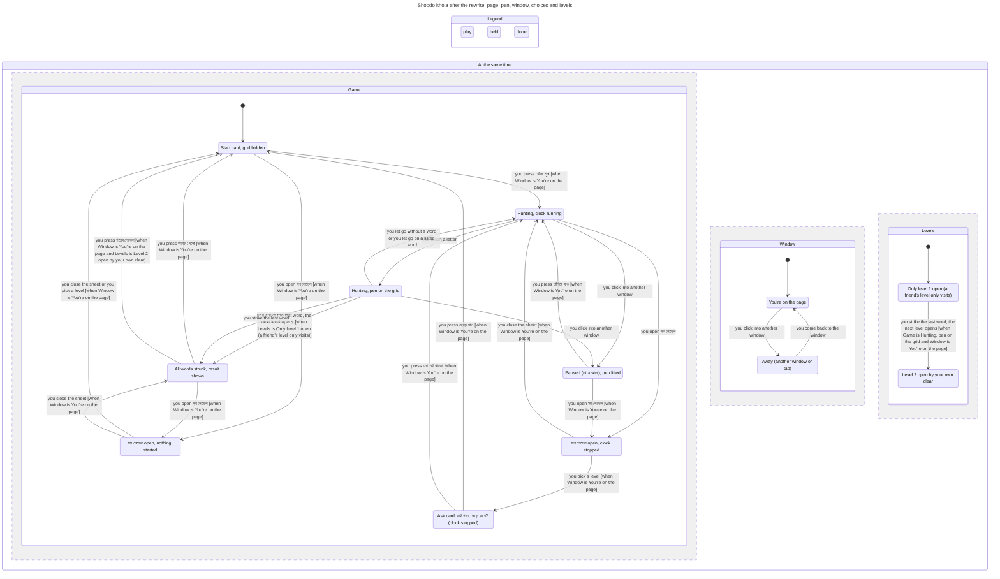

# শব্দ খোঁজা: statechart

## After the rewrite (`after-fix/`)
The spec `ShobdoKhoja.tla` now mirrors the rewritten game:
- `components/shobdo-game.tsx`, the handlers and effects;
- `lib/session.ts`, the phase and clock reducer;
- `lib/save.ts`, your own unlock;
- `lib/game.ts`, the strokes.

It runs twice:
- **Full check:** 3 levels, with a hidden tab modelled apart from a blur (N = 3, Full = TRUE). TLC reached 1,590 states (`after-fix/report-full.md`).
- **Chart run:** N = 2 and Full = FALSE, to fit the chart budget. TLC reached 390 states, and the chart has 12 states and 23 arrows (`after-fix/report.md`, `after-fix/chart.mmd`). Full = FALSE merges a hidden tab into a blur, since both go through `pauseFor("away")`. The chart hides two kinds of step:
  - the friend's link, which can come from any state, like a reset;
  - the pen moving, which stays inside one chart state.

**All 12 rules hold in both runs, and so does NoDeadlock.** A mutation check put two old behaviours back into a copy of the spec: blur that doesn't pause, and a level pick that wipes the page at once. NoProgressWhileAway, PausedWhenBlurred, InputReleasedWhenAway and NoWipeWithoutAsking then broke, so none of them is vacuous.

| Rule | In plain words | Before | After |
|---|---|---|---|
| NoProgressWhileAway | The clock only runs while you're on the page. | breaks | holds |
| PausedWhenHidden | Hiding the tab mid-hunt pauses the page. | holds | holds |
| PausedWhenBlurred (new) | Clicking into another window pauses the page. | (not modelled) | holds |
| InputReleasedWhenAway | After you leave, no finger counts as on the grid. | breaks | holds |
| NoStrokeUnderThePauseCard | Whenever the clock is stopped, no stroke is in flight, so nothing can be struck. | breaks | holds |
| ChoiceFreezesPlay (new) | While সব লেভেল or the ask card is open, the clock is stopped. | (not modelled) | holds |
| NoWipeWithoutAsking (new) | No choice inside the game throws away a started page without a yes on the ask card. | (not modelled) | holds |
| ChimesOnlyOnTheResult | The fanfare plays only on the result; a new page cuts it. | holds | holds |
| ResultMatchesPlay | The result shows exactly when every word is struck. | holds | holds |
| UnlockOnlyByClearing | A level opens for good only when you clear the one before it. | breaks | holds |
| LevelIsOpen (new) | The level on the board is open by your own play, or it's the friend's level you're visiting. | (not modelled) | holds |



### The bugs, fixed, with their tests (`tools/shobdo-khoja/tests/rewrite.test.ts`)
1. **NoStrokeUnderThePauseCard:**
   - every pause (blur, hidden tab, the player's menu, the sheet) goes through `pauseFor`, which calls `cancelPress()` first;
   - `letGo`, `tap`, `hint`, `onPointerDown`, `onPointerMove` and `onPointerUp` each check `session.canMove()`. A move with the clock stopped ends the stroke.

   Live in Orca (phone emulation, 412 px): pointer down on the grid, window `blur`, then a 3 s wait. The pointer then moved across a row and let go. The count stayed at ১/৩, the trail was hidden, the phase read `paused`, and the paper cover and the player's menu were both up. Test: *bug 1 · NoStrokeUnderThePauseCard*.
2. **NoProgressWhileAway:** the game pauses itself on window `blur` and on a hidden tab, and also through the player's `onPause`. Live: the clock read ০:০৯ at the blur and still ০:০৯ 3 s later. Test: *bug 2 · NoProgressWhileAway*.
3. **InputReleasedWhenAway:** the same `pauseFor` → `cancelPress()`. Pointer cancel and lost capture also end the stroke. The live replay is the one in bug 1. Test: *bug 3 · InputReleasedWhenAway*.
4. **UnlockOnlyByClearing:**
   - your own unlock lives in `ektukhani-shobdo-khoja-open`. It is written once from the old rules (the new stars by `unlockedLevel`, plus the old 24-level ladder by `migrateOld`);
   - after that it rises only by `openAfter(open, cleared)`. A friend's level is open for that visit only (`canPick`);
   - `unlockedLevel` itself is unchanged.

   Tests: *bug 4 · UnlockOnlyByClearing*, and *the old 24-level ladder migrates once*.
- **Quality-bar gaps closed:**
  - **Pause:** the player's menu, Esc, the ⏸ button, P (`requestPause`), blur and hide.
  - **First screen:** a start card with one big stamp. The grid stays hidden until it is pressed.
  - **Choices:** pack, difficulty, level and নতুন গ্রিড ask before wiping a started page (*choices* test). The ask card is numbered ১/২, with staying as the default.
  - **Star target:** shown during play, as the ★★★ track, a meter and "★★★ ০:৪৫ পর্যন্ত".
  - **Pacing:** 8 worlds × 4 levels, one new thing each, with a named finale per world (*ladder* tests and bot rates).
  - **HUD:** the word list sits right under the board and fits a Pixel 9 with no scroll (tools end at 703 of an 873 px stage).
  - **Sound:** a found word sings an arpeggio in its world's key. The fanfare goes on the audio clock, and `load()` calls `silenceScheduled()`, so it never rings over the next page.
  - **Keys:** result keys need a fresh press 400 ms after the result shows. Clicked buttons drop focus.

Screenshots: `.shots/shobdo-khoja-phone-play.png`, `.shots/shobdo-khoja-finale-start.png`, `.shots/shobdo-khoja-finale-result.png`, `.shots/shobdo-khoja-clue.png`, `.shots/shobdo-khoja-desktop.png`, `.shots/shobdo-khoja-320-play.png`.

## Regenerate
```sh
# chart run (N = 2, Full = FALSE, as in ShobdoKhoja.cfg)
scripts/statechart.sh ai_docs/statecharts/shobdo-khoja/ShobdoKhoja.tla --view ai_docs/statecharts/shobdo-khoja/view.ts --out ai_docs/statecharts/shobdo-khoja/after-fix
rm ai_docs/statecharts/shobdo-khoja/after-fix/tlc.out
# full check: the same spec with CONSTANTS W = 2 N = 3 Full = TRUE, its report saved as after-fix/report-full.md
```

## Before the rewrite (`before-fix/`)
The old spec modelled `word-search.tsx`: 471 states, 4 rules held and 4 broke, and all 4 bugs reproduced live.

### Systems modelled
- **Play phase:** ready → playing → paused → over. The clock runs exactly while the phase is `playing` (`startClock` and `stopClock`).
- **Tab and window:** the `visibilitychange` handler `hide`. It pauses only from `playing`. The game has **no blur listener**.
- **The finger on the grid:** `press.current` can be none, down on a letter, or dragging a stroke, through `onPointerDown`, `onPointerMove`, `onPointerUp` and `onPointerCancel`. Only `onPointerDown` checks the phase. `attempt()` checks nothing.
- **Time:** the fanfare `setTimeout` in `finish()`. `begin()` clears it.
- **Levels:** stars per level, the stored unlock (`unlockedLevel`), and the picker bound `Math.max(levels.unlocked, friend.stage)`. Also পরের লেভেল, আবার খেলো, picking a level, and a friend's level link (`readFriend`).

The model uses 2 words instead of 6 and 2 levels instead of 24. It leaves out free grids, hints and the first-load jump to the furthest level. The chart hides one step, "the fanfare plays", because it changes nothing the player sees in the regions.

### Rules in plain words
| Rule | Plain words | Result |
|---|---|---|
| NoProgressWhileAway | The clock only runs while you're on the page. | **breaks** |
| PausedWhenHidden | Hiding the tab mid-hunt pauses the round. | holds |
| InputReleasedWhenAway | After you leave the page, no finger counts as on the grid. | **breaks** |
| NoStrokeUnderThePauseCard | While the pause card shows, no stroke is in flight, so no word can be struck. | **breaks** |
| FanfareOnlyOnTheResult | The fanfare only plays on the result it celebrates. | holds |
| ResultMatchesPlay | The result shows exactly when every word is struck. | holds |
| UnlockOnlyByClearing | A level opens for good only when you clear the one before it. | **breaks** |
| NoDeadlock | There's always a next step. | holds |

### Bugs

#### 1. NoStrokeUnderThePauseCard: a word gets struck under the pause card (game)
- **What the player sees:** "I hid the tab mid-stroke. When I came back and finished the stroke, a word got struck while the pause card still showed."
- **Path (report):**
  0. The grid is waiting.
  1. You touch a letter.
  2. You hide the tab.

  After that, dragging and letting go calls `attempt()` with no phase check.
- **Live replay:** done in headless Chrome over CDP. Orca pins `document.hidden` to `false` with a native, non-configurable getter on every document, iframes included, so a page in Orca can't be made to see a hidden tab.
  - Pointer down on পলাশ's first cell (28): the phase goes to `playing` and the clock reads ০:০২.
  - The tab hides: the phase goes to `paused` and the clock stays at ০:০২. The tab shows again and the pause card reads "থেমে আছে, ঘড়িও থেমে আছে।".
  - Pointer moves to cells 36 and 44, then pointer up. The count goes from ১ to ২, পলাশ is marked found and the status says "পেয়েছ: পলাশ! আর ৪টা।". The phase is still `paused` and the clock still reads ০:০২.
  - If that stroke had been the last word, the round would have ended under the pause card.
- **Fix:**
  - On hide (and on blur, see bug 2), run `onPointerCancel()` and set `firstTap` to −1.
  - Guard `onPointerMove`, `onPointerUp`, `tap()` and `attempt()` with `phaseRef.current === "playing" || phaseRef.current === "ready"`.
  - Add a node test of `attempt` while paused, and repeat the replay in Orca with blur.

#### 2. NoProgressWhileAway: the clock runs while another window has focus (shared)
- **What the player sees:** "I clicked into another window and the clock kept counting my time."
- **Path:**
  0. The grid is waiting.
  1. You touch a letter.
  2. You click into another window.
- **Live replay (Orca):** start the round, then dispatch `blur` on the window. The clock reads ০:০২ at the blur and ০:০৭ after 5 s away. No pause card appears and the phase stays `playing`.
- **Fix:** treat window `blur` like hiding the tab: `stopClock()`, `setPhase("paused")` and release the press. Do this in one shared away-handler so every game gets it (see the shared fixes in the carrom and পাটি বুনি READMEs). Note that the game has no pause button and no P or Esc key at all (see the gaps below).

#### 3. InputReleasedWhenAway: a press survives leaving the window (shared)
- **What the player sees:** "I pressed a letter and switched windows. When I came back, just moving the mouse drew a stroke, and letting go struck a word."
- **Path:**
  0. The grid is waiting.
  1. You touch a letter.
  2. You click into another window.
- **Live replay (Orca):**
  - Pointer down on cell 28, then window `blur`, then window `focus`.
  - Pointer moves to cells 36 and 44 with no new press. The trail capsule is drawn.
  - Pointer up: পলাশ is struck and the count goes from ১ to ২.
- **Fix:** the same as bug 1. The blur handler calls `onPointerCancel()`.

#### 4. UnlockOnlyByClearing: a friend's link opens every level below it, for good (shared with carrom)
- **What the player sees:** "My friend's level-20 link opened levels 2 to 20 in my picker. I cleared level 12 and now 13 levels stay open, though I never played level 1."
- **Path (7 steps):**
  1. You open a friend's level-2 link.
  2. You touch, drag and let go on a word.
  3. You touch, drag and strike the last word of level 2.

  The saved stars become {2} and the stored unlock is level 2, with level 1 never cleared.
- **Live replay (Orca):**
  - Clear storage and open `/shobdo-khoja#s=4242&t=120&p=phol&l=1&h=0&v=20&n=রাফি`.
  - The board shows "লেভেল ২০ · ফল, কঠিন" and 20 level buttons are enabled.
  - Pick level 12 and solve it (★★★, ০:০২). The `ektukhani-levels-shobdo-khoja` key now holds `{"12":3}`.
  - Reload without the link. The game opens on "লেভেল ১৩ · পাখি, কঠিন" with 13 levels enabled.
- **Fix:**
  - Only the friend's own level should open, not every level below it. Pass the friend's level to `LevelGrid` as one extra open level.
  - A level above `unlocked` shouldn't raise the stored unlock. Either keep its stars but derive `unlocked` from the run of cleared levels starting at 1, or don't record stars above `unlocked + 1`.
  - Best done once in `shared/game-core.ts` or `LevelGrid`, since carrom has the same bug.

### Quality-bar gaps (played end to end in Orca, with screenshots from headless Chrome)
1. **Pause:** there's no pause button and no P or Esc key. The round pauses only when the tab hides, never on blur. The bar asks for P, Esc, a button, hide and blur, plus a real pause menu.
2. **First screen:**
   - The H1, the lead and two rows of chips (8 packs, then সহজ/কঠিন) sit above the grid. The pack row is cut off at the phone's edge (খেলা is half hidden).
   - The start action is "touch the grid". No big start control exists, and nothing marks the first move beyond the status line.
3. **Choices reset without asking:** a pack chip, a difficulty chip, নতুন গ্রিড or the level picker wipes the round in progress at once. They aren't numbered, and none shows what it changes in one line. সহজ/কঠিন never says "উল্টো দিকেও লুকানো" by the chip itself.
4. **No star target while playing:** the clock shows the time, but the 1, 2 and 3-star cut-offs only appear after the round (`nearLine`). Carrom shows its goal chip during play; this game should too.
5. **Pacing:** the 24 levels are 3 passes over the same 8 packs. Nothing new arrives per level beyond reversed words in pass 2 and a tighter clock in pass 3. There's no named finale for a pass.
6. **HUD:** the word list sits under the grid. On a phone it's partly below the fold during the hunt, so you scroll to see what's left.
7. **Sound:** tap, pen scratch, good, rising combo, wrong and the end fanfare, all synthesized. There's no signature sound for a word strike beyond the shared `good`. The fanfare timer fires even if the tab was hidden right after the finish.
8. **Ending:** this meets the bar. You get stars, the time, the exact gap to the next star, the best on this phone, a card with your strokes, and a link that replays the same grid.

Screenshots:
- `.shots/shobdo-khoja-first.png`: the first screen in Orca on a Pixel 9.
- `.shots/shobdo-khoja-result.png`: the tutorial grid solved, with the stars on the result.
- `.shots/shobdo-khoja-card.png`: the card and the share area.

