# সমান ভাগ: statechart

The game was rewritten on 2026-11-05 (design: `ai_docs/game-dev/rewrites/shoman-bhag.md`). `before-fix/` keeps the run on the old code and the old spec (`before-fix/ShomanBhag.tla`, `.cfg`, `view.ts`, `report.md`: 3 rules held and 5 broke). `after-fix/` is the run on the rewritten code.

| Spec | What it covers | Mirrors | TLC |
|---|---|---|---|
| `ShomanBhag.tla` / `.cfg`, view `view.ts` | the screens (mat, level list, the guests, the end screen), the piece in the child's hand, the ➜ that brings the next guests, stars saved at the last piece, the player's pause, a blur before the menu, a key held through the last serving, the daily limit and the rest screen | `tools/shoman-bhag/lib/round.ts`, `lib/session.ts`, `components/game.tsx` (`play`, `goNext`, `letGo`, `useGamePlayer`), `shared/kids-kit.tsx` | 456 states, 2433 steps, 16 chart states |

The parent gate is the same `<ParentGate>` as in abc-bazar, whose model (`ai_docs/statecharts/abc-bazar/AbcBazarGates.tla`) proves it. Here its rules are node tests: the share link sits only inside the gate, and an open gate shuts on the next touch outside it.

**Every rule holds** (`after-fix/report.md`). The chart is `after-fix/chart.mmd`, drawn below.
- **Model check (mutations, in a scratch copy):** putting the old behaviour back breaks the rule at once. Adding the old 1.7 s timer ("the next guests sit down by themselves") breaks **NoProgressWhileAway** in 5 steps. Keeping the piece in the hand when the window blurs breaks **PieceGoesBackWhenAway** in 3.

## Rules after the fix (plain words)
| Rule | In plain words |
|---|---|
| NoProgressWhileAway (property) | A served table, and the next guests, wait for you while you are away or the menu is open. |
| NextGuestsOnlyByTheArrow (property) | The next guests, and the end screen, come only from the child's ➜. Nothing moves on by itself. |
| PieceGoesBackWhenAway | A piece never stays in the hand while the window is away or the menu is open. |
| RestOnlyAtBreak | The rest screen never covers a serving; if the limit passes on the last piece it waits for the end screen. |
| NoNewRoundPastLimit | Past today's limit, a round does not start: the rest screen shows instead. |
| EveryFinishCounts | Once the last serving is complete, its stars are saved and the limit checked, at that touch. |
| ResultMatchesPlay, StarsNeverDrop | The end screen's stars are this round's; a worse round never lowers the saved best. |
| NothingMovesUnderTheMenu | A touch under the pause menu does nothing. |
| WakeTapIsNotAMove | The touch that brings focus back never lifts, drops or gives a piece, and never presses the ➜. |
| ChoiceFreezesPlay | The level list is a choice screen: no serving waits under it. |
| ResultNeedsFreshPress | A key held through the last serving never skips the end screen or starts the next round. |
| TypeOK, NoDeadlock | |

**Rules replaced or moved to node tests.**
- **SilentWhenMuted** is gone because there is no voice at all: `tests/shoman-bhag.test.ts` › "bug 1" asserts that no file mentions `speak(`, `SpeakButton` or `speechSynthesis`, and that `lib/sound.ts` only uses the kit and no loops.
- **NoNetwork, NoChildData, ParentGate** are node tests (no `fetch`, no `<input>`, only `ektukhani-levels-shoman-bhag` is written, the share link sits inside `<ParentGate>`).
- **NoReadingNeeded** is a node test: every `<button>` on the board, the end screen, the title and the list carries a picture; the three last-piece choices are drawings; the end buttons are 112 px, the ➜ 104 px.

## The bugs, and how each was fixed
| # | Bug (the reader's sentence) | Fix | Node test | Live check (Orca) |
|---|---|---|---|---|
| 1 | **SilentWhenMuted:** "I turned the sound off and the phone still said 'অর্ধেক' out loud." | No voice anywhere: `speak()` calls and `SpeakButton` removed. Every cue is a picture, a motion or a sound effect. | `shoman-bhag.test.ts` › bug 1 | Source scan. With sound off nothing in the game calls the voice API. |
| 2 | **NoProgressWhileAway:** "I gave the last মোয়া to everyone and looked away. When I came back, the happy faces were gone and new guests were waiting." | The 1.7 s / 2.8 s timer is gone. A served table waits for the ➜ for as long as you like; the player's pause freezes everything else. | `session.test.ts` › bug 2; › "the round never advances by itself" | Served the first table, dispatched `blur`, waited 3.2 s: still serving 1, stage done, faces `happy,happy`, pause menu open. After `focus` nothing had moved. |
| 3 | **RestOnlyAtBreak:** "The rest screen was up, but new guests had come to the table behind it." | Kit: `RestScreen` is a real modal (shared). Game: `begin()` asks `kids.atBreak()` first, the last piece asks it too, and nothing starts under the rest screen. | `session.test.ts` › bug 3; › every finish counts | Covered by the kit and the model. |
| 4 | **ParentGate:** "The share button stayed out after Ammu gave the phone back." | Kit: the sum, one action, 20 s, hide. Game: the gate shuts on the next touch outside it (`gateKey` bump) and is unmounted when a round starts. | `session.test.ts` › bug 4 | Gate model: `abc-bazar/AbcBazarGates.tla`. |
| 5 | **NoReadingNeeded:** "Who gets the last one? I can't read the three buttons." | Three drawings: a piece broken over three plates, the little guest with the piece, a covered dish with a heart. End buttons are a circular arrow and a house, 112 px. The ➜ is a 104 px picture. | `shoman-bhag.test.ts` › bug 5 | `.shots/shoman-bhag-ph-left.png`, `.shots/shoman-bhag-ph-n4.png`, `.shots/shoman-bhag-end1.png`. |
| — | **Servings move on by themselves** (gap 3) | The ➜ after every serving; faces cheer in a stagger meanwhile. | `session.test.ts` › the round never advances by itself | `.shots/shoman-bhag-ph-served.png` |
| — | **Hints are text only** (gap 5) | The surprised face, the glowing extra piece and an arrow out of the plate; a row of heads over pieces for a wrong cut; numbered wedges for a wrong name; ≠ on an unequal roti. | `levels.test.ts` › sharing, cutting, naming | `.shots/shoman-bhag-ph-over.png`, `-ph-cutwhy.png`, `-ph-name.png` |
| — | **No pause** (gap 4) | `useGamePlayer({ onPause, onResume, onRestart, onLevels })`; blur and hide pause through the player; a held piece goes back. | `session.test.ts` › pause; › a held piece is returned | Lifted a piece by tap: `hand: basket`; `blur` → `hand: null`, menu open. A drag in flight: `blur` → `hand: null`, the floater hidden, a `pointerup` afterwards did nothing. |
| — | **The first touch back is not a move** | `session.blur` arms a swallow; the next touch only wakes the game, unless the player's menu took it. | `session.test.ts` › pause | — |
| — | **Result keys need a fresh press; Enter goes to the game** | Keys at `window` with `preventDefault`; buttons blur after a pointer press. | `session.test.ts` › result keys; › Enter and Space | — |

## Regenerate
```sh
scripts/statechart.sh ai_docs/statecharts/shoman-bhag/ShomanBhag.tla --view ai_docs/statecharts/shoman-bhag/view.ts --out ai_docs/statecharts/shoman-bhag/after-fix
rm -f ai_docs/statecharts/shoman-bhag/after-fix/tlc*.out
```

## The chart (after the fix)

```mermaid
---
title: "সমfl°°2494¶ßন ভfl°°2494¶ßগ: screens, the piece in hand, the fl°°10140¶ß, pause, the daily limit and keys"
---
stateDiagram-v2
  direction LR
  state "Legend" as legend {
    lg0: play
    lg1: held
  }
  class lg0 teal
  class lg1 yellow
  state "At the same time" as all {
    state "Round" as r0 {
      s0: The mat (খ#2503;ল#2507;)
      s1: The level list
      s2: First guests
      s3: First guests: a piece in the hand
      s4: Table served, every face smiling, waiting for #10140;
      s5: Last guests
      s6: Last guests: a piece in the hand
      s7: Last table served, stars saved, waiting for #10140;
      s8: The end screen (আব#2494;র খ#2503;ল#2507; / শ#2503;ষ)
      [*] --> s0
      s0 --> s1: the child opens the level list [when Menu is Playing and Today is not Rest screen]
      s0 --> s2: the child taps the mat or আব#2494;র খ#2503;ল#2507; [when Menu is Playing and Today is Time left today]
      s1 --> s0: the page opens again
      s1 --> s0: the child goes back from the list [when Menu is Playing and Today is not Rest screen]
      s1 --> s2: the child picks a level [when Menu is Playing and Today is Time left today]
      s2 --> s0: the page opens again
      s2 --> s3: the child lifts a piece [when Menu is Playing]
      s1 --> s0: the child picks a level [when Menu is Playing and Today is Today's time is up]
      s1 --> s0: নত#2497;ন কর#2503; শ#2497;র#2497;, or শ#2503;ষ [when Menu is Pause menu open, nothing moves]
      s2 --> s0: নত#2497;ন কর#2503; শ#2497;র#2497;, or শ#2503;ষ [when Menu is Pause menu open, nothing moves]
      s2 --> s1: সব ল#2503;ভ#2503;ল in the pause menu [when Menu is Pause menu open, nothing moves]
      s3 --> s0: the page opens again
      s3 --> s2: the child puts it on a plate that is still short or the window blurs before the menu opens or #9208; / P / Esc, or the window blurs and the menu opens or the child puts it on a plate with its share already
      s3 --> s4: the child gives the last piece, everyone is equal
      s4 --> s0: the page opens again
      s4 --> s5: the child presses #10140; [when Menu is Playing]
      s5 --> s0: the page opens again
      s5 --> s6: the child lifts a piece [when Menu is Playing]
      s4 --> s0: নত#2497;ন কর#2503; শ#2497;র#2497;, or শ#2503;ষ [when Menu is Pause menu open, nothing moves]
      s4 --> s1: সব ল#2503;ভ#2503;ল in the pause menu [when Menu is Pause menu open, nothing moves]
      s5 --> s0: নত#2497;ন কর#2503; শ#2497;র#2497;, or শ#2503;ষ [when Menu is Pause menu open, nothing moves]
      s5 --> s1: সব ল#2503;ভ#2503;ল in the pause menu [when Menu is Pause menu open, nothing moves]
      s6 --> s0: the page opens again
      s6 --> s5: the child puts it on a plate that is still short or the window blurs before the menu opens or #9208; / P / Esc, or the window blurs and the menu opens or the child puts it on a plate with its share already
      s6 --> s7: the child gives the last piece, everyone is equal
      s7 --> s0: the page opens again
      s7 --> s8: the child presses #10140; [when Menu is Playing]
      s8 --> s0: the page opens again
      s8 --> s2: the child taps the mat or আব#2494;র খ#2503;ল#2507; [when Menu is Playing and Today is Time left today]
      s8 --> s1: the child opens the level list [when Menu is Playing and Today is not Rest screen]
      s8 --> s0: নত#2497;ন কর#2503; শ#2497;র#2497;, or শ#2503;ষ [when Menu is Pause menu open, nothing moves or Today is one of Time left today, Today's time is up]
      s7 --> s1: সব ল#2503;ভ#2503;ল in the pause menu [when Menu is Pause menu open, nothing moves]
      s7 --> s0: নত#2497;ন কর#2503; শ#2497;র#2497;, or শ#2503;ষ [when Menu is Pause menu open, nothing moves]
    }
    --
    state "Menu" as r1 {
      s9: Playing
      s10: Pause menu open, nothing moves
      s11: Back from away, the next touch only wakes
      [*] --> s9
      s9 --> s10: #9208; / P / Esc, or the window blurs and the menu opens
      s9 --> s11: the window blurs before the menu opens [when Round is none of The end screen (আব#2494;র খ#2503;ল#2507; / শ#2503;ষ), The level list, The mat (খ#2503;ল#2507;) and Today is not Rest screen]
      s10 --> s9: the page opens again or নত#2497;ন কর#2503; শ#2497;র#2497;, or শ#2503;ষ or চ#2494;ল#2495;য#2492;#2503; য#2494;ও
      s11 --> s9: the page opens again
      s11 --> s9: the child lifts a piece [when Round is one of First guests, Last guests and Today is not Time's up, the rest waits for the end screen]
      s11 --> s10: #9208; / P / Esc, or the window blurs and the menu opens
      s10 --> s9: সব ল#2503;ভ#2503;ল in the pause menu [when Round is none of The end screen (আব#2494;র খ#2503;ল#2507; / শ#2503;ষ), The level list, The mat (খ#2503;ল#2507;) and Today is not Rest screen]
      s11 --> s9: the child presses #10140; [when Round is one of Last table served, stars saved, waiting for #10140;, Table served, every face smiling, waiting for #10140;]
    }
    --
    state "Today" as r2 {
      s12: Time left today
      s13: Rest screen
      s14: Today's time is up
      s15: Time's up, the rest waits for the end screen
      [*] --> s12
      [*] --> s13
      s12 --> s14: today's play time runs out
      s13 --> s12: a grown-up gives আজ আরও ১০ ম#2495;ন#2495;ট
      s14 --> s13: the page opens again
      s14 --> s13: the child taps the mat or আব#2494;র খ#2503;ল#2507; [when Round is one of The end screen (আব#2494;র খ#2503;ল#2507; / শ#2503;ষ), The mat (খ#2503;ল#2507;) and Menu is Playing]
      s14 --> s13: the child picks a level [when Round is The level list and Menu is Playing]
      s14 --> s15: the child gives the last piece, everyone is equal [when Round is Last guests: a piece in the hand and Menu is Playing]
      s15 --> s13: the page opens again
      s15 --> s13: the child presses #10140; [when Menu is Playing]
      s15 --> s13: সব ল#2503;ভ#2503;ল in the pause menu or নত#2497;ন কর#2503; শ#2497;র#2497;, or শ#2503;ষ [when Menu is Pause menu open, nothing moves]
    }
  }
  class s2 teal
  class s3 teal
  class s4 teal
  class s5 teal
  class s6 teal
  class s7 teal
  class s11 teal
  class s13 yellow
  class s15 teal
```

