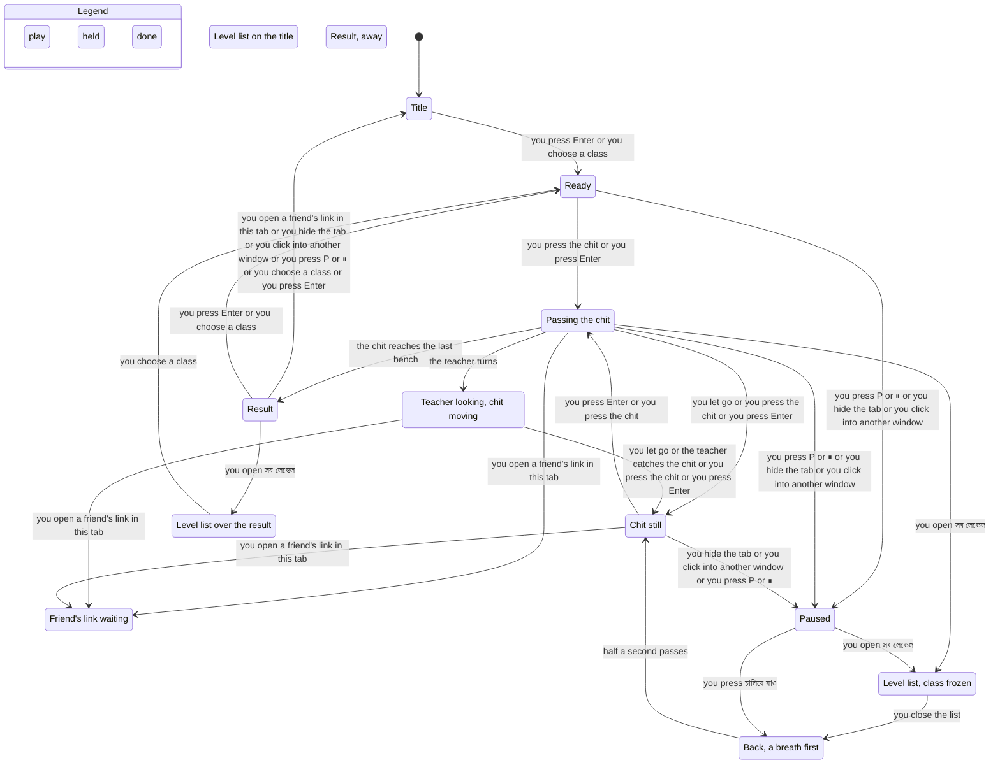

# স্যার ঘুরলেই থামো: statechart

Two runs of the same model. `before-fix/` is the old game: six of nine rules broke. `after-fix/` is the rewrite: all 13 rules hold (TLC reached 376 states and 2,284 steps).

- Model: `Chit.tla` with `Chit.cfg` and `view.ts` (the rewrite). The old spec is kept in `before-fix/`.
- It mirrors `tools/sir-ghurlei-thamo/lib/session.ts`, `lib/step.hot.ts` and `components/class-game.tsx`, with `useGamePlayer` from `shared/game-player-client.tsx`.
- Charts: `before-fix/chart.mmd` (12 states, 22 arrows) and `after-fix/chart.mmd` (13 states, 22 arrows).

## After the rewrite



The chart hides the arrows that repeat ones already drawn: the window and tab coming back, the teacher turning back, the star chimes ending, one-tap against hold mode, and the sound switch.

### Systems modelled
- **Screens:** title, class (ready, playing), result. The story's panels are left out (one screen with no rules).
- **The player's menu and the level list:** both freeze play. The menu opens on P, ⏸, Escape, blur and hide. The list opens from the menu's সব লেভেল, the title or the result.
- **Focus:** tab visible or hidden, window focused or blurred, and the 0.5 s breath after coming back.
- **The teacher:** at the board or facing the class. A held chit under a look is caught: the scolding, then back to the board. In one-tap mode the catch lets go of the chit. (The second watcher, the lights, the sleepers, the glasses and the duster are more routines on this track; their rules are replayed in `tests/game.test.ts`.)
- **Input:** Enter (and its auto-repeat), a pointer press on the chit, hold mode against one-tap mode.
- **Sound:** the hum is set from the state after every event (`syncHum`), so it is a fresh loop each time. The site-wide switch sits in the player's menu.
- **Time:** the star chimes scheduled at the result. There is no timer left to outlive the class: `silenceScheduled()` runs on every new class, on the player's pause, on a friend's link and on unmount.
- **Links:** a friend's link pasted into this tab (hashchange).

### Rules (all hold in `after-fix/`)
| Rule | In plain words | Test that replays it |
|---|---|---|
| PausedWhenHidden | Hide the tab mid-class and the class pauses. | `session.test.ts` "hide, the player's menu and the level list…" |
| PausedWhenBlurred | Click into another window mid-class and the class pauses. | "statechart PausedWhenBlurred…" |
| InputReleasedWhenAway | Once you leave the page, open the menu or the list, the chit isn't held (one-tap too). | "statechart InputReleasedWhenAway…" |
| ClickThatBringsFocusBackIsNotAMove | The press that brings focus back is ignored; the class waits for a fresh press. | "the click that brings focus back is not a move" |
| ChoiceFreezesPlay | While the menu or the level list is open, nothing in the class advances. | "hide, the player's menu and the level list…" |
| LoopOnlyWhenMeaningful | The hum plays only in a running class with sound on. | "statechart LoopOnlyWhenMeaningful / LoopComesBack…" |
| LoopComesBack | In a running class with sound on, the hum is there, and turning sound back on restores it. | same |
| ResultStaysUntilYouChoose | A held Enter never leaves the result; only a fresh press or a button does. | "statechart ResultStaysUntilYouChoose…" |
| NoDoubleResult | A class ends once. | `game.test.ts` "the chit stops at the last bench…" |
| CelebrationOnlyOnResult | The star chimes and the confetti belong to the result, never the next class. | "statechart CelebrationOnlyOnResult…" |
| FriendLinkOpensTheirClass | A friend's link never sits unopened: a running class gets it at the next pause, blur, hide, list or new class. | "statechart FriendLinkOpensTheirClass…" |
| OneNewClassAtATime | On the title there is no link waiting. | (model only) |

Mutation check: breaking the spec the way the old code was broken makes TLC report the rule. Sound-on that doesn't restart the hum breaks LoopComesBack; blur that doesn't pause breaks PausedWhenBlurred; one-tap blur that keeps the hold breaks InputReleasedWhenAway.

### Bugs the model found in the first rewrite draft
- **FriendLinkOpensTheirClass (game):** a link that arrived mid-class waited for a pause, but opening the level list (which freezes play without the player's pause) left it waiting, and picking a level from that list then showed the old list over the friend's title. Fixed: the list takes a waiting link when it opens, and `begin()` closes the list before it opens the link.
- **CelebrationOnlyOnResult (game):** opening a friend's class from the result left the star chimes queued. Fixed: `takeLink` calls `silenceScheduled()`.

## Bugs in the old game, and how each is replayed now
## Bugs

### 1. PausedWhenBlurred: "I looked at another window and the clock kept counting; in one-tap mode the teacher caught my chit" (shared)
- **Path:** (0) ready → (1) you press Enter: passing the chit → (2) you click into another window: the clock runs while you're away. The one-tap path (InputReleasedWhenAway) is (0) ready → (1) you switch to one-tap → (2) you press Enter → (3) you click into another window: the chit is still moving while you're away.
- **Why:** the `blur` handler only lets go of the chit, and only in hold mode. Nothing pauses. `useGameLoop` keeps stepping, so `game.time` (your score) and the teacher's routine both go on. In one-tap mode the chit stays held, so it keeps moving into the teacher's look.
- **Live replay, hold mode:** hold Enter for 0.6 s: clock `০.৬`, status `write`. Window `blur`: the chit is let go (`held=false`) but there's no pause. 3 s later the clock reads `৩.৬` and the teacher has moved on to `tell`.
- **Live replay, one-tap mode:** tap Enter once (clock `০.৩`, held). Window `blur`. While away the chit went bench 1 → 2 (1.0 s) → 3 (2.4 s) → 4 (3.8 s). The teacher turned (`tell`, 3.4 s), looked (`look`, 4.4 s) and caught it at 4.8 s (`scold`, the stage shook). It slid back to bench 3.
- **Fix:** pause on blur in a running class. Let go in both modes (one-tap comes back "stopped"), and resume only from চালিয়ে যাও. This is the shared blur fix. The game also needs a pause control (see gaps).

### 2. ResultStaysUntilYouChoose: "I held Enter to the last bench and the result vanished into the next class" (shared)
- **Path:** (0) ready → (1) you press Enter: passing → (2) the chit reaches the last bench: the result → (3) the held key repeats: the result is skipped.
- **Why:** during play the keydown handler ignores `event.repeat`. On the result, though, `if (event.key === "Enter") again(nextLevel || level)` runs before that check, so the first auto-repeat of a held Enter calls `again()`.
- **Live replay:** an in-page autopilot held Enter while the teacher wrote and let go on `tell` or `look`. Class 1 was cleared at 14.87 s (`ক্লাস ১ পার! ★★★ ১৩.৯ সেকেন্ড`, Enter still held). The next repeat 21 ms later left the result. The page now showed `ক্লাস ২ · মাঝে মাঝে কাশি`, status `ready`.
- **Fix:** on the result, act only on a fresh keydown (`!event.repeat`) made after the result appeared, with a short guard. This is the shared result guard.

### 3. CelebrationOnlyOnResult: "Confetti fell on the next class's blackboard" (shared)
- **Path:** the same as bug 2 (the shortest path), or the result → you press পরের ক্লাস within about 1 s.
- **Why:** `finish()` calls `window.setTimeout(...)` and never keeps the id. `reset()` doesn't clear it, and neither does unmount.
- **Live replay:** in the run above, the confetti canvas was added at 15.89 s. That is 1.0 s after the result appeared (300 + 3 × 260 ms) and 1.0 s after class 2 had opened, so it fell on the ready screen (status `ready`), not on the result.
- **Fix:** keep the timer id. Clear it in `reset()` and on unmount, as ডাংগুলি does with `timers.current`. This is the shared `later()` helper.

### 4. LoopComesBack: "I turned the sound back on and the chit went quiet" (game)
- **Path:** (0) ready → (1) you turn sound off → (2) you switch to one-tap → (3) you press Enter → (4) you let go → (5) you turn sound on: the chit moves in silence. Another path: tap with sound on, then turn sound off and on again.
- **Why:** `SoundToggle onChange={stopHum}` drops the hum when sound goes on as well as off. The hum is made again only inside `press()` (`ear.current.hum ??= loop(...)`), so a chit already moving stays silent. In one-tap mode the next press stops the chit.
- **Live replay (sawtooth oscillators counted):** one-tap, tap Enter: chit moving, 1 hum playing. Sound off: 0. Sound on: 0. 1.5 s later the chit is on bench 2, status `write`, held, sound on, still 0 hums.
- **Fix:** `<SoundToggle onChange={on => { stopHum(); if (on && holding.current && phase === "playing") ear.current.hum = loop("hum", 150); }} />`, or start the hum from `listen()` when it's missing and sound is on.

### 5. FriendLinkOpensTheirClass: "I opened my friend's link and nothing changed" (game)
- **Path:** (0) ready → (1) you open a friend's link in this tab: the link is ignored.
- **Why:** the link is read once, in the mount effect (`parseShared(window.location.hash)`). Nothing listens for `hashchange`. Pasting a link into a tab that already has the game is a same-page navigation, so the page doesn't reload.
- **Live replay:** on `/sir-ghurlei-thamo` (class 1), set the hash to `#s=777&t=300&c=0&n=rafi`. 0.8 s later there was no banner and the page still showed `ক্লাস ১ · ধীরে ধীরে লেখা`. After a reload the banner appeared (`rafi ৩০.০ সেকেন্ডে…`) on `ক্লাস ৫ · রোজকার ক্লাস`.
- **Fix:** listen for `hashchange` like ডাংগুলি and দেরি হয়ে গেল do. Ignore in-page anchors (`#result`), and don't take over a class that's under way.

### Live replays after the fix (Orca, Pixel 9 emulation, a virtual frame clock because Orca stops animation frames in a background tab)
1. **PausedWhenBlurred:** a blur mid-class opened the menu; 3 s later the clock read the same `৩.৮৭` and the teacher was on the same segment. After চালিয়ে যাও a 0.5 s breath, then the class went on from `৩.৮৭`.
2. **InputReleasedWhenAway (one-tap):** one tap, the chit at bench `0.42` after `০.৬৫` s. Blur: held false. After 8 s away: same position, same clock, same segment, 0 catches. Back in the class the chit still waited; a fresh tap moved it. (Old: bench 1 → 4, caught at 4.8 s.)
3. **ResultStaysUntilYouChoose:** on the result of level 1, five `keydown Enter` with `repeat: true` changed nothing; one fresh `Enter` opened level 2.
4. **CelebrationOnlyOnResult:** no timer is left in the component (a source check in `session.test.ts`); pressing পরের লেভেল at once starts the class with no confetti or chimes.
5. **LoopComesBack:** sawtooth starts counted: 2 with the class running. Sound off then on in the menu: still 2 (muted, no stub). চালিয়ে যাও: 3, one fresh hum, `session.hum` true, the chit moving.
6. **FriendLinkOpensTheirClass:** with a class running, the link `#s=777&t=300&c=0&l=3&v=2&n=rafi` (with the player's Back handling) opened the title for level 3 with `rafi ৩০.০ সেকেন্ডে…` and `rafi-এর নিজের ফোনের সময়`. `#result` changed nothing.
7. **Pause and levels:** P opened the menu (সব লেভেল is in it); সব লেভেল opened the list over a frozen class (clock `২.০৫` before and after 2 s); key `2` started level 2.

## Quality-bar gaps (from the play before the rewrite) and what closed them
1. **Pause:** the player's menu (P, ⏸, Escape, blur, hide) now exists and the game has no controls of its own.
2. **Leaving the result:** fresh keys only (`!event.repeat` and a keydown after the screen appeared), no confetti timer.
3. **Danger:** the classroom's edge glows orange as a turn starts (stronger as the look nears) and red while someone looks; the pass button says the same in words ("ছাড়ো!", "নড়বে না"). In ধীরে খেলো the edges are steady borders.
4. **First screen:** the folded chit is the start button; the H1 and lead live in the player's launch card, not above the HUD.
5. **Choices:** the level list is a choice screen (numbered, the next level marked, play frozen behind it). The result has numbered choices with পরের লেভেল marked এটাই ভালো.
6. **Pacing:** 12 levels, each adding exactly one thing (asserted in `levels.test.ts`), and a named finale at 4, 8 and 12.
7. **Sound:** the hum comes back; the bell, chalk, footsteps, cough, squeak, duster, snore, corridor, power cut and tube light are new, each with a visible twin.
8. **Ending:** the result counts its time up, then real stats; the card names the level.

## Regenerate
```sh
scripts/statechart.sh ai_docs/statecharts/sir-ghurlei-thamo/Chit.tla --view ai_docs/statecharts/sir-ghurlei-thamo/view.ts --out ai_docs/statecharts/sir-ghurlei-thamo/after-fix
rm -f ai_docs/statecharts/sir-ghurlei-thamo/after-fix/tlc*.out
# the old model, for comparison
scripts/statechart.sh ai_docs/statecharts/sir-ghurlei-thamo/before-fix/Chit.tla --view ai_docs/statecharts/sir-ghurlei-thamo/before-fix/view.ts --out ai_docs/statecharts/sir-ghurlei-thamo/before-fix-rerun
```
