# সৌরজগতের সফর statechart

The game was rewritten on 2026-11-05 (design: `ai_docs/game-dev/rewrites/sourojogot.md`). The model has two parts so each chart stays readable:

| Spec | What it covers | Mirrors | TLC |
|---|---|---|---|
| `Sourojogot.tla` / `.cfg`, view `view.ts` | the screens (launch picture, level list, the round, the end screen), the end timer or the ▶ button, the player's pause (including সব লেভেল), coming back from away, a key held through the last answer, the daily limit and the rest screen | `tools/sourojogot/lib/session.ts`, `components/game.tsx` (`begin`, `pick`, `nextPlanet`, `enterEnd`, `useGamePlayer`), `shared/kids-kit.tsx` (`useKidsSession`) | 162 states, 749 steps |
| `SourojogotGates.tla` / `.cfg`, view `view-gates.ts` | who has the phone, the share gate on the launch picture, the rest screen's gate | `components/game.tsx` (`<ParentGate key={gateKey}>`, the outside-touch listener), `shared/kids-kit.tsx` (`ParentGate`, `RestScreen`) | 96 states, 536 steps |

- `before-fix/` holds the runs on the old code and the old spec itself (`before-fix/Sourojogot.tla`, `.cfg`, `view.ts`), and `before-kit-fix/` the older run against the kit at b51e328.
- `after-fix/` and `after-fix-gates/` are runs on the rewritten code. **Every rule holds.**
- **Model check (mutations, run in a scratch copy):** putting the old behaviours back breaks the rules at once:
  - saving stars only when the end screen comes breaks **EveryFinishCounts** in 3 steps;
  - dropping `atBreak()` from `begin()` breaks **NoNewRoundPastLimit** in 2 steps;
  - letting the end timer run under the menu breaks **NothingMovesUnderTheMenu** in 5 steps;
  - opening the level list from a round without clearing the waiting ▶ breaks **ChoiceFreezesPlay** in 3 steps.

## Rules (plain words), all holding after the fix
**Sourojogot.tla**
- **RestOnlyAtBreak:** the rest screen comes only between rounds, never over a question. If the limit passes on the last answer, the rest waits for the end screen.
- **NoNewRoundPastLimit:** once today's time is up, খেলো, আবার খেলো and a level from the list show the rest screen, not a round. A reload past the limit opens on the rest screen.
- **EveryFinishCounts:** once the last answer is right, its stars are saved and the limit checked in that same tap, whatever the hand does next.
- **NothingMovesUnderTheMenu:** the end timer and the ▶ button wait while the pause menu is open; চালিয়ে যাও gives the timer back after a 0.5 s breath.
- **ChoiceFreezesPlay:** the level list (from the title, the end screen or the player's সব লেভেল) leaves nothing waiting under it.
- **ResultNeedsFreshPress:** Enter or Space held through the last answer never starts the next round.
- **EndOnlyAfterTheLastAnswer:** the end screen comes only after the last answer.

**SourojogotGates.tla**
- **GateNeedsAnAdult**, **GateShutOutsideTheTitle** (the share gate lives on the launch picture only; a touch anywhere else, a round's start, its one action or 20 s shut it), **RestGateOnlyOnTheRestScreen**, **OnlyParentsGiveMoreTime**, **RestOnlyAtBreak**.

## The bugs from the old run, and how each was fixed
| # | Bug (the reader's sentence) | Fix | Node test | Live check after the fix (Orca, own tab, 412 × 800) |
|---|---|---|---|---|
| 1 | **NoRoundAfterTimeIsUp:** "the time was up, but আবার খেলো gave another whole round." | `begin()` asks `kids.atBreak()` first and starts nothing past the limit; the rest screen shows on every screen but play. | `session.test.ts` › bug 1 | Today's time set past the limit in my tab (saved first, restored after): খেলো on the launch picture showed the rest screen, round counter unchanged (serial 0). |
| 2 | **ShareNeverLeftOpenForTheChild:** "the share link stayed open while my child played on." | The gate lives inside the title, so it unmounts when a round starts; its key is bumped by `begin()` and by any touch outside it. | › bug 2 | Source and model check only. |
| 3 | **NoFreeTextForKids / NothingLoadsAfterStart:** the search box and grown-up tiles in the child's view. | `GamePage` with `kids`: the kids' header and rails, no search, no adult links. | › bug 3 | Desktop and phone frames show only ছোটদের খেলাঘর tiles. |
| — | **The ghost finger covered a choice.** | On the tour board it points at the first planet; on the guessing screens it sits below the choices and goes at the first tap. | `sourojogot.test.ts` (source) | — |
| — | **The quiz screens were half empty; the revealed planet was a dot under 1 px.** | The picture fills the top, a magnifier bubble shows the planet big next to its true-size dot. | — | `.shots/sourojogot-size-q2.png` |
| — | **Wrong guesses read as praise.** | `methodLine`: praise only for 0 slips, a plain count for 1–2, a tip with no praise for 3 or more. | `levels.test.ts` › the end line is honest | `.shots/sourojogot-end-finale.png` |
| — | **The level drawer dropped a round silently.** | The player's সব লেভেল opens our list; nothing waits under it; the stars of a finished round were saved already. | `session.test.ts` › opening a level list | — |
| — | **Pause on blur** (shared pattern) | `onPause` stops the end timer and the sky loop; `onResume` re-arms the timer after 0.5 s. | › pause freezes the end timer | Blur after the last planet: still on the board 2.5 s later, stars saved; চালিয়ে যাও → the end screen **538 ms** later. |
| — | **The first tap back is not a move**, **result keys need a fresh press**, **Enter goes to the game** (shared patterns) | Swallow flag; `freshKey`; keys at `window` with `preventDefault`. | › the tap that brings focus back…, › result keys… | — |

## The chart (after the fix)

```mermaid
---
title: "সfl°°2508¶ßরজগতfl°°2503¶ßর সফর: screens, the end timer or fl°°9654¶ß, pause, the daily limit and keys"
---
stateDiagram-v2
  direction LR
  state "Legend" as legend {
    lg0: play
    lg1: held
  }
  class lg0 teal
  class lg1 yellow
  state "At the same time" as all {
    state "Round" as r0 {
      s0: The launch picture (খ#2503;ল#2507;)
      s1: The level list
      s2: First question
      s3: Last question
      s4: Right answer shown, waiting for #9654;
      s5: Last planet right, stars saved, the end screen in 1.5 s
      s6: The end screen (আব#2494;র খ#2503;ল#2507; / শ#2503;ষ)
      s7: Last answer right, stars saved, waiting for #9654;
      [*] --> s0
      s0 --> s1: the child opens the level list [when Menu is Playing and Today is not Rest screen]
      s0 --> s2: the child taps খ#2503;ল#2507; or আব#2494;র খ#2503;ল#2507; [when Menu is Playing and Today is Time left today]
      s1 --> s0: the page opens again
      s1 --> s2: the child picks a level [when Menu is Playing and Today is Time left today]
      s2 --> s0: the page opens again
      s2 --> s1: সব ল#2503;ভ#2503;ল in the player's menu [when Menu is Playing]
      s2 --> s3: the child taps the right one [when Menu is Playing]
      s2 --> s4: the child taps the right one [when Menu is Playing]
      s3 --> s0: the page opens again
      s3 --> s1: সব ল#2503;ভ#2503;ল in the player's menu [when Menu is Playing]
      s3 --> s5: the child taps the right one [when Menu is Playing]
      s4 --> s1: সব ল#2503;ভ#2503;ল in the player's menu [when Menu is Playing]
      s4 --> s0: the page opens again
      s4 --> s3: the child taps #9654; [when Menu is Playing]
      s1 --> s0: the child picks a level [when Menu is Playing and Today is Today's time is up]
      s1 --> s0: নত#2497;ন কর#2503; শ#2497;র#2497;, or শ#2503;ষ [when Menu is Pause menu open, the timer waits]
      s2 --> s0: নত#2497;ন কর#2503; শ#2497;র#2497;, or শ#2503;ষ [when Menu is Pause menu open, the timer waits]
      s3 --> s7: the child taps the right one [when Menu is Playing]
      s5 --> s0: the page opens again
      s5 --> s6: the end timer fires [when Menu is Playing]
      s5 --> s1: সব ল#2503;ভ#2503;ল in the player's menu [when Menu is Playing]
      s3 --> s0: নত#2497;ন কর#2503; শ#2497;র#2497;, or শ#2503;ষ [when Menu is Pause menu open, the timer waits]
      s4 --> s0: নত#2497;ন কর#2503; শ#2497;র#2497;, or শ#2503;ষ [when Menu is Pause menu open, the timer waits]
      s6 --> s0: the page opens again
      s6 --> s2: the child taps খ#2503;ল#2507; or আব#2494;র খ#2503;ল#2507; [when Menu is Playing and Today is Time left today]
      s6 --> s1: the child opens the level list [when Menu is Playing and Today is not Rest screen]
      s6 --> s0: নত#2497;ন কর#2503; শ#2497;র#2497;, or শ#2503;ষ [when Menu is Pause menu open, the timer waits or Today is one of Time left today, Today's time is up]
      s7 --> s0: the page opens again
      s7 --> s6: the child taps #9654; after the last answer [when Menu is Playing]
      s7 --> s1: সব ল#2503;ভ#2503;ল in the player's menu [when Menu is Playing]
      s5 --> s0: নত#2497;ন কর#2503; শ#2497;র#2497;, or শ#2503;ষ [when Menu is Pause menu open, the timer waits]
      s7 --> s0: নত#2497;ন কর#2503; শ#2497;র#2497;, or শ#2503;ষ [when Menu is Pause menu open, the timer waits]
    }
    --
    state "Menu" as r1 {
      s8: Playing
      s9: Pause menu open, the timer waits
      [*] --> s8
      s8 --> s9: the window blurs, or #9208; / P / Esc
      s9 --> s8: the page opens again or নত#2497;ন কর#2503; শ#2497;র#2497;, or শ#2503;ষ or চ#2494;ল#2495;য#2492;#2503; য#2494;ও
    }
    --
    state "Today" as r2 {
      s10: Time left today
      s11: Rest screen
      s12: Today's time is up
      s13: Time's up, the rest waits for the end
      [*] --> s10
      [*] --> s11
      s10 --> s12: today's play time runs out
      s11 --> s10: a grown-up gives আজ আরও ১০ ম#2495;ন#2495;ট
      s12 --> s11: the page opens again
      s12 --> s11: the child taps খ#2503;ল#2507; or আব#2494;র খ#2503;ল#2507; [when Round is one of The end screen (আব#2494;র খ#2503;ল#2507; / শ#2503;ষ), The launch picture (খ#2503;ল#2507;) and Menu is Playing]
      s12 --> s11: the child picks a level [when Round is The level list and Menu is Playing]
      s12 --> s13: the child taps the right one [when Round is Last question and Menu is Playing]
      s13 --> s11: the page opens again
      s13 --> s11: the end timer fires [when Round is Last planet right, stars saved, the end screen in 1.5 s and Menu is Playing]
      s13 --> s11: সব ল#2503;ভ#2503;ল in the player's menu [when Menu is Playing]
      s13 --> s11: the child taps #9654; after the last answer [when Round is Last answer right, stars saved, waiting for #9654; and Menu is Playing]
      s13 --> s11: নত#2497;ন কর#2503; শ#2497;র#2497;, or শ#2503;ষ [when Menu is Pause menu open, the timer waits]
    }
  }
  class s2 teal
  class s3 teal
  class s4 teal
  class s5 teal
  class s7 teal
  class s11 yellow
  class s13 teal
```

