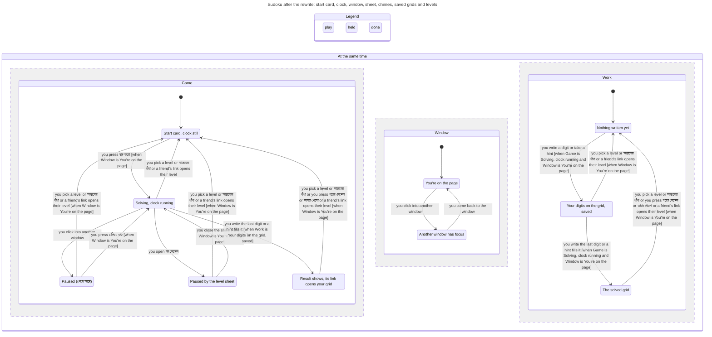

# সুডোকু: statechart

## After the rewrite (`after-fix/`)
The spec `Sudoku.tla` now mirrors the rewritten game:
- `components/sudoku-game.tsx` (handlers and effects);
- `lib/session.ts`, the phase and clock reducer;
- `lib/save.ts`, saved grids and your own unlock;
- `lib/link.ts`.

It runs twice:
- **Full check:** 3 levels, held keys, and both hint counts, with N = 3 and Full = TRUE. TLC reached 1,670 states (`after-fix/report-full.md`).
- **Chart run:** N = 2 and Full = FALSE, to fit the chart budget of 500 states. TLC reached 359 states; the chart has 10 states and 16 arrows (`after-fix/report.md`, `after-fix/chart.mmd`). Full = FALSE merges "10 or more hints" into "1–9", and a hidden tab into a blur. After the fix both pairs take the same path.

**All 13 rules hold in both runs, and so does NoDeadlock.** A mutation check put two old behaviours back into a copy of the spec: a friend's level opening the next one, and the result acting on a repeated key. OpenLevelsAreEarned and HeldKeyNeverSkips then broke, so neither rule is vacuous.

| Rule | In plain words | After |
|---|---|---|
| ClockStillWhileAway | The clock doesn't run while you're in another tab or window. | holds |
| PausedWhenHidden, PausedWhenBlurred | Hiding the tab or clicking away pauses a running puzzle. | hold |
| PausedMeansFrozen | Paused means the clock is stopped. | holds |
| ChoiceFreezesPlay (new) | While সব লেভেল is open, the clock is stopped. | holds |
| ResultMeansSolved | The result shows only for a full grid. | holds |
| ChimesOnlyOnTheResult | Star chimes ring only on the result, never over a new grid. | holds |
| YourLinkOpens | Your card's link opens your grid for a friend, whatever the hint count. | holds |
| LevelIsOpen | The level you're on is open, or it's this visit's friend level. | holds |
| OpenLevelsAreEarned (new) | Only your own unbroken run of cleared levels opens the next level. | holds |
| WorkNeverLostByOneTap | Switching puzzles never throws a half-done grid away, because every move saves it. | holds |
| HeldKeyNeverSkips (new) | A key held through the end never skips the result. | holds |



### The bugs, fixed, with their tests (`tools/sudoku/tests/rewrite.test.ts`)
1. **ClockStillWhileAway:** the game pauses on window `blur` and on a hidden tab itself, and through the player's `onPause`. Live in Orca: blur at ০০:২২, and the clock still read ০০:২২ 3.2 s later, with the paper cover over the grid and the menu open. Test: *bug 1 · ClockStillWhileAway*.
2. **ChimesOnlyOnTheResult:**
   - the star chimes come from the shared `StarReveal`, which clears its timers on unmount;
   - the line bells are `tone(…, delay)` on the audio clock, so a pause cuts them;
   - the line flash has one timer, cleared on `load()` and on unmount.

   Test: *bug 2 · ChimesOnlyOnTheResult*.
3. **YourLinkOpens:** `h` now takes 0 up to the puzzle's blanks (`/^(0|[1-9]\d?)$/`). Every hint count round-trips. Test: *bug 3 · YourLinkOpens* (it includes the live replay `s=20261104&t=2&h=47`).
4. **WorkNeverLostByOneTap:**
   - every move, pause and `pagehide` saves the grid to `ektukhani-sudoku-wip`, keeping the newest 8;
   - `load()` brings it back as **চালিয়ে যাও ০৩:১২ · ১৪/৪৬ ঘর**.

   Live: level 30 at ২৫/৫১, then level 1, then the sheet and level 30 again showed ২৫/৫১ again. A reload showed **চালিয়ে যাও ০০:২৫ · ১/৪ ঘর**. Test: *bug 4 · WorkNeverLostByOneTap*.
5. **OpenLevelsAreEarned:**
   - your own unlock lives in `ektukhani-sudoku-open`. It is migrated once from `unlockedLevel(stars)`, so no old phone loses a level;
   - after that it rises only by `openAfter(open, cleared)`;
   - `unlockedLevel` itself is unchanged.

   Live: on a clean phone, solving `#s=3001&t=99&l=3` saved `{"3":3}` with open still at `1`, and the result offered **তোমার লেভেলে ফেরো**. Test: *bug 5 · OpenLevelsAreEarned*.
- **Minor ones:**
  - game keys are ignored while paused;
  - Space or Enter no longer needs the board in view to resume, because the start card and the paused cover take them;
  - result keys need a fresh press (`!event.repeat`, and arriving 400 ms after the result);
  - clicked buttons drop focus, so Enter never repeats an erase or an undo. Live: after a clicked undo, Enter left the earlier digit in place.

  Test: *keys*.

### Regenerate
```sh
D=ai_docs/statecharts/sudoku
# the drawn chart: Sudoku.cfg as committed (N = 2, Full = FALSE)
scripts/statechart.sh $D/Sudoku.tla --view $D/view.ts --out $D/after-fix-new
# the full check: set CONSTANT N = 3 and CONSTANT Full = TRUE in Sudoku.cfg, run into another folder, then set them back
rm $D/after-fix-new/tlc*.out
```
The `before-fix/` output came from the original spec, which is in git history (before this rewrite).

## Before the rewrite (the original analysis)

Spec `Sudoku.tla` / `Sudoku.cfg`, view `view.ts`, output `before-fix/` (`report.md`, `chart.mmd`).
It mirrors `tools/sudoku/components/sudoku-game.tsx` (every handler and effect) and `tools/sudoku/lib/game.ts` + `lib/link.ts`.
TLC: 252 states, 1128 steps. The chart has 13 states and 19 arrows. **5 rules hold, 4 break** (bug 5 was found in the code after switchboard's model, then replayed live).

## Systems modelled
- **Play phase:** `ready → playing → paused → over`. `begin()` runs on the first tap or digit, `solved()` runs on the last right digit or hint, and `load()` runs for আবার খেলো, পরের লেভেল, the ‹ › arrows, the সব লেভেল grid and আজকের ধাঁধা.
- **Clock:** it runs exactly while `phase = "playing"` (`timer.since ≠ 0` with the 250 ms interval mounted).
- **Pause and focus:** tab visible or hidden, and window focused or blurred. The only away handler is `visibilitychange → hidden`. There is no blur listener and no pause button.
- **Hints:** none, 1–9, or 10 or more. The count matters because the link format only takes one digit.
- **Timers:** the `sfx.star(i)` timeouts at 450, 710 and 970 ms after solving. Nothing ever clears them.
- **Links:** `sharedHash` writes the result, and on open `parseShared` reads it back.
- **Levels:** two levels, `unlocked` capped at the count (`unlockedLevel`).
- **Your work:** whether your own digits are on the grid, and whether one tap threw a half-done grid away.

Not modelled: wrong digits, pencil marks and undo (pure, covered by `tests/sudoku.test.ts`), sound loops (this game has none; `tone()` mutes itself), and star recording (`recordLevel` keeps the max, which is pure and tested).

## Rules, in plain words
| Rule | In plain words | Result |
|---|---|---|
| ClockStillWhileAway (NoProgressWhileAway) | The clock that decides your stars doesn't run while you're in another tab or window. | **breaks** |
| PausedWhenHidden | When the tab hides, a game in progress pauses. | holds |
| PausedMeansFrozen | While paused, the clock is stopped and nothing on the grid can change. | holds |
| ResultMeansSolved (NoDoubleResult) | The result shows only for a full grid, once. | holds |
| ChimesOnlyOnTheResult | The star chimes ring only while the result is on screen, never over a new grid. | **breaks** |
| YourLinkOpens (ReplayIsExact) | The link on your card opens the same grid for a friend, with your time. | **breaks** |
| LevelIsOpen (UnlockNeverShrinks) | The level you're on is always an open level, and solving opens the next one. | holds |
| WorkNeverLostByOneTap | A half-done grid is never thrown away by one stray tap. | **breaks** |
| TypeOK, NoDeadlock | | hold |

## Bugs

### 1. ClockStillWhileAway: "I answered a message in another window and my clock kept running, so I lost a star"
- **Path (report):** 0 new grid → 1 you tap a cell (clock running) → 2 you click into another window (clock still running).
- **Live replay (Orca, level 1):** I tapped a blank cell, which set the phase to `playing`, then dispatched `blur`. The clock read `০০:০০ → ০০:০২ → ০০:০৪ → ০০:০৬` at 2 s steps. The phase stayed `playing` and no overlay appeared. Orca's own window was unfocused the whole time (`document.hasFocus() = false`), so the clock also counts time spent in another app on desktop.
- **Fix:** handle `blur` exactly like `visibilitychange → hidden`: if the phase is `playing`, call `stopClock()` and show the "থেমে আছে" overlay. **Shared:** the same gap (only `visibilitychange` is handled) shows up across the games, so the fix belongs in a shared away hook, for example `useAwayPause(onAway)` in `shared/game-kit.ts`, that listens to both events.

### 2. ChimesOnlyOnTheResult: "I tapped পরের লেভেল and three star chimes rang over the new grid"
- **Path:** 0 → 1 you write a digit → 2 you write the last digit (result, chimes waiting) → 3 you press পরের লেভেল (new grid, chimes still waiting).
- **Live replay:** I instrumented `AudioParam.setValueAtTime`, solved level 1 (3 stars) and clicked পরের লেভেল 1 ms later. Three chimes at 1047, 1319 and 1568 Hz fired at +390, +651 and +910 ms, all while "লেভেল ২" showed a fresh grid with no result on screen. Pressing Enter on the result (which also calls `goTo(level + 1)`) does the same.
- **Fix:** keep the timeout ids in a ref and clear them in `load()` and on unmount. Better, render the shared `StarReveal` (it already clears its timers on unmount) instead of the hand-rolled `.sd-over-stars` plus `setTimeout`. The line-bell timeouts (`90 + step*140`) and `setTimeout(() => setFlash([]), 700)` have the same leak, so clear them too. A related small bug: the flash timeout from an earlier line cuts a later line's glow short, because one timer clears the whole `flash` array. **Shared pattern:** uncleared celebration timeouts. The shared `StarReveal` is already correct.

### 3. YourLinkOpens: "I shared my result, but my friend's link opened a plain level 1"
- **Path:** 0 → 1 you take a hint → 2 you take a 10th or later hint and the grid fills: the result shows, but its link opens nothing.
- **Cause:** `sharedHash` writes `h=<hints>` for any count. `parseShared` accepts only `/^\d$/` (0–9), and the tests even pin `h=10` as invalid. `/api/share` normalises through `parseShared`, so the request fails and the client falls back to the bare `#hash` link, which the page then rejects too.
- **Live replay:** on আজকের ধাঁধা (47 blanks) I pressed বলে দাও 47 times. The result said "৪৭টা ঘর বলে দিয়েছি". লিংক কপি করো sent `POST /api/share {"state":"s=20261104&t=2&h=47"}`, which returned **400**, so the fallback link was `/sudoku#s=20261104&t=2&h=47`. A fresh load of that link showed **লেভেল ১, সহজ · ৪×৪** with no friend card and the generic page title. For comparison, `#s=20261104&t=2&h=9` opens the 4 November grid with the card "এক বন্ধু ৪ নভেম্বরের সুডোকু মিলিয়েছে ২ সেকেন্ডে, ৯টা ঘর সাহায্য নিয়ে।"
- **Fix:** accept `h` as `/^(0|[1-9]\d?)$/` with `hints ≤ puzzle.empty` (already checked), and update the `h=10` case in `tests/sudoku.test.ts` to a valid link (keep `h=01` and `h=-1` invalid). Add a round-trip test: `parseShared(sharedHash(x))` equals `x` for every hint count from 0 to `empty`. **Game-specific.**

### 4. WorkNeverLostByOneTap: "I was eight minutes into a 9×9, tapped আজকের ধাঁধা by mistake, and my grid was gone"
- **Path:** 0 → 1 you write a digit (your digits on the grid) → 2 you tap a level arrow, a level or আজকের ধাঁধা: a new grid, clock at zero, and the half-done grid thrown away.
- **Live replay:** on level 1 I wrote 2 right digits (the clock read `০০:৫১` and undo was available), then tapped আজকের ধাঁধা. The page switched to "রোজের ধাঁধা, ৪ নভেম্বর", with 0 digits filled, the clock at `০০:০০` and undo disabled. লেভেলে ফেরো brought back level 1 with **0** digits. The work was gone, and nothing had asked first. The ‹ › arrows and the সব লেভেল grid also work while paused and do the same.
- **Fix:** keep the in-progress board per puzzle (values, notes, hints and elapsed time in `localStorage` under `ektukhani-sudoku-wip-<level|day>`) and restore it in `load()`, so switching and reloading are both safe. At minimum, ask before replacing a grid that has your own digits on it. **Game-specific**, though every long puzzle game needs the same thing.

### 5. OpenLevelsAreEarned (found from switchboard's model, replayed here): "I solved a friend's level 3 and level 2 opened without my playing it"
- **Cause:** `open = max(levels.unlocked, friend.level)` lets a friend link open a locked level. Solving it saves `{3: 3}`, and `unlockedLevel` in `shared/game-core.ts` opens everything up to 1 + the highest level with stars, not only the unbroken run of cleared levels.
- **Live replay:** with clean storage I opened `/sudoku#s=3001&t=99&l=3` and solved level 3, which saved `{"3":3}`. After a reload without the hash, the সব লেভেল grid showed **4 open**: লেভেল ১, ২, ৩ (৩ তারা) and ৪. Only levels 5 and up were বন্ধ, though I had never played levels 1 or 2. In real play a level-35 link opens 2–36.
- **Fix:** make `unlockedLevel` count the contiguous run of cleared levels from 1, and let a friend's level stay playable for that visit only. **Shared** with switchboard, and with any game whose link carries a level. Add this rule to the spec (`unlocked ≤ 1 + contiguous cleared`) when it's next re-run.

### Minor (not in the model)
- P and N toggle খসড়া even while paused, because `setPencil` skips the `locked` check. This is harmless behind the overlay.
- Space or Enter resumes only while the board is in view (`boardInView`), so a keyboard player scrolled down to the card can't resume.

### Couldn't replay live
- **Tab hide:** Orca pins `document.hidden` as a non-configurable property (`Cannot redefine property: hidden`), so a hidden tab can't be faked. PausedWhenHidden holds in the model and in the code (`hide()` pauses a `playing` phase and calls `stopClock()`). The paused overlay was not seen live for the same reason.

## Quality-bar gaps (game-quality-bar)
1. **Pause isn't a real menu (§7):** there's no pause button, P is pencil and Esc does nothing. Pause happens only when the tab hides, and blur doesn't pause at all (bug 1). The overlay offers only চালিয়ে যাও, with no নতুন করে শুরু, কীভাবে খেলবে, শব্দ or সব লেভেল.
2. **Long puzzles aren't safe (§9 pacing, §7):** a 9×9 ওস্তাদ level runs about 10 minutes, but a reload, a level arrow or আজকের ধাঁধা wipes it (bug 4). Nothing is saved mid-puzzle.
3. **One new idea at a time is missing (§9):** levels 1–10 add blanks only. Level 11 switches to 6×6 with 2×3 boxes, and level 21 jumps to 9×9 with 30 blanks, without a word about the new box shape. খসড়া (pencil marks), the tool that matters from 6×6 on, is never introduced.
4. **No "boss" moment at the end of a tier (§9):** finishing levels 10, 20, 30 and 40 gets one text line ("সহজ ধাপের ১০টা লেভেল শেষ!") and the usual confetti, but no named final puzzle and no special card.
5. **Choices (§4):** the level ladder hides in a `<details>` below the tools. The ‹ › arrows don't say what the next level changes (for example "এবার ৬×৬"), and no default is marked beyond the glow in the grid.
6. **First screen (§1):** the start action is a yellow pre-picked cell plus a status line. That works: the first win comes within 10 s on level 1 (4 blanks). But nothing big says "শুরু করো", and on a phone the digit pad sits below the fold of Orca's pane.
7. **Ending and celebration (§10):** the result has real stats (time, stars, a near-miss line with exact seconds, the best time on this phone) and a good card. But the star pop (CSS delay) and the chimes are separate systems, and the chimes leak (bug 2). Confetti plays only for 3 stars, a new best or a finished tier.
8. **HUD (§5):** the clock sits top-right and the level top-centre, which is good. There's no progress cue for cells left, and the status line above the board changes meaning (hint, pencil mode, par time) with no visual difference.
9. **Sound (§11):** good. There are 4 own sounds (ballpoint tick as the signature, pencil, eraser, line bell) plus shared sounds for wrong, pop and level up, and each has a visible twin (wrong turns red and shakes, a finished line flashes). No loop, which is right for this game.

## Screenshots
- `.shots/sudoku-phone-first-screen.png`: Pixel 9, level 1 with the pre-picked yellow cell. The digit pad starts at the bottom of the pane.
- `.shots/sudoku-desktop-first-screen.png`: desktop, level 4, the whole player in view.
- `.shots/sudoku-desktop-result.png`: the result panel (3 stars, "চা ঠান্ডা হওয়ার আগেই পুরো ছক ভরা।", আবার খেলো / পরের লেভেল).
- `.shots/sudoku-card.png`: the share card, exported from its canvas.
- `.shots/sudoku-phone-result.png`: a phone-mode capture. Orca leaves the scrolled-in area blank in phone mode, so trust only the grid.

## Regenerate
```sh
scripts/statechart.sh ai_docs/statecharts/sudoku/Sudoku.tla --view ai_docs/statecharts/sudoku/view.ts --out ai_docs/statecharts/sudoku/before-fix
rm ai_docs/statecharts/sudoku/before-fix/tlc*.out
```
After the fixes, update the spec (add a blur pause, clear the chimes in `Load`, take the 10+ hint path, keep the work), then re-run into `ai_docs/statecharts/sudoku/after-fix`. All 9 rules must hold.

Note for testers: other agents share the `127.0.0.1:3100` origin, and its `localStorage` was cleared under me mid-run. Don't read a missing `ektukhani-levels-sudoku` as a game bug. I removed the sudoku keys my runs wrote.
