# সুর বানাই statechart (after the rewrite)

A kids' game (ছোটদের জন্য, ages 3–12), rewritten to the tibo.dog bar inside the shared game player. This file is the model of the **new** code. The model of the old code, with its bugs and live replays, is kept in `before-fix/` and in the section "The bugs found before the rewrite" below.

Specs, each mirrored from the files it names in its first lines:
- `SurBanai.tla` / `.cfg` / `view.ts`: the screens, the beat loop, the free tune's draft, a win, away and back, the player's pause menu and the daily limit. TLC: 360 states, 1,516 steps. Chart: `after-fix/chart.mmd` (17 states, 73 arrows).
- `SurBanaiSound.tla` / `.cfg` / `SurBanaiSoundView.ts`: the beat and the site-wide sound switch. TLC: 11 states. Chart: `after-fix-Sound/chart.mmd`.
- `SurBanaiGate.tla` / `.cfg` / `SurBanaiGateView.ts`: the parent gate and leaving the game. TLC: 5 states. Chart: `after-fix-Gate/chart.mmd`.

The model is split in three because one spec with the sound and the gate came to 1,236 states, over the chart's budget of 500. The gate and the sound share no variable with the screens, and no rule mixes them.

## Systems modelled
- **Screens:** title, a level, the free grid (আমার সুর), the end screen (a won level, or a tune kept) and the level list. `lib/session.ts` is the pure session the component forwards events to.
- **The beat loop:** `run()`'s `setTimeout` chain plays one of four things: the free tune (loops), the tune to hear, your copy (once), your matched tune (once, lit). `halt()` stops it. `S.canPlay` says where it may run: on a grid, with nothing covering it, and not on a won level for the tune to hear.
- **The draft:** the free grid writes its tune to `ektukhani-sur-banai-draft` on every tap (`setFree`), so a tune is in storage the moment it exists.
- **A win:** `S.won()` runs at the ✓ tap: stars saved (`levels.record`), `atBreak()` checked. The tune plays through, and ➜ waits. The rest screen shows only after ➜, on the end screen.
- **Away and back:** window blur and a hidden tab both end in `halt()`. The first tap back only wakes the game.
- **The player's menu:** ⏸, P, Escape or blur open it (`onPause` → `halt()`), চালিয়ে যাও resumes without restarting, নতুন করে শুরু goes to the title, সব লেভেল (`onLevels`) opens the list.
- **Kids' limit:** `atBreak()` runs when a round starts and at a keep or a win. `RestScreen` shows on the title, the end screen and the level list, never over a grid.
- **Sound:** every beat calls `playBeat → tone()`, which reads `soundOn()` then and there. There is no `loop()` and no cached node, so nothing silent is kept.
- **No voice:** `speak()` and `SpeakButton` are gone from the game. `tests/session.test.ts` checks the source.

## Rules in plain words
| Rule | Plain words | Result |
|---|---|---|
| NoProgressWhileAway (with SilentWhenHidden) | The tune stops when you click into another window or hide the tab, and coming back doesn't restart it. | holds (was bug 2) |
| PausedMeansQuiet | Nothing plays under the player's menu. | holds |
| PlayOnlyOnTheGrid | The beat never runs on the title, the end screen or the level list. | holds |
| ChoiceFreezesPlay | While the level list is open, nothing plays. | holds (was bug 5) |
| RestOnlyAtBreak | The rest screen comes only after a tune is kept, a level is matched, or when a round is about to open. Never over the free grid or an unwon level. Stopping the tune is not a break. | holds (was bug 1) |
| RestKeepsYourTune | A tune that isn't kept is always in storage. | holds (was bug 1) |
| QuietUnderRest | Nothing plays or reacts under the rest screen. | holds |
| EveryFinishCounts | A won level is recorded at its ✓ tap, before ➜ and before the end screen. | holds |
| NoReadingNeeded | Every screen has its way on by picture. | holds (was bug 8; the node test checks the source) |
| BeatOnlyWithSound, LoopComesBack, NoBeatAwayOrPaused (`SurBanaiSound`) | A beat sounds only with sound on, the next beat after sound-on is heard, and the beat never runs away or paused. | hold |
| HoldMeansHold, NoWayOutWithoutGate (`SurBanaiGate`) | The gate's sum opens only after a real 2-second hold. The only way out of the game lands on another kids' tool. | hold (was bugs 6 and 7) |
| TypeOK, NoDeadlock | | hold |

## The chart (`after-fix/chart.mmd`)

```mermaid
stateDiagram-v2
  direction LR
  state "Legend" as legend {
    lg0: play
    lg1: card
    lg2: rest
  }
  class lg0 teal
  class lg1 blue
  class lg2 yellow
  state "At the same time" as all {
    state "Screen" as r0 {
      s0: Opens on the rest screen
      s1: Title: the card, আম#2494;র স#2497;র, সব ল#2503;ভ#2503;ল
      s2: আম#2494;র স#2497;র: empty grid
      s3: The level list
      s4: Level: listen first
      s5: Rest screen
      s6: Level: heard, copying
      s7: Level: your copy plays
      s8: Level: the tune plays
      s9: Level matched, #10140; waits
      s10: আম#2494;র স#2497;র: a tune in the draft
      s11: End screen: the tune is kept
      s12: End screen: আব#2494;র খ#2503;ল#2507; / শ#2503;ষ
      s13: আম#2494;র স#2497;র: your tune plays
      [*] --> s0
      [*] --> s1
      s0 --> s1: a grown-up gives 10 more minutes
      s1 --> s2: you press আম#2494;র স#2497;র [when In the game]
      s1 --> s3: you open সব ল#2503;ভ#2503;ল [when In the game]
      s1 --> s4: you press খ#2503;ল#2507; or pick a level [when In the game]
      s1 --> s5: you press খ#2503;ল#2507; or pick a level or you press আম#2494;র স#2497;র [when In the game]
      s1 --> s6: you press খ#2503;ল#2507; or pick a level [when In the game]
      s2 --> s1: you press the home button [when In the game]
      s2 --> s10: you tap a cell, the draft is saved [when In the game]
      s3 --> s1: you close the list [when In the game]
      s3 --> s4: you press খ#2503;ল#2507; or pick a level [when In the game]
      s3 --> s5: you press খ#2503;ল#2507; or pick a level [when In the game]
      s3 --> s6: you press খ#2503;ল#2507; or pick a level [when In the game]
      s4 --> s7: you press ব#2494;জ#2494;ও on your copy [when In the game]
      s4 --> s8: you press শ#2507;ন#2507; [when In the game]
      s5 --> s1: a grown-up gives 10 more minutes
      s6 --> s7: you press ব#2494;জ#2494;ও on your copy [when In the game]
      s6 --> s8: you press শ#2507;ন#2507; [when In the game]
      s6 --> s9: you press ম#2503;ল#2494;ও and it matches [when In the game]
      s1 --> s3: সব ল#2503;ভ#2503;ল in the menu [when Pause menu open]
      s7 --> s4: the tune reaches its end or you press থ#2494;ম#2494;ও or you click into another window, or hide the tab or the pause menu opens (#9208;, P, Esc)
      s0 --> s3: a grown-up gives 10 more minutes
      s8 --> s4: you press থ#2494;ম#2494;ও or you click into another window, or hide the tab or the pause menu opens (#9208;, P, Esc)
      s8 --> s6: the tune reaches its end or you press ম#2503;ল#2494;ও and it doesn't match or you press থ#2494;ম#2494;ও or you click into another window, or hide the tab or the pause menu opens (#9208;, P, Esc)
      s7 --> s6: the tune reaches its end or you press ম#2503;ল#2494;ও and it doesn't match or you press থ#2494;ম#2494;ও or you click into another window, or hide the tab or the pause menu opens (#9208;, P, Esc)
      s7 --> s9: you press ম#2503;ল#2494;ও and it matches
      s8 --> s9: you press ম#2503;ল#2494;ও and it matches
      s9 --> s5: you press the big #10140; [when In the game]
      s9 --> s12: you press the big #10140; [when In the game]
      s10 --> s2: you press ম#2497;ছ#2507; [when In the game]
      s10 --> s5: you press র#2494;খ#2507; [when In the game]
      s10 --> s11: you press র#2494;খ#2507; [when In the game]
      s10 --> s13: you press ব#2494;জ#2494;ও [when In the game]
      s10 --> s1: you press the home button [when In the game]
      s2 --> s1: নত#2497;ন কর#2503; শ#2497;র#2497; [when Pause menu open]
      s2 --> s3: সব ল#2503;ভ#2503;ল in the menu [when Pause menu open]
      s3 --> s1: নত#2497;ন কর#2503; শ#2497;র#2497; [when Pause menu open]
      s4 --> s1: নত#2497;ন কর#2503; শ#2497;র#2497; [when Pause menu open]
      s4 --> s3: সব ল#2503;ভ#2503;ল in the menu [when Pause menu open]
      s6 --> s1: নত#2497;ন কর#2503; শ#2497;র#2497; [when Pause menu open]
      s6 --> s3: সব ল#2503;ভ#2503;ল in the menu [when Pause menu open]
      s5 --> s11: a grown-up gives 10 more minutes
      s11 --> s5: you press আব#2494;র খ#2503;ল#2507; [when In the game]
      s11 --> s2: you press আব#2494;র খ#2503;ল#2507; [when In the game]
      s11 --> s3: you open সব ল#2503;ভ#2503;ল [when In the game]
      s11 --> s1: you press শ#2503;ষ [when In the game]
      s5 --> s3: a grown-up gives 10 more minutes
      s5 --> s12: a grown-up gives 10 more minutes
      s12 --> s4: you press আব#2494;র খ#2503;ল#2507; [when In the game]
      s12 --> s6: you press আব#2494;র খ#2503;ল#2507; [when In the game]
      s12 --> s5: you press আব#2494;র খ#2503;ল#2507; [when In the game]
      s12 --> s3: you open সব ল#2503;ভ#2503;ল [when In the game]
      s12 --> s1: you press শ#2503;ষ [when In the game]
      s13 --> s10: you press থ#2494;ম#2494;ও or you click into another window, or hide the tab or the pause menu opens (#9208;, P, Esc)
      s13 --> s5: you press র#2494;খ#2507;
      s13 --> s11: you press র#2494;খ#2507;
      s13 --> s1: you press the home button
      s1 --> s10: you press আম#2494;র স#2497;র [when In the game]
      s9 --> s5: সব ল#2503;ভ#2503;ল in the menu or নত#2497;ন কর#2503; শ#2497;র#2497; [when Pause menu open]
      s9 --> s3: সব ল#2503;ভ#2503;ল in the menu [when Pause menu open]
      s9 --> s1: নত#2497;ন কর#2503; শ#2497;র#2497; [when Pause menu open]
      s10 --> s1: নত#2497;ন কর#2503; শ#2497;র#2497; [when Pause menu open]
      s10 --> s3: সব ল#2503;ভ#2503;ল in the menu [when Pause menu open]
      s13 --> s2: you press থ#2494;ম#2494;ও or you click into another window, or hide the tab or the pause menu opens (#9208;, P, Esc)
      s11 --> s3: সব ল#2503;ভ#2503;ল in the menu [when Pause menu open]
      s11 --> s1: নত#2497;ন কর#2503; শ#2497;র#2497; [when Pause menu open]
      s12 --> s3: সব ল#2503;ভ#2503;ল in the menu [when Pause menu open]
      s12 --> s1: নত#2497;ন কর#2503; শ#2497;র#2497; [when Pause menu open]
    }
    --
    state "Hand" as r1 {
      s14: In the game
      s15: In another window or tab hidden
      s16: Pause menu open
      [*] --> s14
      s14 --> s15: you click into another window, or hide the tab
      s14 --> s16: the pause menu opens (#9208;, P, Esc)
      s15 --> s14: you come back to the window
      s15 --> s16: the pause menu opens (#9208;, P, Esc)
      s16 --> s14: নত#2497;ন কর#2503; শ#2497;র#2497; or চ#2494;ল#2495;য#2492;#2503; য#2494;ও or সব ল#2503;ভ#2503;ল in the menu
      s16 --> s15: নত#2497;ন কর#2503; শ#2497;র#2497; or চ#2494;ল#2495;য#2492;#2503; য#2494;ও or সব ল#2503;ভ#2503;ল in the menu
    }
  }
  class s0 yellow
  class s1 blue
  class s2 teal
  class s3 blue
  class s4 teal
  class s5 yellow
  class s6 teal
  class s7 teal
  class s8 teal
  class s9 teal
  class s10 teal
  class s11 blue
  class s12 blue
  class s13 teal
```


## Live replays of the old bugs, on the new code (headless Chrome with touch, fresh storage)
Replay scripts live in the scratchpad of this run; counts come from `OscillatorNode.prototype.start`.

1. **Bug 1, rest over an unsaved tune.** 2 notes on the grid, বাজাও running, then today's stored time set to 5,000 s (over the limit) and থামাও pressed: playing `none`, **no `.kk-rest`**, 2 notes still on the grid, the draft in storage (`{"tune":[1,4,0,0,0,0],"sound":0}`). Then রাখো: the tune on the shelf, the draft cleared, `.kk-rest` on the end screen. (Before: the rest screen covered the grid at থামাও and the tune was lost on close.)
2. **Bug 2, the tune plays on in another window.** A 3-note tune playing (6 oscillator starts in 0.9 s). A window `blur`: playing `none`, **0 more starts in 2.5 s**, the playhead gone, the pause menu open, the 3 notes still on the grid. `focus` doesn't restart it. (Before: playhead 2→3→4→5→0→1 and 2 more starts after blur.)
3. **Bug 5, the list doesn't freeze the tune.** Level 1, the tune to hear playing; Escape, then সব লেভেল: screen `levels`, playing `none`, **0 starts in 2.5 s**, no playhead. (Before: the tune ran to its end under the open list.)
4. **Bug 7, a picture card leads to a grown-up page.** The page's links are `#main`, this tool's own guide and privacy pages, ছোটদের খেলাঘর and kids' tools from the hub. There is no flagship card (আমার ছোটবেলা) and no `/tools`. Note: the hub's "আরও খেলা" list includes a few tools filed under গেম (for example ঘণ্টার সুর, সাপ-লুডু); that list is shared (`lib/hubs.ts`), not part of this game.
5. **Bug 8, word-only buttons.** Every control carries a drawn icon (ear, play, tick, eraser, heart, home); the end buttons are 112 px picture buttons (আবার খেলো, শেষ) at y 548–660 on a 412×850 phone and y 591 at the bottom on 320×640, above the fold. `tests/session.test.ts` checks the source and the CSS sizes.

Bugs 3, 4 and 6 were fixed in the kit (commit f4f75be) and re-checked live in the first run; the game has no voice now, so bug 3 can't happen.

## Quality-bar gaps, closed
1. **First screen:** the title card (the world's instrument over a small grid, ▶ খেলো) is the biggest thing; the H1 and parent note moved into the player's launch card. On a level, the HUD sits in the corners, then the grid, one line and the controls.
2. **End cards above the fold:** the tune picture, stars, counts and two 112 px buttons fit a 640 px stage; আব্বু-আম্মুকে দেখাও is just below on the smallest phones.
3. **Reading:** modes, controls and end buttons are pictures with one word. A ghost finger shows the first tap.
4. **Pause:** the player's menu (P, Escape, ⏸, blur, hide) stops the beat and keeps the tune.
5. **Choices:** the level list is a numbered, three-star choice screen inside the stage, with the next level marked এটা খেলো.
6. **Pacing:** four worlds, 16 levels, one new idea each (copy, two at once, fill the gap, make your own), a named finale for each. The first level is won inside 10 s of play.
7. **Sound:** each world has its instrument, plus a soft off tick, a low boing for a miss, the signature "মিলেছে" (your own tune plays through, lit, and a chime rings out), star chimes and a four-note finale tune. Every one has a lit cell or a ring beside it.
8. **Rest timing:** the rest screen never cuts a tune.
9. **Leaving the section:** the kids frame links only to kids' tools.

## The bugs found before the rewrite
The write-up from the analysis run, kept as it was. The model of the old code is in `before-fix/` (`chart.mmd`, `report.md`).

### Bugs
Replays ran in my own Orca tab at Pixel 9. In-page instrumentation counted `OscillatorNode.start`, logged `OscillatorNode.stop` offsets and `speechSynthesis.speak/cancel`, and read the playhead from `.sb-cell.head`. The shared keys `ektukhani-sound` and `ektukhani-kids-time` were stubbed **in my tab only**, so other agents' storage was never written. Today's real kids timer read 5,020 s, over the 15-minute limit, so `atBreak()` returned true with no stubbing at all. Blur and focus were plain `window` events; no hide-dependent bug needed a hidden tab.

### 1. RestOnlyAtBreak + RestKeepsYourTune: "I pressed থামাও and the rest screen took my tune" (game)
- **Path:** বাজাও → (tap a cell) → থামাও: *Rest screen*, over a tune never kept.
- **Why:** `playFree()` calls `atBreak()` when it stops. Stopping playback is midway, not a break, and the FAQ says rest comes "সুর রাখা বা মেলানো শেষ হলে, মাঝপথে নয়".
- **Live, re-checked on the current kit (f4f75be + 23fd7c1):** 2 notes on the grid and `ektukhani-sur-banai-tunes` was null. Pressing থামাও showed `.kk-rest` ("আজ এটুকুই, কাল আবার।") over the grid, which still held 2 unsaved notes. Closing the page loses them. The new modal blocked taps on the cells, বাজাও and Enter behind it (still 2 notes, nothing playing), and focus moved into `.kk-rest`. Screenshot: `.shots/sur-banai-rest-mid-tune.png`.
- **Fix:** drop `atBreak()` from `playFree()`. Call it only in `save()` and in `check()` on a match (both already do). If the limit is up while a tune is unsaved, keep it in the saved shelf before resting.

### 2. NoProgressWhileAway: "the tune kept playing while I was in another window" (shared)
- **Path:** বাজাও → you click into another window.
- **Live:** with a 2-note tune playing, after blur the playhead went 2→3→4→5→0→1 over 2.7 s, there were 2 more oscillator starts, and the button still read থামাও ■.
- **Fix (shared):** the shared game player's blur and hide handling (`stopPlay()` on blur). For a music toy, at least stop on blur and keep the tune.

### 3. SilentWhenMuted: "I turned sound off and the voice kept talking" (shared). FIXED in the kit (f4f75be)
- **Path:** you tap the speaker → you turn sound off.
- **Before today's kit fix**, a tap while muted also spoke. Live: `aria-pressed=false`, then `speak("যেকোনো ঘরে চাপো…")` and `speechSynthesis.speaking = true` (voice Piya bn-IN).
- **After the fix** (`speak()` returns early when sound is off, kids-kit.tsx:171), a muted tap is silent (re-checked live: no speak, not speaking). Still broken: speak, then mute, and the voice kept talking 1.2 s after mute, with no `cancel()` logged.
- **Fix (shared), now done:** `setSoundOn(false)` calls `speechSynthesis.cancel()` (f4f75be). The model now holds.

### 4. BeatOnlyWithSound: "after I turned sound off, the last bell note still rang" (shared, minor). FIXED in the kit (f4f75be)
- **Path:** বাজাও → you turn sound off.
- **Why:** `setSoundOn(false)` only calls `stopLoops()`. It doesn't call `silenceScheduled()`, so notes already started play out.
- **Live (টুং, 6 notes, মাঝারি):** each bell note is scheduled to stop at +0.73 s. At mute, no extra `stop()` was issued (no +0.03 s stop), so the ringing note played out. While muted there were 0 oscillator starts; after sound-on, 5 starts in 1 s (LoopComesBack holds).
- **Fix (shared), now done:** `setSoundOn(false)` → `silenceScheduled()` (f4f75be). The model now holds.

### 5. ChoiceFreezesPlay: "I opened সব সুর and the tune finished without me" (shared)
- **Path:** সুরটা মেলাও → শোনো → open সব সুর.
- **Live:** with the list open, the playhead ran 1→5 with 6 oscillator starts. The tune ended, `heard` became true, the button turned আবার শোনো, and মিলিয়ে দেখো was enabled. Screenshot: `.shots/sur-banai-drawer-open-tune-plays.png`.
- **Fix (shared):** the level list moves into the shared player's pause menu (সব লেভেল), and opening it calls `stopPlay()`.

### 6. HoldMeansHold: "a quick press on বড়দের জন্য opened the grown-ups' question" (shared, kids-kit ParentGate). FIXED in the kit (f4f75be)
- **Path:** hold বড়দের জন্য → hold again (Enter's key repeat, or a second finger) → let go.
- **Why:** `start()` overwrites `hold.current` without clearing the earlier timer, and `stop()` clears only the latest one.
- **Live:** in the control, Enter held 600 ms with no repeat, the sum stayed closed. With repeat (keydown, then 2 repeats at 500 ms and 533 ms, keyup at 575 ms), "সাত আর আট যোগ করলে কত?" opened 2 s after the first press. The sum still guards the link. This affects RestScreen's own gate too.
- **Fix, now done:** `start()` returns while a timer is set, and `event.repeat` is ignored (f4f75be).
- **Re-checked live on the current kit:**
  - The same repeat hold (keydown; repeats at 500 ms and 533 ms; keyup at 566 ms) did not open the sum.
  - A two-finger 300 ms press did not open it either.
  - A single 2 s hold did ("সাত আর পাঁচ যোগ করলে কত?").

### 7. NoWayOutWithoutGate: "the big picture under the game took my child to a grown-up page with share and photo buttons" (shared, site-shell)
- **Path:** you tap a card under the game.
- **Live:** the related cards on /sur-banai are `/amar-chhotobela` (with a picture), `/borno-likhi`, `/kar-chinho`, `/nam-shikhi` and `/tools`. `PageFrame` always puts the flagship first. Its page has `ShareBar`, `PhotoPicker` and `addToTally` (network), all with no gate. The header nav and search also lead out.
- **Fix (shared):** for the ছোটদের জন্য category, `PageFrame` shows only kids' tools in related cards (no flagship, no `/tools`). Put links that leave the section behind `ParentGate`.

### 8. NoReadingNeeded: "after রাখো, my 3-year-old didn't know which button plays again" (game)
- **Path:** tap a cell → রাখো: *saved card*.
- **Live:** the saved card's buttons are আবার খেলো, শেষ and আব্বু-আম্মুকে দেখাও, none with an icon or picture. The idle screen is one line of text and a text button. The won card has only পরের সুর → (an arrow glyph) and text buttons. The mode switch (আমার সুর / সুরটা মেলাও) is text only.
- **Fix:** picture buttons with a ghost finger on the end screens (▶ with the tune's mini picture to play again; a home icon for শেষ), and icons on the two mode buttons.

### Rules that hold, checked live
- **Rest at opening (23fd7c1):** with the timer key set past the limit (then restored at once), a reload opened straight on `.kk-rest`, with focus in it. That's a break, allowed by RestOnlyAtBreak.
- **NoNetwork:** after load there were only same-origin static requests (fonts, chunks, two `/_next/image` previews for the related cards); no `/api`, fetch or beacon.
- **NoChildData:** only `ektukhani-sur-banai-tunes`, `ektukhani-levels-sur-banai`, the sound switch and the kids timer were written.
- **LoopComesBack:** the next beat after sound-on is heard.
- **SilentWhenHidden:** hide calls `stopPlay()` (in the code; Orca pins `document.hidden`).
- **QuietUnderRest:** every `atBreak()` call follows `stopPlay()`.

## Regenerate
```sh
scripts/statechart.sh ai_docs/statecharts/sur-banai/SurBanai.tla --view ai_docs/statecharts/sur-banai/view.ts --out ai_docs/statecharts/sur-banai/after-fix
scripts/statechart.sh ai_docs/statecharts/sur-banai/SurBanaiSound.tla --view ai_docs/statecharts/sur-banai/SurBanaiSoundView.ts --out ai_docs/statecharts/sur-banai/after-fix-Sound
scripts/statechart.sh ai_docs/statecharts/sur-banai/SurBanaiGate.tla --view ai_docs/statecharts/sur-banai/SurBanaiGateView.ts --out ai_docs/statecharts/sur-banai/after-fix-Gate
rm ai_docs/statecharts/sur-banai/after-fix*/tlc*.out
```
