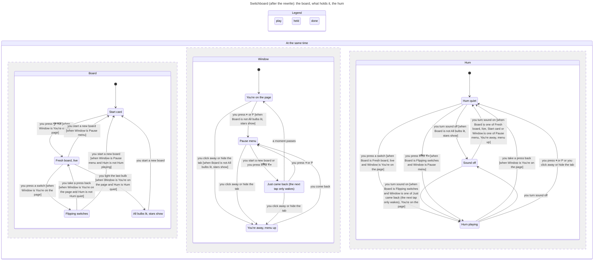

# সুইচবোর্ড statechart

## After the rewrite (2026-11-04)
Model: `Switchboard.tla` with `Switchboard.cfg` (the full check: two levels, a friend link to level 2 while it is locked) and `Chart.cfg` (the drawn chart: one level, `CONSTRAINT ChartScope`), plus `view.ts`. It mirrors:
- `tools/switchboard/lib/flow.ts`: `running`, `held`, `start`, `toTitle`, `finish`, `menu`, `away`, `sheet`, `awake`, `takesPress`, `takesResultKey`, `wantsHum`;
- `lib/save.ts` (`openAfter`, your own open level);
- `components/switchboard-game.tsx`:
  - `pressSwitch`, `takeBack`, `askHint` and `restartBoard`, each gated by `takesPress`;
  - `finishBoard`, which records stars and the open level in the same step as the last bulb;
  - `load`, `openFriend` and the hashchange guard (never over a board in progress);
  - the blur, focus and visibility effect, and `useGamePlayer` `onPause` / `onResume` / `onRestart`;
  - the window key handler (P is `requestPause`; Enter on the result only through `takesResultKey`);
  - the hum effect: a fresh `loop()` whenever `wantsHum` turns true, stopped and dropped whenever it turns false;
- the player's menu, which opens on blur and hide once the game has been touched.

Runs:
- `after-fix/report.md`: the full check, 2,396 states;
- `after-fix/chart.mmd` and `after-fix/chart-report.md`: 88 states, 11 chart states, 23 arrows.

**Every rule holds in both runs:** TypeOK, PausedWhenAway, BoardFrozenWhilePaused, NoProgressWhileAway, ChoiceFreezesPlay, HumOnlyWhilePlaying, HumComesBack, ComeBackIsNotAMove, NoDoubleResult, ResultMatchesPlay, NoChimeAfterMovingOn, OpenLevelsAreEarned, ReplayIsExact, NoDeadlock.

**Mutant check:** each bug was put back into a copy of the spec, one at a time. Then the matching rule broke at once:
- take-back without the `takesPress` gate breaks BoardFrozenWhilePaused (4 steps: start, press, hide, take back);
- resume without restarting the hum breaks HumComesBack;
- unlocking by any clear breaks OpenLevelsAreEarned;
- a press inside the come-back guard breaks ComeBackIsNotAMove.

### What changed in the model
- **One gate for every board action.** A switch, Z, Backspace, H and শুরু থেকে all go through `takesPress`: a live board, no menu, not away, no sheet, and not within 350 ms of coming back.
- **Presence is its own hold.** Blur or a hidden tab sets `away` and the player's menu opens. Coming back starts the guard, and the menu stays up until চালিয়ে যাও.
- **The hum is derived, not remembered.** It plays exactly while `wantsHum` holds (sound on, a live board, at least one press, not lit). So it comes back on resume, when sound turns on, and after a take-back, and it never keeps a muted stub.
- **Your open level is your own.** Clearing it, or a level below it, opens the next one. A friend's far-ahead board records its stars and opens nothing in between.
- **The result shows in the same step as the last bulb.** Only a fresh Enter after 0.4 s, or a click, goes on. StarReveal's chimes live with the end screen, so they can't ring on a board you've left.

| Rule | In plain words | Result |
|---|---|---|
| PausedWhenAway | Away mid-board, the pause menu is up. | holds |
| BoardFrozenWhilePaused | Nothing on the board changes while play is held. | holds (broke before) |
| NoProgressWhileAway | While you're away, no press acts and the hum is silent. | holds |
| ChoiceFreezesPlay | While সব লেভেল is open, play is held. | holds |
| HumOnlyWhilePlaying | The hum plays only on a live board, with sound on. | holds |
| HumComesBack | A live board with presses and sound on is humming. | holds (broke before) |
| ComeBackIsNotAMove | The click that brings you back never presses a switch. | holds |
| NoDoubleResult | A board is recorded and celebrated once. | holds |
| ResultMatchesPlay | The cleared screen's level is saved. | holds |
| NoChimeAfterMovingOn | Star chimes never ring on a board you've left. | holds |
| OpenLevelsAreEarned | Every open level above 1 was opened by clearing the one before. | holds (broke before) |
| ReplayIsExact | A friend link opens that friend's level on a fresh start card. | holds |

| Bug | Fix | Node test | Live replay (Orca, after the fix) |
|---|---|---|---|
| 1. BoardFrozenWhilePaused | `takeBack` (and every board action) checks `takesPress`; the menu also swallows keys. | `bug 1 · BoardFrozenWhilePaused: …` | Level 8, চাল ২, blur: the menu opened. Trusted `z` and `Backspace` keypresses left চাল ২. |
| 2. HumComesBack | The hum effect follows `wantsHum` and starts a fresh loop each time it turns true. | `bug 2 · HumComesBack: …` | The 100 Hz sawtooth was counted. Blur, then চালিয়ে যাও: 1 hum live with no new press. Through the menu, sound off and resume: 0 live. Sound on and resume: 1 live. From the desktop control bar mid-board: off → 0, on → 1. |
| 3. OpenLevelsAreEarned | Your own open level (`ektukhani-switchboard-open`, `openAfter`) decides what's open; `unlockedLevel` is used once, for the migration. | `bug 3 · OpenLevelsAreEarned: …` | Storage cleared, then a v2 link to level 12 (রাফি, 3 presses). Pressing 4, 7, 8 lit it ("একদম সমান! রাফিও ৩ চালে পেরেছিল।"). Saved `{"12":3}`, open level still `1`. |

Also checked live:
- An Enter 150 ms after the last bulb stayed on the result on all 30 levels; a fresh Enter later went on.
- A tap 0 ms after চালিয়ে যাও didn't press (চাল ১); one 550 ms later did (চাল ২).
- P opens the player's menu, নতুন করে শুরু returns to the level's start card, and Back closes immersive mode and stays on `/switchboard`.
- An old link (`s=99049&t=3&l=12&m=16a&n=রাফি`) opens "বন্ধুর বোর্ড · পুরোনো লেভেল ১২" on the old 4×4 board.



### Regenerate
```sh
scripts/statechart.sh ai_docs/statecharts/switchboard/Switchboard.tla --view ai_docs/statecharts/switchboard/view.ts --out <new folder>    # full check → after-fix/report.md
scripts/statechart.sh ai_docs/statecharts/switchboard/Switchboard.tla --config ai_docs/statecharts/switchboard/Chart.cfg --view ai_docs/statecharts/switchboard/view.ts --out <new folder>    # chart.mmd, chart-report.md
```

## Before the rewrite

Model of the game as it is on `games-to-the-bar` (commit a5fb4f1), mirrored from `tools/switchboard/components/switch-game.tsx` and `shared/game-core.ts` (`recordLevel`, `unlockedLevel`). No code was changed.

- Spec: `before-fix-model/Switchboard.tla`, `before-fix-model/Switchboard.cfg` (30 levels abstracted to 2; the friend link points at level 2 while it is still locked; moves are 0, 1 or "2 or more")
- View: `before-fix-model/view.ts` (flat chart: what the board shows, whether the hum plays, whether you are on a level you never opened)
- Output: `before-fix/report.md`, `before-fix/chart.mmd` (TLC: 352 states, 1826 steps; chart: 9 states, 36 arrows)

## Systems modelled
1. **Play phase:** fresh board → flipping switches → all bulbs lit (stars, card) → পরের লেভেল / আবার খেলো / শুরু থেকে / সব লেভেল.
2. **Pause and visibility:** the `visibilitychange` handler stops the hum and pauses only when there are moves and the board isn't solved; চালিয়ে যাও or Enter resumes. There is no blur handler, no P or Esc, and no pause button. The board has no clock, so blur was left out of the model; see the gaps below.
3. **Input:** switch taps (blocked while paused), the window keydown handler (Z or Backspace takes back, H gives a hint, Enter resumes or goes to the next level). No held input exists.
4. **Time:** the star chimes and the levelUp/good sound that `celebrate()` queues with `setTimeout` (0.5–1.25 s), cleared by `goLevel` and `restart`.
5. **Sound:** the `hum` loop (started lazily on a press, a silent stub when sound is off), the site sound switch wrapped in `onClickCapture={stopHum}`.
6. **Choices:** পরের লেভেল, আবার খেলো, শুরু থেকে, and the সব লেভেল grid (open levels only). These are merged as "you start a new board" in the chart.
7. **Links and results:** a valid friend link (on load or `hashchange`) jumps to its level on a fresh board; solving records stars once.
8. **Saved progress:** `recordLevel` keeps the max; `unlockedLevel` = 1 + the highest level with stars.

## Rules (plain words)
| Rule | In words | Result |
|---|---|---|
| HiddenMeansPaused | If you hide the tab mid-board, the board is paused when you come back. | holds |
| BoardFrozenWhilePaused | Nothing on the board changes while the pause overlay ("বোর্ড যেমন ছিল তেমনই আছে") is up. | **breaks** |
| HumOnlyWhilePlaying | The hum plays only on a live board you can see, unpaused, with sound on. | holds |
| HumComesBack | If you're mid-board, on the page, unpaused, with sound on, the hum is playing. | **breaks** |
| NoDoubleResult | A board is recorded and celebrated once. | holds |
| ResultMatchesPlay | The cleared level is saved. | holds |
| NoChimeAfterMovingOn | Star chimes never ring on a board you've left. | holds |
| OpenLevelsAreEarned | Every open level was opened by clearing the one before it. | **breaks** |
| ReplayIsExact | A friend link opens that friend's level on a fresh, unpaused board. | holds |
| TypeOK, NoDeadlock | | hold |

9 held, 3 broke. Not modelled: PausedWhenBlurred, NoProgressWhileAway and InputReleasedWhenAway, because the board has no clock, spawns or held keys. The rest screen and NoShareForKids don't apply because this isn't a kids' game.

## Bugs

### 1. BoardFrozenWhilePaused: "I came back to the paused board, pressed Z, and a move vanished under the overlay"
- **Path:** you press a switch → you hide the tab → the tab shows again → you press Z.
- **Cause:** the window `keydown` handler calls `takeBack()` for Z or Backspace, and `takeBack` never checks `paused`. Only the ফিরিয়ে আনো button is disabled while paused.
- **Live replay (Orca, desktop):** start level 1, moves ০, lit `101000101`. A trusted click on 1-1 gives moves ১, lit `011100101`, hum 1 live. The hide step gives paused true and hum 0. A trusted `z` keypress gives **moves ০, lit `101000101`, paused still true**. The overlay still says "বোর্ড যেমন ছিল তেমনই আছে", while the status line under it changed to "মাঝের সুইচটা চাপো।" Screenshots: `.shots/switchboard-paused-before-z.png` and `.shots/switchboard-paused-after-z.png`.
- **Fix:** `if (paused) return;` at the top of `takeBack` (as `press` and `showOne` already do). Better, have the window key handler drop every game key except resume while paused.
- **Scope:** game-specific code, but it's a shared pattern: any game whose key handler calls actions directly instead of through a pause-aware gate.

### 2. HumComesBack: "I turned sound back on, or pressed চালিয়ে যাও, and the board was silent until my next tap"
- **Paths:** (a) you press a switch → you turn sound off → you turn sound on. (b) You press a switch → you hide the tab → the tab shows → you press চালিয়ে যাও.
- **Cause:** the hum starts only inside `press()`, through `hum.current ??= loop(...)`. The sound toggle's `onClickCapture={stopHum}`, the hide handler and `restart` all drop it, and nothing restarts it: not `SoundToggle`'s `onChange`, not resume.
- **Live replay (Orca, desktop):** sawtooth oscillator starts and stops were counted. For (b): press 1-1 → hum 1 live; hide → paused, hum 0; Enter → resumed, **hum 0 after 2 s**; press 1-2 → hum 1. For (a): sound off → hum 0; sound on → **hum 0 after 2 s**; press 1-3 → hum 1.
- **Fix:** add `const wantHum = () => soundOn() && !paused && visible && moves > 0 && !solved` and a `syncHum()` that starts the loop at `0.06 + 0.4 * lit/cells` when wanted and stops it otherwise. Call it from `<SoundToggle onChange>`, from resume, and after `takeBack`; `takeBack` also never updates the hum level today. This is the same shape as antenna's StaticWhileSearching.
- **Scope:** shared. It's the same LoopComesBack bug as antenna-thik-koro. `shared/game-sound.ts` `setSoundOn(true)` starts nothing, so every game with a `loop()` needs a restart hook. A `useLoop(shouldPlay, kind, level)` helper in the kit would fix it everywhere.

### 3. OpenLevelsAreEarned: "I solved a friend's level 12 and suddenly levels 2–11 were open too"
- **Path:** you open a friend's link (to a locked level) → you light the last bulb.
- **Cause:** `readFriend` calls `goLevel(found.level)` with no unlock check (fine: you may play your friend's board). But `levels.record` then saves stars on that level, and `unlockedLevel()` in `shared/game-core.ts` is `1 + max(level with stars)`. So one friend's board opens every level below it.
- **Live replay (Orca, desktop):** saved progress cleared. Opened `/switchboard#s=99049&t=3&l=12&m=16a&n=রাফি` (a valid link built with `sharedHash`): level 12 showed, the সব লেভেল grid had 1 open and 29 locked, and nothing was saved. Pressing switches 1, 6, 10 cleared it ★★★ ("রাফিও ৩ চালে পেরেছিল"). Saved became `{"12":3}`, and the grid had **13 open and 17 locked**, with levels 1–11 never cleared.
- **Fix (owner's call):** either don't let a friend-link clear count towards unlocking (record the stars but compute `unlocked` from the contiguous run of cleared levels: `while (stars[n]) n++`), or mark friend boards as a separate "বন্ধুর বোর্ড" that saves no level stars. Changing `unlockedLevel` to the contiguous rule fixes every game at once.
- **Scope:** shared (`unlockedLevel` in `shared/game-core.ts`) plus game-specific (link opens a locked level). Check every game whose link carries a level.

### Smaller things seen in the code (not modelled)
- `takeBack` never calls `hum.current.set(...)`, so the hum keeps the old brightness after an undo.
- A `hashchange` to a friend link mid-board jumps away and throws your board away without asking.
- With sound off the first press stores a silent stub in `hum.current`. It's harmless today only because the toggle's `onClickCapture` clears it.

## Quality-bar gaps (played all 30 levels end to end in Orca with an autopilot; 0 console errors)
1. **Pause isn't a real menu:** there's no pause button, P or Esc, and blur doesn't pause or quiet the hum (it keeps humming while another window has focus). The overlay offers only চালিয়ে যাও. The bar wants চালিয়ে যাও, নতুন করে শুরু, কীভাবে খেলবে, শব্দ, ধীরে খেলো and সব লেভেল.
2. **One idea for 30 levels:** each world only grows the board (3×3 → 4×4 → 5×5) and adds presses. Nothing new arrives per level or world (the bar asks for one new element per stage), and there's no named "boss" board at the end of a world.
3. **World changes and the ending are silent:** going from 10 to 11 and from 20 to 21 changes only the label (মেসের ঘর, বিয়েবাড়ির প্যান্ডেল), with no intro panel, new look or tune. Level 30 ends on the same small panel as every level, with one line ("এবার পাখাটা ছাড়ো") and no finale or total-stars summary.
4. **Text above the play area:** the H1, lead and how-to line sit above the board. On a Pixel 9 the board starts at 235 px, and the clear panel starts at 746 of 923 px, so the stars sit at the fold and the card is far below.
5. **No danger edge:** going past par shows nothing during play. The counter could warm or the frame glow once a star is lost, so "about to lose a star" shows at the edge rather than only on the result.
6. **Sound:** there are good signature sounds (টক্‌, the hum, the fan chord, star chimes), but the hum drops out (bug 2), doesn't follow undo, and there's no per-world tune.
7. **Choices:** পরের লেভেল is the clear default, but the সব লেভেল grid is a collapsed `<details>` under the controls. Level select isn't numbered for the keyboard and doesn't say what's new in each world.
8. **Good already:** the first win takes one tap (level 1 is the middle switch, with a pulsing hint). The HUD sits in the top corners. The card is personal and the link is verified by replay (`.shots/switchboard-card-l30.png`). Arrow keys walk the grid, and every level's par is exact (autopilot got ★★★ at par on all 30).

Screenshots: `.shots/switchboard-first-screen.png` (desktop first screen), `.shots/switchboard-phone-first.png` (Pixel 9 first screen), `.shots/switchboard-paused-before-z.png` and `.shots/switchboard-paused-after-z.png` (bug 1), `.shots/switchboard-card-l30.png` (level 30 card).

## How the replays were done
- Orca pins `document.hidden` to `false`: every document, iframes included, gets a non-configurable own getter. So the real `visibilitychange` handler can't be made to fire its hidden branch. The "you hide the tab" step was replayed with a stand-in that runs the handler's exact body through React's own hooks: stop and clear `hum.current`, then `setPaused(true)` when `gameRef.current` has moves and isn't solved. Every other step used trusted Orca input: `orca click` on the switch refs, `orca keypress z` and `Enter`, and clicks on the sound toggle.
- The hum was counted by wrapping `OscillatorNode.prototype.start/stop` for `sawtooth` oscillators (only the hum uses sawtooth here).
- In Pixel 9 emulation, `orca click` on a switch ref landed on switch 1-1 instead of the target, so phone-mode play used `element.click()`.

## Regenerate
```sh
scripts/statechart.sh ai_docs/statecharts/switchboard/before-fix-model/Switchboard.tla --view ai_docs/statecharts/switchboard/before-fix-model/view.ts --out ai_docs/statecharts/switchboard/before-fix
rm ai_docs/statecharts/switchboard/before-fix/tlc*.out
```
After the fixes, update the spec: guard `YouTakeBack` with `~paused`, make `SoundOn` and `YouResume` restart the hum, and make `Unlocked` use the contiguous run of cleared levels. Then re-run into `after-fix/`; every rule must hold.
