# তারের ফাঁকে বেলুন: statechart

Two halves:
- **before-fix/**: the model of the shipped tap-to-puff game, which found 3 broken rules (3 bugs). `before-fix/notes.md` is that analysis, with its live replays. The old spec is in git history (`TarerFankeBelun.tla` before the Nov 2026 rewrite).
- **after-fix/**: the model of the rewrite (hold to rise, 3 পাড়া × 4 levels, spare balloons, crows and gusts), where every rule holds.

## Files
| File | What |
|---|---|
| `TarerFankeBelun.tla`, `.cfg`, `view.ts` | The rewritten game: the screens, the shared player's menu, window focus, the lane on screen, the level list, your finger or Space, the run with a spare balloon, the wire hum and wind loops, the card's chimes. |
| `before-fix/report.md`, `chart.mmd`, `notes.md` | The old model's run and the bug write-up. |
| `after-fix/report.md`, `chart.mmd` | Today's spec: 303 states, 1634 steps, all 15 rules hold (14 plus NoDeadlock). |

**What the model mirrors:**
- `tools/tarer-fanke-belun/components/belun-game.tsx`: `begin` (cuts scheduled tones), `finish`, `keepStars` on `E.WIN`, the blur/focus/visibility effect, the IntersectionObserver on the lane, the sound effect, the sheet effect, and `useGamePlayer`'s `onPause`, `onResume`, `onRestart`;
- `lib/session.ts`: `ticking`, `wantHum`, `wantWind`, `syncLoops` (after every event and every step), `blur`, `hide`, `setInView`, `pause`, `resume` (with its breath), `openSheet`, `pointerDown`, `letGo`, `takeInput` (a tap between two steps still counts once);
- `lib/step.hot.ts` and `lib/belun.ts`: the first press, a pop, `respawn` (it marks the hold, so a finger held through the pop must lift and press again), the last crossing and the glide (`END`);
- `shared/game-player-client.tsx`: blur, hide and scrolling the stage away open the menu once you've touched the game; চালিয়ে যাও and নতুন করে শুরু send a focus first; pausing cuts scheduled tones.
- Abstractions: a level is one crossing and two balloons; `Windy` (a street with gusts) is a constant, set TRUE so the wind loop is checked too.

## Rules (each holds after the fix)
| Rule | In plain words | Before | After |
|---|---|---|---|
| PausedWhenBlurred | Clicking into another window mid-flight pauses the run. | **broke** | holds |
| NoCelebrationAfterLeaving | A fanfare never plays after you've left the card. | **broke** | holds |
| LoopComesBack | While you fly with sound on, the wires hum (and the wind blows on a windy street). | **broke** | holds |
| PausedWhenHidden | Hiding the tab mid-flight pauses it. | held | holds |
| StillWhenOffScreen | With the lane scrolled away, nothing on the street moves. | held (as PausedWhenOffScreen) | holds |
| LoopOnlyWhenMeaningful | The hum plays only while you fly, unpaused, with sound on; the wind only on top of it. | held | holds |
| NoDoubleResult | A run ends once. | held | holds |
| InputReleasedWhenAway | After a blur, a hidden tab, the menu or the list, no finger or key is held. | new | holds |
| ChoiceFreezesPlay | The level list opens only on the title or the card, and nothing moves while it is open. | new | holds |
| StarsKeptTheMomentYouWin | Stars are saved as the last crossing passes, before the glide and the card, so leaving early never loses them. | new | holds |
| SpareWaitsForAFreshPress | A balloon (the first or a spare) flies only after a press made while the street was moving. | new | holds |
| ProgressOnlyWhileTicking | A press taken, a pop, the win or the glide happen only while the street moves. | new | holds |
| TheClickBackIsNotAPress | The click that brings focus back never lifts the balloon. | new | holds |

**PausedWhenOffScreen** is restated as **StillWhenOffScreen**. The first run of the new model found the shared player's hole: on a desktop, the bar's ⟳ (or ▶) under the stage works with the stage scrolled away, so the menu can close while the lane is off screen. The game's own observer (`ticking` needs `inView`) keeps the street still until it is back, which is what the reader cares about. The player hole is reported to the orchestrator (same as ভো-কাট্টা).

## The three bugs, fixed
1. **PausedWhenBlurred:** "I clicked into another window for a second and came back to ফটাস!" `session.blur` lets go and `ticking` needs focus; the player opens its menu. Test: `bug 1, PausedWhenBlurred` in `tests/session.test.ts`.
   - Live (Orca, Pixel 9, level 2, finger held): before the blur y 269.8, dist 1197.7; after 2 s away y 269.8, dist 1197.7, the menu open, `pointer` null. After চালিয়ে যাও, the street is still at 150 ms (the breath), then moves (dist 1258.4 at 950 ms).
2. **NoCelebrationAfterLeaving:** "I pressed আরেকবার right after a new best, and the fanfare went off over my next run." The component keeps no timers. Stars, the fanfare and the lose tones are delayed `tone()`s, which `begin()` (`silenceScheduled`) and the player's pause cut. Stars are recorded at `E.WIN`. Test: `bug 2, NoCelebrationAfterLeaving` (a source check: no `setTimeout` in the component, `begin` cuts scheduled tones, `keepStars` on `E.WIN`).
   - Live: a ★★★ win on level 2, then ১ পরের লেভেল 450 ms after the card. In the next 1.5 s, only 4 tones started (the new level's motif) and no confetti canvas was added.
3. **LoopComesBack:** "After চালিয়ে যাও, or after turning sound back on, the wires stay silent until my next tap." `syncLoops` runs after every event, including the sound switch and resume, and always makes a fresh loop (never `??=`). Test: `bug 3, LoopComesBack`.
   - Live (counting `AudioScheduledSourceNode.start()` with no argument; the dev server keeps audio muted): flying with the hum on; P opened the menu (hum off); sound off, then on (still paused: hum off); চালিয়ে যাও brought the hum back at once (1 new loop start, no press needed).

## Also checked live in Orca (Pixel 9)
- World 1 end to end by an in-page autopilot (shared `ektukhani-slow` was on, so in ধীরে খেলো): levels 1–4 cleared with ★★★, level 1 in 8.1 s of flying, the finale's tangle bar counted down. Level 8 (গোদা কাক) cleared after one pop and a spare, level 12 (রাতের ঝড়) cleared, with 4 gusts ridden.
- Orca pauses `requestAnimationFrame` in a pane that isn't on screen, and other agents switch tabs, so the long runs used a 16 ms `setTimeout` shim for rAF, with the game code unchanged.
- 320 px: no sideways scroll on the page, the title or the lane.

## The chart (after-fix/chart.mmd)

```mermaid
stateDiagram-v2
  state "Legend" as legend {
    lg0: play
    lg1: held
    lg2: done
    lg3: wait
  }
  class lg0 teal
  class lg1 yellow
  class lg2 blue
  class lg3 tan
  state "Run On the title" as s0 {
    s1: Window You're on the lane
    s2: Window Away: another window, a hidden tab or the lane scrolled off
  }
  state "Run Waiting for the first press" as s3 {
    s4: Window You're on the lane
    s5: Window Away: another window, a hidden tab or the lane scrolled off
  }
  state "Run Level list open" as s6 {
    s7: Window You're on the lane
    s8: Window Away: another window, a hidden tab or the lane scrolled off
  }
  state "Run Paused (menu)" as s9 {
    s10: Window Away: another window, a hidden tab or the lane scrolled off
    s11: Window You're on the lane
  }
  state "Run Flying" as s12 {
    s13: Window You're on the lane
    s14: Window Away: another window, a hidden tab or the lane scrolled off
  }
  state "Run Cleared: floating free" as s15 {
    s16: Window You're on the lane
    s17: Window Away: another window, a hidden tab or the lane scrolled off
  }
  state "Run ফট#2494;স!" as s18 {
    s19: Window You're on the lane
    s20: Window Away: another window, a hidden tab or the lane scrolled off
  }
  state "Run Card shows" as s21 {
    s22: Window You're on the lane
    s23: Window Away: another window, a hidden tab or the lane scrolled off
  }
  state "Run A spare balloon waits" as s24 {
    s25: Window You're on the lane
    s26: Window Away: another window, a hidden tab or the lane scrolled off
  }
  [*] --> s1
  s1 --> s4: you tap the title balloon
  s1 --> s2: you hide the tab or you click into another window or you scroll the lane away
  s1 --> s7: you open সব ল#2503;ভ#2503;ল
  s4 --> s10: you scroll the lane away
  s2 --> s1: the tab shows again or you come back to the window or you scroll the lane back
  s7 --> s1: you close the list
  s7 --> s4: you pick a level
  s7 --> s8: you hide the tab or you click into another window or you scroll the lane away or you press pause
  s4 --> s13: you press: the balloon flies
  s10 --> s11: the tab shows again or you come back to the window or you scroll the lane back
  s10 --> s5: you press নত#2497;ন কর#2503; শ#2497;র#2497; or you press চ#2494;ল#2495;য#2492;#2503; য#2494;ও
  s8 --> s2: you close the list
  s8 --> s7: the tab shows again or you come back to the window or you scroll the lane back or you press চ#2494;ল#2495;য#2492;#2503; য#2494;ও
  s13 --> s10: you scroll the lane away
  s13 --> s16: the last crossing is passed (stars kept)
  s13 --> s19: the balloon touches a wire, a crow or the street
  s5 --> s4: you scroll the lane back
  s11 --> s10: you hide the tab or you click into another window or you scroll the lane away
  s10 --> s14: you press চ#2494;ল#2495;য#2492;#2503; য#2494;ও
  s16 --> s10: you scroll the lane away
  s16 --> s22: the card shows
  s19 --> s10: you scroll the lane away
  s19 --> s25: the pop ends
  s14 --> s13: you scroll the lane back
  s10 --> s17: you press চ#2494;ল#2495;য#2492;#2503; য#2494;ও
  s22 --> s4: you pick পর#2503;র ল#2503;ভ#2503;ল or আব#2494;র খ#2503;ল#2507;
  s22 --> s7: you open সব ল#2503;ভ#2503;ল
  s22 --> s23: you hide the tab or you click into another window or you press pause or you scroll the lane away
  s10 --> s20: you press চ#2494;ল#2495;য#2492;#2503; য#2494;ও
  s25 --> s10: you scroll the lane away
  s17 --> s16: you scroll the lane back
  s7 --> s22: you close the list
  s23 --> s22: the tab shows again or you press চ#2494;ল#2495;য#2492;#2503; য#2494;ও or you come back to the window or you scroll the lane back
  s23 --> s5: you press নত#2497;ন কর#2503; শ#2497;র#2497;
  s20 --> s19: you scroll the lane back
  s10 --> s26: you press চ#2494;ল#2495;য#2492;#2503; য#2494;ও
  s8 --> s5: you press নত#2497;ন কর#2503; শ#2497;র#2497;
  s26 --> s25: you scroll the lane back
  s25 --> s13: you press: the balloon flies
  s8 --> s23: you close the list
  s19 --> s22: the pop ends
  s3 --> s10: you hide the tab or you click into another window or you press pause
  s6 --> s4: you press নত#2497;ন কর#2503; শ#2497;র#2497;
  s9 --> s4: you press নত#2497;ন কর#2503; শ#2497;র#2497; or you press চ#2494;ল#2495;য#2492;#2503; য#2494;ও
  s9 --> s13: you press চ#2494;ল#2495;য#2492;#2503; য#2494;ও
  s9 --> s16: you press চ#2494;ল#2495;য#2492;#2503; য#2494;ও
  s9 --> s19: you press চ#2494;ল#2495;য#2492;#2503; য#2494;ও
  s9 --> s25: you press চ#2494;ল#2495;য#2492;#2503; য#2494;ও
  s12 --> s10: you hide the tab or you click into another window or you press pause
  s15 --> s10: you hide the tab or you click into another window or you press pause
  s18 --> s10: you hide the tab or you click into another window or you press pause
  s21 --> s4: you press নত#2497;ন কর#2503; শ#2497;র#2497;
  s24 --> s10: you hide the tab or you click into another window or you press pause
  class s1 tan
  class s2 tan
  class s4 tan
  class s5 tan
  class s10 yellow
  class s11 yellow
  class s13 teal
  class s14 teal
  class s16 teal
  class s17 teal
  class s19 teal
  class s20 teal
  class s22 blue
  class s23 blue
  class s25 tan
  class s26 tan
```


## Regenerate
```sh
scripts/statechart.sh ai_docs/statecharts/tarer-fanke-belun/TarerFankeBelun.tla --view ai_docs/statecharts/tarer-fanke-belun/view.ts --out ai_docs/statecharts/tarer-fanke-belun/after-fix
rm ai_docs/statecharts/tarer-fanke-belun/after-fix/tlc*.out
```
