# উল্টো খেলা statechart

The game was rewritten on 2026-11-05 (design: `ai_docs/game-dev/rewrites/ulto-khela.md`). The model has two parts so each chart stays readable:

| Spec | What it covers | Mirrors | TLC |
|---|---|---|---|
| `UltoKhela.tla` / `.cfg`, view `view.ts` | the screens (launch picture, level list, a round, the end screen), the rest after each picture, চটপট's clock, the player's pause, going away and coming back, a key held through the last answer, the daily limit and the rest screen | `tools/ulto-khela/lib/session.ts`, `components/game.tsx` (`begin`, `pick`, `finished`, `quickPass`, `armPending`, `useGamePlayer`, the blur and hide handlers), `shared/kids-kit.tsx` (`useKidsSession`) | 400 states, 2036 steps |
| `UltoKhelaGates.tla` / `.cfg`, view `view-gates.ts` | who has the phone, the share gate on the launch picture, the rest screen's gate | `components/game.tsx` (`<ParentGate key={gateKey}>`, the outside-touch listener), `shared/kids-kit.tsx` (`ParentGate`, `RestScreen`) | 96 states, 536 steps |

- `before-fix/` holds the run on the old code, the old spec (`before-fix/UltoKhela.tla`, `.cfg`, `view.ts`) and the old chart.
- `after-fix/` and `after-fix-gates/` are runs on the rewritten code. **Every rule holds.** Two things are left out of the model on purpose and are node tests instead: a wrong tap (it only counts a try) and the swallowed first tap after coming back (`tests/session.test.ts`).
- **Model check (mutations, run in a scratch copy):** putting the old behaviours back breaks the rules at once:
  - চটপট's clock ignoring away, the menu and the level list breaks **NoProgressWhileAway** and **ChoiceFreezesPlay** in 6 steps;
  - the rest after a picture running while away breaks **NoProgressWhileAway** in 4 steps;
  - opening the level list from a round without dropping the waiting rest breaks **ChoiceFreezesPlay** in 3 steps;
  - saving stars only when the end screen comes breaks **EveryFinishCounts** in 4 steps;
  - starting a round without asking `atBreak()` breaks **NoNewRoundPastLimit** in 2 steps.

## Rules (plain words), all holding after the fix
**UltoKhela.tla**
- **NoProgressWhileAway:** pictures don't pass, and the next picture doesn't come, while you are away or the pause menu is open. (Bug 1: 37 s away finished a round with 1 star.)
- **ChoiceFreezesPlay:** the level list is a screen of its own; nothing is waiting under it. (Bug 2: pictures passed while সব ধাপ was open.)
- **RestOnlyAtBreak:** the rest screen comes only between rounds, never over a picture. If the limit passes on the last picture, the rest waits for the end screen.
- **NoNewRoundPastLimit:** once today's time is up, খেলো, আবার খেলো and a level from the list show the rest screen, not a round.
- **EveryFinishCounts:** once the last picture is done, its stars are saved and the limit checked in that same moment, whatever the hand does next.
- **ResultNeedsFreshPress:** Enter or Space held through the last answer never starts the next round.
- **EndOnlyAfterTheLastPicture:** the end screen comes only after the last picture.

**UltoKhelaGates.tla**
- **GateNeedsAnAdult**, **GateShutOutsideTheTitle** (the share gate lives on the launch picture only; a touch anywhere else, a round's start, its one action or 20 s shut it), **RestGateOnlyOnTheRestScreen**, **OnlyParentsGiveMoreTime**, **RestOnlyAtBreak**.

## The bugs from the old run, and how each was fixed
| # | Bug (the reader's sentence) | Fix | Node test | Live check after the fix (Orca, own tab) |
|---|---|---|---|---|
| 1 | **NoProgressWhileAway:** "I switched apps for half a minute with চটপট on, and when I came back the round was over with one star." | Own blur and hide handlers plus the player's pause stop both timers; `quickMayRun()` asks the session before every clock; a picture gets its full time again after চালিয়ে যাও. | `session.test.ts` › bug 1, bug 1b | চটপট on, the demo tapped, the next picture waiting with its bar, then `window` `blur` and no input for 38 s: **picture 2 still waiting, 0 passes, still on the round, nothing new saved** (`{"s":38,"idx":1,"stage":"pick","passes":0,"screen":"play"}`). Before the fix the same path ended the round at 37 s with `{"1":1}` saved. After a 14 s blur and চালিয়ে যাও, the first pass came 4 s after resuming. |
| 2 | **ChoiceFreezesPlay:** "I opened সব ধাপ to look at the levels, and pictures went by as misses." | The level picker is a screen of its own (and the player's সব লেভেল opens it); it drops the waiting rest and stops every clock. No `<details>` under the game any more. | › bug 2 | Source and model check; the list replaces the stage. |
| 3 | **ParentGate / NoShareForKids / GateClosesBehindParent** (shared: ways out without the gate, a gate left open behind the parent). | `GamePage` with `kids`: the kids' header and rails, no search, no adult links. The gate lives on the title only; a round's start and any other touch shut it. | › bug 3 | Phone and desktop frames show only ছোটদের খেলাঘর tiles. |
| 4 | **NoReadingNeeded:** "Pictures all the way, then four buttons of words." | The end buttons are pictures (↻ and a setting sun) of 112 px, equal in size; no পরের ধাপ button (শেষ goes to the title with the next level ready); the pace and level chips carry icons. | › bug 4 | `.shots/ulto-khela-end.png` |
| 5 | **MuteMeansSilent / the bell spoke** (fixed in the kit at `b51e328`). | No voice at all: `speak()` and `SpeakButton` are gone from the game. | › no voice anywhere | — |
| — | **The level picker under the game didn't freeze play; the controls row crowded the picture buttons.** | The player's menu owns sound and ধীরে খেলো; চটপট moved to the title where it is explained in one line. | `ulto-khela.test.ts` › the page uses the shared player | — |
| — | **A clean demo reset the "three misses in a row" count.** (Found while writing the tests.) | A demo picture leaves the miss count alone. | `levels.test.ts` › three missed pictures in a row ease the pace | — |
| — | **"১০টা ছবি · ৮টা প্রথমবারেই" after a perfect round** (the first-try count left out the demos). | The end screen counts pictures answered without a slip. | `levels.test.ts` | `.shots/ulto-khela-end.png` |
| — | **Pause on blur, the first tap back is not a move, result keys need a fresh press, Enter goes to the game** (shared patterns). | The shared patterns, in `session.ts`. | › pause freezes both timers, › the tap that brings focus back…, › result keys… | Blur after a right tap: still on the same picture 2.2 s later; চালিয়ে যাও → the next picture **516 ms** later. |

## The chart (after the fix)
```mermaid
---
title: "উলfl°°2509¶ßটfl°°2507¶ß খfl°°2503¶ßলfl°°2494¶ß: screens, the rest after a picture, চটপট's clock, pause and away, the daily limit and keys"
---
stateDiagram-v2
  state "Legend" as legend {
    lg0: play
    lg1: held
    lg2: done
  }
  class lg0 teal
  class lg1 yellow
  class lg2 blue
  state "Round The launch picture (খ#2503;ল#2507;, আর#2494;ম#2503; / চটপট)" as s0 {
    state "Pace আর#2494;ম#2503;" as s1 {
      state "Eyes Here" as s2 {
        s3: Today Time left today
        s4: Today Rest screen
        s5: Today Today's time is up
      }
      state "Eyes Away (another window or tab), every clock waits" as s6 {
        s7: Today Time left today
        s8: Today Rest screen
        s9: Today Today's time is up
      }
      state "Eyes Pause menu open, every clock waits" as s10 {
        s11: Today Time left today
        s12: Today Rest screen
        s13: Today Today's time is up
      }
    }
    state "Pace চটপট on" as s14 {
      state "Eyes Here" as s15 {
        s16: Today Time left today
        s17: Today Today's time is up
        s18: Today Rest screen
      }
      state "Eyes Away (another window or tab), every clock waits" as s19 {
        s20: Today Time left today
        s21: Today Today's time is up
        s22: Today Rest screen
      }
      state "Eyes Pause menu open, every clock waits" as s23 {
        s24: Today Time left today
        s25: Today Today's time is up
        s26: Today Rest screen
      }
    }
  }
  state "Round The level list" as s27 {
    state "Pace আর#2494;ম#2503;" as s28 {
      state "Eyes Here" as s29 {
        s30: Today Time left today
        s31: Today Today's time is up
        s32: Today Rest screen
      }
      state "Eyes Away (another window or tab), every clock waits" as s33 {
        s34: Today Time left today
        s35: Today Today's time is up
        s36: Today Rest screen
      }
      state "Eyes Pause menu open, every clock waits" as s37 {
        s38: Today Time left today
        s39: Today Today's time is up
        s40: Today Rest screen
      }
    }
    state "Pace চটপট on" as s41 {
      state "Eyes Here" as s42 {
        s43: Today Time left today
        s44: Today Today's time is up
        s45: Today Rest screen
      }
      state "Eyes Away (another window or tab), every clock waits" as s46 {
        s47: Today Time left today
        s48: Today Today's time is up
        s49: Today Rest screen
      }
      state "Eyes Pause menu open, every clock waits" as s50 {
        s51: Today Time left today
        s52: Today Today's time is up
        s53: Today Rest screen
      }
    }
  }
  state "Round First picture (the ghost finger shows the tap)" as s54 {
    state "Pace আর#2494;ম#2503;" as s55 {
      state "Eyes Here" as s56 {
        s57: Today Time left today
        s58: Today Today's time is up
      }
      state "Eyes Away (another window or tab), every clock waits" as s59 {
        s60: Today Time left today
        s61: Today Today's time is up
      }
      state "Eyes Pause menu open, every clock waits" as s62 {
        s63: Today Time left today
        s64: Today Today's time is up
      }
    }
    state "Pace চটপট on" as s65 {
      state "Eyes Here" as s66 {
        s67: Today Time left today
        s68: Today Today's time is up
      }
      state "Eyes Away (another window or tab), every clock waits" as s69 {
        s70: Today Time left today
        s71: Today Today's time is up
      }
      state "Eyes Pause menu open, every clock waits" as s72 {
        s73: Today Time left today
        s74: Today Today's time is up
      }
    }
  }
  state "Round First picture (demo) done, the next comes in 0.7 s" as s75 {
    state "Pace আর#2494;ম#2503;" as s76 {
      state "Eyes Here" as s77 {
        s78: Today Time left today
        s79: Today Today's time is up
      }
      state "Eyes Away (another window or tab), every clock waits" as s80 {
        s81: Today Time left today
        s82: Today Today's time is up
      }
      state "Eyes Pause menu open, every clock waits" as s83 {
        s84: Today Time left today
        s85: Today Today's time is up
      }
    }
    state "Pace চটপট on" as s86 {
      state "Eyes Here" as s87 {
        s88: Today Time left today
        s89: Today Today's time is up
      }
      state "Eyes Away (another window or tab), every clock waits" as s90 {
        s91: Today Time left today
        s92: Today Today's time is up
      }
      state "Eyes Pause menu open, every clock waits" as s93 {
        s94: Today Time left today
        s95: Today Today's time is up
      }
    }
  }
  state "Round Last picture" as s96 {
    state "Pace আর#2494;ম#2503;" as s97 {
      state "Eyes Here" as s98 {
        s99: Today Time left today
        s100: Today Today's time is up
      }
      state "Eyes Away (another window or tab), every clock waits" as s101 {
        s102: Today Time left today
        s103: Today Today's time is up
      }
      state "Eyes Pause menu open, every clock waits" as s104 {
        s105: Today Time left today
        s106: Today Today's time is up
      }
    }
    state "Pace চটপট on" as s107 {
      state "Eyes Here" as s108 {
        s109: Today Time left today
        s110: Today Today's time is up
      }
      state "Eyes Away (another window or tab), every clock waits" as s111 {
        s112: Today Time left today
        s113: Today Today's time is up
      }
      state "Eyes Pause menu open, every clock waits" as s114 {
        s115: Today Time left today
        s116: Today Today's time is up
      }
    }
  }
  state "Round Last picture done, stars saved, the end screen in 0.7 s" as s117 {
    state "Pace আর#2494;ম#2503;" as s118 {
      state "Eyes Here" as s119 {
        s120: Today Time left today
        s121: Today Today's time is up
        s122: Today Time's up, the rest waits for the end
      }
      state "Eyes Away (another window or tab), every clock waits" as s123 {
        s124: Today Time left today
        s125: Today Today's time is up
        s126: Today Time's up, the rest waits for the end
      }
      state "Eyes Pause menu open, every clock waits" as s127 {
        s128: Today Time left today
        s129: Today Today's time is up
        s130: Today Time's up, the rest waits for the end
      }
    }
    state "Pace চটপট on" as s131 {
      state "Eyes Here" as s132 {
        s133: Today Time left today
        s134: Today Today's time is up
        s135: Today Time's up, the rest waits for the end
      }
      state "Eyes Away (another window or tab), every clock waits" as s136 {
        s137: Today Time left today
        s138: Today Today's time is up
        s139: Today Time's up, the rest waits for the end
      }
      state "Eyes Pause menu open, every clock waits" as s140 {
        s141: Today Time left today
        s142: Today Today's time is up
        s143: Today Time's up, the rest waits for the end
      }
    }
  }
  state "Round The end screen (আব#2494;র খ#2503;ল#2507; / শ#2503;ষ)" as s144 {
    state "Pace আর#2494;ম#2503;" as s145 {
      state "Eyes Here" as s146 {
        s147: Today Time left today
        s148: Today Today's time is up
        s149: Today Rest screen
      }
      state "Eyes Away (another window or tab), every clock waits" as s150 {
        s151: Today Time left today
        s152: Today Today's time is up
        s153: Today Rest screen
      }
      state "Eyes Pause menu open, every clock waits" as s154 {
        s155: Today Time left today
        s156: Today Today's time is up
        s157: Today Rest screen
      }
    }
    state "Pace চটপট on" as s158 {
      state "Eyes Here" as s159 {
        s160: Today Time left today
        s161: Today Today's time is up
        s162: Today Rest screen
      }
      state "Eyes Away (another window or tab), every clock waits" as s163 {
        s164: Today Time left today
        s165: Today Today's time is up
        s166: Today Rest screen
      }
      state "Eyes Pause menu open, every clock waits" as s167 {
        s168: Today Time left today
        s169: Today Today's time is up
        s170: Today Rest screen
      }
    }
  }
  [*] --> s3
  [*] --> s4
  s3 --> s30: the child opens the level list
  s3 --> s57: the child taps খ#2503;ল#2507; or আব#2494;র খ#2503;ল#2507;
  s3 --> s7: the window blurs or the tab hides
  s3 --> s16: the child picks আর#2494;ম#2503; or চটপট
  s3 --> s5: today's play time runs out
  s3 --> s11: the player pauses (#9208;, P, Esc)
  s4 --> s3: a grown-up gives আজ আরও ১০ ম#2495;ন#2495;ট
  s4 --> s8: the window blurs or the tab hides
  s4 --> s12: the player pauses (#9208;, P, Esc)
  s30 --> s3: the page opens again
  s30 --> s57: the child picks a level
  s30 --> s34: the window blurs or the tab hides
  s30 --> s31: today's play time runs out
  s30 --> s38: the player pauses (#9208;, P, Esc)
  s57 --> s3: the page opens again
  s57 --> s30: সব ল#2503;ভ#2503;ল in the player's menu
  s57 --> s78: the child taps the right picture
  s57 --> s60: the window blurs or the tab hides
  s57 --> s58: today's play time runs out
  s57 --> s63: the player pauses (#9208;, P, Esc)
  s7 --> s3: the page opens again or the window is back
  s7 --> s9: today's play time runs out
  s7 --> s11: the player pauses (#9208;, P, Esc)
  s16 --> s3: the page opens again or the child picks আর#2494;ম#2503; or চটপট
  s16 --> s43: the child opens the level list
  s16 --> s67: the child taps খ#2503;ল#2507; or আব#2494;র খ#2503;ল#2507;
  s16 --> s20: the window blurs or the tab hides
  s16 --> s17: today's play time runs out
  s16 --> s24: the player pauses (#9208;, P, Esc)
  s5 --> s4: the page opens again or the child taps খ#2503;ল#2507; or আব#2494;র খ#2503;ল#2507;
  s5 --> s31: the child opens the level list
  s5 --> s9: the window blurs or the tab hides
  s5 --> s17: the child picks আর#2494;ম#2503; or চটপট
  s5 --> s13: the player pauses (#9208;, P, Esc)
  s8 --> s4: the page opens again or the window is back
  s8 --> s7: a grown-up gives আজ আরও ১০ ম#2495;ন#2495;ট
  s8 --> s12: the player pauses (#9208;, P, Esc)
  s11 --> s3: the page opens again or নত#2497;ন কর#2503; শ#2497;র#2497;, or শ#2503;ষ or চ#2494;ল#2495;য#2492;#2503; য#2494;ও
  s11 --> s13: today's play time runs out
  s12 --> s4: the page opens again or নত#2497;ন কর#2503; শ#2497;র#2497;, or শ#2503;ষ or চ#2494;ল#2495;য#2492;#2503; য#2494;ও
  s12 --> s11: a grown-up gives আজ আরও ১০ ম#2495;ন#2495;ট
  s34 --> s3: the page opens again
  s34 --> s30: the window is back
  s34 --> s35: today's play time runs out
  s34 --> s38: the player pauses (#9208;, P, Esc)
  s78 --> s3: the page opens again
  s78 --> s30: সব ল#2503;ভ#2503;ল in the player's menu
  s78 --> s81: the window blurs or the tab hides
  s78 --> s99: the picture's rest ends
  s78 --> s79: today's play time runs out
  s78 --> s84: the player pauses (#9208;, P, Esc)
  s60 --> s3: the page opens again
  s60 --> s57: the window is back
  s60 --> s61: today's play time runs out
  s60 --> s63: the player pauses (#9208;, P, Esc)
  s43 --> s3: the page opens again
  s43 --> s67: the child picks a level
  s43 --> s47: the window blurs or the tab hides
  s43 --> s44: today's play time runs out
  s43 --> s51: the player pauses (#9208;, P, Esc)
  s67 --> s3: the page opens again
  s67 --> s43: সব ল#2503;ভ#2503;ল in the player's menu
  s67 --> s88: the child taps the right picture
  s67 --> s70: the window blurs or the tab hides
  s67 --> s68: today's play time runs out
  s67 --> s73: the player pauses (#9208;, P, Esc)
  s20 --> s3: the page opens again
  s20 --> s16: the window is back
  s20 --> s21: today's play time runs out
  s20 --> s24: the player pauses (#9208;, P, Esc)
  s31 --> s4: the page opens again or the child picks a level
  s31 --> s35: the window blurs or the tab hides
  s31 --> s39: the player pauses (#9208;, P, Esc)
  s58 --> s4: the page opens again
  s58 --> s31: সব ল#2503;ভ#2503;ল in the player's menu
  s58 --> s79: the child taps the right picture
  s58 --> s61: the window blurs or the tab hides
  s58 --> s64: the player pauses (#9208;, P, Esc)
  s9 --> s4: the page opens again
  s9 --> s5: the window is back
  s9 --> s13: the player pauses (#9208;, P, Esc)
  s17 --> s4: the page opens again
  s17 --> s5: the child picks আর#2494;ম#2503; or চটপট
  s17 --> s44: the child opens the level list
  s17 --> s21: the window blurs or the tab hides
  s17 --> s18: the child taps খ#2503;ল#2507; or আব#2494;র খ#2503;ল#2507;
  s17 --> s25: the player pauses (#9208;, P, Esc)
  s38 --> s3: the page opens again or নত#2497;ন কর#2503; শ#2497;র#2497;, or শ#2503;ষ
  s38 --> s30: চ#2494;ল#2495;য#2492;#2503; য#2494;ও
  s38 --> s39: today's play time runs out
  s63 --> s3: the page opens again or নত#2497;ন কর#2503; শ#2497;র#2497;, or শ#2503;ষ
  s63 --> s57: চ#2494;ল#2495;য#2492;#2503; য#2494;ও
  s63 --> s64: today's play time runs out
  s11 --> s7: নত#2497;ন কর#2503; শ#2497;র#2497;, or শ#2503;ষ or চ#2494;ল#2495;য#2492;#2503; য#2494;ও
  s24 --> s3: the page opens again
  s24 --> s16: নত#2497;ন কর#2503; শ#2497;র#2497;, or শ#2503;ষ or চ#2494;ল#2495;য#2492;#2503; য#2494;ও
  s24 --> s25: today's play time runs out
  s13 --> s4: the page opens again
  s13 --> s5: নত#2497;ন কর#2503; শ#2497;র#2497;, or শ#2503;ষ or চ#2494;ল#2495;য#2492;#2503; য#2494;ও
  s12 --> s8: নত#2497;ন কর#2503; শ#2497;র#2497;, or শ#2503;ষ or চ#2494;ল#2495;য#2492;#2503; য#2494;ও
  s81 --> s3: the page opens again
  s81 --> s78: the window is back
  s81 --> s82: today's play time runs out
  s81 --> s84: the player pauses (#9208;, P, Esc)
  s99 --> s3: the page opens again
  s99 --> s30: সব ল#2503;ভ#2503;ল in the player's menu
  s99 --> s102: the window blurs or the tab hides
  s99 --> s120: the child taps the right picture
  s99 --> s100: today's play time runs out
  s99 --> s105: the player pauses (#9208;, P, Esc)
  s47 --> s3: the page opens again
  s47 --> s43: the window is back
  s47 --> s48: today's play time runs out
  s47 --> s51: the player pauses (#9208;, P, Esc)
  s88 --> s3: the page opens again
  s88 --> s43: সব ল#2503;ভ#2503;ল in the player's menu
  s88 --> s91: the window blurs or the tab hides
  s88 --> s109: the picture's rest ends
  s88 --> s89: today's play time runs out
  s88 --> s94: the player pauses (#9208;, P, Esc)
  s70 --> s3: the page opens again
  s70 --> s67: the window is back
  s70 --> s71: today's play time runs out
  s70 --> s73: the player pauses (#9208;, P, Esc)
  s35 --> s4: the page opens again
  s35 --> s31: the window is back
  s35 --> s39: the player pauses (#9208;, P, Esc)
  s79 --> s4: the page opens again
  s79 --> s31: সব ল#2503;ভ#2503;ল in the player's menu
  s79 --> s82: the window blurs or the tab hides
  s79 --> s100: the picture's rest ends
  s79 --> s85: the player pauses (#9208;, P, Esc)
  s61 --> s4: the page opens again
  s61 --> s58: the window is back
  s61 --> s64: the player pauses (#9208;, P, Esc)
  s44 --> s4: the page opens again
  s44 --> s18: the child picks a level
  s44 --> s48: the window blurs or the tab hides
  s44 --> s52: the player pauses (#9208;, P, Esc)
  s68 --> s4: the page opens again
  s68 --> s44: সব ল#2503;ভ#2503;ল in the player's menu
  s68 --> s89: the child taps the right picture
  s68 --> s71: the window blurs or the tab hides
  s68 --> s74: the player pauses (#9208;, P, Esc)
  s21 --> s4: the page opens again
  s21 --> s17: the window is back
  s21 --> s25: the player pauses (#9208;, P, Esc)
  s18 --> s4: the page opens again
  s18 --> s16: a grown-up gives আজ আরও ১০ ম#2495;ন#2495;ট
  s18 --> s22: the window blurs or the tab hides
  s18 --> s26: the player pauses (#9208;, P, Esc)
  s38 --> s7: নত#2497;ন কর#2503; শ#2497;র#2497;, or শ#2503;ষ
  s38 --> s34: চ#2494;ল#2495;য#2492;#2503; য#2494;ও
  s84 --> s3: the page opens again or নত#2497;ন কর#2503; শ#2497;র#2497;, or শ#2503;ষ
  s84 --> s78: চ#2494;ল#2495;য#2492;#2503; য#2494;ও
  s84 --> s85: today's play time runs out
  s63 --> s7: নত#2497;ন কর#2503; শ#2497;র#2497;, or শ#2503;ষ
  s63 --> s60: চ#2494;ল#2495;য#2492;#2503; য#2494;ও
  s51 --> s3: the page opens again
  s51 --> s16: নত#2497;ন কর#2503; শ#2497;র#2497;, or শ#2503;ষ
  s51 --> s43: চ#2494;ল#2495;য#2492;#2503; য#2494;ও
  s51 --> s52: today's play time runs out
  s73 --> s3: the page opens again
  s73 --> s16: নত#2497;ন কর#2503; শ#2497;র#2497;, or শ#2503;ষ
  s73 --> s67: চ#2494;ল#2495;য#2492;#2503; য#2494;ও
  s73 --> s74: today's play time runs out
  s24 --> s20: নত#2497;ন কর#2503; শ#2497;র#2497;, or শ#2503;ষ or চ#2494;ল#2495;য#2492;#2503; য#2494;ও
  s39 --> s4: the page opens again
  s39 --> s5: নত#2497;ন কর#2503; শ#2497;র#2497;, or শ#2503;ষ
  s39 --> s31: চ#2494;ল#2495;য#2492;#2503; য#2494;ও
  s64 --> s4: the page opens again
  s64 --> s5: নত#2497;ন কর#2503; শ#2497;র#2497;, or শ#2503;ষ
  s64 --> s58: চ#2494;ল#2495;য#2492;#2503; য#2494;ও
  s13 --> s9: নত#2497;ন কর#2503; শ#2497;র#2497;, or শ#2503;ষ or চ#2494;ল#2495;য#2492;#2503; য#2494;ও
  s25 --> s4: the page opens again
  s25 --> s17: নত#2497;ন কর#2503; শ#2497;র#2497;, or শ#2503;ষ or চ#2494;ল#2495;য#2492;#2503; য#2494;ও
  s102 --> s3: the page opens again
  s102 --> s99: the window is back
  s102 --> s103: today's play time runs out
  s102 --> s105: the player pauses (#9208;, P, Esc)
  s120 --> s3: the page opens again
  s120 --> s147: the picture's rest ends
  s120 --> s30: সব ল#2503;ভ#2503;ল in the player's menu
  s120 --> s124: the window blurs or the tab hides
  s120 --> s121: today's play time runs out
  s120 --> s128: the player pauses (#9208;, P, Esc)
  s91 --> s3: the page opens again
  s91 --> s88: the window is back
  s91 --> s92: today's play time runs out
  s91 --> s94: the player pauses (#9208;, P, Esc)
  s109 --> s3: the page opens again
  s109 --> s43: সব ল#2503;ভ#2503;ল in the player's menu
  s109 --> s112: the window blurs or the tab hides
  s109 --> s133: চটপট: 4 s of live time pass and the picture passes or the child taps the right picture
  s109 --> s110: today's play time runs out
  s109 --> s115: the player pauses (#9208;, P, Esc)
  s82 --> s4: the page opens again
  s82 --> s79: the window is back
  s82 --> s85: the player pauses (#9208;, P, Esc)
  s100 --> s4: the page opens again
  s100 --> s31: সব ল#2503;ভ#2503;ল in the player's menu
  s100 --> s103: the window blurs or the tab hides
  s100 --> s122: the child taps the right picture
  s100 --> s106: the player pauses (#9208;, P, Esc)
  s48 --> s4: the page opens again
  s48 --> s44: the window is back
  s48 --> s52: the player pauses (#9208;, P, Esc)
  s89 --> s4: the page opens again
  s89 --> s44: সব ল#2503;ভ#2503;ল in the player's menu
  s89 --> s92: the window blurs or the tab hides
  s89 --> s110: the picture's rest ends
  s89 --> s95: the player pauses (#9208;, P, Esc)
  s71 --> s4: the page opens again
  s71 --> s68: the window is back
  s71 --> s74: the player pauses (#9208;, P, Esc)
  s22 --> s4: the page opens again
  s22 --> s20: a grown-up gives আজ আরও ১০ ম#2495;ন#2495;ট
  s22 --> s18: the window is back
  s22 --> s26: the player pauses (#9208;, P, Esc)
  s84 --> s7: নত#2497;ন কর#2503; শ#2497;র#2497;, or শ#2503;ষ
  s84 --> s81: চ#2494;ল#2495;য#2492;#2503; য#2494;ও
  s105 --> s3: the page opens again or নত#2497;ন কর#2503; শ#2497;র#2497;, or শ#2503;ষ
  s105 --> s99: চ#2494;ল#2495;য#2492;#2503; য#2494;ও
  s105 --> s106: today's play time runs out
  s51 --> s20: নত#2497;ন কর#2503; শ#2497;র#2497;, or শ#2503;ষ
  s51 --> s47: চ#2494;ল#2495;য#2492;#2503; য#2494;ও
  s94 --> s3: the page opens again
  s94 --> s16: নত#2497;ন কর#2503; শ#2497;র#2497;, or শ#2503;ষ
  s94 --> s88: চ#2494;ল#2495;য#2492;#2503; য#2494;ও
  s94 --> s95: today's play time runs out
  s73 --> s20: নত#2497;ন কর#2503; শ#2497;র#2497;, or শ#2503;ষ
  s73 --> s70: চ#2494;ল#2495;য#2492;#2503; য#2494;ও
  s39 --> s9: নত#2497;ন কর#2503; শ#2497;র#2497;, or শ#2503;ষ
  s39 --> s35: চ#2494;ল#2495;য#2492;#2503; য#2494;ও
  s85 --> s4: the page opens again
  s85 --> s5: নত#2497;ন কর#2503; শ#2497;র#2497;, or শ#2503;ষ
  s85 --> s79: চ#2494;ল#2495;য#2492;#2503; য#2494;ও
  s64 --> s9: নত#2497;ন কর#2503; শ#2497;র#2497;, or শ#2503;ষ
  s64 --> s61: চ#2494;ল#2495;য#2492;#2503; য#2494;ও
  s52 --> s4: the page opens again
  s52 --> s17: নত#2497;ন কর#2503; শ#2497;র#2497;, or শ#2503;ষ
  s52 --> s44: চ#2494;ল#2495;য#2492;#2503; য#2494;ও
  s74 --> s4: the page opens again
  s74 --> s17: নত#2497;ন কর#2503; শ#2497;র#2497;, or শ#2503;ষ
  s74 --> s68: চ#2494;ল#2495;য#2492;#2503; য#2494;ও
  s25 --> s21: নত#2497;ন কর#2503; শ#2497;র#2497;, or শ#2503;ষ or চ#2494;ল#2495;য#2492;#2503; য#2494;ও
  s26 --> s4: the page opens again
  s26 --> s24: a grown-up gives আজ আরও ১০ ম#2495;ন#2495;ট
  s26 --> s18: নত#2497;ন কর#2503; শ#2497;র#2497;, or শ#2503;ষ or চ#2494;ল#2495;য#2492;#2503; য#2494;ও
  s147 --> s3: the page opens again or নত#2497;ন কর#2503; শ#2497;র#2497;, or শ#2503;ষ
  s147 --> s57: the child taps খ#2503;ল#2507; or আব#2494;র খ#2503;ল#2507;
  s147 --> s30: the child opens the level list
  s147 --> s151: the window blurs or the tab hides
  s147 --> s148: today's play time runs out
  s147 --> s155: the player pauses (#9208;, P, Esc)
  s124 --> s3: the page opens again
  s124 --> s120: the window is back
  s124 --> s125: today's play time runs out
  s124 --> s128: the player pauses (#9208;, P, Esc)
  s112 --> s3: the page opens again
  s112 --> s109: the window is back
  s112 --> s113: today's play time runs out
  s112 --> s115: the player pauses (#9208;, P, Esc)
  s133 --> s3: the page opens again
  s133 --> s160: the picture's rest ends
  s133 --> s43: সব ল#2503;ভ#2503;ল in the player's menu
  s133 --> s137: the window blurs or the tab hides
  s133 --> s134: today's play time runs out
  s133 --> s141: the player pauses (#9208;, P, Esc)
  s103 --> s4: the page opens again
  s103 --> s100: the window is back
  s103 --> s106: the player pauses (#9208;, P, Esc)
  s121 --> s4: the page opens again
  s121 --> s148: the picture's rest ends
  s121 --> s31: সব ল#2503;ভ#2503;ল in the player's menu
  s121 --> s125: the window blurs or the tab hides
  s121 --> s129: the player pauses (#9208;, P, Esc)
  s122 --> s4: the page opens again
  s122 --> s149: the picture's rest ends
  s122 --> s32: সব ল#2503;ভ#2503;ল in the player's menu
  s122 --> s126: the window blurs or the tab hides
  s122 --> s130: the player pauses (#9208;, P, Esc)
  s92 --> s4: the page opens again
  s92 --> s89: the window is back
  s92 --> s95: the player pauses (#9208;, P, Esc)
  s110 --> s4: the page opens again
  s110 --> s44: সব ল#2503;ভ#2503;ল in the player's menu
  s110 --> s113: the window blurs or the tab hides
  s110 --> s135: চটপট: 4 s of live time pass and the picture passes or the child taps the right picture
  s110 --> s116: the player pauses (#9208;, P, Esc)
  s105 --> s102: চ#2494;ল#2495;য#2492;#2503; য#2494;ও
  s105 --> s7: নত#2497;ন কর#2503; শ#2497;র#2497;, or শ#2503;ষ
  s128 --> s3: the page opens again or নত#2497;ন কর#2503; শ#2497;র#2497;, or শ#2503;ষ
  s128 --> s120: চ#2494;ল#2495;য#2492;#2503; য#2494;ও
  s128 --> s129: today's play time runs out
  s94 --> s20: নত#2497;ন কর#2503; শ#2497;র#2497;, or শ#2503;ষ
  s94 --> s91: চ#2494;ল#2495;য#2492;#2503; য#2494;ও
  s115 --> s3: the page opens again
  s115 --> s109: চ#2494;ল#2495;য#2492;#2503; য#2494;ও
  s115 --> s16: নত#2497;ন কর#2503; শ#2497;র#2497;, or শ#2503;ষ
  s115 --> s116: today's play time runs out
  s85 --> s9: নত#2497;ন কর#2503; শ#2497;র#2497;, or শ#2503;ষ
  s85 --> s82: চ#2494;ল#2495;য#2492;#2503; য#2494;ও
  s106 --> s4: the page opens again
  s106 --> s100: চ#2494;ল#2495;য#2492;#2503; য#2494;ও
  s106 --> s5: নত#2497;ন কর#2503; শ#2497;র#2497;, or শ#2503;ষ
  s52 --> s21: নত#2497;ন কর#2503; শ#2497;র#2497;, or শ#2503;ষ
  s52 --> s48: চ#2494;ল#2495;য#2492;#2503; য#2494;ও
  s95 --> s4: the page opens again
  s95 --> s17: নত#2497;ন কর#2503; শ#2497;র#2497;, or শ#2503;ষ
  s95 --> s89: চ#2494;ল#2495;য#2492;#2503; য#2494;ও
  s74 --> s21: নত#2497;ন কর#2503; শ#2497;র#2497;, or শ#2503;ষ
  s74 --> s71: চ#2494;ল#2495;য#2492;#2503; য#2494;ও
  s26 --> s22: নত#2497;ন কর#2503; শ#2497;র#2497;, or শ#2503;ষ or চ#2494;ল#2495;য#2492;#2503; য#2494;ও
  s151 --> s3: the page opens again
  s151 --> s147: the window is back
  s151 --> s152: today's play time runs out
  s151 --> s155: the player pauses (#9208;, P, Esc)
  s160 --> s3: the page opens again
  s160 --> s67: the child taps খ#2503;ল#2507; or আব#2494;র খ#2503;ল#2507;
  s160 --> s43: the child opens the level list
  s160 --> s164: the window blurs or the tab hides
  s160 --> s16: নত#2497;ন কর#2503; শ#2497;র#2497;, or শ#2503;ষ
  s160 --> s161: today's play time runs out
  s160 --> s168: the player pauses (#9208;, P, Esc)
  s137 --> s3: the page opens again
  s137 --> s133: the window is back
  s137 --> s138: today's play time runs out
  s137 --> s141: the player pauses (#9208;, P, Esc)
  s148 --> s4: the page opens again
  s148 --> s149: the child taps খ#2503;ল#2507; or আব#2494;র খ#2503;ল#2507;
  s148 --> s31: the child opens the level list
  s148 --> s152: the window blurs or the tab hides
  s148 --> s5: নত#2497;ন কর#2503; শ#2497;র#2497;, or শ#2503;ষ
  s148 --> s156: the player pauses (#9208;, P, Esc)
  s149 --> s4: the page opens again
  s149 --> s147: a grown-up gives আজ আরও ১০ ম#2495;ন#2495;ট
  s149 --> s153: the window blurs or the tab hides
  s149 --> s157: the player pauses (#9208;, P, Esc)
  s32 --> s4: the page opens again
  s32 --> s30: a grown-up gives আজ আরও ১০ ম#2495;ন#2495;ট
  s32 --> s36: the window blurs or the tab hides
  s32 --> s40: the player pauses (#9208;, P, Esc)
  s125 --> s4: the page opens again
  s125 --> s121: the window is back
  s125 --> s129: the player pauses (#9208;, P, Esc)
  s126 --> s4: the page opens again
  s126 --> s122: the window is back
  s126 --> s130: the player pauses (#9208;, P, Esc)
  s113 --> s4: the page opens again
  s113 --> s110: the window is back
  s113 --> s116: the player pauses (#9208;, P, Esc)
  s134 --> s4: the page opens again
  s134 --> s161: the picture's rest ends
  s134 --> s44: সব ল#2503;ভ#2503;ল in the player's menu
  s134 --> s138: the window blurs or the tab hides
  s134 --> s142: the player pauses (#9208;, P, Esc)
  s135 --> s4: the page opens again
  s135 --> s162: the picture's rest ends
  s135 --> s45: সব ল#2503;ভ#2503;ল in the player's menu
  s135 --> s139: the window blurs or the tab hides
  s135 --> s143: the player pauses (#9208;, P, Esc)
  s155 --> s3: the page opens again or নত#2497;ন কর#2503; শ#2497;র#2497;, or শ#2503;ষ
  s155 --> s147: চ#2494;ল#2495;য#2492;#2503; য#2494;ও
  s155 --> s156: today's play time runs out
  s128 --> s124: চ#2494;ল#2495;য#2492;#2503; য#2494;ও
  s128 --> s7: নত#2497;ন কর#2503; শ#2497;র#2497;, or শ#2503;ষ
  s115 --> s112: চ#2494;ল#2495;য#2492;#2503; য#2494;ও
  s115 --> s20: নত#2497;ন কর#2503; শ#2497;র#2497;, or শ#2503;ষ
  s141 --> s3: the page opens again
  s141 --> s133: চ#2494;ল#2495;য#2492;#2503; য#2494;ও
  s141 --> s16: নত#2497;ন কর#2503; শ#2497;র#2497;, or শ#2503;ষ
  s141 --> s142: today's play time runs out
  s106 --> s103: চ#2494;ল#2495;য#2492;#2503; য#2494;ও
  s106 --> s9: নত#2497;ন কর#2503; শ#2497;র#2497;, or শ#2503;ষ
  s129 --> s4: the page opens again
  s129 --> s121: চ#2494;ল#2495;য#2492;#2503; য#2494;ও
  s129 --> s5: নত#2497;ন কর#2503; শ#2497;র#2497;, or শ#2503;ষ
  s130 --> s4: the page opens again or নত#2497;ন কর#2503; শ#2497;র#2497;, or শ#2503;ষ
  s130 --> s122: চ#2494;ল#2495;য#2492;#2503; য#2494;ও
  s95 --> s21: নত#2497;ন কর#2503; শ#2497;র#2497;, or শ#2503;ষ
  s95 --> s92: চ#2494;ল#2495;য#2492;#2503; য#2494;ও
  s116 --> s4: the page opens again
  s116 --> s110: চ#2494;ল#2495;য#2492;#2503; য#2494;ও
  s116 --> s17: নত#2497;ন কর#2503; শ#2497;র#2497;, or শ#2503;ষ
  s164 --> s3: the page opens again
  s164 --> s160: the window is back
  s164 --> s165: today's play time runs out
  s164 --> s168: the player pauses (#9208;, P, Esc)
  s152 --> s4: the page opens again
  s152 --> s148: the window is back
  s152 --> s156: the player pauses (#9208;, P, Esc)
  s153 --> s4: the page opens again
  s153 --> s151: a grown-up gives আজ আরও ১০ ম#2495;ন#2495;ট
  s153 --> s149: the window is back
  s153 --> s157: the player pauses (#9208;, P, Esc)
  s36 --> s4: the page opens again
  s36 --> s34: a grown-up gives আজ আরও ১০ ম#2495;ন#2495;ট
  s36 --> s32: the window is back
  s36 --> s40: the player pauses (#9208;, P, Esc)
  s161 --> s4: the page opens again
  s161 --> s162: the child taps খ#2503;ল#2507; or আব#2494;র খ#2503;ল#2507;
  s161 --> s44: the child opens the level list
  s161 --> s165: the window blurs or the tab hides
  s161 --> s17: নত#2497;ন কর#2503; শ#2497;র#2497;, or শ#2503;ষ
  s161 --> s169: the player pauses (#9208;, P, Esc)
  s162 --> s4: the page opens again
  s162 --> s160: a grown-up gives আজ আরও ১০ ম#2495;ন#2495;ট
  s162 --> s166: the window blurs or the tab hides
  s162 --> s170: the player pauses (#9208;, P, Esc)
  s45 --> s4: the page opens again
  s45 --> s43: a grown-up gives আজ আরও ১০ ম#2495;ন#2495;ট
  s45 --> s49: the window blurs or the tab hides
  s45 --> s53: the player pauses (#9208;, P, Esc)
  s138 --> s4: the page opens again
  s138 --> s134: the window is back
  s138 --> s142: the player pauses (#9208;, P, Esc)
  s139 --> s4: the page opens again
  s139 --> s135: the window is back
  s139 --> s143: the player pauses (#9208;, P, Esc)
  s155 --> s151: চ#2494;ল#2495;য#2492;#2503; য#2494;ও
  s155 --> s7: নত#2497;ন কর#2503; শ#2497;র#2497;, or শ#2503;ষ
  s168 --> s3: the page opens again
  s168 --> s160: চ#2494;ল#2495;য#2492;#2503; য#2494;ও
  s168 --> s16: নত#2497;ন কর#2503; শ#2497;র#2497;, or শ#2503;ষ
  s168 --> s169: today's play time runs out
  s141 --> s137: চ#2494;ল#2495;য#2492;#2503; য#2494;ও
  s141 --> s20: নত#2497;ন কর#2503; শ#2497;র#2497;, or শ#2503;ষ
  s156 --> s4: the page opens again
  s156 --> s148: চ#2494;ল#2495;য#2492;#2503; য#2494;ও
  s156 --> s5: নত#2497;ন কর#2503; শ#2497;র#2497;, or শ#2503;ষ
  s157 --> s4: the page opens again or নত#2497;ন কর#2503; শ#2497;র#2497;, or শ#2503;ষ
  s157 --> s149: চ#2494;ল#2495;য#2492;#2503; য#2494;ও
  s157 --> s155: a grown-up gives আজ আরও ১০ ম#2495;ন#2495;ট
  s40 --> s4: the page opens again or নত#2497;ন কর#2503; শ#2497;র#2497;, or শ#2503;ষ
  s40 --> s32: চ#2494;ল#2495;য#2492;#2503; য#2494;ও
  s40 --> s38: a grown-up gives আজ আরও ১০ ম#2495;ন#2495;ট
  s129 --> s125: চ#2494;ল#2495;য#2492;#2503; য#2494;ও
  s129 --> s9: নত#2497;ন কর#2503; শ#2497;র#2497;, or শ#2503;ষ
  s130 --> s126: চ#2494;ল#2495;য#2492;#2503; য#2494;ও
  s130 --> s8: নত#2497;ন কর#2503; শ#2497;র#2497;, or শ#2503;ষ
  s116 --> s113: চ#2494;ল#2495;য#2492;#2503; য#2494;ও
  s116 --> s21: নত#2497;ন কর#2503; শ#2497;র#2497;, or শ#2503;ষ
  s142 --> s4: the page opens again
  s142 --> s134: চ#2494;ল#2495;য#2492;#2503; য#2494;ও
  s142 --> s17: নত#2497;ন কর#2503; শ#2497;র#2497;, or শ#2503;ষ
  s143 --> s4: the page opens again
  s143 --> s135: চ#2494;ল#2495;য#2492;#2503; য#2494;ও
  s143 --> s18: নত#2497;ন কর#2503; শ#2497;র#2497;, or শ#2503;ষ
  s165 --> s4: the page opens again
  s165 --> s161: the window is back
  s165 --> s169: the player pauses (#9208;, P, Esc)
  s166 --> s4: the page opens again
  s166 --> s164: a grown-up gives আজ আরও ১০ ম#2495;ন#2495;ট
  s166 --> s162: the window is back
  s166 --> s170: the player pauses (#9208;, P, Esc)
  s49 --> s4: the page opens again
  s49 --> s47: a grown-up gives আজ আরও ১০ ম#2495;ন#2495;ট
  s49 --> s45: the window is back
  s49 --> s53: the player pauses (#9208;, P, Esc)
  s168 --> s164: চ#2494;ল#2495;য#2492;#2503; য#2494;ও
  s168 --> s20: নত#2497;ন কর#2503; শ#2497;র#2497;, or শ#2503;ষ
  s156 --> s152: চ#2494;ল#2495;য#2492;#2503; য#2494;ও
  s156 --> s9: নত#2497;ন কর#2503; শ#2497;র#2497;, or শ#2503;ষ
  s157 --> s153: চ#2494;ল#2495;য#2492;#2503; য#2494;ও
  s157 --> s8: নত#2497;ন কর#2503; শ#2497;র#2497;, or শ#2503;ষ
  s40 --> s36: চ#2494;ল#2495;য#2492;#2503; য#2494;ও
  s40 --> s8: নত#2497;ন কর#2503; শ#2497;র#2497;, or শ#2503;ষ
  s169 --> s4: the page opens again
  s169 --> s161: চ#2494;ল#2495;য#2492;#2503; য#2494;ও
  s169 --> s17: নত#2497;ন কর#2503; শ#2497;র#2497;, or শ#2503;ষ
  s170 --> s4: the page opens again
  s170 --> s162: চ#2494;ল#2495;য#2492;#2503; য#2494;ও
  s170 --> s168: a grown-up gives আজ আরও ১০ ম#2495;ন#2495;ট
  s170 --> s18: নত#2497;ন কর#2503; শ#2497;র#2497;, or শ#2503;ষ
  s53 --> s4: the page opens again
  s53 --> s45: চ#2494;ল#2495;য#2492;#2503; য#2494;ও
  s53 --> s51: a grown-up gives আজ আরও ১০ ম#2495;ন#2495;ট
  s53 --> s18: নত#2497;ন কর#2503; শ#2497;র#2497;, or শ#2503;ষ
  s142 --> s138: চ#2494;ল#2495;য#2492;#2503; য#2494;ও
  s142 --> s21: নত#2497;ন কর#2503; শ#2497;র#2497;, or শ#2503;ষ
  s143 --> s139: চ#2494;ল#2495;য#2492;#2503; য#2494;ও
  s143 --> s22: নত#2497;ন কর#2503; শ#2497;র#2497;, or শ#2503;ষ
  s169 --> s165: চ#2494;ল#2495;য#2492;#2503; য#2494;ও
  s169 --> s21: নত#2497;ন কর#2503; শ#2497;র#2497;, or শ#2503;ষ
  s170 --> s166: চ#2494;ল#2495;য#2492;#2503; য#2494;ও
  s170 --> s22: নত#2497;ন কর#2503; শ#2497;র#2497;, or শ#2503;ষ
  s53 --> s49: চ#2494;ল#2495;য#2492;#2503; য#2494;ও
  s53 --> s22: নত#2497;ন কর#2503; শ#2497;র#2497;, or শ#2503;ষ
  class s3 blue
  class s4 yellow
  class s5 blue
  class s7 blue
  class s8 yellow
  class s9 blue
  class s11 blue
  class s12 yellow
  class s13 blue
  class s16 blue
  class s17 blue
  class s18 yellow
  class s20 blue
  class s21 blue
  class s22 yellow
  class s24 blue
  class s25 blue
  class s26 yellow
  class s30 blue
  class s31 blue
  class s32 yellow
  class s34 blue
  class s35 blue
  class s36 yellow
  class s38 blue
  class s39 blue
  class s40 yellow
  class s43 blue
  class s44 blue
  class s45 yellow
  class s47 blue
  class s48 blue
  class s49 yellow
  class s51 blue
  class s52 blue
  class s53 yellow
  class s57 teal
  class s58 teal
  class s60 teal
  class s61 teal
  class s63 teal
  class s64 teal
  class s67 teal
  class s68 teal
  class s70 teal
  class s71 teal
  class s73 teal
  class s74 teal
  class s78 teal
  class s79 teal
  class s81 teal
  class s82 teal
  class s84 teal
  class s85 teal
  class s88 teal
  class s89 teal
  class s91 teal
  class s92 teal
  class s94 teal
  class s95 teal
  class s99 teal
  class s100 teal
  class s102 teal
  class s103 teal
  class s105 teal
  class s106 teal
  class s109 teal
  class s110 teal
  class s112 teal
  class s113 teal
  class s115 teal
  class s116 teal
  class s120 teal
  class s121 teal
  class s122 teal
  class s124 teal
  class s125 teal
  class s126 teal
  class s128 teal
  class s129 teal
  class s130 teal
  class s133 teal
  class s134 teal
  class s135 teal
  class s137 teal
  class s138 teal
  class s139 teal
  class s141 teal
  class s142 teal
  class s143 teal
  class s147 blue
  class s148 blue
  class s149 yellow
  class s151 blue
  class s152 blue
  class s153 yellow
  class s155 blue
  class s156 blue
  class s157 yellow
  class s160 blue
  class s161 blue
  class s162 yellow
  class s164 blue
  class s165 blue
  class s166 yellow
  class s168 blue
  class s169 blue
  class s170 yellow

```

## The gates (after the fix)

```mermaid
---
title: "উলfl°°2509¶ßটfl°°2507¶ß খfl°°2503¶ßলfl°°2494¶ß: the phone, the share gate and the rest screen's gate"
---
stateDiagram-v2
  state "Legend" as legend {
    lg0: play
    lg1: held
    lg2: done
  }
  class lg0 teal
  class lg1 yellow
  class lg2 blue
  state "Screen The launch picture" as s0 {
    state "Today Time left today" as s1 {
      state "Phone The child has the phone" as s2 {
        state "ShareGate Share gate closed" as s3 {
          s4: RestGate Rest gate closed
        }
        state "ShareGate Share gate open (a parent answered)" as s5 {
          s6: RestGate Rest gate closed
        }
      }
      state "Phone A parent has the phone" as s7 {
        state "ShareGate Share gate closed" as s8 {
          s9: RestGate Rest gate closed
        }
        state "ShareGate Share gate open (a parent answered)" as s10 {
          s11: RestGate Rest gate closed
        }
      }
    }
    state "Today Rest screen" as s12 {
      state "Phone The child has the phone" as s13 {
        state "ShareGate Share gate closed" as s14 {
          s15: RestGate Rest gate closed
          s16: RestGate Rest gate open (a parent answered)
        }
      }
      state "Phone A parent has the phone" as s17 {
        state "ShareGate Share gate closed" as s18 {
          s19: RestGate Rest gate closed
          s20: RestGate Rest gate open (a parent answered)
        }
      }
    }
  }
  state "Screen The page or the level list" as s21 {
    state "Today Time left today" as s22 {
      state "Phone The child has the phone" as s23 {
        state "ShareGate Share gate closed" as s24 {
          s25: RestGate Rest gate closed
        }
      }
      state "Phone A parent has the phone" as s26 {
        state "ShareGate Share gate closed" as s27 {
          s28: RestGate Rest gate closed
        }
      }
    }
    state "Today Rest screen" as s29 {
      state "Phone The child has the phone" as s30 {
        state "ShareGate Share gate closed" as s31 {
          s32: RestGate Rest gate closed
          s33: RestGate Rest gate open (a parent answered)
        }
      }
      state "Phone A parent has the phone" as s34 {
        state "ShareGate Share gate closed" as s35 {
          s36: RestGate Rest gate closed
          s37: RestGate Rest gate open (a parent answered)
        }
      }
    }
  }
  state "Screen A round" as s38 {
    state "Today Time left today" as s39 {
      state "Phone The child has the phone" as s40 {
        state "ShareGate Share gate closed" as s41 {
          s42: RestGate Rest gate closed
        }
      }
      state "Phone A parent has the phone" as s43 {
        state "ShareGate Share gate closed" as s44 {
          s45: RestGate Rest gate closed
        }
      }
    }
  }
  [*] --> s4
  [*] --> s15
  s4 --> s9: a parent takes the phone
  s15 --> s19: a parent takes the phone
  s25 --> s4: the page opens again or the child goes back to the launch picture
  s25 --> s15: the page opens again
  s25 --> s42: the child taps খ#2503;ল#2507;
  s25 --> s28: a parent takes the phone
  s25 --> s32: the child taps খ#2503;ল#2507;
  s42 --> s4: the page opens again or the child goes back to the launch picture
  s42 --> s15: the page opens again
  s42 --> s25: the round ends
  s42 --> s32: the round ends
  s42 --> s45: a parent takes the phone
  s9 --> s4: the child takes the phone back
  s9 --> s11: the parent opens বড#2492;দ#2503;র জন#2509;য
  s19 --> s15: the child takes the phone back
  s19 --> s20: the parent opens the rest screen's gate
  s28 --> s25: the child takes the phone back
  s28 --> s9: the page opens again or the child goes back to the launch picture
  s28 --> s19: the page opens again
  s28 --> s45: the child taps খ#2503;ল#2507;
  s28 --> s36: the child taps খ#2503;ল#2507;
  s32 --> s36: a parent takes the phone
  s45 --> s42: the child takes the phone back
  s45 --> s9: the page opens again or the child goes back to the launch picture
  s45 --> s19: the page opens again
  s45 --> s28: the round ends
  s45 --> s36: the round ends
  s11 --> s9: the page opens again or 20 s pass or the link is shared
  s11 --> s6: the child takes the phone back
  s20 --> s19: the page opens again or a limit is chosen, or 20 s pass
  s20 --> s9: আজ আরও ১০ ম#2495;ন#2495;ট
  s20 --> s16: the child takes the phone back
  s36 --> s32: the child takes the phone back
  s36 --> s37: the parent opens the rest screen's gate
  s6 --> s4: the page opens again or 20 s pass or the link is shared
  s6 --> s11: a parent takes the phone
  s16 --> s15: the page opens again or a limit is chosen, or 20 s pass
  s16 --> s20: a parent takes the phone
  s16 --> s4: আজ আরও ১০ ম#2495;ন#2495;ট
  s37 --> s36: a limit is chosen, or 20 s pass
  s37 --> s28: আজ আরও ১০ ম#2495;ন#2495;ট
  s37 --> s33: the child takes the phone back
  s33 --> s32: a limit is chosen, or 20 s pass
  s33 --> s37: a parent takes the phone
  s33 --> s25: আজ আরও ১০ ম#2495;ন#2495;ট
  s2 --> s15: the page opens again or the child taps খ#2503;ল#2507;
  s2 --> s25: the child opens the level list
  s2 --> s42: the child taps খ#2503;ল#2507;
  s13 --> s4: the page opens again
  s7 --> s19: the page opens again or the child taps খ#2503;ল#2507;
  s7 --> s28: the child opens the level list
  s7 --> s45: the child taps খ#2503;ল#2507;
  s17 --> s9: the page opens again
  s30 --> s4: the page opens again
  s30 --> s15: the page opens again
  s34 --> s9: the page opens again
  s34 --> s19: the page opens again
  class s4 blue
  class s6 blue
  class s9 blue
  class s11 blue
  class s15 yellow
  class s16 yellow
  class s19 yellow
  class s20 yellow
  class s25 blue
  class s28 blue
  class s32 yellow
  class s33 yellow
  class s36 yellow
  class s37 yellow
  class s42 teal
  class s45 teal

```


## Regenerate
```sh
scripts/statechart.sh ai_docs/statecharts/ulto-khela/UltoKhela.tla --view ai_docs/statecharts/ulto-khela/view.ts --out ai_docs/statecharts/ulto-khela/after-fix
scripts/statechart.sh ai_docs/statecharts/ulto-khela/UltoKhelaGates.tla --view ai_docs/statecharts/ulto-khela/view-gates.ts --out ai_docs/statecharts/ulto-khela/after-fix-gates
rm -f ai_docs/statecharts/ulto-khela/after-fix*/tlc*.out
```
