# ভো-কাট্টা: statechart

Two halves:
- **before-fix/**: the model of the shipped one-evening game, which found 3 broken rules (2 bugs). That spec is in git history (`VoKatta.tla` at 9e0724c).
- **after-fix/**: the model of the rewrite (Nov 2026), where every rule holds, plus a small second model for the level unlock.

## Files
| File | What |
|---|---|
| `VoKatta.tla`, `VoKatta.cfg`, `view.ts` | The rewritten game: the screens, the shared player's menu, window focus, the sky on screen, the level list, your finger, the প্যাঁচ, the wind and hum loops, the card's chimes. |
| `unlock/Unlock.tla`, `Unlock.cfg`, `view.ts` | Which levels open and the stars kept, with a friend's far link in the mix (3 levels stand in for 12). A separate spec only so each chart stays under the tool's 500-state budget. |
| `before-fix/report.md`, `chart.mmd` | The old model's run. |
| `after-fix/report.md`, `chart.mmd` | Today's `VoKatta.tla`: 320 states, 1686 steps, all 14 rules hold (13 plus NoDeadlock). |
| `after-fix/unlock/` | `Unlock.tla`: 127 states, all 5 rules hold. |

**What the model mirrors:**
- `tools/vo-katta/components/vo-katta.tsx`: `begin`, `finish`, the blur/focus/visibility effect, the IntersectionObserver on the sky, the sound effect, the sheet effect, and `useGamePlayer`'s `onPause`, `onResume` and `onRestart`;
- `lib/session.ts`, the pure session the component forwards every event to: `ticking`, `wantWind`, `wantHum`, `syncLoops`, `blur`, `hide`, `setInView`, `pause`, `resume` (with its breath), `openSheet`, `pointerDown`, `letGo`, `freshResultKey`;
- `lib/step.hot.ts`: the hook, the cut, the lost kite and the end of an evening (two rivals and two kites stand in for the list and the নাটাই);
- `lib/levels.ts`: `openLevel`, `nextAhead`, `starsOf`;
- `shared/game-player-client.tsx`: blur, hide and scrolling the stage away open the menu once you've touched the game; চালিয়ে যাও and নতুন করে শুরু send a focus first; pausing cuts scheduled tones.

## Before → after
| | Before (the shipped game) | After (the rewrite) |
|---|---|---|
| Page | Its own hero, a `#tool` section and its own pause overlay with only চালিয়ে যাও | `<GamePage>`; the player's real menu. P calls `player.requestPause()`. |
| Window blur | `letGo()` only. The round clock and the rivals kept running in a visible, blurred window. | `session.blur` lets go, `ticking` needs focus, and the player opens its menu. |
| Sky scrolled away | Paused only on the change; the HUD ▶ above the sky resumed with it off screen. | The game's own observer: `ticking` needs the sky on screen however play resumes (the shared player still has the "resume while off screen" hole; the game no longer cares). |
| Who decides input and loops | Ad hoc flags in a 700-line component | `lib/session.ts`. `syncLoops` runs after every event and every step. |
| Level list | `<details>` under the game, open in any phase, picking threw the round away | A choice screen from the title or the card; `session.sheet` stops the sky. |
| Card fanfare | `setTimeout`s, cleared on reset | Scheduled `tone()`s, cut by the player's pause and by `begin()` (`silenceScheduled`). The component has no timers (a test checks the source). |
| Friend's far level | Its stars went into the levels key, and `unlockedLevel` opened every level below it. | Kept in `ektukhani-ahead-vo-katta`; `openLevel` ignores it until your own play reaches it. |
| Result keys | Space on the card restarted at once | Only a fresh, non-repeating keydown after the card appeared (`freshResultKey`). |

## The chart (after-fix/chart.mmd)

```mermaid
stateDiagram-v2
  state "Legend" as legend {
    lg0: play
    lg1: held
    lg2: done
    lg3: wait
  }
  class lg0 teal
  class lg1 yellow
  class lg2 blue
  class lg3 tan
  state "Evening On the title" as s0 {
    s1: Window You're on the sky
    s2: Window Away: another window, a hidden tab or the sky scrolled off
  }
  state "Evening Waiting for the first touch" as s3 {
    s4: Window You're on the sky
    s5: Window Away: another window, a hidden tab or the sky scrolled off
  }
  state "Evening Level list open" as s6 {
    s7: Window You're on the sky
    s8: Window Away: another window, a hidden tab or the sky scrolled off
  }
  state "Evening Flying" as s9 {
    s10: Window You're on the sky
    s11: Window Away: another window, a hidden tab or the sky scrolled off
  }
  state "Evening Paused (menu)" as s12 {
    s13: Window Away: another window, a hidden tab or the sky scrolled off
    s14: Window You're on the sky
  }
  state "Evening In a প#2509;য#2494;#2433;চ" as s15 {
    s16: Window You're on the sky
    s17: Window Away: another window, a hidden tab or the sky scrolled off
  }
  state "Evening Card shows" as s18 {
    s19: Window You're on the sky
    s20: Window Away: another window, a hidden tab or the sky scrolled off
  }
  [*] --> s1
  s1 --> s4: you tap the title kite
  s1 --> s2: you hide the tab or you click into another window or you scroll the sky away
  s1 --> s7: you open সব ল#2503;ভ#2503;ল
  s4 --> s10: you put a finger on the sky
  s4 --> s13: you scroll the sky away
  s2 --> s1: the tab shows again or you come back to the window or you scroll the sky back
  s2 --> s5: you tap the title kite
  s2 --> s8: you open সব ল#2503;ভ#2503;ল
  s7 --> s1: you close the list
  s7 --> s4: you pick a level
  s7 --> s8: you hide the tab or you click into another window or you scroll the sky away or you press pause
  s10 --> s16: the strings cross
  s10 --> s13: you scroll the sky away
  s5 --> s4: you scroll the sky back
  s13 --> s14: the tab shows again or you come back to the window or you scroll the sky back
  s13 --> s5: you press নত#2497;ন কর#2503; শ#2497;র#2497; or you press চ#2494;ল#2495;য#2492;#2503; য#2494;ও
  s8 --> s2: you close the list
  s8 --> s7: the tab shows again or you come back to the window or you scroll the sky back or you press চ#2494;ল#2495;য#2492;#2503; য#2494;ও
  s8 --> s5: you pick a level or you press নত#2497;ন কর#2503; শ#2497;র#2497;
  s16 --> s10: you cut one (ভ#2507;-ক#2494;ট#2509;ট#2494;!) or they cut yours
  s16 --> s13: you scroll the sky away
  s13 --> s11: you press চ#2494;ল#2495;য#2492;#2503; য#2494;ও
  s14 --> s13: you hide the tab or you click into another window or you scroll the sky away
  s11 --> s10: you scroll the sky back
  s13 --> s17: you press চ#2494;ল#2495;য#2492;#2503; য#2494;ও
  s17 --> s16: you scroll the sky back
  s16 --> s19: you cut one (ভ#2507;-ক#2494;ট#2509;ট#2494;!) or they cut yours
  s19 --> s4: you pick পর#2503;র ল#2503;ভ#2503;ল or আব#2494;র খ#2503;ল#2507;
  s19 --> s7: you open সব ল#2503;ভ#2503;ল
  s19 --> s20: you hide the tab or you click into another window or you press pause or you scroll the sky away
  s7 --> s19: you close the list
  s20 --> s19: the tab shows again or you press চ#2494;ল#2495;য#2492;#2503; য#2494;ও or you come back to the window or you scroll the sky back
  s20 --> s5: you press নত#2497;ন কর#2503; শ#2497;র#2497; or you pick পর#2503;র ল#2503;ভ#2503;ল or আব#2494;র খ#2503;ল#2507;
  s20 --> s8: you open সব ল#2503;ভ#2503;ল
  s8 --> s20: you close the list
  s3 --> s13: you hide the tab or you click into another window or you press pause
  s6 --> s4: you press নত#2497;ন কর#2503; শ#2497;র#2497;
  s9 --> s13: you hide the tab or you click into another window or you press pause
  s12 --> s4: you press নত#2497;ন কর#2503; শ#2497;র#2497; or you press চ#2494;ল#2495;য#2492;#2503; য#2494;ও
  s12 --> s10: you press চ#2494;ল#2495;য#2492;#2503; য#2494;ও
  s12 --> s16: you press চ#2494;ল#2495;য#2492;#2503; য#2494;ও
  s15 --> s13: you hide the tab or you click into another window or you press pause
  s18 --> s4: you press নত#2497;ন কর#2503; শ#2497;র#2497;
  class s1 tan
  class s2 tan
  class s4 tan
  class s5 tan
  class s10 teal
  class s11 teal
  class s13 yellow
  class s14 yellow
  class s16 teal
  class s17 teal
  class s19 blue
  class s20 blue
```

The view keeps two regions (the evening, and whether you're on the sky); the hand and the loops are in the rules. "Flying" while away is real: চালিয়ে যাও from the bar with the sky scrolled off. Nothing moves there (ProgressOnlyWhileTicking) until the sky is back.

## Rules (plain words)
The first ten are the old model's, in the new variables; the first three are the ones that broke.
| Rule | The reader's sentence | Before | After |
|---|---|---|---|
| **PausedWhenBlurred** | Clicking into another window mid-evening opens the menu. | **broke** | holds |
| **NoProgressWhileAway** | The clock, the rivals and the wind move only while you can see the sky on a focused page with the menu and the list shut. | **broke** | holds |
| **OffScreenMeansPaused** | Nothing moves with the sky scrolled away, however you got back to playing. | **broke** | holds |
| InputReleasedWhenAway | After a blur, a hidden tab, the menu, the list or scrolling away, no finger or key counts as held. | held | holds |
| PausedWhenHidden | A hidden tab during an evening is a paused evening. | held | holds |
| LoopOnlyWhenMeaningful | The wind plays only while the sky moves with sound on; the hum only inside a প্যাঁচ. | held | holds |
| LoopComesBack | When the sky moves with sound on, the wind plays (and the hum while hooked): turning sound on or resuming brings them back. | held | holds |
| NoDoubleResult | An evening ends once. | held | holds |
| NoFanfareAfterMovingOn | The card's chimes play only on their own card, with the menu shut and sound on. | held | holds |
| StarsNeverDrop (unlock) | Saved stars only go up. | held | holds |
| ChoiceFreezesPlay | While the level list is open, nothing moves. | (not in model) | holds |
| ProgressOnlyWhileTicking | A kite is hooked, cut or lost only while the sky moves. | (not in model) | holds |
| TheClickBackIsNotAMove | A finger or key starts holding only while the sky moves, so the click that brings focus back never pulls. | (not in model) | holds |
| UnlockNeverShrinks (unlock) | What you can pick never shrinks. | (not in model) | holds |
| FriendOpensNoGap (unlock) | Every level below the highest you may pick was cleared by you. | would break | holds |
| FriendStarsKept (unlock) | A friend's level you cleared keeps its stars. | (not in model) | holds |

**Mutation check:**
- With `Ticking` not needing focus or the sky on screen (the old behaviour), TLC breaks NoProgressWhileAway, OffScreenMeansPaused and InputReleasedWhenAway.
- With `Open == Unlocked(Cleared)` (the old rule), it breaks FriendOpensNoGap in one step: clear a friend's level 2 and level 2 opens with 1 never played.
- The first run of the new spec broke LoopComesBack: নতুন করে শুরু from the menu over an open level list. The code was right (`begin()` shuts the list); the model wasn't, and now mirrors it.

## Bugs, fixed and replayed
| Bug | Fix | Node test (`tools/vo-katta/tests/session.test.ts`) | Live (Orca) |
|---|---|---|---|
| 1. Blur kept the evening running (PausedWhenBlurred, NoProgressWhileAway) | `ticking` needs focus; blur lets go; the player's menu | "statechart PausedWhenBlurred / NoProgressWhileAway…" | Pixel 9, holding টান at 0.58 s: blur → menu up, finger released, clock 0.58 → 0.58 and rival x 285.1 → 285.1 after 3 s. |
| 2. Resume with the sky off screen (OffScreenMeansPaused) | `ticking` needs `inView` (the game's own observer) | "statechart OffScreenMeansPaused: resumed with the sky scrolled away…" | — (the shared player now owns the resume button) |
| No real pause menu (quality gap 3) | The player's menu; P calls `requestPause` | "celebrations are scheduled tones…" (checks `requestPause` and no timers) | চালিয়ে যাও → a 0.35 s breath → the sky moves; নতুন করে শুরু → back to the level's start. |
| The click back is not a move | `pointerDown` refuses while not ticking | "statechart TheClickBackIsNotAMove…" | — |
| The list mid-round threw the round away | The list is a choice screen from the title or the card; it stops the sky | "statechart ChoiceFreezesPlay…" | — |
| Loops | `syncLoops` every step and event | "statechart LoopComesBack and LoopOnlyWhenMeaningful…" | — |
| One result | `phase` over is final | "statechart NoDoubleResult…" | — |
| Friend's far level opened the gap | `ahead` list | "statechart FriendOpensNoGap…" | — |

## Before the rewrite
### The bugs, as found

#### 1. PausedWhenBlurred / NoProgressWhileAway: "I clicked into another window and the evening kept going. The rivals cut my kite while I was away."
- **Path (report):** 0 waiting on the roof → 1 you hold টান (round 1) → 2 you click into another window. The round is still flying.
- **Code:** `window.addEventListener("blur", letGo)` releases the hand but never calls `pause()`. useGameLoop stops only on `visibilitychange`, so the round clock and the rivals keep running in a visible but blurred window. The wind loop keeps playing too.
- **Live replay (Orca, tab 98508f53):** tap শুরু করো, press টান (pointerdown), then `window.dispatchEvent(new Event("blur"))`. Sequence: phase `playing`, clock 0.63 s, `pulling: true` → at blur `pulling: false` (letGo works), phase still `playing`, wind on → +4 s: clock 4.65 → +12 s: clock 12.65 → +22 s: clock 30.02, break between roofs → +32 s: round 2, hooked, `lost: 1` → +52 s: round 3, `lost: 5`. While away, the second roof cut your kite 5 times and the 30 s round ran out.
- **Fix:** on window `blur`, call `pause()` (it already does letGo and stopLoops), the same as on hide. **Shared:** jam-chharao and bhangti-nai have the same gap. Put the handling in one kit hook (blur and hide release input and pause real-time play) and use it in every game.

#### 2. OffScreenMeansPaused: "The sky was scrolled off my screen, I tapped play on the bar above it, and the round ran where I couldn't see it."
- **Path (report):** 0 waiting → 1 you hold টান → 2 you scroll the sky away (paused) → 3 you press চালিয়ে যাও. The round runs with the sky scrolled away.
- **Code:** `useEffect(() => { if (!boardInView) pause(); }, [boardInView])` fires only when `boardInView` changes. The HUD pause button (`.vk-pause`, above the board, outside `.vk-board`) calls `resume()` with no `boardInView` check. The keys check it, the button doesn't. `restart()` from the আবার খেলো button under the board has the same hole.
- **Live replay:** viewport 915×380 (a phone in landscape). The sky starts at y=355, so 6% of it shows and `boardInView` is false. The game was paused and the HUD was on screen. Click the HUD ▶ → phase `playing`, clock 2.30 → 2.58 → 7.58 s after 5 s, with 6% of the sky on screen. Screenshot: `.shots/vo-katta-offscreen-resume.png` (the HUD shows ॥, so the round is running, and the sky is below the fold).
- **Fix:** have `resume()`/`restart()` scroll the sky into view first (`play.current.scrollIntoView`), or refuse while `!boardInView`. Also re-check `boardInView` inside `go("playing")`. **Shared** with bhangti-nai, which has the same useInView pattern.

#### Bugs that did not appear
- The sound switch restores the wind (LoopComesBack holds). `SoundToggle onChange` calls `startLoops()` while playing, and `resume()` restarts the loops.
- Hide → `pause()` → `letGo()` + `stopLoops()`: holds. In Orca, `document.hidden` is a native getter pinned to `false`, so the hidden path could not be faked live. The model and the code agree.

#### ReplayIsExact, live
- `#s=862479917&t=18&n=রাফি`: banner "রাফি ১৮টা ঘুড়ি কেটেছে…", level 1, windBase −0.1819, first rival home (237.66, 180.9). The same values come back with or without a name.
- `#s=0&t=999` and `#s=…&l=11`: no banner, a fresh seed on the unlocked level (2).

## Regenerate
```sh
scripts/statechart.sh ai_docs/statecharts/vo-katta/VoKatta.tla --view ai_docs/statecharts/vo-katta/view.ts --out ai_docs/statecharts/vo-katta/after-fix
scripts/statechart.sh ai_docs/statecharts/vo-katta/unlock/Unlock.tla --view ai_docs/statecharts/vo-katta/unlock/view.ts --out ai_docs/statecharts/vo-katta/after-fix/unlock
```
Delete `tlc.out` after a run. Orca throttles rAF in a background tab, and its `document.hidden` is pinned to false, so the hidden-tab path is proved by the model and the node test, not live.
